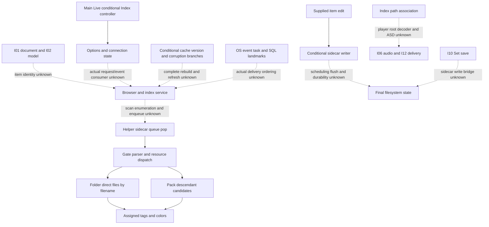

# Browser index family route cut

Author map, 2026-10-20; **pending independent structure review**. Selection
follows amended plan4 item4, extending the reviewed component/integration maps
outside the first scenario. Current [SPEC-BROWSER-INDEX r2](../../../../wiki/specs/browser-index.md)
and immutable [browser-index-v1](../../../../handoff/browser-index-v1/README.md)
remain authoritative for their respective draft/released scopes. No spec,
case, release or grade changes. Parent owns atlas integration, seal and review.

## Integration extension

The approved integration predecessor is manifest
`7dddd59650ca3395d10e1b3c8aded3cda01d66b522dda4973a08f32e7bfb8f83`,
following component manifest
`392a738005f7d776dca96d7c78220cb94091081ef7086ec45b9397afccbe438b`.
I-01/I-02 supply the document/media boundary; I-06/I-12 supply audio/file
delivery boundaries; I-10 supplies generic Set save/reopen. None supplies a
browser service, indexed-item identity, selected kind filter, preview player,
sidecar write or cache/refresh receiver. These are explicit extension gaps,
not a newly independent graph or inferred bridge from shared filenames.

The helper's arm64 image is
`3390bd4b030c74080540d025b7688c8612d63a1abc89ea8f36162f2b9a289b62`.
Main Live remains
`3a99ceeabce62ccd069b6b55d99d186c9bdf8a6b80a7e3350dd0f9d1c383cfad`.
An address in Ableton_Index.arm64 is never merged with the same number in
Live.arm64. Main indirect inventory remains **25,071/268,015**, with **zero**
new resolved-site credit. Historical helper vtable/query evidence is not an
addition to that main-image count.

Arrows describe qualified source relationships; drawing order is not runtime
or SQLite transaction order. [chain-edges.json](chain-edges.json) records fifteen
relationships and eight explicit unknown bridges. C-expression spans establish
recovered source expressions only, never invented native call PCs or actual
receiver delivery. The task/SQL/string association is deliberately weaker than
a complete native call chain.

## Evidence and boundaries

[source-map.json](source-map.json) binds exact current owner spans, 48 already
retained provider records (43 D2 and five release addendum), twenty selected C
expressions, eleven source/review text spans and three SQL/string row locators.
The existing records are referenced by raw-byte and decoded-C hashes; they are
not recaptured or copied. Warnings, native body metadata and partial-code
fields remain visible. A C projection is not new instruction or whole-body ABI
proof. [pins.json](pins.json) pins selected files and predecessor manifests;
it does not replay predecessor payload universes or copy a spec snapshot.

The separate browser release review carried seven assumptions, with I3 later
confirmed and I4 no longer used by its removed cases. The active limits remain:
I1 actual sidecar enumeration/enqueue, I2 lowercase extension lookup, I5 User
Library base, I6 pack identity and I7 UUID text. Folder candidates are direct
files by name; pack candidates use an ancestor query. RVB-01 withdrew the old
recursive folder/folder-item positives; BI-045/046 are the r2 negatives.
RVB-02's unmatched-entry pruning and changed flag describe held state only.
Disk write-back remains unknown. RVB-03 makes missing/unedited UI items
inconclusive, not proof of no kind, no tags or successful edit.

The historical binding review retains helper constructor/vptr/slot/query and
apply observations. Full C bodies for apply `1006dbf98`, direct/deep queries
`1002af190/1002af23c`, their slot wrappers `100288fc8/1002890e0`, and built-in
reader `1006d0ae4` are absent from the selected retained record set. This map
does not fetch them or pretend the review text is their full source. The folder
apply expression is specifically the flag1 occurrence (CEX-020), separate from
other resource branches. No new class-slot resolution or binary read occurs.

Low32 color conversion is supported by the earlier retained instruction/PC
review; no decoder runs here. Own compiled-pseudocode evaluation, Python UUID
calculations and color/binding models are historical static cross-checks,
**not X**, and are neither imported nor rerun. The recorded helper ARM sources
do not supply an existing self-contained original-function harness/ABI model.
No X batch is selected or executed.

## Bounded route inventory

[route-ledger.json](route-ledger.json) has **83** bounded observable/context
partitions: **35 S**, **48 no-established-route**, **0 X**. S means a conditional
local static route with its stated premises, not an observed browser listing,
active service, public UI action or durable file transaction. No-route means no
established complete route/oracle in the selected evidence; it does not prove
impossibility. All thirteen requirement IDs and state/error/cancellation/quit
contexts are addressed. Shared unknowns are collapsed explicitly rather than
counted again in timing/error summaries.

The extension table and keyword/label sets are grouped behavioral predicates;
individual extensions, sample numbers, schema fields, helper functions, SQL
topics, source rows and internal task stages do not pad the inventory.
The named default-kind set is auxiliary and cannot identify the active view.
Indexed locations/availability, preview lookup, watch/removal and cache
version/corruption mechanisms are distinct from their public listing, actual
scan/commit/refresh, decode, playback, progress and lifecycle joins. Conditional
empty-document deletion does not settle BI-069's actual emptiness test.

[input-sets.json](input-sets.json) points to 68 draft case IDs (66 active and two
withdrawn) and 26 immutable released objects; they are not 83 required outcomes
or a denominator. The current release covers only partial 001/003–008, and its
kind-only/file/RDF comparisons exclude listing/write timing. REQ-002 and
009–013 are unreleased. Current r2 expands static clauses beyond that release,
but this map adopts none. Draft BI-067's one-second quit is a setup, not an
accepted persistence tolerance. Missing User Library, unreadable sidecars,
color conversion errors, unsupported media and corruption remain qualified.

Whole-family/product closure remains open. No original/candidate application,
native provider, harness, model, comparator, build, fixture/schema runner or
SQLite operation runs for this map. Documentation and source-span integrity
are the only executed checks. [check.py](check.py) supplies discriminating
negative controls; [author-check.json](author-check.json) records the result.
