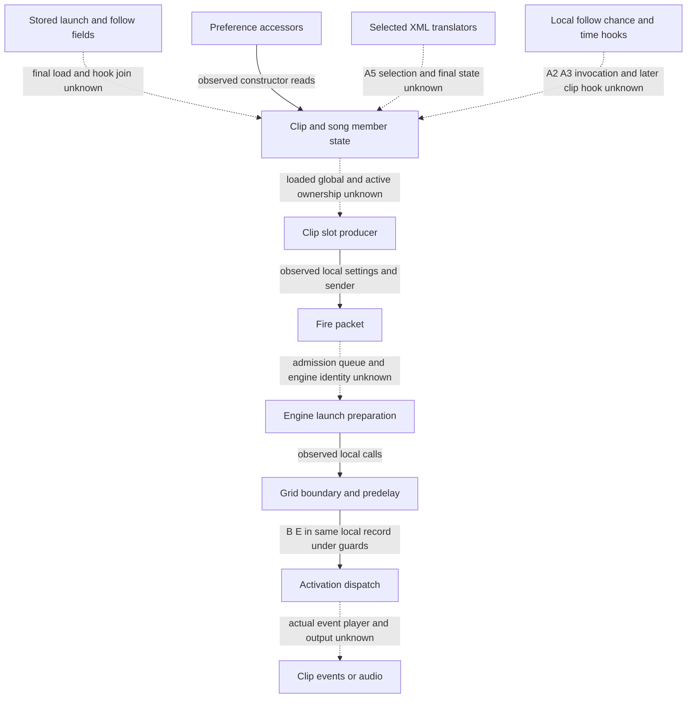

# Clip-launch owner: bounded structure and route inventory

Authored 2026-10-20; **pending independent structure review**. This packet covers
[SPEC-CLIP-LAUNCH revision 5](../../../../wiki/specs/clip-launch.md), requirements
001–023, without changing a requirement, case, release or grade. The approved
[integration manifest](../integration-structure-v1/manifest.json) is pinned at
`7dddd59650ca3395d10e1b3c8aded3cda01d66b522dda4973a08f32e7bfb8f83`, with its
[independent review](../reviews/integration-structure-v1-review.json).
The frozen [playback sibling manifest](../family-playback-routes-v1/manifest.json)
`d69a45b394e6f1143a0efbaee61634aa5330ece0e1afe6c3d87a61d2304dc981` is a
predecessor inventory pointer, not an additional behavioral authority.

## Outcome boundary and evidence units

The [ledger](route-ledger.json) records **229 bounded semantic outcomes**:
21 X-route, 98 S-route, 110 no-established-route. These are inventory counts,
not grades, a complete family or a frozen whole-product denominator.
[Clause decomposition](clauses.tsv) retains 230 formulations; the out-of-range
chance-normalization clause points to its three detailed chance outputs and is
not counted twice. Field/enum/grid tables are input-domain mappings. Individual
numeric cases, helper operations and shipped-corpus counts do not add outcomes.
Every row identifies its exact owner requirement span, stated predicate/context,
related case set, evidence sources, assumptions and missing join. Unknown state
and receiver enumeration is explicit.

The boundary matters. A schema field/type/order, a constructor value, a local
member writer, a supplied enum getter or a numeric helper can have a route while
a successful document opening, later saved/reopened state, actual UI text,
script-visible error or launched clip output still has none. A row with an
internal X leaf does not acquire a public route from that leaf. Owner U remains U,
including a named investigative static landmark. No-established-route means no
established complete route under ADR 0003 and this source scope, not impossibility
or an exclusion. A1/A7 keep their original bounded settled status; A2–A6,
PLAYBACK-CORE A3/A4, request sample R, absolute-clock P/P+1 ambiguity and known
cross-architecture qualifications remain intact.

The [source catalog](sources.json) deduplicates exact retained S5/N1/T13 C rows,
S5 dossier references/C files and X2 native disassembly blocks. Each retains
function entry, source byte/row/hash or JSON pointer/line range, warnings and C
availability. In particular `103abc6e8` has unavailable C in both the S5 row and
dossier. Its retained disassembly/metadata can support only their qualified
observations; no C body is invented. X2 disassembly entries are explicitly a
different source kind. A data address or call PC mentioned in an owner appendix
is a nomination unless the catalog separately locates a function body.

The [source pins](source-pins.json) pin the owner, predecessor manifests, selected
sources and current release manifest/cases/review. They preserve the full existing
research-page prefix; no old spec or case body is copied. Case links in the ledger
are navigation into 64 draft case IDs and 100 released case records, not proof
that every split outcome has an independent case or that any case was executed.

## Component cut and state ownership

This family is cut from [atlas I-04](../../../../wiki/research/program-structure.md#component-boundaries-state-and-ownership)
and the approved [transport/launch integration](../integration-structure-v1/transport-playback.md).
Stored XML and local constructor/migration landmarks explain the owner’s additional
persistence scope. They do not supply an unproved loaded-object-to-active-engine
join. “Observed-static” means a retained reference/expression; semantic owner
names are inherited inference from the cited sources. Arrows are not execution,
thread, delivery or audio order.

| Boundary / state owner | Retained exact local relation | Unresolved composition |
| --- | --- | --- |
| Clip fields and generic member serialization | Owner appendix/N1 and S5 registry/vtable readings identify generic loader `101487310`, writer `101486cdc`, clip registry order, typed child paths and `Value` members. `sources.json` requirements001–003 retains exact row/data pointers. | Public open/save, same graph/receiver, later clip hook and durable reopen are separate from member syntax or writer expressions. UI A6 is not proved by field labels. |
| Constructor and preferences | CL-E01/02: `102436fc4@102437e18 → 1026ab2ec`; `@102437ee0 → 1026ab2f4`. Dossier `/references_from_body/252` and `/267`, plus matching C lines. CL-E03: `102505030@102505350 → 101565624` sets the FollowTime quantize flag. CL-E04/05: member builder `102505724@1025057d0/102505808 → 10157432c`. | These are local constructor/accessor/member-init facts. Actual factory preference defaults/UI numbering, every creation path and missing-field final values are not established. |
| Follow correction hooks | ARM `1025044b4`, matched x86 `10262a930`, transforms supplied chance members; UserFloat setter `101565360` clamps/stores. RemoteableDouble hook `101555850` / ARM `10156580c` rounds supplied member values with flag `+70`. Exact X2 disassembly blocks, matches, driver and raw runs are pinned. | A2/A3 actual load invocation and later `AClip` hook `102441a30` remain untraced. Scene invocation is unknown. An out-of-range member-rounding result is not a final open or held-value result. |
| Enabled setter observation | Zero/zero X2 chance case records a call to `101554600` with false; `run_x2.py` lines547–579 skips that setter and the listener callback. | Invocation(false) is partial evidence, not the Boolean write or final loaded flag. The required disable-state row has no established complete route here; the existing owner X label is unchanged. |
| XML migrations | Selected S5 functions: `101493140` (17), `1014b6d14` (406), `1014b82d8` (417), `1014b8b00` (421), `1014bb048` (12008), `1014c04d0` (12203). The catalog retains exact C/dossier/disassembly locations and owner spans. | A5 selection/order, older unreviewed transforms, step17 reachability, step406 existing-compound error disposition and scene save remain unknown. No generic reader/writer intersection establishes a round trip. |
| Clip setting → grid | CL-E06: `102442998@1024429d8 → 101aaae44`, S5 dossier `/references_from_body/3`. Setting k and clip signature feed the local grid helper; X2 enum getter maps stored−99 to0. | Loaded global quantization publication/current song signature and several clip-signature entry selection remain unbound. Existing Trigger settlement does not settle PLAYBACK-CORE A4. |
| I-04 preparation → timing | Approved integration edges0/1/4: `101ad0130@101ad06cc → 101acffa4`, `@101ad08f0 → 101ad1418`, `101b0dc14@101b0dcdc → 101ad0130`. CL-E07: boundary helper call `101ad07c8 → 101abf294`; CL-E08–10: already-playing predicate at `101ad090c/101ad09b0/101ad0b68 → 101acfe68`. | Native PCs/retained C expressions are observed; recovered floating ABI, current segment anchor and actual timing receiver keep their original premises. |
| I-04 B/E → activation | Approved boundary source record7 C44/C93/C107 passes the same `auStack_140` from preparation into guarded `101ad15e8`; preparation record5 C623/C624 stores two doubles at byte+28/+20. B/E semantics are inherited T13. | Public admission, packet delivery/order, event class, same active player and independent activation/output observable remain unknown. Positive-pre-delay audio and exact clip output are not closed by the record. |
| Modes, Legato, velocity and follow | Slot-data sender `10245efa0` and follow sender `10250416c` serialize the named fields; linked iterations versus sentinel is a static input fact. T13 locates note-velocity `101b78010` and audio-property `10235ca20` landmarks. | Their discovery does not establish public velocity scaling. Mode/release transitions, Legato consumption, linked/unlinked timing, jump selection, random chance state and final player/output are still U. |

No new graph traversal or indirect target was added. The inherited component layer
uses packet1a’s symbol clusters, constructor/vtable address points and type-name
strings: baseline 25,071 nonempty-reference sites of 268,015, separate from 24
conditional additions (combined inventory 25,095). The inherited transport search
prunes top 1,000 hubs, exempts explicit seeds, uses 200 edges/80 nodes per direction
per level and stops at depth 3. Its 121 unknown indirect-site associations and 24/19
terminal frontiers remain local inventory, not a complete census. OSend receiver/
vptr/opaque-call premises do not transfer to scheduler, hook or player receivers.

## Finite inputs and prospective work

[Batch inputs](batch-inputs.json) point to **11,756 historical input/result rows**:
6,463 grid, 37 explicit boundary, 5,136 grid-line sweep, 10 enum getter, 28 chance,
66 FollowTime and 16 predelay. These are not original call counts or required
outcomes. Exact bit/hex inputs remain in the pinned source rows. Compact selectors
identify complete arrays rather than copying the result bodies. Original driver
call shapes, supplied object bytes and skipped callbacks remain mandatory context
for any later selected batch.

Two declared near-maximum FollowTime sentinels are absent from the retained 66
FollowTime rows. Their exact hex values with flag 0/1 are prospectively enumerated;
this does not claim they were run. Mode/request/effect questions are enumerated
for the three named modes and Trigger release, but actual transition-state,
receiver and clock inputs remain unresolved. No unbounded state inventory is
silently treated as complete.

No batch is selected or executed here. Historical real init/mapping calls and
skipped methods do not confer standing authorization on future object construction.
Root selects and classifies subsequent calls against the current harness contract.
No provider, decoder, harness, installation, original instruction/function or
candidate execution occurred.

## Checks and review

Run `python analysis/ableton-live-12.4.3/full-spec-v1/family-clip-launch-routes-v1/author-check.py`
from the repository root. [Author results](author-check.json) cover selected hashes,
exact source pointers/row/code/PC locators, bounded outcome/case/input references,
null-C handling, local Markdown links and the protected full wiki prefix. This is
a mechanical source check, not independent semantic approval or compatibility.
Root owns the final seal, separate structure review, shared atlas/catalogs/coverage/
log updates and next packet selection. Whole-product specification closure is open.
