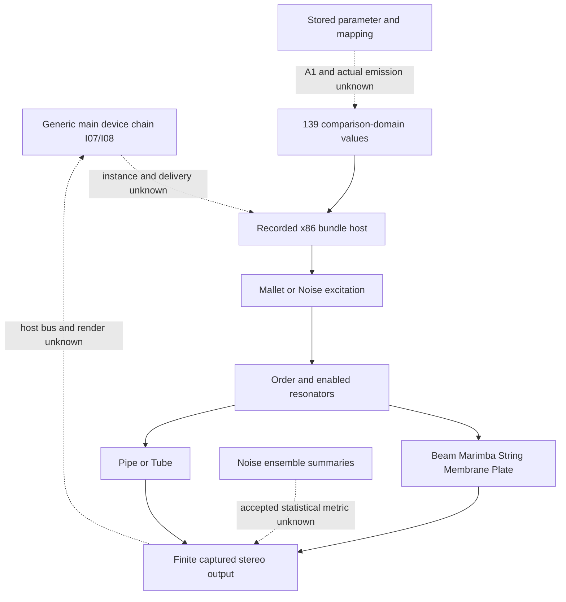

# Collision family routes: recovered inputs, resonators and finite output

Author map, 2026-10-20. **Pending independent family-map review.** The current
[SPEC-DEVICE-COLLISION revision1](../../../../wiki/specs/device-collision.md)
owns 18 requirement contexts and 50 draft-case rows. The
[canonical research](../../../../wiki/research/device-collision-dsp.md) owns
source/execution provenance; [device-collision-v1](../../../../handoff/device-collision-v1/README.md)
approves only two finite comparisons. Older unreleased/proposed language records
historical draft state. This packet changes no norm, case, tolerance, grade or
release. Root owns the seal, independent review and shared routing.

## Integration and same-instance boundaries

This extends approved integration manifest
`7dddd59650ca3395d10e1b3c8aded3cda01d66b522dda4973a08f32e7bfb8f83`
and the [approved mix family](../family-mix-routes-v1/structure.md).
The generic I-07/I-08 device-chain construction is **not** a proved Collision
instance, loaded parameter vector, event receiver, audio callback or output bus.
Its builder `102731438` and wiring helpers `102321f5c` / `102312ed0` retain
local argument/connection evidence with unresolved endpoint receivers. Naming
that generic boundary Collision would invent the missing same-instance join.
The map's first and last relationships remain UNKNOWN.

[chain-edges.json](chain-edges.json) records 13 qualified relationships and seven
missing bridges. Static source arrows are not runtime sequence. Named addresses
are carried canonical source citations, not fresh body or instruction reads:

- N6's main ARM builder `1030debd0` supplies the 139-index table. Stored domains,
  converters and mode words are data/source evidence. `col.py:stored_to_host`
  constructs explicit comparison values; its successful supplied-host execution
  does not prove Live's actual emitted values. The six position values retain
  A1; two VelToStartTranspose range mismatches and R2 Type6 stay unresolved.
- The recorded x86 bundle host creates a fresh instrument, sends rate and all
  139 values in order, warms up without events and renders with silent input,
  inputflag0 and stopped0/0/120 transport. The exact slice, substitutions, fixed
  clock and event-relative frame base are premises. Main application call order,
  grid phase, loaded object and ARM/Apple output remain unknown.
- ARM wrapper `13ba0`, modal processor `2809c`, mallet processor `38edc` and
  note source `2faa0` are existing source explanations. Recovered signatures,
  receiver identity and static-to-x86 equivalence are qualified. The model's
  formulas or a control catalog do not establish current native state, actual
  invocation or a public audio result. Measurement/quantization/build helpers
  are dependencies, not additional required outcomes.
- The two-resonator topology has finite supplied-host observations: parallel
  order permits either alone; serial order requires R1 excitation for R2.
  R1's audible volume0 does not remove its tested serial excitation. Productive
  matched controls are required before interpreting absence/isolation. The
  measured serial component sum is distinct from random fresh-instance parallel
  mismatches; there is no universal cross-instance additive identity.
- Constructor silence is explained by both resonators being off. The Defaults
  preset changes only R1 enabled among sent binary32 values and gives a genuine
  positive output. It is not a proof that every preset/control or note sounds.
  Host mallet noise amount0 still leaves randomness; Q is not deterministic.

## Bounded observable inventory

[route-ledger.json](route-ledger.json) has **84 local predicate/context rows**:
38 X, 10 S, 36 without a complete established route or oracle. All 18 requirement
bodies have exact byte/line/hash [source spans](source-spans.json). Requirement
IDs, the 50 draft cases, 41 render files, 139 indices, numeric sweep points or
individual helper calls are not the outcome denominator. Continuous input,
interaction and lifecycle histories have no evidence-backed finite equivalence
partition; the whole-family denominator is null and completion remains false.

X means a retained original-x86 supplied-host route and the stated bounded
observation. It does not mean a released continuum, calibrated target result,
new execution or application compatibility. S means existing source/data
association under named premises. No-established-route includes an oracle gap
although a capture or parameter name exists. Every new expected/actual field is
null and all existing grades stay unchanged. The catalogue explicitly covers
protocol, conversion, enabled/order topology, grid, modal pitch, five modal
families, hit/listening positions, mallet, velocity/key, levels/pan, note-off,
voices, sampled pitch envelope, Pipe/Tube, noise and the unresolved modulation,
transition and lifecycle contexts. Auxiliary arithmetic is not padded into
outcome counts.

[control-navigation.json](control-navigation.json) indexes all 139 N6 rows by
exact TSV row/byte/hash and required context. Both resonators, all seven models,
LFO1/2 targets and controller/MPE entries remain identifiable. This crosswalk
is not 139 additional outcomes or control-delivery credit. The dummy index134
is fixed comparison input, not a stored per-note pitch-bend behavior contract.

## Original recovery and finite input sets

The original manifest has **103 payloads**. [preservation.json](preservation.json)
uses the existing recovery manifest's exact two mappings:

| Logical original | Verified original provider |
| --- | --- |
| `run_collision.py` | `recovery/originals/run_collision.py` |
| `results/collision.json` | `recovery/originals/collision.json` |

Every other original path remains unchanged. The current two paths contain
unknown-provenance concurrent extras and are excluded from route evidence.
Their hashes are preservation-only as-of data. No extras, stripping procedure,
regeneration command, recovery audit or old helper was executed. Hashing original
WAV bytes is not decoding or remeasuring audio. Recovery provenance is not an
approval of the current whole tree. The existing audit's broader external and
WAV-format checks are carried, not newly repeated.

[input-sets.json](input-sets.json) provides all50 draft-row digests/navigation,
all41 original WAV/script registry pointers (32 original registry + nine noise),
11 finite summary-only study-set pointers,
and the two immutable released object digests. No case/spec/audio snapshots are
copied. Every script's 139 ordered parameter indices, process commands and event
records are checked as text; values remain in the exact original scripts. Sweep summaries do not imply their external scratch audio survives. Only
41 captures exist in this retained set; DCL042–046 are measurement-summary
checks, and DCL047–050 are open contexts rather than new render files.

The 41 retained renders are not 41 approved comparisons. DCL014 has zero
resolved modes; all nine DCL033–041 noise fixtures lack an accepted statistical
metric. These ten retained fixtures remain U. The remaining unreleased draft
metrics remain proposals. The two released evaluations are:

| Released evaluation | Draft provenance | Exact accepted scope |
| --- | --- | --- |
| DEVICE-COLLISION-001 | DCL001 | 22050 frames, both resonators off; all-sample stereo peak <=1e-18 |
| DEVICE-COLLISION-002 | DCL031 | 32768 frames, held C4 Pipe; full joint-stereo relative RMS <=0.003 |

Both have fixed139 binary32 vectors, rate44100, warm-up11264/512, exact events
and partitions. Constructor note-off lies beyond its finite output. Pipe has
no separately released frequency comparator. Its calibration and .003 budget
do not transfer to Tube, modal/noise outputs, arbitrary seeds, ARM or a whole
Live session. The release's no-fitting/no-alignment and positive reference
energy scopes remain unchanged; its checks were not run by this map.

A later selected batch can enumerate the whole existing finite set from these
script/registry pointers, with exact slice/harness/time/rate/parameters/event
history and preselected metric applicability. This map authorizes no batch.
Do not rerun original `run.sh`: its historical low-pitch probes reach278
CalcA calls including warm-up, exceeding the current256 limit. The41 retained
fixture scripts themselves used at most109. A different setup cannot silently
replace their reference or acquire their expectations.

## Uncertainty and scope retained

- A1 position conversion, A2 actual host protocol and draft A3 acceptance remain
  owner-scoped; only the two release metrics have independent finite approval.
  The 29 listening-preview wins and mixed hit evidence are not actual calls.
- Tested grid covers336 note-ons and44 note-offs at declared uniform partitions.
  It can precede the nominal timestamp. Nonuniform/event-order/fractional timing
  and actual Live phase/base remain unknown; no other device's offset transfers.
- Modal comparisons describe strong, separated fitted components only. Weak,
  close, excluded and zero-resolved modes are ungraded. Nominal pitch, normalized
  amplitude or analyst model agreement does not prove actual rounded poles,
  absolute output gain or physical mode identity. Corpus's separate omissions
  or finite metrics are not imported into Collision.
- Noise ensembles are unstable (up to7.899dB split spectra/8.185dB envelope90th
  percentile). One retained seed, fixed clock or positive flags cannot supply
  an exact RNG law or statistical oracle. Filter summaries measure resonator
  output, not an isolated filter's transfer function. No widened noise budget.
- Note-off fitted pole T60 is not an envelope cutoff. Short tails, other types,
  retrigger/released priority and exact pitch-envelope trajectory stay open.
  The TubeRadius0 short-lived peak is not an established steady pole.
- One-ulp libm/modal/ARM FMA concerns limit transfer. No ARM run or Apple math
  uncertainty bound exists. Pipe finite calibration cannot close those gaps.
- Fixed fixtures and one setup-rate difference do not establish active automation,
  smoothing, rate/reset while sounding, transport, undo/persistence, malformed
  inputs, concurrency, complete teardown, UI/file or real-time behavior.

## Checks and contribution scope

The owned `python3 -B check.py --check` performs stdlib JSON/text/hash checks only:
selected pins, exact spans/pointers, original103 through recovery mappings,
recovery inventory, released bytes and both case objects, all41 script/registry
identities, all139 row locators and the additive research prefix. Twelve negative
fixtures reject oracle/grade promotion, lost omissions, current-extras evidence,
false main-instance/runtime joins and corrupt inventory/metric scope. Unsupported
write mode refuses before reads. Mutable wiki/current incident identities are
as-of availability reports, never future live-file gates on old source evidence.

Fresh reading covered the complete owner contexts/case tables, canonical research,
recovery manifest, release contract/review/README/compact exact vectors, handoff
plan, N6 relevant sections and full6695-byte `col.py` as source data. All41 registry
records and script metadata were mechanically inspected; unchanged import maps,
old model/estimator bodies, original source/capture universe and prior review
commands were not independently re-audited. Integration/mix associations and old
calibration/audit results are carried with exact predecessor pins. The author has
prior Corpus/Utility/integration analyst contributions, not current Collision
capture authorship. Author readback is separate from Root seal and independent
map review. No original, provider, decoder, model, comparator or harness was run.
