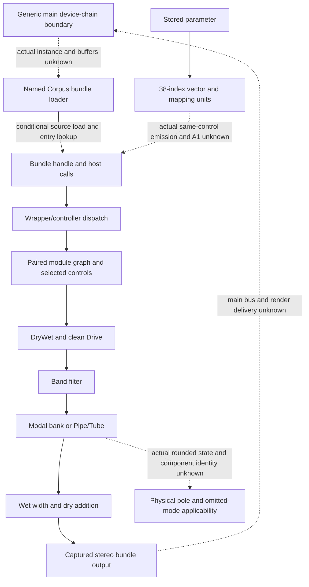

# Corpus family routes: host values, seven models and finite observations

Author map, 2026-10-20. **Pending independent structure review.** The authority is
[SPEC-DEVICE-CORPUS revision 7](../../../../wiki/specs/device-corpus.md), its adopted
R7 provider/review, and the partial [device-corpus-v5 release](../../../../handoff/device-corpus-v5/README.md).
The current canonical page includes the adopted disposition banner and a later
nonnormative source follow-up. Historical pending/proposal language remains
author-freeze history. [pins.json](pins.json) records exact current/as-of and
immutable identities; no spec, case, source-body or capture snapshot is copied.

D01's ability to extract finite device output is answered. This is not a
complete Corpus profile, a frozen required-outcome denominator, a candidate
result or an implementation selection. The map adds no requirement, case,
expectation, numeric budget, grade or release. Root owns seal/review and shared
routing. No original, provider, decoder, model, comparator or harness is run.

## Integration extension and actual ownership gaps

This extends approved integration manifest
`7dddd59650ca3395d10e1b3c8aded3cda01d66b522dda4973a08f32e7bfb8f83`
through the [approved mix-family context](../family-mix-routes-v1/structure.md).
I-07/I-08's generic device-chain/TrackOut construction does **not** prove an
actual Corpus instance, loaded parameter mapping, audio input or host/bus output.
The first relationship in [chain-edges.json](chain-edges.json) is explicitly
UNKNOWN. It must not be relabelled a proved Corpus edge because both sides
mention a device. The retained integration's unknown indirect sites, bounded
frontiers and pruned hubs remain unknown; there is no new graph traversal or
class-slot resolution credit.

The map retains 14 qualified relationships and eight missing bridges. Exact
byte/line/hash and JSON locators are in [evidence-locators.json](evidence-locators.json).
Source expressions are observed-static; semantic names/owner associations can
be inferred; receiver/path/ABI/state/delivery premises remain separate. Static
arrows are not proof of runtime sequence.

The concrete retained associations are:

- Main's named Corpus getter `1030e6104 → 103196ec0 → 1031983d4`, factory
  `102fbdf34 → 102f998c4`, and instance wrapper `102fbe25c` describe a conditional
  bundle loading route. CFBundle lookup, seven valid pointers, selector/state and
  compatible receivers are premises. The generic source path and a successful
  supplied-host capture do not identify a running Live instance. The reviewed
  host-protocol correction distinguishes ordinary reset from grouped warm-up;
  older one-warm-up wording is not current authority.
- `1030e54e8 → 10319cb10` builds indexed mapping units; `102fccd28` retains the
  latest index/value and `102fbfe54` flushes to SetParameterA. N5 supplies the
  named 38-index map and conversions. The position companion proves conditional
  initialization/current-value pull/conversion only, not the emitted processing
  output, AIndexedFloatModule attachment or actual SetParameterA value. A1 is
  unaccepted. Stored position and direct HOST position remain different scopes.
- The ARM report's wrapper `d75c / 50c0` and message chain `19370 → 18588`
  describe controller dispatch to an admitted registered receiver/control.
  Recovered arguments and types are qualified. Index37 is sent and stored but
  ignored by the base setter; the older report's “never sent” shorthand is
  superseded. General note priority/sustain/side-chain routing is not closed.
- The reviewed x86 entry `29c0 → 3820` uses a fresh receiver `V=[I+8]`, then
  `T=[V]` and `call[T+20]`. Its independent `I+e0028` status chain is not a model
  or coefficient object. A nominal constructor table `30628` and retained word
  `+20 → 85e0` are conditional nominations, not a current runtime vptr.
- In reached `85e0`, fourteen fresh record fields at X+f0..158 call
  `mem64[V+8]` **directly**. Those sites have no extra first-word table read;
  queue/tail sites do. Current record construction, roles, types, progress and
  model identity remain unknown. Setup target3ab0's fixed96-byte preparation
  stays **UNEXECUTED**; its metadata is not an extent or a resolved callback.
- ARM module graph `5ca8 / 182f8` names DryWet/Gain/Filters/Resonator pairs,
  Width/Plus and output. Five modal builders/process paths (`243e8`, `24ee4`,
  `25210`, `257b4`, `1f3f8`) and waveguide `23670` supply conditional model
  construction/recurrence associations. Port/model agreement is distinct from
  source, original audio, current native coefficients and measured physical poles.
- Membrane's reviewed source associates builder B=M+148 and same-k ratio,
  denominator-bank and recurrence cells. Requested quality N differs from
  post-cull active count; a separately guarded resonance can contribute to output.
  Actual rounded coefficient state, lane/order/path, nonzero residue and ARM→x86
  association are still needed. Nominal ratio/theta cannot substitute for poles
  of the actual rounded denominator, and a retained low-band component does not
  independently identify physical mode1.
- The supplied-host bundle route returns retained stereo output, not a proved
  main application bus, device-chain attachment or target ARM/Apple result.

## Bounded predicate inventory and complete navigation

[route-ledger.json](route-ledger.json) has **146 local predicate/context rows**:
49 X routes, 83 S routes and 14 without a complete established route or oracle.
All 13 requirement bodies and the separate timing/state section have exact
[source spans](source-spans.json). Requirement IDs, 33 canonical case rows,
27 released groups, 73 evaluations, each numeric point or every helper call
are not the denominator. Continuous input/control/history families have no
evidence-backed finite equivalence partition; the whole-family/product
denominator remains null. Current profile completion is zero.

X means a known original bundle/recorded-harness route with finite retained
inputs and observations. It is not a newly graded continuum, general formula
or public application result. S includes conditional source/data/formula
associations. Model/port agreement, static analysis and finite original capture
are labelled separately. For example modal transfer equations remain S here
while each model's listed eligible-mode/early-waveform comparison has an X
route. Helpers such as controller arithmetic, pow2, builders and measurement
FIR/fit/fsum steps are dependencies, not extra device outcomes. All new expected
and actual fields remain null; all old grades and uncertainties are unchanged.

[control-navigation.json](control-navigation.json) covers every host index0–37
with an exact mapping-row reference and its relevant DSP contexts. It is a
crosswalk, not 38 additional outcomes beyond the ledger's required mapping
predicates. It also names all seven models: Beam, Marimba, String, Membrane,
Plate, Pipe and Tube. Every model already has retained finite references;
none is presented as wholly absent. All five modal models retain their ratio,
requested quality, cull, transfer/residue and finite-comparison contexts.
Pipe/Tube retain waveform-only finite scope, ignored-control source claims and
the unresolved outside-vector waveform/Radius/Opening behavior.

The seven LFO shapes, Free/Sync, Phase/Spin, random seed roles, filter on/off,
all timing controls and MIDI-only controls are retained in their actual owner
scopes. Source lists do not grade unrendered waveforms. A finite random seed is
not a RNG distribution/independence law or every-input non-silence guarantee.
Disabled/negative/isolation tests require genuinely productive matched paths
and changed inputs; configuration, flags and names alone are not delivery proof.
Storage/default/UI/workflow/automation/lifecycle requirements owned elsewhere
are not silently imported from the older 96-row navigation proposal.

## Finite input sets, metrics and preserved omissions

[input-sets.json](input-sets.json) indexes every one of the 73 immutable v5
evaluation objects by exact JSON pointer and canonical record digest. It retains
all 27 group digests, declared model/quality, metric kind and mode-point counts
without copying host vectors, cases or audio. [callable-sets.json](callable-sets.json)
retains the 64 historical script metadata references and local source-function
families. Named internal functions are **source nominations**, not standing new
direct calls or a license to construct their receivers. The exact existing
bundle-host call model is the available finite X route.

Future work can select one whole enumerated family batch from these existing
sets, with exact input/order/history, slice/harness/substitution hashes, timeouts
and results. This map authorizes no execution. Additional model×quality×rate or
38-control interactions need explicit preselected inputs, metric applicability
and admitted-state partitions; no Cartesian oracle is invented. A batch is not
a succession of new numeric examples or single-case owner revisions. No old
collector, comparator, model, fit, FFT, native function, provider or fixture
universe was replayed as an integrity check.

The **174 historical omitted mode/channel/evaluation occurrences and both
note72mode16 occurrences remain ungraded**. Their exact provider pointers are
retained. They are observation units, not a frozen required-outcome denominator.
The original 1e-4 reference-to-pole eligibility test is unchanged. The stopped
006-01 physical mode1 method still lacks independent identity, signal order,
model-error and full data-to-frequency uncertainty. Neither a waveform
replacement, nominal coefficient formula, successful estimator variants,
favorable local condition nor port output supplies that missing obligation.

The preserved finite comparisons remain distinct:

- Old modal comparisons use only their frozen significant, eligible mode lists
  and early256 samples; frequency/log-radius/complex-amplitude budgets and
  low-frequency precision/window qualifications are unchanged. Pipe/Tube/filter/
  dry waveform, sine, third-octave noise, old Sine-LFO and startup scopes keep
  their separate rules. General equations and storage/host mapping are not
  released merely because finite vectors agree.
- Held note60 copies 32 scored mode points by exact post4096-byte identity and
  cannot alone reject ignoring MIDI. Held note72 scores only first15/channel
  (30 total), an explicit post-observation engineering exception with unchanged
  modal budgets; mode16 remains U, not absent. Prefix0..4095 is finite-only.
- Ramp020-02, NoteOff026-01 and pickup027-01 use separate explicit 1% engineering
  waveform methods, not a transferred vendor/Apple/ARM/calibrated uncertainty
  bound. Ramp and NoteOff score all post4096 samples per channel; pickup uses
  four independent pre/post L/R checks. Exact size, full-file finiteness and
  positive reference/candidate scored energies apply as specified, without
  alignment/fitting or epsilon.
- NoteOff's three wrong references have one unique scored waveform; an entire
  genuinely nonzero late half can be zeroed yet pass its aggregate budget.
  Pickup's concentrated last-right and finite-prefix corruptions pass; artificial
  splices/tail corruptions failing are sensitivity observations, not physical
  timing laws. New vectors acquire no old block/rate/reset/clock/FP invariance.
  Pickup establishes neither 4000-frame movement, eight-frame latency nor
  general right-channel invariance. No finite method closes A1 or omitted modes.

## Checks, contribution history and next gate

The owned `python3 -B check.py --check` reads JSON/text/hashes only. It verifies
selected provider identities, spans/pointers, all current evaluation/group
digests, 38-index/seven-model navigation, omission memberships, parked status,
null grading and the additive research prefix. Focused negative fixtures reject
lost omissions, generic-mix→Corpus promotion, A1 acceptance, metric/position
promotion, wrong sources/cases and false actual grades. Passing checks establish
integrity, not semantic completeness or new original measurements. Unsupported
write mode is refused before reads.

The author contributed earlier Corpus source queries, capture preparations,
R7/v5 author packets and reviews; their independent approvals are carried by
exact pins, not independently renewed here. Fresh reading covered the current
owner's complete normative/metric/fixture/case scopes and selected canonical
host/model/Membrane/current-x86 sections, retained report sections and current
release metadata. Every evaluation was mechanically parsed and its compact
model/quality/protocol/metric metadata read; the unchanged old capture/body/raw
proof universe was not semantically re-audited. Author readback/preservation
is separate from Root's seal and the next independent structure review.
