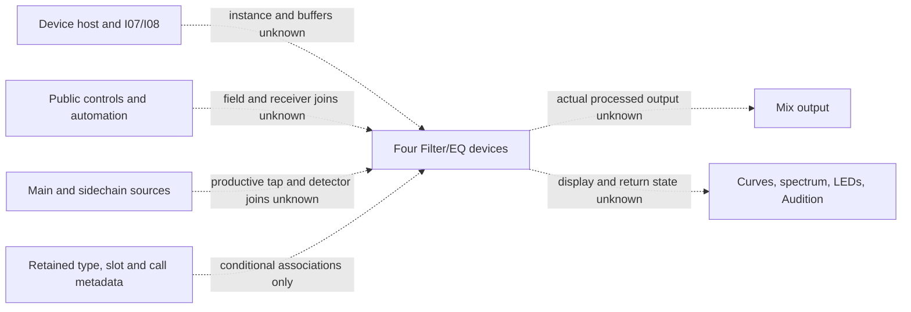

# Filter/EQ component and route frontier

This is an outside-scenario cut of integration I07/I08, not a new audio architecture.
Generic device placement and activation belong to the device/rack host; mix maps
own generic routing; the automation map owns its narrower representation/evaluation.
None establishes these four processors' current control delivery, audio instance,
public lifecycle or comparison oracle.

The graph's dashed boundaries are missing joins, not established ordering. Exact
supporting relations are in chain-edges.json and the native metadata locators.

Seven selected literal types comprise four current processor names, the exact
AutoFilter2/ChannelEq sample-rate wrapper templates and a separate legacy processor.
Each retained table has a three-slot executable prefix; stop conditions are not
complete-table or render-method assertions. Literal decompiled store candidates
preserve source/body-hash/line references but prove neither constructor execution,
receiver lifetime, ABI nor a public device identity. No source C is copied or read.

The selected Eq8/EQ3 member-pointer callbacks and exact device-kit wrapper aliases
support lexical method candidates. Callback names, class tokens, schema fields,
manual control labels and preset strings remain separate domains. In particular:

- AutoFilter2 and ChannelEq wrapper call data reaches externally resolved device-kit
  symbols. Providers, bodies, actual processing and receiver/scheduler/buffer joins
  remain uninspected. A symbol frontier is not a processing or resource law.
- EQ Eight callback-labelled OnMode/OnGlobalGain edges reach external exp10f at
  retained sites. No argument relationship, unit conversion, enum, smoothing or
  public output binding was derived. These dependencies are auxiliary.
- Shared Biquad spellings were counted only for the initial census. No retained
  fixed edge uniquely selected a coefficient body. No coefficient/formatter/helper
  universe, native body or transitive target was materialized.
- The legacy AutoFilter processor/table vocabulary remains separate. It supplies
  no modern D12 control law or exact-target Legacy parity.

The fixed call set has 429 unconditional-call and 24 unconditional-jump records;
39 additional disjoint indirect sites remain unresolved. These are native metadata
units, not executed calls or outcomes. Resolution credit stays zero and the main
25,071/268,015 inventory is unchanged. Absence of a join in this bounded set is
not absence of a runtime route.

All 65 clause bundles remain represented; public exact-target behavior is unknown.
Four S rows concern retained package/schema strings only. D12 applicability,
AF detector and Type ambiguities, stochastic/reset behavior, productive modulation,
EQ Audition return state, Scale/adaptive-Q transfer, numerical filter/audio laws,
latency/timing/smoothing and all retained lifecycle/error actions remain open.
The file Creator12.4d1 and saved zero amounts do not provide current defaults or
working modulation. No zero/neutral-looking configuration is a transparency oracle.

A productive future source-depth batch must first join actual public controls,
accepted values and device instances to the retained native/template boundaries,
and then to actual output/state and a bounded comparison. A coefficient leaf may
be useful auxiliary computation without answering a public predicate. This map
selects no body expansion or original execution; independent structure review and
coordinator selection are separate gates.
