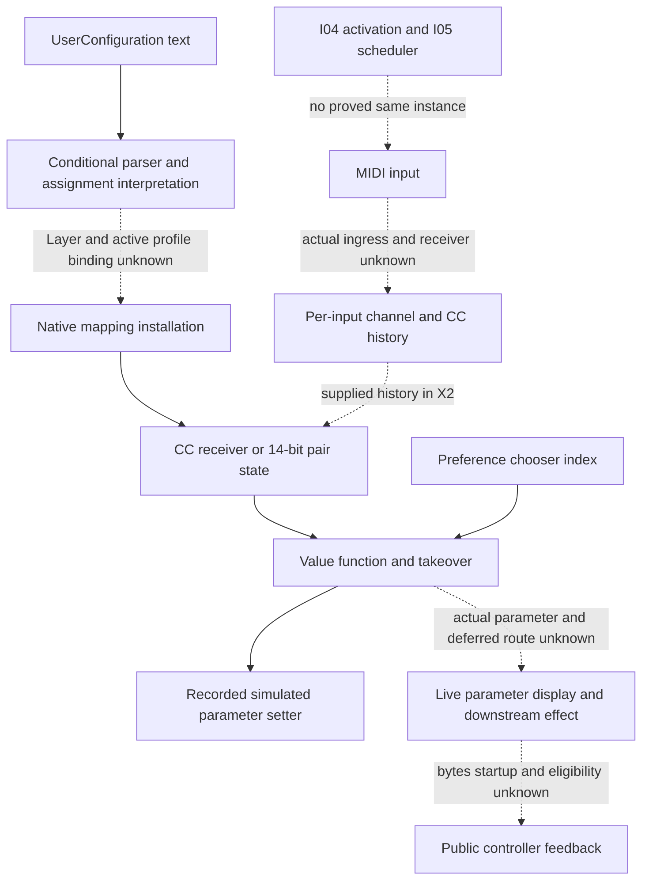

# MIDI-user mapping family: configuration, receiver state and value boundaries

Author map, 2026-10-20. **Pending independent review.** Current
[SPEC-MIDI-USER-MAPPING revision6](../../../../wiki/specs/midi-user-mapping.md)
owns the contract; [midi-config-v4](../../../../handoff/midi-config-v4/README.md)
releases only its explicit partial scopes. The immutable v4 release names parent
revision5; current revision6 separately reconciles its reviewed precision findings
without changing released case expectations. [pins.json](pins.json) binds current
as-of and immutable predecessor identities without copying specs or cases.
The 161 released objects, 56 MT rows and 13 requirement IDs are navigation/input
units, not a required-outcome denominator. No new rule, case, numeric budget,
expectation, grade or release is adopted. Parent seals/reviews this contribution.

## Integration extension and ownership

Approved integration manifest
`7dddd59650ca3395d10e1b3c8aded3cda01d66b522dda4973a08f32e7bfb8f83`
supplies the I-04/I-05 launch/activation/scheduler context. It does **not**
prove a particular active user mapping, MIDI port/CC receiver, target parameter,
or feedback output. I-04's local preparation→activation relationship and
I-05's scheduler virtual+10 are not a controller-ingress class proof. Generic
scheduler events, arrangement note playback and physical controller messages
must not be equated because they all mention MIDI. Unresolved indirect sites,
queue admission and actual event class remain unknown rather than dead ends.

[chain-edges.json](chain-edges.json) records thirteen qualified relationships
and seven missing bridges. Entries/source expressions are evidence; semantic
owner associations and runtime sequence have separate premises. No new traversal,
PC search, indirect-call resolution, source export or native window was performed.

The concrete retained source and finite-X associations are:

- S4 `_UserScript.create_instance/parse_int/parse_map_mode` feeds
  `_Generic.GenericScript` components. Exact module source-line/bytecode-offset
  references are in the current owner appendix E1–E9 and S4 listings. The
  `Layer` control→setter association remains I5, not a freshly proved runtime
  connection. The absent revision1 source tree is not fabricated or fetched;
  S4 retained provenance and later review carry its bounded interpretation.
- `_Framework.ControlSurface._install_mapping` L735–743 (bytecode offsets
  814–1044) passes channel/CC/mode/feedback/avoid/sensitivity. Native ARM
  `103b4d744→102593258` validates and builds details. Actual parameter handle,
  registry/installation admission and receiver object remain premises. Details
  `1026fa5c8→1026fa684` reads native properties, but the on/off registry check
  `1011aeb80` can alter the range choice. Names/type categories do not establish
  an actual application's target kind or stored thresholds.
- ARM `101b69248→101b65b68→101b7842c` is the retained conditional dispatch/history
  source route. Registry `101b84798/10260535c` and entry+30 mode ownership remain
  inferred. Every received CC is recorded per input/channel/number, including
  unmapped CC; it is not the same state as held pair halves. X2 did not run
  this dispatcher/table: it supplied the previous data value.
- Ordinary CC receiver ARM `101b7f894`, x86 `101bbc3b0`, calls the Apply callback
  ARM `101b83974→101b7fde4` / x86 `101bc09b0→101bbc9c0`. Pair install
  `1026094e0` has the retained `102609548` fixed-zero avoid argument; MSB/LSB
  `101b8028c/101b802bc` feed `101b7fcc0`. Each half replaces its own held value;
  completion clears the held fields. This source PC is not a new decoder read.
- Apply reaches value function ARM `101b76bf0` / x86 `101bb27b0`; relative
  decoder ARM `101b7b96c` / x86 `101bb7ff0` is a dependency of parameter-value
  outcomes. Takeover/Pick-Up ARM `101b7c508/101b7c344`, x86
  `101bb8b70/101bb8990`, computes the finite recorded local values. Reversed
  targets preserve reported order while windows/scaling use sorted lo/hi.
- Preference constructor ARM `1022cc18c` / x86 `1023e0050` and change handler
  ARM `1022cec38` / x86 `1023e2a60` supply entry-position association; engine
  handler ARM `101b83750` / x86 `101bc0770` receives the index. Default choice
  and displayed localized words remain unknown. `reset_input_history`
  `1039fa2a4→10259b710→101b68f98→101b65c1c` is the existing static reset route;
  no user-mapping module calls it, but another surface sharing the input can.
- The real setter ARM `101b0d328` / x86 `101b3d360`, parameter virtuals,
  notification, display, feedback and deferred `OChangeControllerDataCommand`
  remain separate endpoints. The pure mixer curve/text helpers do not identify
  the actual master/cue/crossfader parameter or its public response.

Addresses/line references above are carried exact locators from N7/E10–E16/X2,
not new full-body/ABI proof. Call PCs are stated only when already retained;
missing exact PCs are not filled with function entries. Existing recovery,
architecture, valid-object/call-path and initialization qualifications apply.

## Bounded predicate inventory

[route-ledger.json](route-ledger.json) has **94 local observable/context rows**:
19 X, 31 S, 44 without a complete established route or oracle. All thirteen
requirements and the separate state/error sections have exact byte/line/hash
[source spans](source-spans.json). These counts describe this bounded inventory,
not a frozen whole-family/product denominator or grade numerator. Continuous
ranges, histories, topology and lifecycle lack a complete finite partition.
Every new expected/actual remains null and every old grade is unchanged.

Shared crossfader predicates under REQ005/010 and transport effects under
REQ004/012 are linked with `also_requirements`, not counted twice. The eight
relative encodings are one finite value-family context with all eight input
modes, not eight newly invented helper outcomes. Alias names, parser arithmetic,
acceleration arrays, schema domains and per-case numeric points are dependencies
or navigation rather than extra outcomes. The ledger covers:

- discovery/activation and configuration/error distinctions; ordinary CC versus
  direct pad parsing, global/per-control/pad channel rules and all ten modes;
- absolute/pair/relative/stepped/reversed transformations, held halves and
  independent previous-message history, None/Pick-Up/Value Scaling and all
  stated first-pair/missing-half/boundary contexts;
- visible pad identity versus playback, encoder/bank compaction, conditional
  navigation/lock/activator effects, strip/send targeting, master/cue/crossfader,
  button kinds, mute/arm/select and feedback boundaries;
- target-kind/range/post-set/display, message ordering/coalescing/defer,
  persistence/reload/undo/automation interactions and held-control teardown.

S is a retained static/data/bytecode route, conditional on its path and host
premises. X is an existing finite computation route, not a whole application
route or newly accepted continuum. Public-effect S-cond handlers are retained
as auxiliary evidence on no-established-route rows. A documentary name, source
handler or an alias does not become an executed state change.

## Finite input and callable sets

[input-sets.json](input-sets.json) indexes all **161 immutable case objects** by
exact pointer/digest and authored fixture hash: 109 configuration-only and 52
value cases. Per-case provenance remains 127 static-derived and 34 extracted
execution, although historical X corroborates all18 older value cases. All
**56 MT rows** have current owner labels and exact row/source-record pointers:
18 S, 34 X and four S-cond (MT17/18/43/44). Those four on/off rows remain
unreleased despite local arithmetic agreeing under supplied thresholds. Old
N7/X2 source labels cannot override the current owner disposition. The older
S4-MIDI030 lone-Send2→SendB expectation is not adopted; current owner states
compaction to the first send and the release excludes that isolated input.

[control-domains.json](control-domains.json) names the103 CC keys by bounded
pattern families (28device/61mixer/14transport),16pad note keys,16pad channels,
27per-control channels, four mode keys and ten exact tokens. It keeps CC/channel
and 14-bit addressing domains, parameter kinds, range orders and choice labels
separate from the outcome count. It is not a class-membership or public binding
proof. Known target labels are a comparison convention, not a native API.

The complete existing finite sets are the161 release fixture/stimulus objects,
23 original MT computation records and40 TK/TB computation records. They can
nominate a later whole-set batch with exact receiver/details/history/choice,
call bounds and known substitutions; this map selects **no execution**. Some
TK records exercise on/off, harness-only avoid flags or unrounded passed values
with no released public effect. Do not turn every retained result into a graded
case. Do not replay the old GDB harness or construct new object models merely
because these locators are present. Root separately selects any preparation,
batch and independent review after the family-map review.

## What X2 and the release do not prove

Historical X2 ran receivers, Apply, value computation and takeover in one local
chain. It used owned receiver/details buffers and GDB stubs for owner/parameter
accessors (`101abb210/101b3d680`), current-value read (`101b6f830`) and setter
(`101b3d360`). Pick-Up notification `101bb8a0d..101bb8a7f` was jumped over.
The direct path was taken; deferred application did not run. The real dispatcher,
per-input table, details builder and actual parameter setter were not executed.
These are permanent evidence limits, not details to omit from a future batch.
Static cross-slice comparison and bounded binary32 modeling support the stated
ARM assumption; no ARM application/runtime result is added here. Historical
X2's over256-call harness defect was corrected by at-most201-call reruns; that
history stays in the pinned evidence and is not repeated or erased by this map.

Precision remains exactly current r6/v4:

- τ = max(1e-6,2^-22×max(abs(min),abs(max))); after k consecutive nonstepped
  relative messages, k×τ. No global1e-6 or single-message tolerance transfers
  to an arbitrarily long sequence.
- Tests within8τ of takeover bounds and stepped n/p within8τ of half-integers
  have no expectation outside the explicit exceptions. After an excluded result,
  later values of the same sequence have no expectation either.
- Value Scaling moves outside the ten explicit X moves are excluded; lo=0
  removes one slice difference, not all exact-formula error. The96–408τ figures
  are model examples, not a calibration bound. A stepped value after a move
  remains unknown even when an unrounded local passed value is retained.
- Crossfader ordinary Absolute is exempt; a completed14-bit pair is not.
  Firstpair priors use the four missing-half cases, not the ordinary first-CC
  no-prior rule. Current actual range/kind remains a required precondition.

Profile discovery, unknown-token outcome, actual MIDI ingress, parameter details,
on/off threshold source, feedback bytes/startup, bank/track/native Song effects,
default preferences, display/audio, back-to-back timing, undo/automation,
reload/save/reopen, disconnect/reselection/exit with held controls stay open.
No arbitrary wait proves no action, and a flag/configuration/name alone is not
productive delivery. The release one-at-a-time/fresh-input conventions and test
parameter are explicit premises, not observed physical-controller behavior.

## Verification and contribution boundaries

The owned `python3 -B check.py --check` is a stdlib JSON/text/hash integrity
check, with focused mutations of the likely false promotions. It imports no old
code and calculates no MIDI value, audio, tolerance model or comparison. It
verifies selected pins, spans and JSON pointers,161 exact objects/fixture hashes,
56 current MT dispositions, named input domains and the unchanged research
prefix plus append. Mutable wiki hashes are as-of availability reports rather
than future live-page gates. Unsupported write mode refuses before reading.

Fresh semantic reading covered the full current requirement/state/error/MT
contexts, current v4 contract/README/review, S4 classification, N7 notes and
native research including corrections/X2 method/limits, exact address/stub and
traceability records, and all161 compact assignment/value descriptions. Unchanged
original instruction dossiers, bytecode bodies, old raw GDB run universe and
old per-case review executions were not independently replayed or reapproved.
The absence of revision1 evidence is retained explicitly. The author has prior
integration/Corpus/Utility analyst contributions; none supplies MIDI-user
runtime binding. Parent seal and independent map review remain separate gates.
