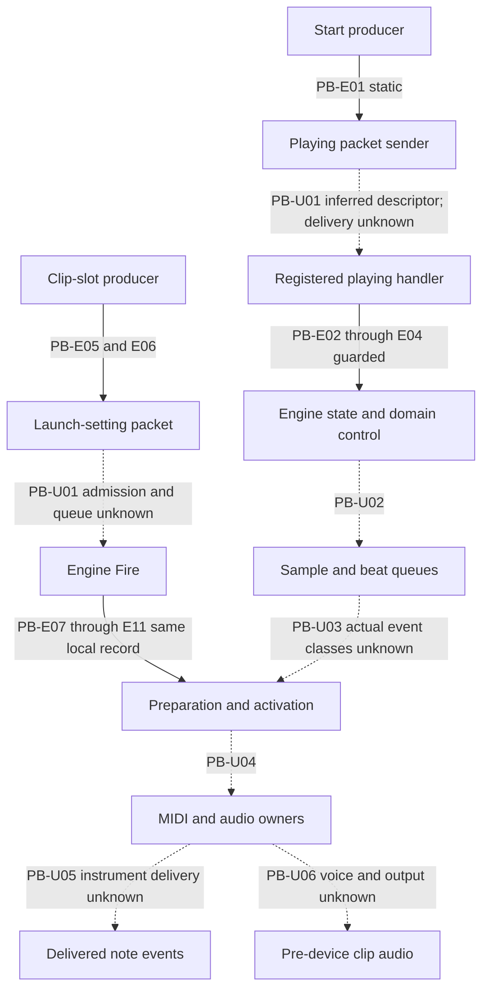

# Playback owner: bounded call-chain and route inventory

Authored 2026-10-20; **pending independent structure review**. Owner:
[SPEC-PLAYBACK-CORE revision 2](../../../../wiki/specs/playback-core.md), requirements
001–023. This packet changes no requirement, case, release, grade or expectation.
Its predecessor is the approved [integration manifest](../integration-structure-v1/manifest.json),
SHA-256 `7dddd59650ca3395d10e1b3c8aded3cda01d66b522dda4973a08f32e7bfb8f83`,
with [independent approval](../reviews/integration-structure-v1-review.json).
The [atlas I-03–I-06](../../../../wiki/research/program-structure.md#component-boundaries-state-and-ownership)
and [transport integration synthesis](../integration-structure-v1/transport-playback.md)
are the integration context. This is analyst evidence, not a clean implementation input.

## Inventory boundary

The [ledger](route-ledger.json) enumerates 243 stated semantic outcomes within
this pinned owner: 43 X-route, 69 S-route, and 131 no-established-route. These are
**route inventory counts, not outcome grades or a frozen whole-product denominator**.
The [authored decomposition](outcomes.tsv) has 251 clause formulations; eight
cross-references collapse into the more detailed outcome and are not counted twice.
Examples, numeric case instances, helper-only operations and shipped-corpus counts
do not add required outcomes. Source spans identify the complete requirement;
individual outcome wording identifies the split within it. Scope exclusions remain
those of the pinned owner. No claim of whole-playback or whole-product completeness follows.

An X-route means that the requirement states a bounded calculation and an existing
original-function harness route can compute it on supplied inputs. It does not
assert that every boundary vector was previously run. An S-route means a stated
static calculation or predicate, with its existing assumptions. No-established-route
means the stated observable has no established complete route under ADR 0003 and
this evidence scope. It is not global impossibility and does not remove the outcome.
The owner’s U parts remain U; route status does not replace its D/S/S-cond/X labels.

Clock anchors, beat-to-sample placement, clip-time folding, read-step and gain
computations are narrower observables than delivered notes or clip audio. A
function-local X result cannot establish public admission, active receiver identity,
instrument delivery or a clip-output sample. These joins remain explicit in every
applicable ledger row. [Case links](case-links.json) are requirement-level navigation
into the unchanged 68 draft case IDs and 92 released cases, not independent proof
that every split outcome is exercised or any application was run.

## Inherited source and search bounds

The component layer is packet1a’s lexical symbol clusters, constructor/vtable
address points and type-name strings, as qualified by packet1b. Baseline nonempty
indirect-reference sites remain 25,071 of 268,015, separate from 24 conditional
class-slot additions (combined inventory 25,095). This family packet adds zero
indirect resolutions. In particular the conditional OSend receiver/vptr/opaque-call
proof cannot be transferred to scheduler-event or player receivers.

No new traversal was performed. The inherited transport search prunes the top
1,000 destination hubs, exempts explicit seeds, accepts at most 200 edges and 80
new nodes per direction/level, and stops after three levels. It leaves 121 unknown
indirect-site associations in considered functions, 24 forward and 19 backward
terminal frontier nodes, and all hub-pruned rows. Those are local search units,
not exhaustive application or terminal-frontier inventories. There was no
forward/backward intersection in this finite neighborhood; that does not prove
separation. Call references, override references, tail branches and conditional
class-slot overlays retain their distinct provenance. The predecessor’s retained
process/timing limitations are not re-proved here.

[Source pins](source-pins.json) pin selected reused sources and the predecessor
manifest rather than copying a spec snapshot or replaying the predecessor universe.
[Source map](source-map.json) dereferences inherited T13 excerpt rows, code identities
and whole-C line spans by requirement. An absent excerpt is a locator limit, not
proof. [Component edges](component-edges.json) retain exact JSON pointers, native
call PCs, index byte/row hashes and matching C lines for the following local edges.
C lines are one-based lines inside retained code strings, not instruction PCs.

## Call-chain cut, state and owners

“Observed-static” below means a retained reference or C expression. Semantic owner
names are inferred from the qualified canonical/T13 matches. Diagram order is not
runtime order, thread order or measured audio flow.

| Boundary | State/data owner and exact local evidence | Remaining composition limit |
| --- | --- | --- |
| I-03 Start → packet | PB-E01: ARM `10276a7b0@10276a8e8 → 101a4abd8`. Boundary C record0 constructs descriptor `106f55ea8`, writes one word/three byte-like values, then virtual `+10`. | SetPlaying name/member/handler association is inferred from exact N3 rows28/31, not a direct producer-to-consumer call. Queue delivery/order and actual same engine remain unknown. |
| I-03 handler → state → domain | PB-E02–04: `101a524b8@101a524f8 → 101a4ac8c`; guarded call at `101a4ad70 → 101a4af58`; state receiver writes byte `+60` only on change and calls domain helper `101a54364` for enumerated results (boundary record2 C29). | Controller has unrecovered jump-table warnings/early callback returns. Domain to actual scheduler control is PB-U02, not a proved continuation. |
| I-04 slot → assembled request | PB-E05–06: `10245c72c@10245c7a8 → 102710290 → 102754ff0`; assembler’s complete retained C forwards local settings at C122. Descriptor `10700d040` association is inherited T13. | Public gesture/API admission and ARM engine handler-to-Fire join remain unknown. Recovered floating argument positions do not prove native ABI. |
| I-04 Fire → preparation → activation | PB-E07–11: `101af0cbc → 101b0dc14`; `101b0dc14@101b0dcdc → 101ad0130`, then guarded calls to `101ad15e8` with the same `auStack_140` (boundary record7 C44, C93/C107). Preparation calls grid/predelay helpers at PCs `101ad06cc`/`101ad08f0`, writes two doubles at byte `+20/+28` (record5 C623–624; its parameter is a uint pointer). | Same-local record connection is observed. B/E meanings are inherited T13 inference. Actual activation event receiver, active player and output binding are PB-U03/U04. |
| I-05 scheduler | `101ab5cec`, source record1 C69–109 and C114–172: list state at owner `+1d0/+1c0`, countdown calculations and entry virtual `+10` at C101/C172. | Beat/sample semantics are inherited. Event implementation classes, runtime dispatch and host callback/order remain unknown. No OSend class proof applies here. |
| I-06 MIDI | Builder `1028cf5c0`, source record10 complete C1–412, allocates eight-byte times and 28-byte records and writes kinds0/1/2. Consumer `101b48da8`, record4, selects records and calls helper `101b492e4` at two native PCs `101b490fc`/`101b49278` (PB-E13; C108/C183 not independently paired to PCs). | Local producer/consumer shapes are observations, not same active list/provider proof. Receiver, chase range, callback order and final instrument/event delivery remain PB-U05. |
| I-06 audio | PB-E14: parameter writer `1027cab44` calls interpolation chooser `1027bd748` at C27; controls/marker values are serialized. `10225b4e8`, source record5 C1–35, computes file-start position and calls `10224865c` on its other branch. | ARM StartFileSmpl is position calculation, not voice activation. The broader voice chain is a qualified x86_64 claim. Parameter message → voice → selected chunk/kernel → pre-device clip output is PB-U06. |
| Clip end versus repeat | PB-E12: `101adb0b8@101adb178 → 101ae7984`, source record3 C58; warped flag separates recurring beat scheduling from unwarped seconds-end scheduling. | Actual event instance/output remains unbound. This branch neither establishes Warp resampling nor an observable unwarped end sample. |
| Automation context only | Source record7 `1026f1e4c` C43–48 creates descriptor `106e522b0` and sends count/time/value arrays. | Exact ARM handler, active provider, timebase and parameter application are PB-U07. No new automation-owner requirement is counted in this playback ledger. |

## Preserved unknowns and batch boundaries

The ledger keeps each of these joins or unknown input dimensions explicit:
public controls/API admission; command delivery/order; absolute clock selection;
loaded insert-marker/Session state; actual scheduler events and player/provider
instances; MIDI delivery, overlap/chase/random capability/seed/group state and
panic callbacks; audio field publication, offsets, chunks, decoder formats,
padding, parameter updates and fades; pending-stop survival; restart samples;
and distinguishable unwarped clip end. The original A1–A5, request-sample boundary,
known arm64 FMA differences and x86_64/glibc limitations remain intact.

REQ-009/F6 has no independent activation observable for positive pre-delay;
PBC-023 same-beat relaunch stays ungraded. REQ-021/F7’s Fade-off silence cannot
distinguish a scheduled end from a still-active silent clip. PBC-061/064 stay
ungraded for end sample. Song-loop re-anchoring still permits one-sample differences
from placing later clip events independently. The map changes no tolerances.

[Batch inputs](batch-inputs.json) enumerate 703 historical input/result rows:
clock88, predelay16, clip-position234, MIDI builder12, audio278, stop/end38 and
dependency boundary37. These are **rows, not original call counts or outcomes**;
some rows cover several calls, and lists can overlap. Raw transcripts/driver hashes
are pinned; summaries do not substitute for full ABI, object bytes or stubs.
The negative-start vector in PBC-007 is separately enumerable without claiming
that exact vector was historically executed. Unknown active receiver/host states
remain unresolved enumeration. No execution is selected by this map. A future
batch must meet the current standing-harness scope; historical construction or
stubs do not confer blanket authorization.

## Author checks and review boundary

Run `python analysis/ableton-live-12.4.3/full-spec-v1/family-playback-routes-v1/author-check.py`
from the repository root. It checks selected source pins, exact retained locators,
JSON pointers, the clause/outcome cross-reference inventory and protected research
prefix, and records [author-check.json](author-check.json). It runs no original
function, driver, decoder, provider or harness. The check is mechanical; Root must
freeze and separately review the structure packet, update shared atlas/catalogs
and select any batch. No application, candidate or binary compatibility was tested.
