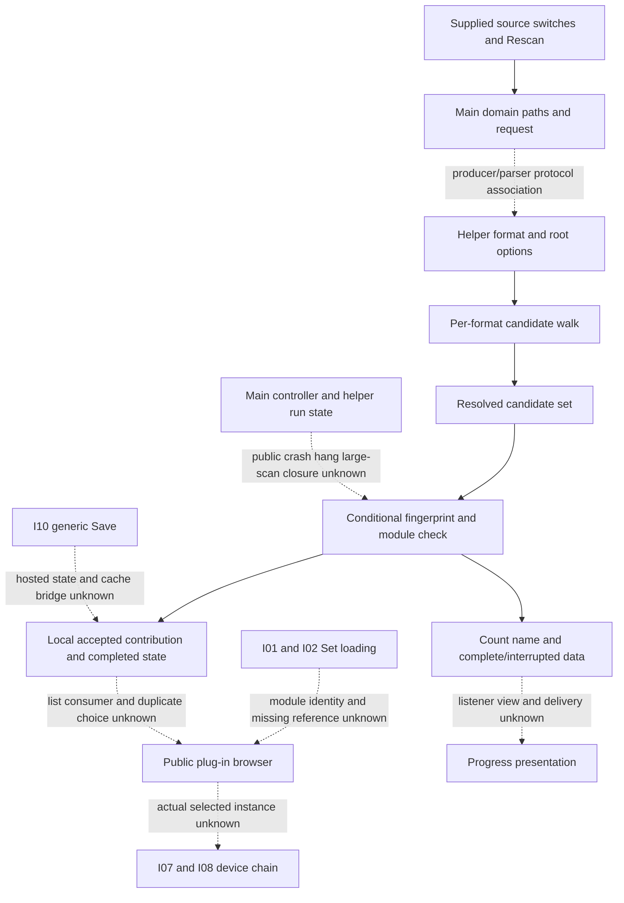

# Plug-in discovery family route cut

Author map, 2026-10-20; **pending independent structure review**. Selected by
amended plan4 item4, extending the existing integration map outside its first
scenario. [Current owner r2](../../../../wiki/specs/plugin-discovery.md) retains
16 requirements and 62 unexecuted case IDs; immutable
[plugin-discovery-v1](../../../../handoff/plugin-discovery-v1/README.md) releases
35 candidate-set cases for partial 001/002/004/005 only. No spec, case, release,
expectation, compatibility grade or implementation changes. Parent owns final
seal, atlas, independent review and shared routing.

## Integration extension and source domains

Approved integration manifest
`7dddd59650ca3395d10e1b3c8aded3cda01d66b522dda4973a08f32e7bfb8f83`
and component manifest
`392a738005f7d776dca96d7c78220cb94091081ef7086ec45b9397afccbe438b`
remain pinned predecessors. I-01/I-02 document loading does not identify an
installed module or specify missing-plug-in behavior. I-07/I-08 device-chain
construction/processor dispatch does not select or instantiate a scanner
contribution. I-10 generic save/reopen does not establish hosted plug-in state
or private discovery-cache persistence. These are explicit extension gaps.
This is not a disconnected fresh graph, nor a bridge inferred from the word
"plug-in" or a shared path/format label.

Main Live arm64 image:
`3a99ceeabce62ccd069b6b55d99d186c9bdf8a6b80a7e3350dd0f9d1c383cfad`.
Scanner arm64 image:
`6ce847b0f56d842d638ca638546636ecdba66f5942fa668f4d2d3403f2a97ad6`.
The source domains are separate even where numerical addresses overlap.
Historical x86_64 comparison was strings/options only; it does not establish
ABI, loading, numerical or arm64 behavioral equivalence. macOS Security,
CFBundle and path-service premises are not Windows or other-platform proof.
Main resolved-indirect inventory stays **25,071/268,015**, with zero new credit.

[chain-edges.json](chain-edges.json) has fourteen qualified relationships and
nine unknown bridges. Source expression arrows are not native call PCs,
invocation/delivery, transaction order, actual process startup or sound. Old
helper class-slot associations require the correct valid receiver/vptr and
processor/context; they add no resolved site to the main-image inventory.

## Retained evidence and its limits

[pins.json](pins.json) binds 67 selected files and the preserved research
prefix. [source-map.json](source-map.json) locates 44 retained C files (32
scanner H1, twelve main Live N4), with original H1 chunk/state/hash data;
21 exact C expressions; 28 owner/research/review spans; six historical helper
table pointers; and fourteen explicitly unretained source pointers. No source
or specification snapshot is copied. H1 warnings, exception-handler omissions,
RTTI/gmock role inference and missing method/ABI proof continue to apply.
The database-open function `1005a30f8` failed to decompile; no body, version,
journal or catch behavior is reconstructed from its name.

Historical reviewer RVP-06 confirmed readable-listing/permission handling and
unchanged path/case for the released description domain (I3/I4/I5); the two
accepted assumptions remain I1 VST2 system path-service locations and I2 the
abstract independent switches. Exact displayed labels/defaults are unknown.
Resolver, lister, leading-period extension, Unicode lowercase and several Live
path/listener helpers were read historically but their full C bodies are not
retained here. [Source pointers](source-map.json) preserve chunk/hash prefixes
and the earlier review text; nothing is fetched to fill those gaps.

The VST3 match uses the reached resolved name, exactly/case-sensitively, for
files and directories. Candidate directories are not searched inside. Iterator
option5, symlink traversal and unreadable subfolder semantics remain unknown;
the old Boost-version suggestion is a lead, not adopted semantics. VST2 ignores
plain files, uses directory suffix case folding, and includes hidden entries
apart from dot/dotdot. The leading-period extension branch remains unknown for
both formats. Root-local canonical dedup is not duplicate public plug-in choice.

Released candidate comparison is independent of successful module loading,
reported entries, public listing, instance selection and audio. Directory
examination could be observed through a separately designed load-recording
plug-in; no such plug-in is supplied, built or loaded here. RVP-04 leaves
plain-file candidacy statically specified with no established reference load-log
channel. Absence from the public browser is not a candidate-set observation.
The release excludes links, leading-period names, case beyond ASCII, more than
50 candidates and the other stated domain exceptions. Broader r2 clauses are
not retroactively released.

Conditional VST3 class/Instrument token metadata and VST2 signature/entry/host
callback results remain local scanner source routes. A format/architecture enum
or `--au` option label does not establish AU discovery. The lack of a CLAP
option/string is not proof of every product path's absence. Supplied host
callback source values are not a required independent application architecture,
and no fake host identity or original module execution occurs.

## Route inventory and lifecycle qualifications

[route-ledger.json](route-ledger.json) inventories **84** bounded observable/
context partitions: **53 conditional/documentary S**, **31 no-established-route**,
**0 X**. All sixteen requirement IDs are addressed, including source selection,
enumeration, contribution, persistence/change detection, Rescan, progress,
crash/hang/scale/duplicates and quit. No ratio, complete family/profile or
whole-product outcome denominator is established. Every row's new expectation
and actual are null and its grade remains unchanged.

**All rows of the four U-only requirements 012–015 remain no-established-route.**
The following are auxiliary source explanations, not requirements or new grades:

- The crash-state sweep runs once per format pass, filtered by processor rather
  than format. It moves at most one matching row with `LIMIT 1` and no order;
  modules with plug-in rows have different eligibility. Thus the old
  session-by-session shorthand is conditional and cannot establish retry counts,
  safe disable, remaining-module completion or public recovery.
- The local stop condition is limit < confirmed count; default 50 yields a local
  boundary of 51 new confirmed modules per format. This does not prove all modules
  become listed, cross-session format order or automatic completion.
- Old controller source has relaunch branches and no restart counter in that
  path, and clears reset before relaunch. It does not establish a bounded crash
  policy, an interrupted two-format reset's eventual effect, or large-scan closure.
- A before-next-candidate liveness/orphan check cannot interrupt a currently
  blocked module. Watchdog constants do not establish a per-module deadline or a
  measured delay after quit. No indefinite-stall result is invented from absence
  of a found timeout.

Fingerprint size/whole-second mtime and completed cache state have conditional
static routes. Same-size same-second edits remain U despite a non-detection
prediction. A searched-but-empty root is distinct from a disabled/unsearched
source. Private table/scan-state names do not establish browser listing,
duplicate selection, transaction durability or a required cache schema.
Progress fields and a parsed completion result are separate from visible UI.
Quit completion-state reuse retains the current module/scan-state premises;
the actual in-progress module and cessation time remain unmeasured.

[input-sets.json](input-sets.json) keeps the 62 draft IDs, 35 released objects
and 35 scenario-description inputs as different units. Historical SDK/probe
proposals, helper/table/numeric values and function counts do not pad outcomes.
Own restatements, model/comparator/build scripts and original functions are not
imported or run. No existing scanner-object/ABI/filesystem/Security/module-call
harness input model is established, so no X batch is selected.

[check.py](check.py) performs stdlib data-only integrity and discriminating
negative controls; [author-check.json](author-check.json) records the result.
No provider/native/binary read, decoder, harness, module loading, model,
comparator, build or fixture execution occurs. Source route inventory is not
behavioral validation, public application success or whole-product closure.
