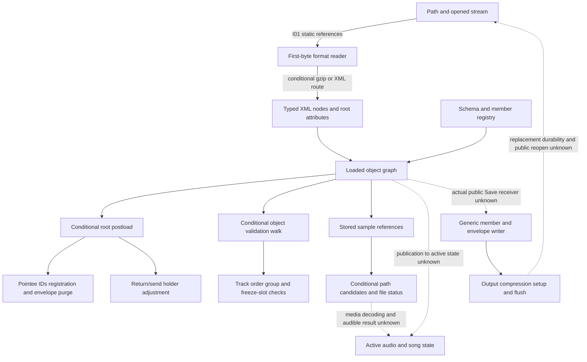

# Live Set structure and ALS container routes

Author map, 2026-10-20. **Pending independent structure review.** This is one
combined cut of integration boundaries I-01, I-02 and I-10. It selects no
execution and changes no requirement, case, released byte, expectation or grade.
Root owns the seal, atlas, shared routing and independent review.

The pinned owners are [Live Set structure revision 2](../../../../wiki/specs/live-set-structure.md)
(18 IDs) and [ALS container revision 2](../../../../wiki/specs/als-container.md)
(nine IDs). The second owner's canonical native research is
[document-container-native.md](../../../../wiki/research/document-container-native.md),
not a separate `als-container` research page. [pins.json](pins.json) records exact
as-of owner, research and partial-release identities without copying their
specifications or fixtures. Mutable wiki hashes are reading context, not future
live-file gates. Only the two dated pending-review research pointers are added;
their complete prior bytes remain prefixes.

## Integration cut

The predecessor is the approved [integration manifest](../integration-structure-v1/manifest.json),
SHA256 `7dddd59650ca3395d10e1b3c8aded3cda01d66b522dda4973a08f32e7bfb8f83`.
The [atlas](../../../../wiki/research/program-structure.md#component-boundaries-state-and-ownership)
places document entry/parser in I-01, loaded root/validation in I-02, and generic
save/reopen in I-10. [chain-edges.json](chain-edges.json) contains 24 qualified
relationships, including the eight exact DOC call-index edges, and six unknown
bridges. [evidence-locators.json](evidence-locators.json) supplies their byte,
line, hash and JSON pointers. The supplementary T11/N2 relationships are carried
source associations, not newly traversed or independently rederived native edges.

Static drawing order is not a runtime sequence. The important state boundaries
are as follows:

- `1002e6e00 → 1018536d4 → 10148389c → 101484108 → 101486fe4`
  carries a compatible file/stream to the generic document reader. Type-branch,
  stream validity, object receiver and normal-call premises remain mandatory.
  Recognizing a plain XML envelope is not proof that the public File Open command
  admits that path or that the Set opens.
- The root handler `1015299e0` reads MajorVersion and SchemaChangeCount through
  `10152a900 / 10152ab04` before document version checks at `101529024`.
  Literal resource lookup `101514c6c → 101514954` differs from newer-family and
  suffix classification. The later RVA review supports the handler catch (I1)
  and integer converter (I3). I2, I4, I5 and I6 qualifications remain; arbitrary
  path-like MinorVersion text is not automatically refused by a name grammar.
- T11's read context `101478258 → 10151e0d8` enables conditional postload before
  validation. A compatible root's virtual `+d0` is associated with
  `102695f70 → 102695f78`; validation walks through `101487198` and virtual
  `+100`. These associations require actual class/addresspoint, registry and
  context matches. Offsets alone do not identify an object or active engine.
- The postload path carries registered pointee IDs and the counter to
  `1015441a8 / 10154368c`, and conditionally to repair `102686a3c`. Registration
  and envelope purge differ from list-item IDs. Accepted duplicate repair,
  displayed question, declined repair and references outside tracks are distinct
  contexts. `10271d824 → 102659a78 → 102658f54` adjusts send holders; the trailing
  return count is not an arbitrary malformed document's total return count.
- The validation path associates `1026969d8 → 102687a7c` with player/return order
  and grouping. `1025cb248` compares session/freeze list sizes through chain
  fields `+1f8/+200` and `10265d5e0`. This does not establish a scene-count rule,
  compatible clip-kind admission, or an active playback graph.
- `102877af8 → 10279aba8 → 10279aae0 → 1014e8504` carries stored sample metadata
  and reader context to candidate resolution. The retained fallback is narrowed
  to codes 0/1. Codes 2–7 still lack complete relocation/search and graded
  end-to-end binding. File size/CRC fields do not prove how identity chooses a
  file, and a missing clip being kept does not define its audible output.
- `1014e98cc → 101279eac → 1011b6e88` reaches the ARM CRC leaf; the matched x86
  leaf `101191310` has eight retained inputs. This establishes a finite checksum
  computation, not file access, decoding, application attachment or source choice.
- `101485c50 → 101485240` and the latter's `1014338b0 / 1014339e4` setup/flush
  calls establish conditional generic writing. Member order/flags, held IDs and
  sample-reference update `10279a590 → 10279a744` remain under A7's public Save
  join. Flush is not file replacement or durability. Reopening meaning is the
  existing contract; no save/reopen experiment was performed for this map.

## Bounded observable inventory

[route-ledger.json](route-ledger.json) has **196 local predicate/context rows**:
129 S, one X and 66 without an established complete route in selected evidence.
All 27 requirement bodies have exact spans in [source-spans.json](source-spans.json).
The inventory includes explicitly unresolved questions in those bodies, with
their unknown or delegated contexts retained. It is not a frozen count of
required family/product outcomes. Clause IDs, case rows, helper steps, shipped
sample counts and each numerical input instance are not separate outcomes.
Identical predicates shared by clauses/owners use multiple source references in
one row. For example, list-item spaces, integer admission and the public save
container/layout boundaries are cross-referenced rather than recounted.

S includes shipped representation (D) and conditional static inference; it does
not upgrade them to original application observations. The sole counted X row
is the required CRC computation. The existing X2 integer parser's 72 texts are
an auxiliary dependency of root/list admission, not 72 more outcomes or a second
required X result. Older owner U labels, including combined whitespace cases,
remain unchanged. All new expected/actual fields are null, with no new grades.

The 33-row R/V/O/W minimal-document table is a
[source crosswalk](minimal-status-crosswalk.json), not 33 extra outcomes. It
points to the appropriate predicates or other existing owners. W and unknown
absence status do not authorize invented defaults or refusals. Field placement
does not adopt its playback, transport, mixer, note or automation behavior here.

[input-sets.json](input-sets.json) retains all 34 released Live Set and 35 ALS
case objects by identity and pointer, eight CRC run inputs, the integer-parser
dependency, and bounded prospective absence/order/sample/envelope/save contexts.
The case references on a route row identify relevant existing fixtures, not an
assertion that every setup field is an action or that every predicate is already
judged by that case. The complete case input sets preserve unassigned controls
such as NextPointeeId 100000. No old capture/author/validator was replayed and no
fixture universe was decoded or executed.

The reviewed Live Set release is device-free: 66 pointees and NextPointeeId 67.
Historical T11 outputs with devices and 68/69 counts remain historical. Its 34
cases contain 18 refusals, nine positives, three repairs, three missing-element
contexts and one computed sample identity. These are static/documentary expected
outcomes, not new reference runs. The three repair cases append sends or remove
dangling envelopes; they do not prove public duplicate-pointee repair delivery.
Device placement and clauses 011/012/017 save scope remain unreleased.

ALS's 35 cases judge only bounded envelope recognition. The five unspecified
refusal-class cases still require **refused**, not unknown acceptance. Clauses
007–009 remain outside that release. Current shipped names and historical
Creator/version values do not establish the active writer's current resource
selection or a universal older-version migration route.

## Remaining bridges and verification scope

The explicit missing joins concern public command/OS entry, loaded-to-active
state publication, owner-specific list class/reader flags, media decoding and
resolution, actual public Save/lifecycle, and public error/repair recovery. A1–A3
remain qualified static conclusions; A4–A7 remain conditional. Unknown indirect
calls and pruned/hub/frontier omissions in integration 1b are not dead ends. Its
three-wave, per-direction/per-level 80-node/200-edge limits and top-1000 incoming
hub policy remain inherited search limits, with 168 unknown associations. There
is no new indirect-resolution credit or graph traversal here.

Fresh reading covered the complete current normative bodies, canonical research,
69 current case objects, both release reviews and the four retained T11 trace
walkthroughs. Original function bodies, instruction/table/exception data and the
full predecessor execution proofs are carried through pinned providers; they
were not rerun or freshly rederived. ALS's deep unwind review-check trace is
selected context rather than a claimed fresh whole unwind reconstruction.

The owned `python3 -B check.py --check` reads JSON/text and hashes only. It checks
source spans, pointers, case identities, crosswalk links, route/count invariants,
null grading, immutable pins and the two exact-prefix canonical additions. Its
negative fixtures check specific association/qualification errors, not complete
semantic truth. `--write` is refused before reads. Author readback and provider/
packet watches are recorded separately in `author-check.json`. Independent review
and a separately selected batch are still required.
