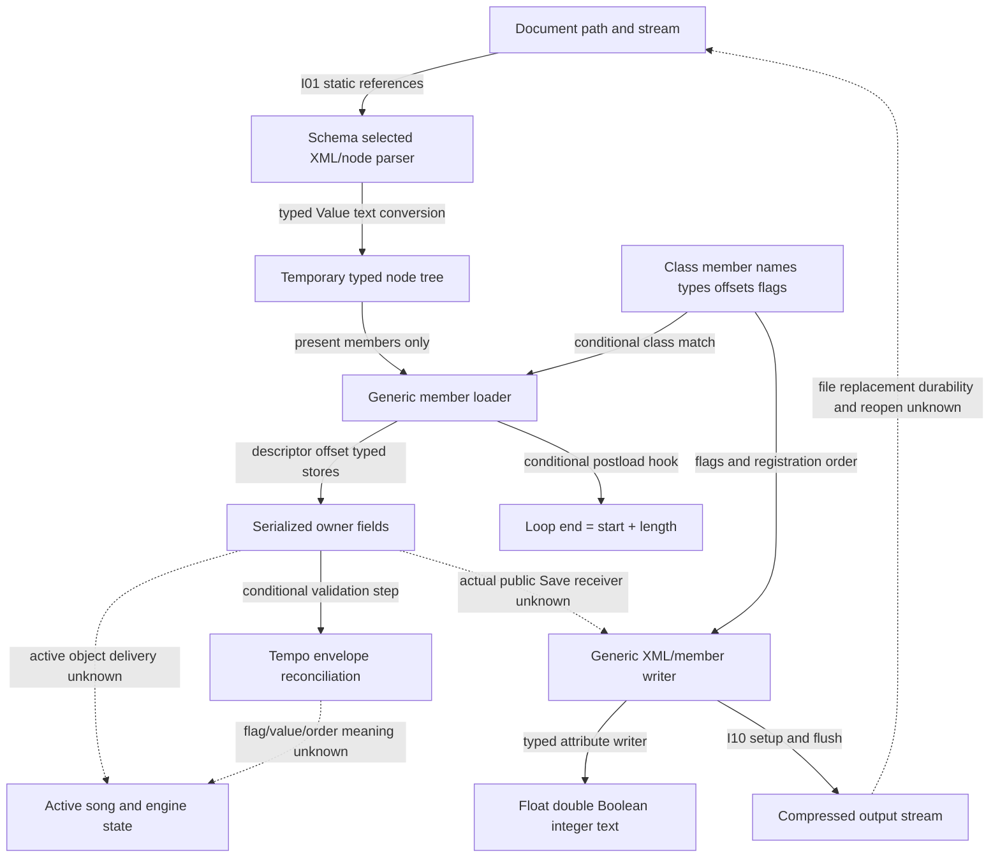

# Transport-state persistence and number-text routes

Author map, 2026-10-20. **Pending independent structure review.** This packet cuts
one family from approved integration packet 1b; it adopts no requirement, case,
expectation or grade. Root owns the combined atlas/catalog/seal/review and any
later batch selection. No original execution is selected by this map.

The owner is [SPEC-TRANSPORT-STATE revision 5](../../../../wiki/specs/transport-state.md):
12 IDs, six serialized fields and their read/write text. Transport start/stop,
quantized scheduling, playback, UI edits, MIDI/API control and synchronization
are separate owners. The word “Transport” in this packet does not join the
persistent fields to an engine transport state.

## Integration cut and evidence authority

The approved [integration manifest](../integration-structure-v1/manifest.json),
SHA256 `7dddd59650ca3395d10e1b3c8aded3cda01d66b522dda4973a08f32e7bfb8f83`,
is the predecessor. [Atlas revision 10](../../../../wiki/research/program-structure.md#component-boundaries-state-and-ownership)
boundaries I-01 (document entry/parser), I-02 (loaded root/validation) and I-10
(generic save/reopen boundary) supply the context. I-03 through I-06 establish
other transport/playback relationships; they supply no evidence that a stored
loop/tempo value became the active scheduler state.

[Exact provider pins](pins.json) retain N1/S1/X1/X2 and current partial
transport-state-v3 identities without copying specs. Wiki hashes are an as-of
reading context, never a future mutable-file gate. The native research page's
only authorized change is its additive pending-review pointer; its original
31,590 bytes remain an exact prefix. The canonical requirements and all released
bytes remain unchanged.

The family makes no new graph traversal or indirect-resolution claim. Packet 1b's
three bounded document waves retained 168 unknown indirect-site associations,
with hub and node omissions. Its per-direction/per-level 200 edge/80 node budgets
and top 1,000 incoming-row hub pruning remain historical search limits, not a
proof that an omitted/unknown path does not exist. The packet 1a combined
25,095/268,015 site inventory is carried, with no new resolution credit.

## Call-chain map and ownership

[chain-edges.json](chain-edges.json) keeps 19 source-qualified relationships,
including eight exact DOC call-index edges from 1b, and five explicit missing
bridges. Each edge retains a source or JSON pointer locator. An observed-static
edge means the expression/reference is present; a semantic interpretation or
class/table join is separately qualified. Drawing order is not runtime order.

The reusable local joins are:

- I-01 carries `1002e6e00 → 1018536d4 → 10148389c → 101484108 →
  101486fe4`, conditional on file-type branch, valid streams and compatible
  application/object receivers. These are observed static references; they do
  not run a load or prove a file-type predicate's user meaning.
- N1's schema-selected parser chain `1015299e0 / 10152adb0 / 10152b77c →
  10152bfb8` converts decoded attribute text to temporary node values. The
  [reader walkthrough](../../../../wiki/research/learning/walkthroughs/transport-state-reader.md#step-2-where-the-converted-value-goes)
  distinguishes those nodes from transport objects. X2 supplies the matched
  x86 converter `10151b630`, not an application open.
- The freshly read existing N1 loader `101487310` walks present nodes. Matching
  descriptors choose Boolean/int32/float32/double64 stores at descriptor offsets;
  it does not call the range setter on that store. Compound recursion uses
  virtual `+140`, and a context predicate gates postload `+d0`. Retained table
  associations identify the generic loader for selected ATransport/ALoopOn/
  ALoopStart/SongTempo classes, conditional on the actual instance/addresspoint.
  No class-name similarity establishes an active receiver.
- For compatible ATransport, postload `10276c6f4` reads the two field handles,
  adds their values and forwards the sum to `1015652f0`. LoopEnd naming is the
  inherited N1 association. This is a local sum, with no new beat-unit,
  scheduling or later-clamp law.
- I-02's root load reaches validation `101487198`. The retained v3 review adds
  the conditional timeable step `1026fc558`, comparison `102777640` and
  setter `10156e6ec`. Envelope/enable/ownerflag/difference predicates are mandatory;
  the flag's meaning and chosen envelope value remain unknown. With no envelope,
  this step leaves Manual alone. There is no unconditional first-event or scene
  precedence rule.
- I-10's `101485c50 → 101485240` is a generic format/XML writer route, not a
  known public Set Save action. Existing member writer `101486cdc` chooses
  attributes through `10152205c`, child writing through virtual `+138`, and base
  writing through `101521750`; descriptor flags, suppression predicates and
  registry order control selection. The retained registry check reports
  80 registrations/33 persistent/schema order equality. Actual song receiver,
  replacement/durability and successful reopened state remain unjoined.
- Float/double attribute text uses matched arm64 writers `101520c70/101520dbc`
  and formatters `101431584/101431788`; X2 counterparts are
  `10150f6a0/10150f7a0` and `10142b6c0/10142b980`. This source matching and the
  prior static comparisons are carried, not freshly re-proved from opcodes.
  Meter encoder/decoder/list likewise has an existing self-contained X route;
  loaded-code delivery to a display or active meter is unknown.

## Required-observable route inventory

[route-ledger.json](route-ledger.json) has 108 local predicate/context rows:
30 X, 44 S and 34 with no established route in the selected evidence. The table uses
one primary requirement per row; the shared loaded-out-of-range-meter predicate
also cites 010, without being counted again.

| Primary requirement | X | S | No established route |
| --- | ---: | ---: | ---: |
| 001 | 0 | 7 | 2 |
| 002 | 0 | 3 | 4 |
| 003 | 2 | 1 | 0 |
| 004 | 9 | 1 | 2 |
| 005 | 5 | 1 | 0 |
| 006 | 1 | 5 | 0 |
| 007 | 0 | 10 | 2 |
| 008 | 0 | 6 | 3 |
| 009 | 0 | 6 | 15 |
| 010 | 6 | 0 | 1 |
| 011 | 7 | 2 | 1 |
| 012 | 0 | 2 | 4 |

Rows split distinct load/save, absence, admission and effective/display/next-save
predicates. Numeric samples, grammar input instances, helper computations,
constructor details and case IDs are not additional required outcomes. The
inventory's 108 is not a frozen whole-product denominator, completion fraction or
grade. All 12 requirements have exact byte/line/hash source spans, but source-span
coverage does not establish behavioral coverage. Every new map actual/expected
field remains null; its grade is unchanged/U.

For X rows the self-contained leaf computes the stated value/text/code predicate;
its surrounding document path, selection and store/save lift remain S. Refusal
rows use S for the document outcome and cite an X leaf dependency where present:
X2 stopped at exceptionallocation, not a completed throw/catch/open/recovery.
No error-dialog or previous-set-state expectation is supplied. Existing labels
are preserved instead of upgrading a full application case from a leaf result.

The six location predicates remain separate from unit interpretation. Five
missing-child/attribute default families have ten explicit contexts, conditional
on fresh owner construction. Time-signature absence and user-template override
stay unknown. The five numeric range-admission predicates are separate from
15 effective/display/next-save predicates, all unknown. Direct stores and a local
postload sum cannot supply those later results.

## Enumerable inputs and batch limits

[input-sets.json](input-sets.json) points to exact retained arrays and per-process
call history; it duplicates no audio, specs or old scripts. [evidence-locators.json](evidence-locators.json)
contains the byte/line or JSON pointer bindings plus 13 matched X2 function dependencies.
Those dependencies are not another required-outcome count.

- X2 parse inputs: 13 Boolean, 67 double, 66 float and 72 integer records. Integer
  from_chars executes original code; floating grammar/signzero uses substituted
  glibc strtod in C locale. XML attribute decoding is upstream: literal tabs and
  line breaks normalize to spaces; character references can deliver those bytes.
- X2 writer inputs: 6,539 sweep records, 16 special and 16 case-value records. Select
  the relevant width/category for a predicate; do not count each sample as a
  required outcome. The recorded raw history has 412 process records with exact
  argv/debugger scripts/results, bound to its immutable copied loader/setup.
- Meter encoder retains 510 legal-pair rows but 495 distinct legal pairs; repeats
  are not extra outcomes. Decoder legalset is 495 codes, and the list has 495 texts.
  Invalid-denominator and n<1 subsets are explicit; above 99 numerators are
  countercontext and must not be falsely classified as always rejected.
- Static document contexts include the ten stated absence mutations, seven
  bounded range discriminators and separate envelope/scene branches. They are
  prospective input navigation, not selected calls or newly graded cases.
  KeyMidi mapping state, arbitrary envelope value/owner flag setup, template order,
  actual versioned mode/current SchemaChangeCount and Apple library decisions
  still lack an enumerable public target setup.

No batch is selected here. Before a later X batch, the reviewer/coordinator must
bind the exact available harness/source/stubs/slice, preserve each call's input
and result, and stay in ADR 0003's authorized model. The old X2 copied loader is
not the current default by assumption. Library-substituted and trap-stopped
results remain narrower than full original call or application success.

## Accuracy, history and explicit unknowns

REQ-011's A-LOG assumption remains: outside the undecided 1/4–3/4 binary64 spacing
band, the target logarithm's last bit must meet the stated <3/4 spacing bound where
it selects precision. The glibc sweep differs from correctly-rounded-L text at
11 of 6,539 inputs; Apple's log10 was not run. Negative-zero parsing/save sign,
fixed-decimal formatting/ties and C-locale grammar retain their library-dependent
qualifiers. No released case lies on a decimal tie. No threshold, platform
uncertainty bound or inferred rounding law is broadened by this map.

Shipped Creator 12.4d1/12.1d1 documents and their schema/version distributions are
read-only historical evidence, not 12.4.3 save observations. Generic reader flags
and on-disk schemaChangeCount do not prove the current in-memory selection.
Current partial release v3 preserves 33 case objects with repaired one-MIDI-track
fixtures; v1/v2 fixtures remain defective/immutable and must judge no case.
Canonical TS-017–019 are unreleased U, and TS-023 is withdrawn. The owner’s 36 nonwithdrawn
canonical rows and 12 IDs are not the required-outcome denominator.

The five remaining integration bridges in [chain-edges.json](chain-edges.json)
separate active object publication, actual public Save receiver/file lifecycle,
malformed error recovery, later range effects and general precedence. None is
claimed impossible under ADR 0003. Unknown indirects are not dead ends. No new
binary window/data word, graph traversal, callee expansion, original call,
model/comparator run, provider, harness, compiler or decoder was selected here.
Only retained text/JSON/source identities and owned structural checks were used.
The four existing complete C bodies freshly read were loader, member writer,
ATransport postload and tempo initializer; all other semantics explicitly carry
identified prior evidence. This is an author proposal pending independent review.
