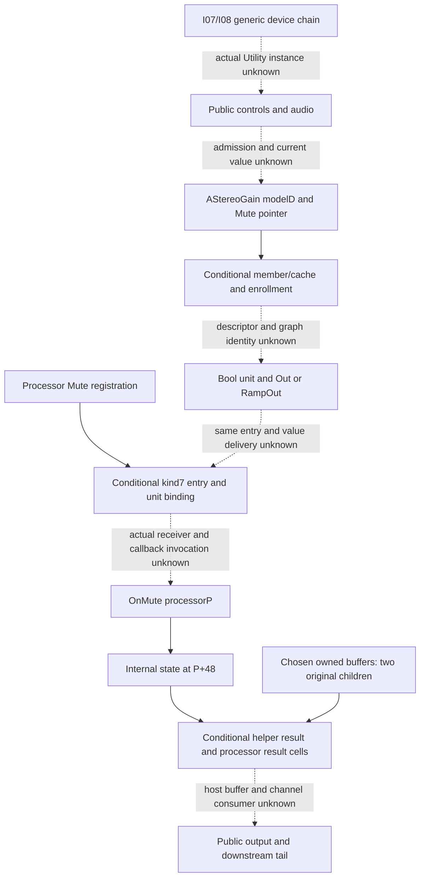

# Utility family: public controls, processor state and output boundaries

Analyst author map, 2026-10-20. **Pending independent structure review and Root
seal.** [SPEC-DEVICE-UTILITY revision2](../../../../wiki/specs/device-utility.md)
is the unchanged behavioral owner. It has fifteen requirement IDs and41case
objects:38application outcomes U and three historical retained-file checks.
These are navigation units, not the outcome denominator. No Utility handoff,
new criterion, case, grade or complete profile is created. Tuner and Spectrum
remain outside this family cut. [pins.json](pins.json) retains predecessor
manifests and selected providers rather than copying the specification or cases.

## Integration extension and state ownership

Approved integration1b manifest
`7dddd59650ca3395d10e1b3c8aded3cda01d66b522dda4973a08f32e7bfb8f83`
and component1a manifest
`392a738005f7d776dca96d7c78220cb94091081ef7086ec45b9397afccbe438b`
supply the I07/I08 generic device/track connection context. The approved mix
family cut preserves unit-local builder102731438 input fields+168/+170 into
TrackOut+428 (MIX-E06, C1482–1489 and1898–1903), then local output/routing/send
ports. Those arguments do not identify an actual Utility device, source buffer,
processor instance, callback cadence or host output. The generic virtual
connection helper chain is not proof of this device's active path. Component
symbols, RTTI and conditional class-slot associations are inventory; none is
silently joined to an actual Utility receiver. No new traversal or resolution
was performed. Unresolved indirect edges are unknown, not dead ends.

[chain-edges.json](chain-edges.json) retains twelve qualified evidence edges
and six missing bridges, with [exact provider pointers](evidence-locators.json).
The useful split is modelD / graphG / UnitU / entryE / processorP orM / helper
stateS / owned buffers. Similar names and offsets do not establish object
identity, valid lifetime, actual invocation or execution order.

Observed-static means retained source or decoded-data association, with the
original recovery warnings and path premises; it is not a run. Inference is
separate. Existing X means actual finite original call-return observations,
with the supplied owned state, loader/stubs and limitations. Public behavior
and complete route remain distinct from both.

The carried concrete local edges are:

- ARM model constructor102f50558 initializes a wrapper atD+350 and separately
  loads its pointer atD+358 for the literal Mute. Declaration102f4fb10 labels
  offset350 mpMute. These are private construction/declaration associations,
  not a public gesture or current value. The model-routing claims MR01–03 give
  exact code spans and raw source row locators.
- MR04–08 retain conditional bool metadata/factory and graph linking. Earlier
  float/enum comparisons must fail before the bool branch. The model's
  virtual+328 is a role flag used to select Out/RampOut, not the current public
  Mute float. Getter-like local access, source table words and names do not
  supply current member admission, source-to-unit value delivery or the actual
  processor receiver. OutText storage is not a proved runtime name/value.
- MR10–12 retain observer and SAddToParameterUnit enrollment into member/cache
  construction. Actual Mute traversal, eligibility, descriptor/cache identity,
  initialized typeword and callback association remain premises. The stopped
  generic type/name/buffer branch is not proof of no route or runtime zero.
- The independently retained registration10215eafc supplies little-endian Mute
  and callback storage1065411a0; its retained word gives10216533c. Registration
  plus builder/kind7 source narrows E+100=kind7, unitU+18 bindingE, U+4c byte3,
  U+50 graphG andU+58 entryE. Kind7, bind argument3 and U+64(decimal100) are
  distinct. Graph-local pointer append does not prove later processing or
  E+110 callback invocation. Prior vptr assumptions apply at EACH read;
  preservation across intervening calls cannot be assumed.
- ARM callback10216533c saves predicateF!=0 atP+161 and tests selectorP+162.
  Its nonlegacy operand isS=P+48 and setter1047bd760 writes S+cf. The reviewed
  CalcMain1021658b0 machine layout supplies two32-bit inputs through adjacent
  stack words, calls1047bd790(M+48, pair), then stores S0/S1 atM+40/+44.
  SameP=M, actual callback input, normal return/callee-save, valid pointers,
  reached paths and no interference remain explicit. The helper's bit0-set
  prefix/RET path yields conditional local zero stores, not public silence.
  Prefix32+return4 leave708metadata bytes unread; the724skipped bytes include
  sixteen already-read prefix bytes. No additional bytes were read here.
- X86 OnMute10224e760 has a conditional path to setter104b8c760 withP+48;
  thirteen selected setter bytes store SIL atRDI+cf. CalcMain10224ef20 supplies
  receiver+48 and an input pair to104b8c7b0, then stores low64XMM0 atreceiver+40.
  X86 helper tests the full byte!=0; ARM tests bit0. Cross-slice/public
  equivalence, incoming register state and general FP behavior are not inferred.
- The reviewed904-byte x86 physical span and separate16-byte table retain
  local mode/index/update expressions. Index0..3 and signed table offsets
  are private branch data, not a public ChannelMode enumeration or entire CFG.
  Only the exact owned-state histories below were executed. Their state fields
  do not establish general width, gain, balance, phase, Mono, DC or Bass laws.

The pre-steering named x86 processor-create capture is held as nomination only:
fixed240bytes,16rows occupying47bytes,193opaque; calls at1022313d8→101ad08a0
and1022313e3→102231400. Its Root readback checks retained data identities;
independent actual-result approval is pending. Neither callee is selected or
read by this map. A raw name/table/address does not prove a creation contract,
function extent, callback ABI or current object.

## Required observable inventory

[route-ledger.json](route-ledger.json) enumerates48bounded normative
predicate/context rows: **0 X,2 S,46 no-established-route**. This is strict
route inventory for the current owner, not a grade numerator, whole-family
closure or frozen whole-product denominator. Existing local X/S dependencies
are retained on the missing-public-route rows; their results are not erased.
No required public predicate gains a complete X route solely from a helper
calculation on analyst-owned state. The two S rows are retained-file-only.
Current-manual D12 stays documentary; the source says Version12, captured
2026-10-19, with no exact12.4.3 publication pin. It is not an S-native or X
application assertion. Figures were not inspected.

The15requirements are covered as follows:

- Input/output at a chosen chain position; independent phase UI/actions; Left
  selection; Width mono/widening and disabled UI versus disabled signal effect;
  Mid/Side menu, continuum context and distinct endpoint/relative-phase facets.
- Mono; low-frequency Bass Mono and cutoff membership; Audition exclusion;
  Gain level/domain and arrow-edit relations; Balance; direct Mute and
  independent downstream effect-output ownership; DC filtering and its necessary
  low/DC-plus-downstream-nonlinearity condition.
- Retained schema-vocabulary and ten-preset saved-value predicates; malformed/range/text/edit
  cancellation; undo/redo; Set/preset persistence and hot-swap; automation and
  override/re-enable; deletion/Undo, engine suspension and audio-device failure;
  sample-rate/block transitions, timed edits, combined-control order and legacy
  migration. No invented recovery or identity behavior supplies these U rows.

Shared Width/MidSide disablement is counted once and cross-references both
requirements004/005. Numeric case examples and public continuum probes share
one predicate instead of inflating the inventory per sampled value. The
contract's unclaimed coefficient/matrix/smoothing/normalization domains and
unpartitioned continuous histories are explicit enumeration gaps, not a new
list of helper outcomes. Exact source spans include immutable R2 clause
byte/line/hash locators and their actual contract JSON pointers.

## Existing finite inputs and what they establish

[input-sets.json](input-sets.json) indexes all41unchanged Utility case objects
by actual catalog JSON pointer and object hash, without duplicating them. It
retains their26D12/3Dpkg/12U source labels,38application-U standing, finite
parameter/signal/navigation sets and admitted-history prerequisites. Proposed
signals are input definitions, never detector/output truth. The three file
checks refer to historicalCreator12.4d1 files shipped in12.4.3; schema and ten
stored presets give vocabulary and saved examples, not constructor defaults,
valid malformed domains, live control state or file-load behavior. No old
package decode, validator or grade was replayed.

The four R2 compound histories are not broadened: both Width AND Mid/Side must
be productively operated before EACH Left/Right no-function branch; MidSide
interiors must actually be admitted; independently sustained NONZERO reverb
and delay tails precede Mute; known low/DC plus genuinely productive nonlinear
processing AFTER Utility is necessary, not sufficient, for the stated sonic
condition. UI-only menu/control membership does not require audio/hardware.
An enabled flag, arbitrary nominal signal or silent tail is not positive
baseline proof. No tails' waveform/duration or downstream kernel is imported.

Two existing X input histories are enumerated whole, not expanded:

1. One owned208-byte zero-state setter1/helper history, two original returns.
   Observed byte207=1 and low64helper zero; distinct owned8-byte input. This
   exercises the selected nonzero-flag path only.
2. One owned208-byte numeric-index1 history, helper/helper/setter1/helper, four
   returns. Selected helper pairs[1,-2], [1.5,-2.5], then[0,0]; common state
   pairs[1.5,1.25]→[2,1.5], counters1→2 then frozen. The setter changes only
   observed byte207. The final helper dump equals post-setter state. Actual
   state/returns were retained even if they differed from the source question;
   expected/comparison remain null, with no numeric acceptance filter.

This is **two children/six returned original calls**, not six public outcomes.
Exact argv/inputhex, command order, binary/source/stub identities, state/result
records and independent peer reports are linked by pointers, not reexecuted.
No pre-first-call input/state/register snapshot exists; initial bytes are bound
by argv/loader source. Mapped13/920-byte comparisons are POSTHOC, without a
pre-call barrier.208bytes is a sufficient chosen footprint, not actual object
size. No MXCSR control/readback; protocol d:1 is not a register trace. Import
counter rows are instrumentation, not exhaustive absence of import work or
current target-address identity. Owned buffers are not a real Live instance.

The useful next whole-set target is the public binding boundary, not more
single numeric examples. The map names the exact retained leaf/input sets and
public control/state domains for a later reviewed batch or static frontier;
it selects no capture, execution, source expansion or new method now. Actual
model admission→same callback/processor→host output, control ordering, load/save,
legacy, automation, failure/lifecycle and all38public case outcomes stay U.
A missing retained join does not prove native absence or infeasibility.

## Checks, provenance and contribution limits

The new owned stdlib `python3 -B check.py --check` hashes selected providers,
resolves real JSON pointers, verifies fifteen contract spans/all41case objects,
route/auxiliary separation, fixed two/six accounting, bounded prefix qualification,
research-prefix preservation and meaningful false-promotion controls. It imports
no old method or code and evaluates no signal/model/metric. Mutable wiki hashes
are as-of identity reports rather than future live gates; immutable predecessors
remain exact. Unsupported modes refuse before reads. Root supplies the final
seal and independent review; the author does not self-approve the map.

Fresh reading covered current selector/owner, all41fullcase fields,14Utility
manual blocks, latest evidence synthesis and selected independent source/native/
actual peers, exact input/pointer structure and I07/I08/mix cut. The earlier
46-block Utility/Tuner/Spectrum audit,29-function model-routing study and other
D03 bodies/byte fields are carried from their explicit pinned source/peer
associations; no fresh complete replay of those historical universes is claimed.
The author has earlier source/preparation/capture/review contributions disclosed
through their reports. No new native/image bytes, provider, decoder, harness,
original call, build, installation, numerical model/comparator/fit, case/spec/
release change or Tuner/Spectrum investigation occurred. The research change
is additive and pending review; shared atlas/index/coverage/log belong to Root.
