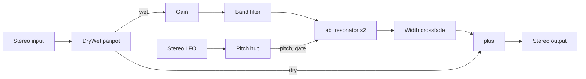

# Corpus device: signal chain and resonator (decompiled)

**Question.** What does Live 12.4.3's bundled Corpus audio effect compute, from
Live's parameter call down to each output sample? This was read from the
decompiled bundle only. Nothing was executed, and no output was compared with
Corpus's real sound.

**Answer.**
- **Engine.** Corpus is a small modular engine of linked per-channel modules
  (*Inferred:* Applied Acoustics–style, from the module and class names).
- **Signal path.** The input splits into dry and wet through a panpot. The wet
  part goes through a clean gain (Live's Drive) and a band filter into one
  `ab_resonator` per channel. The resonator outputs pass a width crossfade, and
  the dry signal is added back.
- **Resonator models.** Five body types are banks of two-pole modal filters
  with fixed mode-ratio tables. Pipe and Tube are two-line waveguides.
- **Pitch.** Pitch arrives in octaves around 261.62 Hz from a pitch hub, which
  adds the LFO and Detune.
- **Parameters.** Live drives 37 numbered parameters. Resonator values are
  quantized to 128 controller steps.

The decompiled bundle carries no Live parameter names. The host-index → Live
name mapping below is inferred from what each target does. How Live converts
its stored values before calling the device is not traced; that is the
coordinator's N5 packet.

## Evidence

- **Binary.** `Corpus.arm64`, 248,624 bytes, SHA-256 `29df4582…ad9fe8`. It is
  stripped: only the seven host exports are named. Identity and host interface
  are in [device bundles](device-bundles-static.md).
- **Readable code.** The C1 corpus has 644 functions (446 exported, 198 with
  warnings, 0 failed); browse it in the
  [Corpus browser](../../analysis/ableton-live-12.4.3/browse/r2/Corpus/index.html).
- **Trace reports.** The two retained reports, with function and data
  addresses for every claim and a mode-table rebuild script, are in
  [corpus-dsp-v1](../../analysis/ableton-live-12.4.3/r2/corpus-dsp-v1/manifest.sha256):
  - [resonator](../../analysis/ableton-live-12.4.3/r2/corpus-dsp-v1/report-resonator.md);
  - [signal chain](../../analysis/ableton-live-12.4.3/r2/corpus-dsp-v1/report-chain.md).
- **Method.** The C1 pseudocode was read, with rizin disassembly where
  constants or NEON code were unclear. Two read-only subagents traced the
  resonator and the rest of the chain. Their claims were then checked against a
  port (see [Port checks](#port-checks)).

## Host parameters

`_SetParameterA` calls the wrapper at `0xd75c`. That function converts the host
value *v* to a controller value *c* in 0–127 and sends it to a module. The
constructor at `0xc40c` builds the 37-entry routing table. The module drivers
map *c* to a value:

| Driver | Mapping |
| --- | --- |
| Linear | *c* = 64 gives the midpoint, otherwise *c*/127 |
| Exponential | min·(max/min)^(*c*/127) |
| Cubic | (*c*/127)³, with 0.125 at *c* = 64 |
| Integer | Controller 64 gives 63 |

The resonator's handler (`0x20fc8`) truncates every value to an integer
controller.

The conversions in the table:
- **D:** `v ≤ 0.5 ? 128v : 126v+1`
- **B:** `v < 0 ? 63.5v+63.5 : 63v+64`
- **P:** `64 + 31.5v`

| Host | Live parameter (inferred) | Target | Conversion → value |
| --- | --- | --- | --- |
| 0 | ResonanceType | resonator type | table `0x2a450` = [1,2,3,4,5,7,6] |
| 1 | Decay | resonator decay | D → 0.05·700^(c/127) s |
| 2 | FreqDamping | resonator tone | B, −1…1 |
| 3 | Inharmonics | resonator inharmonicity | B, −1…1 |
| 4 | Ratio | resonator ratio | D → 1…20 (exp) |
| 5 | Radius | resonator tube_radius | inverted D → 0.005…0.4 (exp) |
| 6 | Frequency | hub fixed pitch | D → −4…+4 octaves, 1 ms ramp |
| 7 | Transpose | hub transpose | `int(v)+48`, MIDI pitch mode only |
| 8 | FineTranspose | hub fine | `1.27v+63.5` → ±0.5 semitone, MIDI pitch mode only |
| 9 | Detune | hub detune | B → ±1/12 octave, opposite sign per channel |
| 10 | PitchBendRange | hub bend range | integer, 0–24 semitones |
| 11 | AmpFreq | resonator amp_freq | B, −1…1 |
| 12, 13 | MidiPitch, MidiGate | hub tune and gate source | D → enum |
| 14 | ExcitationX | resonator exci_x | P → 0.05…0.95 |
| 15, 16 | ListeningXL, ListeningXR | list_l_x of each resonator | P → 0.01…0.99; the right instance swaps L and R |
| 17–26 | LfoOnOff … LfoAmount | ab_stereo_lfo | see [Modules](#the-other-modules) |
| 27–29 | FilterOn, FilterMidFreq, FilterBandWidth | corpus_filter | on/off; D → 50·360^(c/127) Hz; `14.94v−7.47` → 0.5…9 octaves |
| 30 | Drive | corpus_gain | D → −15…+15 dB |
| 31 | StereoWidth | corpus_stereo_crossfade | D → 0…1 |
| 32 | DryWet | panpot angle | D, *c*/127 |
| 33 | ResonatorQuality | resonator quality | integer 0–3 |
| 34 | DecayOnNoteOff | resonator decay_muted | D → cubic 0…1 |
| 35 | TubeOpening | resonator tube_opening | D → 0.005…1 |
| 36 | Bleed | resonator amp_hp | D → 0.01…1 (exp) |

MidiMode is the only Live parameter that is never sent to the device.
Several mappings fit Live's stored ranges exactly: the bipolar parameters,
Transpose ±48, Fine ±50, BandWidth 0.5–9 and the phase angles 0–360. That
supports Live passing those values through unchanged.

## Module graph

Built in `0x5ca8`; each per-channel module exists twice, and the left instance
forwards every parameter message to the right.

The engine processes sub-blocks of up to 512 samples and applies parameter
messages once per host block. The net output gain is unity.

## Resonator

**Types** (builders at `0x243e8`, `0x24ee4`, `0x25210` and `0x257b4`). Each
entry gives the ratios r_k:

| Live index | Internal | Model | Ratios r_k |
| --- | --- | --- | --- |
| 0 | 1 Beam | modal | (β_k/4.730)²; β = 4.730, 7.853, 10.996, then (k+1.5)π |
| 1 | 2 Marimba | modal | β = 4.730, 9.413, 15.450, 20.710, 24.580, then (1.4142k+2.1213)π |
| 2 | 3 String | modal | k+1 |
| 3 | 4 Membrane | modal, 2-D | √(m²+(Rn)²)/√(1+R²), with R = Ratio |
| 4 | 5 Plate | modal, 2-D | (m²+(Rn)²)/(1+R²) |
| 5 | 7 Pipe | waveguide | — |
| 6 | 6 Tube | waveguide | — |

This confirms the label order that the Corpus demo had to assume. The Marimba
ratios start 1, 3.96, 10.67; Membrane at R = 1.5 starts 1, 1.387, 1.754.

**Modal model** (`0x1f3f8`):
- **Mode count.** Quality selects 4, 16, 30 or 70 modes. There is no
  oversampling.
- **Mode frequency.** Mode k's angular frequency is
  1643.807·2^p·r_k·r_k^(inh³), with pitch p in octaves.
- **Dropped modes.** A mode at or above 5/12 of the sample rate ends the list
  and turns Bleed off.
- **Damping.** Each mode is a two-pole resonator. Its damping is
  8·2^e / decay, where *e* tilts the damping by `tone` across the modes'
  log-ratios. Gain is tilted by `amp_freq`.
- **Hit and pickups.** Excitation and pickup weights come from a coarse
  mode-shape table with linear (1-D) or bilinear (2-D) interpolation, not from
  analytic sines. Each channel is mono: the left resonator listens at
  ListeningXL and the right at ListeningXR.
- **Update rate.** Coefficients update at most every 200 samples. Pickups move
  linearly over 4,000 samples.
- **Bleed.** A two-pole high-pass of the excitation is added before the ×3000
  output scale.

**Waveguide** (`0x23670`):
- **Lines.** Two 2,048-sample delay lines, each about fs/(2^p·523.24) − 0.75
  samples (half that for Tube). Reads use 5-tap Lagrange interpolation.
- **Feedback.** −0.999, with a 30 Hz DC blocker on the input.
- **Reflection.** A first-order reflection filter set by Radius and, for Pipe,
  Opening. Tube's loop is inverted once more.
- **Loss.** Per-trip loss is exp(−4/(decay·261.62·2^p)).

## The other modules

- **Panpot (DryWet).** The wet gain is P(a/4) and the dry gain P(0.25 − a/4),
  with P(t) = 6√3·t(1−t)(1−2t). Gains ramp over 100 samples.
- **Gain (Drive).** A linear gain of −15 to +15 dB with a 10 ms ramp. There is
  no saturation.
- **Band filter.** An RBJ low-pass at f·2^(bw/2) feeds an RBJ high-pass at
  f/2^(bw/2), both Q 0.707. Coefficients ramp over 30 samples, and on/off fades
  over 10 ms.
- **Width.** L' = (½+½w)L + (½−½w)R, applied to the resonated signal only.
- **LFO.** Seven shapes, in order: Sine (polynomial), Square, Triangle, Ramp
  Up, Ramp Down, Sample and Hold (phase at double rate), Random Ramp.
  - Free rate: 0.01·1000^(c/127) Hz. Sync uses a 22-entry bar table from 8 to
    1/64.
  - Stereo: Phase mode applies a fixed offset to the right channel; Spin mode
    runs the right channel faster.
  - Output adds to pitch: Amount 1 is ±1 octave.
- **Pitch hub.**
  - With MidiPitch off, pitch is the fixed pitch (from Frequency) plus the LFO,
    with Detune added on the left and subtracted on the right.
  - With MidiPitch on, pitch is (note − 60)/12 plus bend, Fine and Transpose,
    with the highest held note winning.
  - The gate is open unless MidiGate is on and no note is held.

## Quirks a faithful port reproduces

1. Resonator parameters move in 128 steps.
2. The integer driver maps controller 64 to 63: Transpose +16 sounds as +15.
3. Pitch and LFO changes reach the modal filters at most every 200 samples.
4. Pipe and Tube ring below their nominal pitch because the reflection filter
   adds delay. At 48 kHz with default Radius and Opening, the port gives
   251.0 Hz and 241.2 Hz against a nominal 261.62 Hz.
5. Bleed's minimum is 0.01, not 0.
6. Bleed turns off when any mode passes 5/12 of the sample rate.

## Candidate requirements for SPEC-CORPUS-DEVICE

These are static predictions of observable output, derived from the bundle,
for the Phase 4 probe batch to measure. Where a candidate needs the
untraced Live-side conversion, it says so.

| ID | Statement | Evidence | Strength |
| --- | --- | --- | --- |
| CD-C01 | ResonanceType 0–6 selects Beam, Marimba, String, Membrane, Plate, Pipe, Tube | Remap `0x2a450` and the type builders | Static (bundle) |
| CD-C02 | With MidiPitch off, the fundamental spans 261.62·2^(−4…+4) Hz as Frequency moves over its range | Hub fixed pitch `0x27278` | Static; Live-side conversion assumed |
| CD-C03 | Modal partials follow the ratio tables above (String harmonic; Beam 1, 2.756, 5.404…; Marimba 1, 3.96, 10.67…; Membrane and Plate set by Ratio) | Builders; the port's mode-table check | Static (bundle) |
| CD-C04 | ResonatorQuality 0–3 gives at most 4, 16, 30 or 70 partials; partials at or above 5/12 of the sample rate are absent | `0x2ab90`, `0x1f3f8` | Static (bundle) |
| CD-C05 | Drive changes level by −15 to +15 dB before the filter and adds no harmonics | corpus_gain `0x271cc` | Static (bundle) |
| CD-C06 | LfoAmount 1 modulates the resonance pitch by ±1 octave; the LfoType order is the seven shapes above | LFO `0x1d1b4`, hub `0x2764c` | Static (bundle) |
| CD-C07 | Pipe and Tube resonances sit below the Frequency setting, by more as the device's tube radius widens. Live's Radius is mapped inverted, so a lower Radius means a wider tube. The drop is about 4% and 8% at the default radius and Opening, 48 kHz | Waveguide `0x23670`; port measurement | Static derivation; unmeasured |
| CD-C08 | MidiMode is not a device parameter; Live applies it before the device | 37-entry table `0xc40c` | Static (bundle) |

## Port checks

A JavaScript port of this chain was written from the reports. It is kept
outside the repository, in `~/Documents/sound-local/corpus-faithful/`, because
it is code derived from third-party DSP and this repository has a public
remote. Its checks:
- **Node tests (8 passing):**
  - the 2^x approximation;
  - all four mode tables against the traced ratios;
  - String at 261.62 Hz and an octave up;
  - Beam's second partial at 2.756·f0;
  - Pipe and Tube within 1 Hz of the resonance predicted from the traced loop
    (line delays, reflection-filter phase, loop sign);
  - all 26 shipped presets render finite, bounded output.
- **Browser self-test:** String at Frequency 0.5 peaks at 261.5 Hz, through
  an AudioWorklet in headless Chromium.
- **CPU:** at most 9% of one core in real time.

These checks show the port agrees with the traced structure. They do not show
that either matches Corpus.

The repository's [Corpus demo](learning/demos/corpus-resonator.md) still uses
its textbook stand-in. That page compares the two.

## Unknowns

- **Live-side conversion.** How Live converts stored values to host values (N5).
  The port assumes they pass through unchanged, except FilterMidFreq (Hz to the
  device's normalized scale) and the three positions (0–1 mapped to −1–1).
- **Parameter names.** The host-index → name mapping for FreqDamping (tone),
  Drive (gain) and Bleed (amp_hp) rests on what each target does.
- **Unconnected inputs.** Resonator inputs 4 and 5 are assumed to read zero.
- **Runtime comparison.** None exists. Live cannot run on this host; see
  Phase 4 of the [roadmap](native-decompilation-roadmap.md#proposed-sequencing).
