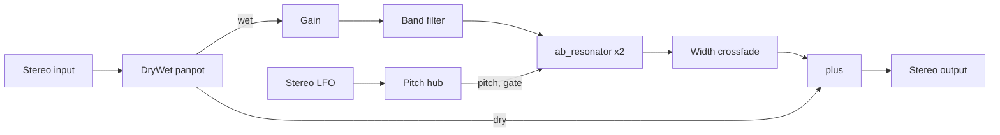

# Corpus device: signal chain and resonator (decompiled)

**Question.** What does Live 12.4.3's bundled Corpus audio effect compute, from
Live's parameter call down to each output sample? The original 2026-10-17
report below used decompiled bundle evidence only. Later bounded x86 extracted
execution belongs to [device DSP evidence](device-dsp-extracted.md); neither
the original application nor the arm64 device has been executed.

The accepted behavioral scope belongs to [Corpus R7](../specs/device-corpus.md)
and [released v5](../../handoff/device-corpus-v5/README.md). Current source/tooling
work follows the [reviewed constructor/setup nomination](#reviewed-constructor-span-and-setup-nomination--2026-10-20)
and [sole execution plan](full-live-specification-plan.md). The original report
and later as-of investigations below are evidence with their stated limits;
they do not enlarge the released finite cases or establish whole-device coverage.

**Original report answer (2026-10-17).**
- **Engine.** Corpus is a small modular engine of linked per-channel modules
  (*Inferred:* Applied Acoustics–style, from the module and class names).
- **Signal path.** The input splits into dry and wet through a panpot. The wet
  part goes through a clean gain (Live's Drive) and a band filter into one
  `ab_resonator` per channel. The resonator outputs pass a width crossfade, and
  the dry signal is added back.
- **Resonator models.** Five body types are banks of two-pole modal filters
  with fixed mode-ratio tables. Pipe and Tube are two-line waveguides.
- **Pitch.** Pitch arrives in octaves around 261.62 Hz from a pitch hub, which
  adds the LFO and Detune.
- **Parameters.** Live sends 38 numbered parameters, and the device uses the
  first 37. Resonator values are
  quantized to 128 controller steps.

Live's side is traced in the [device parameter mapping](device-parameter-mapping-native.md)
(N5). It confirms the Live names for host indices 0–36 below. Current conversion
claims belong to [Corpus requirement002](../specs/device-corpus.md#req-device-corpus-002--from-stored-values-to-host-values),
including its unaccepted position assumption A1; the historical report does not
establish a general stored-value identity. The [reviewed position companion](../../analysis/ableton-live-12.4.3/full-spec-v1/reviews/corpus-position-value-source-review.json)
resolves conditional initialization/pull/conversion only, with actual emission
and the public parameter path still unknown.

## Evidence

- **Binary.** `Corpus.arm64`, 248,624 bytes, SHA-256 `29df4582…ad9fe8`. It is
  stripped: only the seven host exports are named. Identity and host interface
  are in [device bundles](device-bundles-static.md).
- **Readable code.** The C1 corpus has 644 functions (446 exported, 198 with
  warnings, 0 failed); browse it in the
  [Corpus browser](../../analysis/ableton-live-12.4.3/browse/r2/Corpus/index.html).
- **Trace reports.** The two retained reports, with function and data
  addresses for every claim and a mode-table rebuild script, are in
  [corpus-dsp-v1](../../analysis/ableton-live-12.4.3/r2/corpus-dsp-v1/manifest.sha256):
  - [resonator](../../analysis/ableton-live-12.4.3/r2/corpus-dsp-v1/report-resonator.md);
  - [signal chain](../../analysis/ableton-live-12.4.3/r2/corpus-dsp-v1/report-chain.md).
- **Method.** The C1 pseudocode was read, with rizin disassembly where
  constants or NEON code were unclear. Two read-only subagents traced the
  resonator and the rest of the chain. Their claims were then checked against a
  port (see [Port checks](#port-checks)).

## Host parameters

`_SetParameterA` calls the wrapper at `0xd75c`. That function converts the host
value *v* to a controller value *c* in 0–127 and sends it to a module. The
constructor at `0xc40c` builds the 37-entry routing table. The module drivers
map *c* to a value:

| Driver | Mapping |
| --- | --- |
| Linear | *c* = 64 gives the midpoint, otherwise *c*/127 |
| Exponential | min·(max/min)^(*c*/127) |
| Cubic | (*c*/127)³, with 0.125 at *c* = 64 |
| Integer | Controller 64 gives 63 |

The resonator's handler (`0x20fc8`) truncates every value to an integer
controller.

The conversions in the table:
- **D:** `v ≤ 0.5 ? 128v : 126v+1`
- **B:** `v < 0 ? 63.5v+63.5 : 63v+64`
- **P:** `64 + 31.5v`

| Host | Live parameter (confirmed by N5) | Target | Conversion → value |
| --- | --- | --- | --- |
| 0 | ResonanceType | resonator type | table `0x2a450` = [1,2,3,4,5,7,6] |
| 1 | Decay | resonator decay | D → 0.05·700^(c/127) s |
| 2 | FreqDamping | resonator tone | B, −1…1 |
| 3 | Inharmonics | resonator inharmonicity | B, −1…1 |
| 4 | Ratio | resonator ratio | D → 1…20 (exp) |
| 5 | Radius | resonator tube_radius | inverted D → 0.005…0.4 (exp) |
| 6 | Frequency | hub fixed pitch | D → −4…+4 octaves, 1 ms ramp |
| 7 | Transpose | hub transpose | `int(v)+48`, MIDI pitch mode only |
| 8 | FineTranspose | hub fine | `1.27v+63.5` → ±0.5 semitone, MIDI pitch mode only |
| 9 | Detune | hub detune | B → ±1/12 octave, opposite sign per channel |
| 10 | PitchBendRange | hub bend range | integer, 0–24 semitones |
| 11 | AmpFreq | resonator amp_freq | B, −1…1 |
| 12, 13 | MidiPitch, MidiGate | hub tune and gate source | D → enum |
| 14 | ExcitationX | resonator exci_x | P → 0.05…0.95 |
| 15, 16 | ListeningXL, ListeningXR | list_l_x of each resonator | P → 0.01…0.99; the right instance swaps L and R |
| 17–26 | LfoOnOff … LfoAmount | ab_stereo_lfo | see [Modules](#the-other-modules) |
| 27–29 | FilterOn, FilterMidFreq, FilterBandWidth | corpus_filter | on/off; D → 50·360^(c/127) Hz; `14.94v−7.47` → 0.5…9 octaves |
| 30 | Drive | corpus_gain | D → −15…+15 dB |
| 31 | StereoWidth | corpus_stereo_crossfade | D → 0…1 |
| 32 | DryWet | panpot angle | D, *c*/127 |
| 33 | ResonatorQuality | resonator quality | integer 0–3 |
| 34 | DecayOnNoteOff | resonator decay_muted | D → cubic 0…1 |
| 35 | TubeOpening | resonator tube_opening | D → 0.005…1 |
| 36 | Bleed | resonator amp_hp | D → 0.01…1 (exp) |

MidiMode is sent as host index 37 and ignored, because the device's default
path accepts only indices below 37 (N5). Several mappings fit Live's stored
ranges exactly: the bipolar parameters, Transpose ±48, Fine ±50, BandWidth
0.5–9 and the phase angles 0–360. N5 confirms that Live passes those values
through unchanged.

**Open: position range.** The positions' conversion 64 + 31.5v fits an input
of −1 to 1. Live passes ExcitationX, ListeningXL and ListeningXR as 0–1 with
no remap (N5), so as traced they reach only from the centre to 0.72 of the
body. N5's evidence stops at Live's float parameter unit, which is inferred.
Probe P4-N5-01 should settle it.

## Module graph

Built in `0x5ca8`; each per-channel module exists twice, and the left instance
forwards every parameter message to the right.

The engine processes sub-blocks of up to 512 samples and applies parameter
messages once per host block. The net output gain is unity.

## Resonator

**Types** (builders at `0x243e8`, `0x24ee4`, `0x25210` and `0x257b4`). Each
entry gives the ratios r_k:

| Live index | Internal | Model | Ratios r_k |
| --- | --- | --- | --- |
| 0 | 1 Beam | modal | (β_k/4.730)²; β = 4.730, 7.853, 10.996, then (k+1.5)π |
| 1 | 2 Marimba | modal | β = 4.730, 9.413, 15.450, 20.710, 24.580, then (1.4142k+2.1213)π |
| 2 | 3 String | modal | k+1 |
| 3 | 4 Membrane | modal, 2-D | √(m²+(Rn)²)/√(1+R²), with R = Ratio |
| 4 | 5 Plate | modal, 2-D | (m²+(Rn)²)/(1+R²) |
| 5 | 7 Pipe | waveguide | — |
| 6 | 6 Tube | waveguide | — |

This confirms the label order that the Corpus demo had to assume. The Marimba
ratios start 1, 3.96, 10.67; Membrane at R = 1.5 starts 1, 1.387, 1.754.

**Modal model** (`0x1f3f8`):
- **Mode count.** Quality selects 4, 16, 30 or 70 modes. There is no
  oversampling.
- **Mode frequency.** Mode k's angular frequency is
  1643.807·2^p·r_k·r_k^(inh³), with pitch p in octaves.
- **Dropped modes.** A mode at or above 5/12 of the sample rate ends the list
  and turns Bleed off.
- **Damping.** Each mode is a two-pole resonator. Its damping is
  8·2^e / decay, where *e* tilts the damping by `tone` across the modes'
  log-ratios. Gain is tilted by `amp_freq`.
- **Hit and pickups.** Excitation and pickup weights come from a coarse
  mode-shape table with linear (1-D) or bilinear (2-D) interpolation, not from
  analytic sines. Each channel is mono: the left resonator listens at
  ListeningXL and the right at ListeningXR.
- **Update rate.** Coefficients update at most every 200 samples. Pickups move
  linearly over 4,000 samples.
- **Bleed.** A two-pole high-pass of the excitation is added before the ×3000
  output scale.

**Waveguide** (`0x23670`):
- **Lines.** Two 2,048-sample delay lines, each about fs/(2^p·523.24) − 0.75
  samples (half that for Tube). Reads use 5-tap Lagrange interpolation.
- **Feedback.** −0.999, with a 30 Hz DC blocker on the input.
- **Reflection.** A first-order reflection filter set by Radius and, for Pipe,
  Opening. Tube's loop is inverted once more.
- **Loss.** Per-trip loss is exp(−4/(decay·261.62·2^p)).

## The other modules

- **Panpot (DryWet).** The wet gain is P(a/4) and the dry gain P(0.25 − a/4),
  with P(t) = 6√3·t(1−t)(1−2t). Gains ramp over 100 samples.
- **Gain (Drive).** A linear gain of −15 to +15 dB with a 10 ms ramp. There is
  no saturation.
- **Band filter.** An RBJ low-pass at f·2^(bw/2) feeds an RBJ high-pass at
  f/2^(bw/2), both Q 0.707. Coefficients ramp over 30 samples, and on/off fades
  over 10 ms.
- **Width.** L' = (½+½w)L + (½−½w)R, applied to the resonated signal only.
- **LFO.** Seven shapes, in order: Sine (polynomial), Square, Triangle, Ramp
  Up, Ramp Down, Sample and Hold (phase at double rate), Random Ramp.
  - Free rate: 0.01·1000^(c/127) Hz. Sync uses a 22-entry bar table from 8 to
    1/64.
  - Stereo: Phase mode applies a fixed offset to the right channel; Spin mode
    runs the right channel faster.
  - Output adds to pitch: Amount 1 is ±1 octave.
- **Pitch hub.**
  - With MidiPitch off, pitch is the fixed pitch (from Frequency) plus the LFO,
    with Detune added on the left and subtracted on the right.
  - With MidiPitch on, the earlier report describes (note − 60)/12 plus bend,
    Fine and Transpose. Its highest-held-note shorthand is not a universal
    priority law: the [later bounded source query](#later-bounded-midi-pitch-evidence--2026-10-19)
    leaves arbitrary sustain/control histories and caller updates unresolved.
  - The gate is open unless MidiGate is on and no note is held.

## Quirks a faithful port reproduces

1. Resonator parameters move in 128 steps.
2. The integer driver maps controller 64 to 63: Transpose +16 sounds as +15.
3. Pitch and LFO changes reach the modal filters at most every 200 samples.
4. Pipe and Tube ring below their nominal pitch because the reflection filter
   adds delay. At 48 kHz with default Radius and Opening, the port gives
   251.0 Hz and 241.2 Hz against a nominal 261.62 Hz.
5. Bleed's minimum is 0.01, not 0.
6. Bleed turns off when any mode passes 5/12 of the sample rate.

## Candidate requirements for SPEC-CORPUS-DEVICE

These are static predictions of observable output, derived from the bundle,
for the Phase 4 probe batch to measure. Where a candidate needs the
untraced Live-side conversion, it says so.

| ID | Statement | Evidence | Strength |
| --- | --- | --- | --- |
| CD-C01 | ResonanceType 0–6 selects Beam, Marimba, String, Membrane, Plate, Pipe, Tube | Remap `0x2a450` and the type builders | Static (bundle) |
| CD-C02 | With MidiPitch off, the fundamental spans 261.62·2^(−4…+4) Hz as Frequency moves over 0–1; stored 0.5 gives 261.62 Hz | Hub fixed pitch `0x27278`; Live side (N5) | Static (bundle and Live) |
| CD-C03 | Modal partials follow the ratio tables above (String harmonic; Beam 1, 2.756, 5.404…; Marimba 1, 3.96, 10.67…; Membrane and Plate set by Ratio) | Builders; the port's mode-table check | Static (bundle) |
| CD-C04 | ResonatorQuality 0–3 gives at most 4, 16, 30 or 70 partials; partials at or above 5/12 of the sample rate are absent | `0x2ab90`, `0x1f3f8` | Static (bundle) |
| CD-C05 | Drive changes level by −15 to +15 dB before the filter and adds no harmonics | corpus_gain `0x271cc` | Static (bundle) |
| CD-C06 | LfoAmount 1 modulates the resonance pitch by ±1 octave; the LfoType order is the seven shapes above | LFO `0x1d1b4`, hub `0x2764c` | Static (bundle) |
| CD-C07 | Pipe and Tube resonances sit below the Frequency setting, by more as the device's tube radius widens. Live's Radius is mapped inverted, so a lower Radius means a wider tube. The drop is about 4% and 8% at the default radius and Opening, 48 kHz | Waveguide `0x23670`; port measurement | Static derivation; unmeasured |
| CD-C08 | MidiMode reaches the device as host index 37 and has no effect there | Table `0xc40c`; default path `0x50c0`; Live side (N5) | Static (bundle and Live) |

## Port checks

A JavaScript port of this chain was written from the reports. Its built page
is the [traced-engine demo](../../analysis/ableton-live-12.4.3/demos/corpus-traced/index.html),
published here by the user's decision on 2026-10-17. The page embeds the
engine. Its sources (engine, Node tests, build script) remain in
`~/Documents/sound-local/corpus-faithful/`. The code is derived from
third-party DSP and must never seed the independent reimplementation. Its
checks:
- **Node tests (8 passing):**
  - the 2^x approximation;
  - all four mode tables against the traced ratios;
  - String at 261.62 Hz and an octave up;
  - Beam's second partial at 2.756·f0;
  - Pipe and Tube within 1 Hz of the resonance predicted from the traced loop
    (line delays, reflection-filter phase, loop sign);
  - all 26 shipped presets render finite, bounded output.
- **Browser self-test:** String at Frequency 0.5 peaks at 261.5 Hz, through
  an AudioWorklet in headless Chromium.
- **CPU:** at most 9% of one core in real time.

These checks show the port agrees with the traced structure. They do not show
that either matches Corpus.

The repository's [Corpus demo](learning/demos/corpus-resonator.md) still uses
its textbook stand-in. That page compares the two.

## Unknowns

- **Position range.** See [the open question above](#host-parameters): the
  device expects −1 to 1, but Live is traced passing 0 to 1 (probe P4-N5-01).
  The port follows Live's traced side.
- **Unconnected inputs.** Resonator inputs 4 and 5 are assumed to read zero.
- **Runtime comparison.** None exists. Live cannot run on this host; see
  Phase 4 of the [roadmap](native-decompilation-roadmap.md#proposed-sequencing).

## Later bounded Ramp evidence — 2026-10-19

The [independent Sine/Ramp capture review](../../analysis/ableton-live-12.4.3/full-spec-v1/reviews/corpus-lfo-ramp-up-review.json)
approves two declared original-x86 calls through the existing loader, with exact
retained Sine baseline and one new finite Free Ramp Up output. The [separate
sensitivity review](../../analysis/ableton-live-12.4.3/full-spec-v1/reviews/corpus-lfo-ramp-sensitivity-review.json)
approves two additional coherent math-substitution captures as observations,
not an Apple/arm64 or mixed-error bound. These are separate from this report's
original static scope. The [finite criterion review](../../analysis/ableton-live-12.4.3/full-spec-v1/reviews/corpus-lfo-ramp-criterion-review.json)
approves an explicit 1% per-channel engineering waveform budget for separately
reviewed owner/release adoption. It does not recover an internal LFO law or
close A1, Live protocol, omitted modes or full-device coverage. Current work
selection remains in the [full specification plan](full-live-specification-plan.md).

## Later bounded MIDI pitch evidence — 2026-10-19

The [two-capture packet](../../analysis/ableton-live-12.4.3/full-spec-v1/depth-corpus-midi-pitch/README.md)
[passed independent bounded evidence review](../../analysis/ableton-live-12.4.3/full-spec-v1/reviews/corpus-midi-pitch-review.json)
with no required findings. Root invoked the selected collector once at
2026-10-20T06:31:45UTC: note60 then note72, each one held note-on at harness
coordinate1537, velocity100, MidiPitch on/LFO off, before the same stereo
impulse4096 at44100Hz. Both original-x86 children returned finite productive
stereo131072B with zero exit/trap/failbits; total new Corpus original children
are now six, including the earlier four Ramp/sensitivity calls. This is bundle
execution with declared substitutions, not an original Live application run.

Three fixed post-impulse spectral views show multiple prominent components
shifting approximately an octave across both channels, consistent with the
note60-to72 intervention. The selected diagnostic was authored by the reviewer;
Root independently selected/read/self-tested it before capture, while the
selection record timestamp is afterward. The reviewer independently rebuilt
all12 spectral records without importing that diagnostic. This is descriptive
evidence, not independent calibrated-method approval. Note60 already has a
strong523Hz component, so presence or the largest peak alone is insufficient.
No exact fundamental, note identity, absence bound, onset/frame-base law,
threshold, normative case, release expectation or application grade is adopted.
Existing R4/v2 remain unchanged.

A separate [two-body retained-source query](../../analysis/ableton-live-12.4.3/full-spec-v1/queries/corpus-midi-modulator-frontier-2026-10-19.json)
is unreviewed exploration: complete2764c/279f4 decompiler records narrow local
event dispatch, selected-note assignment, sustain/all-off state and bend update
order. It does not prove public parameter/control binding, x86/arm64 equivalence
or caller/helper reachability. In particular, ordinary incremental highest-note
selection does not establish a universal highest-held-note rule across arbitrary
sustain histories; untraced control/caller/helper updates remain unknown. This
is not a whole-device stale-note or priority-bug finding. The full R4 REQ013
state-machine/timing/Live-sidechain scope stays open.

Next selected D01 work proposes a finite note60 input/output case using exact
post4096 byte identity with released013-04 and unchanged modal criteria. That
case alone cannot reject ignoring MIDI because note60 equals fixed pitch here.
Note72 needs separately justified centers/eligibility and criterion review;
neither the Ramp1% budget nor a Sine frequency threshold transfers automatically.

### Event-format frontier (unreviewed source query)

[Ten complete retained bodies](../../analysis/ableton-live-12.4.3/full-spec-v1/queries/corpus-midi-event-bridge-frontier-2026-10-19.json)
(17553C-text bytes; exact JSONL locations/raw/code hashes retained) narrow the
external event bridge: CalcA→dff8→ed48→e50c stages16-byte records, conditionally
decrements nonzero timestamps, narrows the timestamp argument to32bits, then
stores16-byte generic queue records with timestamp+0/status+4/note+5/data2+6.
Queue-state timing is added; this is not proof of onset or Live's coordinate
base. The consumer getter uses that same16-byte stride/count layout. The leading
fields are not a complete8-byte record.

The parallel e7c4 dispatch stores a distinct16-byte receiver note representation.
Actual producer/registered receiver association with the modulator object and
its queue remains unproved. The offset equality P=M+88 is only hypothetical
algebra for one possible alias, not an established or required actual route.
State-operation bodies resolve local count clearing/suffix rebasing, without
closing that object link or queue-base initialization. This remains unreviewed
arm64 decompiler evidence, not executed source, x86 correspondence, a general
MIDI state-machine law or a new acceptance grade. Reuse the exact remaining
constructor/enrollment/caller frontier before searching more generic getters.

### Constructor and callback frontier — 2026-10-20

[Ten further complete bodies, one151-line graph excerpt and three vtable words](../../analysis/ableton-live-12.4.3/full-spec-v1/queries/corpus-midi-enrollment-frontier-2026-10-20.json)
are retained as unreviewed source exploration. The actual constructed graph
stores moduleB; its embeddedP=B+148 contains the initialized16-byte-stride
queueQ=P+60. The installed process callback forwards P and resolves through
the exact vtable process slot to2764c, under valid-object/unchanged-vptr/actual-
invocation/lifetime predicates. Seven named control construction/registration
calls are retained; labels alone do not establish public UI/index bindings.

The state-text callback branch is now stopped: its secondary virtual target
is locally a no-op and its saved callback parses named module state. Neither
is a direct event-queue copy. This is a specific inspected-branch finding,
not proof of no route. Outer CalcA instanceI, graphS and MIDI managerM remain
distinct until an actual association is proved. The remaining event frontier
is exact manager-global-to-module queue enrollment/copy, not another generic
getter or state-text callback sweep. No new original call, accepted case,
source-to-x86/Live timing proof or coverage grade follows.

### Modal calibration preparation — 2026-10-20

The [first independent preparation review](../../analysis/ableton-live-12.4.3/full-spec-v1/reviews/corpus-midi-modal-preflight-review.json)
requires CMOD-PREFLIGHT-001: a known complex-amplitude/frame4096-phase fixture
and bounded two-component control before numerical calibration readiness.
Earlier preparation bytes are preserved. The [focused R2 readiness review](../../analysis/ableton-live-12.4.3/full-spec-v1/reviews/corpus-midi-modal-preflight-r2-review.json)
resolved the fixture-design finding before the later data-only calculation
below. No new original call or normative criterion follows from readiness.
The proposed p1 calculation remains conditional arithmetic/navigation, not
recovered actual coefficient state or MIDI-source binding.

### Executed finite modal calibration proposal — 2026-10-20

Root ran the reviewed preparation once at2026-10-20T07:15:34.755322–
07:15:37.229500UTC. It exited0 with empty stderr; all117outer watched identities
and8internal paths stayed unchanged. No original code, collector, private
model/fit, FFT, comparator CLI/run, candidate or Live executed. Eight
synthetic/invalid-data controls passed, including analytic complex response,
wrong phase/scale conventions and bounded two-tone/nuisance contrasts. Exact
source, prior revisions/finding, stdout172055B and receipt are frozen in the
[finite modal method proposal](../../analysis/ableton-live-12.4.3/full-spec-v1/depth-corpus-midi-modal-method/README.md),
manifest3603B/SHA-256
`cfae7c60b502b55b7143208c7ac5770a3143b1424f3cb6bad41084977d788f8c`
(21payloads/22files). [Independent semantic method review](../../analysis/ableton-live-12.4.3/full-spec-v1/reviews/corpus-midi-modal-method-review.json)
approved the bounded engineering criteria; it does not recover native poles
or calibrate estimator uncertainty.

All32exploratory reference fits had finite measurable amplitudes and passed
the conditional hypothesis-relative flag, but mode16 was materially window-
sensitive in BOTHchannels: complex half/full differences approximately
0.0124/0.0261left and0.0253/0.0531right. Root explicitly proposes scoring
only first15points per channel AFTER observing this reference evidence and
before any candidate. All32original rows stay retained; both mode16observations
remain ungraded, separately from the174historical omissions. This is not a
predeclared subset, an automatic half-window criterion, absence or physical
pole/source-binding proof. The remaining observed sensitivity is descriptive,
not calibrated uncertainty or a complete significant-gap/spectrum bound.

The note60proposal reuses existing013-04criteria by exact scored-byte identity
and cannot alone detect ignoring MIDI. Note72proposes30fixed navigation points
and the unchanged numerical modal budgets as an explicit finite ENGINEERING
applicability/eligibility decision. It does not claim all old native-pole
eligibility premises or transfer a vendor4ULP/library/arm64 tolerance. Original
98selfchecks passed; wrongnote60failed70. JSON-only removal of exactly6mode16
measurements yields92selfpasses/64wrongfailures, including both early waveforms
and all30complex amplitudes, without another fit/comparison run. Shared
harmonic frequencies can pass for the wrong note; this is no universal classifier.
The [separate owner R5 review](../../analysis/ableton-live-12.4.3/full-spec-v1/reviews/corpus-owner-r5-review.json)
approved integration, and Root [adopted the exact reviewed R5](../../analysis/ableton-live-12.4.3/full-spec-v1/reviews/corpus-owner-r5-adoption.json)
into the canonical draft:13IDs/31cases (27finite/fourU), all29oldrows exact.
Only DCO030/031 gain these exact host-input obligations. [Corpus v3](../../handoff/device-corpus-v3/README.md)
is released locally after separate handoff/final-seal review; v1/v2 remain
immutable. Its 25 groups/71 evaluations preserve all 69 earlier ones. General MIDI,
A1,174old/two new omitted observations and full-device coverage remain open.
No application or candidate grade follows.

### Render-manager argument frontier — 2026-10-20

The [bounded render query](../../analysis/ableton-live-12.4.3/full-spec-v1/queries/corpus-midi-render-join-frontier-2026-10-20.json)
retains the complete2419Cbytes of59d0 and exact earlier CalcA caller spans.
Root checked both full body and raw source identity. Under valid objects,
faithful recovered ABI, stable instance fields and actual invocation, CalcA
admits events to M=*(I+e0028), then59d0 explicitly passes that same manager
as the second argument to render object R=*(I+8)'s virtual slot20. This closes
a conditional argument edge, without proving a queue copy into moduleP/Q.
The preceding e28c call has no explicit M argument in this source; it is not
selected merely by its position before dispatch. Other full-body output gain
and clipping code remains private context, not new public requirements.

A [separate factory query](../../analysis/ableton-live-12.4.3/full-spec-v1/queries/corpus-midi-instance-constructor-frontier-2026-10-20.json)
retains complete332Cbytes of_CreateInstanceU. The factory allocates and returns
I, delegates initialization to a named constructor thunk and has no direct
I+8 or manager store in that body. Its decompiled constructor call omits
arguments; an actual this-pointer relation must not be inferred from the name.
Both queries remain unreviewed source exploration. Actual R construction/vptr,
R-to-graphS identity and manager-to-module queue enrollment remain the selected
join. No source-to-x86/Live timing proof, new original call, case or grade.

The later [base-initializer query](../../analysis/ableton-live-12.4.3/full-spec-v1/queries/corpus-midi-base-initializer-frontier-2026-10-20.json)
retains all 11,013 C bytes of cef0; Root read that body and verified its exact
export record. It stores allocated R at I+8 and a manager-factory result M
at I+e0028. After nonnull checks, it passes the same M to R's virtual init
slot10; the earlier render trace passes M to R's slot20. The initializer
returns I, closing the base-return identity in this C projection on normal
return. A length-error branch carries the decompiler's nonreturn warning;
valid arguments, faithful ABI/control flow, lifetime and stable fields remain
explicit premises. Missing constructor arguments in the decompiled factory
and render-constructor calls have not yet been recovered.

This narrows actual instance fields and manager arguments without proving
R's constructed class, graphS identity or queue enrollment. The selected
render-constructor continuation is source data only; manager-factory internals
are not needed for this pointer-identity observation and remain unread. No
new original execution, public MIDI law, case or compatibility grade follows.

### Prepared gate/release probe — 2026-10-20

The [frozen three-child preparation](../../analysis/ableton-live-12.4.3/full-spec-v1/depth-corpus-midi-gate-release-preparation/README.md)
proposes gate1-held, gate1-off and gate0-off histories, preserving all other
controls of the reviewed note60 input. The older gate0-held output is a
historical control, not a new matched recapture. On1537 and off8193 are host
coordinates; neither declares device onset. Silent or unchanged finite outputs
remain valid observations. No criterion or normative case has been selected.

Root read the full collector, checker, optional diagnostic and protocol. The
independent preflight identified a failure-accounting problem: an attempted
row could be counted as a native child even when process creation raised,
and process creation alone does not prove original device exports executed.
The preparation remains frozen and unexecuted pending a reviewed correction.
Six actual original children remain the total in this continuation.

### Actual gate/release captures — 2026-10-20

After [focused R2 preflight approval](../../analysis/ableton-live-12.4.3/full-spec-v1/reviews/corpus-midi-gate-release-preflight-r2-review.json),
Root selected the exact revised collector and ran the three fixed probes at
08:14:19.818872–08:14:20.075509UTC. The [frozen capture record](../../analysis/ableton-live-12.4.3/full-spec-v1/depth-corpus-midi-gate-release/CAPTURE.md)
contains three attempted launches, three returned PIDs and three structurally
valid original-x86 captures, with unchanged601durable paired identities. The
first preflight/failure-accounting finding and every R1 byte remain preserved.
Nine original Corpus children have now run in this continuation. The separate
fixed-window descriptive reader ran once afterward; no fit or new criterion.

Observed: gate1-held and gate1-off are byte-identical across the full capture.
Gate0-off equals the historical gate0-held output across the full file. All
three outputs from4096 onward equal that historical output exactly; gate1
changes only a tiny prefix relative to it. Complete hashes, times and window
statistics belong to the frozen record. The historical fourth input is not a
new matched recapture. These observations do not prove note-off admission, a
general no-effect/gate/release law, absence of an envelope or a bug. They add
no normative case or threshold, and do not close REQ013. Independent capture
[review](../../analysis/ableton-live-12.4.3/full-spec-v1/reviews/corpus-midi-gate-release-capture-review.json) approved these bounded X observations only; canonical R5/currentv3 remain unchanged.
Used math-import counts differ despite output equality, so identical internal
execution or ignored/admitted Note Off is not established. A separately
prepared before-impulse Off probe is the next selected investigation; it has
not executed. The earlier input is zero after its only impulse, so possible
input-gating behavior is a hypothesis that this new timing can help examine,
not a recovered explanation of the equal files.

### Conditional initialization queue join — 2026-10-20

The [independent manager-to-queue review](../../analysis/ableton-live-12.4.3/full-spec-v1/reviews/corpus-midi-manager-queue-join-review.json)
approves partial static research only. Its retained independent check matches
200 instruction bytes/50 words, two pointer words and nine full source bodies
(6,850 C bytes); nine carrier-field counterexamples are rejected. This advances
the earlier constructor/enrollment frontier above, without asserting runtime
reachability. No original execution occurred in this source review.

Under the explicitly retained premises X21=M, actual visited entry E=B,
eligibility, successful allocations, valid stable objects/stack, faithful source
and normal ABI/returns, initialization at1b814..1b828 places M in the caller's
first stack slot. The value is incoming X21, not ec40's return. Callback b758
passes a cursor to that slot into the constructed module P's slot40, whose
retained target is18258. Its mode0 path consumes L=M, resets its local field,
clears Q=P+60 through e414, and conditionally invokes e4cc(M+e8,index) followed
by e714(Q,returned value). This establishes the conditional call/argument edge;
the item representation and copy/admission/order policy of e4cc/e714 remain
uninspected here. The primary [argument query](../../analysis/ableton-live-12.4.3/full-spec-v1/queries/corpus-midi-enrollment-argument-frontier-2026-10-20.json)
and [queue-slot query](../../analysis/ableton-live-12.4.3/full-spec-v1/queries/corpus-midi-module-queue-slots-frontier-2026-10-20.json)
retain exact sources and premises.

Actual B membership remains conditional: the [membership companion](../../analysis/ableton-live-12.4.3/full-spec-v1/queries/corpus-midi-module-list-membership-frontier-2026-10-20.json)
shows append/traversal operations, but the graph's uninspected middle does not
prove that the appended node remains reachable from the later root. Crucially,
the render9300 preparation calls omit variadic arguments in recovered C. The
initialization stack proof cannot establish per-block M-to-Q refresh or delivery
of the captured later Note On/Off events. Only the exact render mode0 argument
setup is selected for the next source query. Eligibility-wrapper native flow,
item codec, timing, x86/arm64 correspondence and Live routing remain unknown.
No new criterion, case, application grade or complete-profile credit follows.

The separate [MidiGate dispatch query](../../analysis/ableton-live-12.4.3/full-spec-v1/queries/corpus-midigate-dispatch-branches-frontier-2026-10-20.json)
remains unreviewed source exploration. It stops at handler15f08 after a
conditional control-message association; it does not prove float/index ABI,
actual module lookup or processor application. It supplies no gate law or
explanation for equal captured audio. This branch is parked while the new
before-impulse preparation undergoes independent preflight.

### Actual before-impulse Note Off captures — 2026-10-20

After [independent readiness review](../../analysis/ableton-live-12.4.3/full-spec-v1/reviews/corpus-midi-gate-before-impulse-preflight-review.json)
and its [authorship-only addendum](../../analysis/ableton-live-12.4.3/full-spec-v1/reviews/corpus-midi-gate-before-impulse-preflight-review-role-addendum.json),
Root ran the selected exact collector once at08:43:12.948222–08:43:13.103129UTC.
The [frozen actual record](../../analysis/ableton-live-12.4.3/full-spec-v1/depth-corpus-midi-gate-before-impulse/CAPTURE.md)
contains three attempted launches/returned PIDs/valid captures,665collector
paired identities and full2398-path Root paired maps, all unchanged. Total
original Corpus children is now twelve. The earlier preflight author-name
mistake is corrected by an immutable addendum, with readiness unchanged.

A is a fresh gate1-held control; B gate1-off and C gate0-off move only the
Off command from8193 to3073, before the same impulse4096. A equals the previous
gate1-held file; C equals historical gate0-held. A/B have a full-file difference
confined to the tiny3072..4095prefix:866left/674right samples, max absolute
changes6.462348535570529e-26left/3.877409121342317e-26right. ALLthree outputs
from4096 onward are byte-identical to the historical held0 control. Full hashes,
protocol, failures/accounting limits and exact receipts belong to the frozen
record. No changed post-impulse response, input-gating/no-effect law, actual
Note Off admission, bug or internal onset follows. A new data-only reader
retains24fixed-window difference rows; no criterion, fit, FFT or original call.
[Independent capture review](../../analysis/ableton-live-12.4.3/full-spec-v1/reviews/corpus-midi-gate-before-impulse-capture-review.json) approved these bounded observations with no required findings; no gate/admission law or grade follows. CanonicalR5/currentv3 remain
unchanged; no new normative case or application/complete-profile credit.

The later [render argument query](../../analysis/ableton-live-12.4.3/full-spec-v1/queries/corpus-midi-render-argument-frontier-2026-10-20.json)
retains188instruction bytes/47words as data: its selected mode0call writes
saved entryX1 through X19 to the first stack slot. This is render-site evidence,
not transfer of the initialization argument by analogy. [Independent render-argument review](../../analysis/ableton-live-12.4.3/full-spec-v1/reviews/corpus-midi-render-argument-review.json) approves this conditional selected-site carrier.
The9348-to93f0 out-of-line branch and actual module membership stay explicit
premises: ordinary callee ABI alone does not cover that unread intraprocedural
branch. The two item-access/insertion callees are filed below; no all-path or
actual event-delivery proof follows.

The [two-body queue-item query](../../analysis/ableton-live-12.4.3/full-spec-v1/queries/corpus-midi-queue-item-frontier-2026-10-20.json)
remains exploratory: e4cc returns an item pointer at base+16*index when in
range, otherwise queue+8. In18258 the source queue at L+e8 has its count at
L+108, matching the caller's count field. Under stable valid bounded indices,
the returned eight-byte value is a pointer, not a copied event payload. e714
reads that cell's words/bytes and forwards them separately to e50c, including
a timestamp-like sum with Q+4028. It is fieldwise re-insertion, not a16-byte
memcpy or a proved lossless public MIDI/wire schema. Root read both full bodies
and the immediate701C-byte caller and checked all three exact export rows.

The earlier retained e50c source remains available in the [event-bridge query](../../analysis/ableton-live-12.4.3/full-spec-v1/queries/corpus-midi-event-bridge-frontier-2026-10-19.json);
Root reread that existing body rather than collect another source copy. Its own
base addition, status normalization and sorted insertion must not be erased by
assuming identity copying or a public timestamp. Actual queue/base state,
admission, normal allocation, finite index domain, source ABI, module membership
and x86/Live correspondence remain premises. No runtime, gate law or grade
follows. The next separately selected MidiGate source frontier is only handler
15f08 and its already retained immediate caller; no other callee or runtime
probe is selected.

### Conditional control-message dispatch — 2026-10-20

Three retained source-only successors [passed independent partial review](../../analysis/ableton-live-12.4.3/full-spec-v1/reviews/corpus-midigate-control-dispatch-review.json):
[keyed handler15f08](../../analysis/ableton-live-12.4.3/full-spec-v1/queries/corpus-midigate-message-handler-frontier-2026-10-20.json),
[recursive receiver19370](../../analysis/ableton-live-12.4.3/full-spec-v1/queries/corpus-midigate-receiver-handler-frontier-2026-10-20.json)
and [module callback18588](../../analysis/ableton-live-12.4.3/full-spec-v1/queries/corpus-midigate-module-callback-frontier-2026-10-20.json).
Root read all three full bodies and retained immediate callers/construction
context. They narrow the earlier MidiGate setter frontier without proving
actual control application or explaining the captured outputs.

Handler15f08 uses message+8 to select a16-byte registry entry. Its primary
19370 call has omitted recovered arguments; the secondary-list calls explicitly
forward a receiver and message. Its condition dereferences the entry before
its base-null test, so this is no malformed-input/null-safety guarantee.
Receiver19370 recursively forwards through its receiver+118 list, then calls
the function pointer stored directly at receiver+18. This is not a processor
vptr slot. Indirect-jump recovery warnings remain retained.

Under actual receiver=B and stable constructor/callback premises, the retained
183a0 assignment supplies callback18588 at B+18;84a4's later overrides do not
visibly replace that field. Callback18588 searches its sentinel list for a
control matching message[1], with node flagbit4 clear. On message type2 it reads
the payload at message+16 and attempts dispatch through that matched control's
virtual+40. Pre/post virtual queries gate a receiver+90 change notification.
This is a concrete conditional source dispatch attempt, not an observed value
change or proof of immediate versus deferred application in the unseen setter.
No packed public message format, float/index ABI or control identity is assumed.

Actual numeric module lookup, primary receiver, key1 control membership/type,
virtual setter target and scalar effect remain unknown. No further source
callee/word is selected at this boundary. The next parallel preparation changes
only host DecayOnNoteOff index34 from1 to0 in three fresh versions of the
before-impulse histories. Both previous timing series used host34=1; a different
host endpoint is a proposed finite contrast, not a recovered UI/stored-value
mapping, prediction of silence/change, criterion or new normative case. The new
preparation has now executed as recorded below; fifteen original children
remain the total, with no new normative case yet.

### Actual host-index34 zero captures — 2026-10-20

After [independent endpoint readiness approval](../../analysis/ableton-live-12.4.3/full-spec-v1/reviews/corpus-midi-noteoff-decay-zero-preflight-review.json),
Root ran the exact sealed collector once at09:06:23.713366–09:06:23.869091UTC.
The [frozen capture record](../../analysis/ableton-live-12.4.3/full-spec-v1/depth-corpus-midi-noteoff-decay-zero/CAPTURE.md)
contains three attempts, returned PIDs and valid captures: fifteen original
Corpus children in this continuation. All three fresh scripts change only host
index34 from1 to+0 versus their before-impulse counterparts. No UI/stored-value
conversion or general decay/gate law follows from this protocol.

Observed: A held/gate1 has the same post4096bytes as its older host34=1 control;
C Off/gate0 equals the historical held0 file entirely. B Off/gate1 now has a
post4096contrast, with late-window mean-square2.3543347925862585e-19left/
1.9121054489645528e-19right versus held A0.00031960164951807364left/
0.0002622434910628739right. B is not an all-zero capture. Its process output
flags are21blocks1 followed by11blocks0, all returns0 and inputflag1 fixed;
this establishes no host scheduling or admission rule. Full raw hashes/protocol
and fixed-window statistics belong to the frozen record, not a new law.

The collector's725paired identities and Root's full2457-path paired maps stayed
unchanged. Root separately selected one fully read data-only reader:40fixed-window
rows/two arithmetic controls,31paired identities unchanged. No extra original,
fit, FFT, normalization or comparator ran. [Independent capture review](../../analysis/ableton-live-12.4.3/full-spec-v1/reviews/corpus-midi-noteoff-decay-zero-capture-review.json) approved these bounded observations without required findings. Every later B sample is nonzero in each channel, including the region associated with flag0 reports; no silence or scheduling law follows.
The [finite criterion method](../../analysis/ableton-live-12.4.3/full-spec-v1/reviews/corpus-midi-noteoff-decay-zero-criterion-review.json) passed independent review for this exact B reference only.
It proposes per-channel waveform RMS over frames4096..16383, binary64 products
and math.fsum energies, computed error<=0.01 with no epsilon, full-file finite
validation and positive scored energy in both reference/candidate channels.
This is an explicit finite engineering budget; no B-specific uncertainty,
repeatability, architecture or Ramp sensitivity claim follows. One unique
wrong scored waveform fails; deliberately zeroing the genuinely nonzero last
8192samples/channel passes, so local tail/silence/envelope accuracy is ungraded.
Prefix0..4095 is finite-only. Capture, method and [owner R6 review](../../analysis/ableton-live-12.4.3/full-spec-v1/reviews/corpus-owner-r6-review.json) have separate bounded approvals. Root
[adopted exact R6](../../analysis/ableton-live-12.4.3/full-spec-v1/reviews/corpus-owner-r6-adoption.json):13IDs/32cases,28finite/fourU, adding only DCO-032.
All31oldrows and clauses001–012 stay literal. [Corpus v4](../../handoff/device-corpus-v4/README.md)
is released locally after separate content/final-seal review:26groups/72evaluations,
all71oldobjects/80oldF32 retained. Its manifest20279B/SHA-256
`5375571b14812cfc901e0970ab0c627b2e6a6a1a51e0ab3e4c6c29f9a959a1ad`
binds87payloads/88files. Isolated publicCLI actually passed4795reference-self
measurements; no candidateDSP. Catalog33releases/19current,260device evaluations.
No application grade, frozen required-outcome denominator or complete profile.

### Required-outcome navigation and next method decision — 2026-10-20

The private [outcome proposal](../../analysis/ableton-live-12.4.3/full-spec-v1/corpus-required-outcomes-proposal/README.md)
received [bounded selection-aid review](../../analysis/ableton-live-12.4.3/full-spec-v1/reviews/corpus-required-outcomes-proposal-review.json).
Its96overlapping navigation rows and38-control crosswalk are not atomic
required outcomes, a frozen denominator or coverage numerator. Six open-family
obligations retain unknown cardinalities: control/input/history continua, MIDI,
lifecycle/storage/error and target UI/applicability contexts. Template invariance
wording remains a question with null expected/comparison, never a new law.

The [006-01 mode1 decision](../../analysis/ableton-live-12.4.3/full-spec-v1/depth-corpus-006-component-method-proposal/README.md)
is STOP/U for left and right: retained calibration does not establish physical
identity, model order or complete data-to-frequency uncertainty. A known
underfit mixture can err by0.283449Hz despite favorable local condition and
residual. No rank100/SVD/DFT fingerprint or new engineering exception is selected
solely to add cases. Old1e-4eligibility/174omissions and the two note72mode16
omissions remain literal. This stops one method route, not all conceivable
methods. A1/control-emission and general laws remain open.

### Actual pickup-step histories — 2026-10-20

The [independent preflight](../../analysis/ableton-live-12.4.3/full-spec-v1/reviews/corpus-pickup-step-preflight-review.json)
approved preparation readiness. Root separately selected the exact collector
once at 10:12:55.287216 UTC. Its two children completed at 10:12:55.408786–
10:12:55.430193 UTC: two attempts, returned PIDs and structurally valid captures
(PIDs 3913420 and 3913426). There are now seventeen original Corpus children
in this continuation. No retry or additional baseline was run.

The [frozen capture manifest](../../analysis/ableton-live-12.4.3/full-spec-v1/depth-corpus-pickup-step-capture/manifest.json)
binds 25 payloads/26 files, SHA-256
`eb26cc30ae0e52cd74b73459532c7e81587fafc6ff2a313f09f7ad8f9cd5e6e2`.
Both fresh histories use the complete released006-01 vector, I1 at frame4096,
44100Hz/16384frames/block512, and process8192→param15→process8192 on one
instance. Control repeats ListeningXL0.10000000149011612; the contrast writes
0.75. All other commands match; right pickup is fixed. Both process segments
report sixteen return0/flag1 blocks. This is an extracted x86 host protocol,
not an observed Live scheduling or stored/UI-value mapping.

Root selected one new [data-only fixed-window reader](../../analysis/ableton-live-12.4.3/full-spec-v1/depth-corpus-pickup-step-capture/describe-fixed-windows.py)
and retained its [description](../../analysis/ableton-live-12.4.3/full-spec-v1/depth-corpus-pickup-step-capture/fixed-window-description.json).
[Independent actual-capture review](../../analysis/ableton-live-12.4.3/full-spec-v1/reviews/corpus-pickup-step-actual-review.json)
approved the bounded protocol/accounting and observations with no findings. Both files match
sample bits before8192; their4096–8191 ringing energies are1.6849001033898303L/
1.9023683329874226R. Across8192–16383 the left channel differs at8184 samples,
first at absolute frame8200; the right channel matches every sample bit. The
pre-impulse windows contain tiny nonzero energy (approximately7.9e-37), so no
literal silence is asserted. These observations establish neither a4000-frame
transition duration nor a general right-channel invariance law.

[Root execution receipts and durable maps](../../analysis/ableton-live-12.4.3/full-spec-v1/reviews/corpus-pickup-step-root-execution/receipt.json)
retain the full selection/output evidence: the original910-path outer watch and
collector820-path watch were unchanged. The separate reader's934-path watch
also stayed unchanged. Its38 fixed-window rows use binary64 products/math.fsum,
with no fit, FFT, threshold or grade. No spec row, release or coverage numerator
changes from capture approval alone. The next selected preparation is an exact
dynamic waveform-history acceptance proposal underREQ012, with its own budget
and failed controls; no numerical method execution or smoothing law is selected.

### A1 registered callback word — 2026-10-20

The [selected data-word query](../../analysis/ableton-live-12.4.3/full-spec-v1/queries/corpus-a1-callback-word-frontier-2026-10-20.json)
and [Root partial review](../../analysis/ableton-live-12.4.3/full-spec-v1/reviews/corpus-a1-callback-word-review.json)
verify exactly eight image bytes at VA106530350: `a8d84f0201000000`, decoded
little-endian address1024fd8a8. Pinned image identity, header/load commands and
unique file-backed mapping were checked. This address matches the retained
CallMemberFunc<AFloatModulatorModule::Update> alias. No invocation, bound-object
identity, current-cell consumption or downstream emission follows from that
literal equality. A1 remains unknown. The next selection is only the resolved
wrapper's metadata and full retained C if at most2048 bytes, stopping before any
callee body or second data word.

The resolved callback wrapper's [partial review](../../analysis/ableton-live-12.4.3/full-spec-v1/reviews/corpus-a1-callback-wrapper-review.json)
retains1154C bytes but only4native-body bytes in metadata, with an indexed tail
branch to1024f46bc. Its recovered C tests+130 and passes configuration fields
through unread helpers; it has no direct+48 current-cell load. The [target
metadata reconciliation](../../analysis/ableton-live-12.4.3/full-spec-v1/reviews/corpus-a1-callback-target-metadata-review.json)
finds216native/845C bytes with a different declared C hash. Metadata alone
proves neither semantic equality nor difference; no target C was interpreted.
This callback lead is stopped for current-value consumption. An existing-source
navigation task may identify a directly evidenced module construction/processing
frontier; no new body/word/native execution is selected by that navigation.

### Conditional current-module construction — 2026-10-20

Existing-source navigation identified the exact factory call in1026f070c and
its wrapper store to model+268. The selected [factory and derived constructor](../../analysis/ableton-live-12.4.3/full-spec-v1/queries/corpus-a1-current-module-construction-frontier-2026-10-20.json)
[passed partial source review](../../analysis/ableton-live-12.4.3/full-spec-v1/reviews/corpus-a1-current-module-construction-review.json):
two complete bodies/1852C bytes, ten source lines and exact raw rows checked;
six watched paths unchanged. Factory1024f415c calls1026e8e50, then writes
1067c6b90 and secondary+28constant1067c6e98 through the recovered constructor
result. These overwrite the constructor's earlier1067f94f8/1067f9800 writes.
The current-module lead is distinct from the player+90Update object.

The factory's omitted constructor argument, returned allocation versus
constructor-result identity, base-call identity and unread later helpers keep
this conditional. No cell+48/+50 processing load or virtual slot is identified.
The next selection is only an exact retained C2 metadata record for1067c6b90,
if available, with schema needed to interpret it. No image word, arbitrary
slot enumeration or further body is selected. A1 remains unknown.

### Pickup finite-method design — 2026-10-20

The [proposal](../../analysis/ableton-live-12.4.3/full-spec-v1/depth-corpus-pickup-step-method-proposal/README.md),
with its preserved [addendum](../../analysis/ableton-live-12.4.3/full-spec-v1/reviews/corpus-pickup-step-method-proposal-addendum.json),
[passed independent design review](../../analysis/ableton-live-12.4.3/full-spec-v1/reviews/corpus-pickup-step-method-design-review.json).
It proposes four separate reference-relative waveform RMS checks: L/R in
[4096,8192) and [8192,16384), each computed in binary64 with math.fsum and
inclusive error<=0.01, no epsilon or fitting. Full131072-byte files must be
finite, all four scored energies positive, and the reference hash must match
the exact left-step capture. Prefix0..4095 is finite-only. This is a new finite
engineering budget, with no transferred Ramp/B calibration or uncertainty.

The addendum corrects historical006 identity attribution: the actual control
bytes equal published006-01, independently checked through exact case/manifest
pointers and raw bytes; that identity was not stated by the earlier actual
capture review. It also requires four separate positive-energy2% corruptions,
one per scored axis, each rejected for its own error while the other three
stay unchanged. Ignored-step, boundary/format/trust and sensitivity controls
remain required. No general no-op/resegmentation law follows from one identity.

Root selects only new evaluator/control preparation authoring next. No new
metric has run, criterion/case is adopted, or comparator/handoff changed.
Whole-history waveform agreement will not establish4000-frame smoothing,
8-frame latency, general channel invariance, A1 or a complete profile.

### Factory instruction-data refinement — 2026-10-20

The exact100-byte factory [packet](../../analysis/ableton-live-12.4.3/full-spec-v1/depth-corpus-a1-factory-instructions/README.md)
[passed bounded instruction-data review](../../analysis/ableton-live-12.4.3/full-spec-v1/reviews/corpus-a1-factory-instruction-review.json).
Image/hash/header/mapping and all25decoded byte/address rows were checked;
Root independently decoded register/store/branch bitfields, with21paths
unchanged. EntryX8 is saved inX19 as the actual result-store carrier. Allocator
X0 is saved inX20 and reaches the constructor unchanged; the constructor's
returnedX0 receives the vptr stores. AllocationX20 is then written through
savedX8 under normal-call/callee-save premises. Recovered C argument numbering
alone did not establish an X0 outpointer. No original instructions ran.

The selected288-byte constructor decode then [failed structural validation](../../analysis/ableton-live-12.4.3/full-spec-v1/depth-corpus-a1-constructor-instructions/README.md):
Rizin exited0 but supplied64valid four-byte rows and eight invalid rows, with
an analysis-length warning. Extractor exit1 and all raw bytes/output are
retained. No complete constructor-return result follows. The initial extractor
did not save its final paired map; no durable initial map is claimed.

The failure begins at byte256, consistent with a tool buffer limit. Root read
the command/help and failed output, then separately selected one new sibling
attempt using the same288bytes and adding only `-f` (blocksize=file size).
No retry occurred inside the failed experiment. The corrected attempt must
retain durable before/after maps and all statuses, and stop if incomplete.
Static decoding never executes original instructions. A1/current-cell
consumption remain unknown; no additional source, table word or native run.

### Actual pickup-method validation — 2026-10-20

After [independent validator source preflight](../../analysis/ableton-live-12.4.3/full-spec-v1/reviews/corpus-pickup-step-validator-preflight-review.json),
Root selected the sealed new data-only evaluator once at10:48:59UTC. The
[frozen actual record](../../analysis/ableton-live-12.4.3/full-spec-v1/depth-corpus-pickup-step-method-validation/manifest.json)
binds87payloads/88files, SHA-256
`1364401c1222cf8ec694383125790234ccac8553701e2be72ff60ec296f9cdc3`.
Exit0/empty stderr; all89required checks pass. There are38comparisons and
152axis records:108valid scored records and44invalid records, not152successful
compatibility measurements. No original device/model/fit/FFT/candidate ran;
original Corpus children remain17. The evaluator128-path and Root2120-path
durable watches stayed unchanged, including all33published release trees.
[Root receipts](../../analysis/ableton-live-12.4.3/full-spec-v1/reviews/corpus-pickup-step-method-root-validation/receipt.json)
retain selection, complete stdout/stderr and paired identities.

Observed method controls: the matched ignored-step waveform rejects only
post-L with error0.8990030348930524; its other three errors are0. Each isolated
2%corruption rejects its own axis with actual rounded errors near0.02 and
unchanged other three records. Four synthetic boundary fixtures admit0.01
exactly and reject0.010000076293945313; scalar nextafter/format/finite/energy/
reference-trust controls behave as declared. These validate this implementation
of the proposed engineering rule, not reference uncertainty or candidate code.

A last-sample right error passes at0.005000000371140732; finite prefix-only
value123 also passes. The artificial1-frame waveform splice rejects with
post-L/R0.10871026094437651/0.10848966403528756;512-frame splice rejects with
1.0736442643938138/1.1388073460530967. Zeroing the last512frames rejects at
0.2319891829452571/0.24272178041687906. These are fixed artificial sensitivity
controls, not simulated parameter latency, general tail accuracy or smoothing
laws. No threshold/window was tuned. Independent actual-method/results review
is pending; private R7 owner proposal may prepare, with adoption/release gated
on separate reviews. All R6/v4 canonical and published bytes remain unchanged.

The corrected constructor [R2 data packet](../../analysis/ableton-live-12.4.3/full-spec-v1/depth-corpus-a1-constructor-instructions-r2/README.md)
[passed partial review](../../analysis/ableton-live-12.4.3/full-spec-v1/reviews/corpus-a1-constructor-instruction-r2-review.json).
Adding-f yields72valid four-byte rows matching the same288bytes and empty
stderr; the failed first packet remains unchanged. EntryX0 is saved inX19;
finalX0 is restored fromX19 before only epilogue/RET. This now supports normal
constructor-return identity from instructions under normal ABI/callee-save/
valid-state/no-interference premises. Rizin's literal `[sp, 0lr]` pair rendering
was retained; bitfields independently establish SP+0x30 FP/LR saves/restores.
No original instructions execute. Runtime binding/current-cell consumption and
A1 remain unknown. Next source selection is only baseconstructor1024dd018 and
three known tiny field-accessor candidates668/69c/6c0; no callees/words/native.

### Reviewed pickup method and current-cell construction — 2026-10-20

The [actual method/results review](../../analysis/ableton-live-12.4.3/full-spec-v1/reviews/corpus-pickup-step-method-actual-review.json)
approves the bounded finite method: all38 candidate byte recipes,152 complete
axis records (108valid/44invalid),89required checks and six scalar boundaries
independently reproduce exactly. The review pins the actual87-payload packet
and discloses the reviewer's earlier design/preflight contributions. Its own
new stdlib arithmetic checker ran once; no supplied evaluator/comparator/model
or original function ran. All2213 watched files stayed unchanged. Prefix-only
and concentrated-error blind spots remain explicit. Separate owner review and
adoption are still required; R6/v4 remains current.

The [four-body current-cell query](../../analysis/ableton-live-12.4.3/full-spec-v1/queries/corpus-a1-current-cell-accessors-frontier-2026-10-20.json)
[passed conditional source review](../../analysis/ableton-live-12.4.3/full-spec-v1/reviews/corpus-a1-current-cell-accessors-review.json).
Complete base1024dd018 stores the low32 helper result to receiver+0x50, derives
an address through symbolic PTR_DAT106ccd5a0, stores it+0x48 and initializes
four-byte fields through it. The three selected neighbors668/69c/6c0 set+0x38
and other fields, with no+0x48/+0x50 access in these bodies. All2565C bytes,
six exact line quotes and four original raw records were checked; four watched
providers stayed unchanged. Table contents/helper/allocator semantics and a
processing consumer remain unknown. The earlier constructed receiver relation
is conditional on faithful recovery, normal ABI/state and no interference.
No pointer/interface meaning is inferred for opaque+0x38, and these three
non-accessors do not establish absence elsewhere. This source selection stops
here; no other callee, table word or original execution is selected.

### Corpus R7 owner adoption — 2026-10-20

[Independent owner review](../../analysis/ableton-live-12.4.3/full-spec-v1/reviews/corpus-owner-r7-review.json)
approved the exact frozen R7 (13IDs/33cases,29finite/fourU), preserving32oldrows,
all13IDs and the complete old013body. Root [adopted it](../../analysis/ableton-live-12.4.3/full-spec-v1/reviews/corpus-owner-r7-adoption.json)
into the [canonical draft](../specs/device-corpus.md), adding only the separately
reviewed456B disposition banner. Canonical66141B/SHA-256
`26a95052328ca15005cea18bd2985ca9b1044cd7b21c02d320b512bbb308d366`;
frozen R7 remains unchanged. The banner qualifies retained proposal/pending
wording as author-freeze history. All47scoped watched paths stayed unchanged.

Only DCO033 adds the exact same-instance pickup history under001/012 with the
separately approved four-axis finite engineering rule. This does not close
smoothing/latency, A1,174historical/two note72modal omissions, general host/Live
behavior or a complete profile. Current released v4 still has72evaluations and
excludes DCO033. The [private v5 design](../../analysis/ableton-live-12.4.3/full-spec-v1/corpus-v5-proposal/README.md)
is accepted for author staging; one new group/evaluation and4799selfmeasurements
are prospective, not built/executed results. New comparison code/preparation
must pass source inspection before separately selected numerical execution and
independent handoff review. No new original capture is required or selected.

### Actual v5 comparison integration — 2026-10-20

The corrected R2 [source preflight](../../analysis/ableton-live-12.4.3/full-spec-v1/reviews/corpus-v5-r2-code-preflight-review.json)
closed CORPUS-V5-PREFLIGHT-001 at exactly six manifest pointers; all88public
payloads and99first-candidate files remain exact. Root read the complete original
runner/comparator and proved R2 differs only by its fixed stage basename, then
selected the sealed R2 once11:29:46–11:30:12UTC. [Actual results](../../analysis/ableton-live-12.4.3/handoff-staging/device-corpus-v5-r2-analysis/numeric-validation/manifest.json)
manifest2541B/SHAdec9d54c036f973b7c27d05188ddaa7fd568aba67adc6d5f1f5bd3942725451e;
[Root receipts](../../analysis/ableton-live-12.4.3/full-spec-v1/reviews/corpus-v5-r2-root-numeric-execution/receipt.json)
record exit0/empty stderr,294inner/2382outer paths unchanged, including every
published release/catalog and all200R1/R2candidate/preparation files.

The isolated new public CLI passed73reference-self evaluations/4799measurements:
4795old plus four new zero-error checks. All72old result objects are exactly
equal as JSON data to retained v4stdout;311tiny nonzero self errors remain,
max3.2476120812840545e-15. No old comparison or fit was separately replayed.
All38fixed controls match:24whole-valid results emit96public measurements;
14whole-invalid/hash-refusal cases emit no invented partial-axis report. Three
separate wrong-reference guards reject. This is not152new public measurements.
The retained concentrated/prefix passes and artificial splice/tail limitations
remain unchanged. No new original or candidate DSP ran; original children17.

[Independent actual-result/finite-content review](../../analysis/ableton-live-12.4.3/full-spec-v1/reviews/corpus-v5-content-and-results-review.json)
approved the finite content and actual validation, with no required findings.
Final metadata seal remains pending. Finalization is limited to five status/metadata paths in a
new tree, preserving all27group/73evaluation objects,82F32, comparison code and
normative criteria. Embedded pending/proposal provenance must be qualified as
fixture-author history rather than rewritten. Current releasev4/260device
evaluations and whole-profile/application status remain unchanged.

### Release5 local publication — 2026-10-20

Separate [content/actual-result review](../../analysis/ableton-live-12.4.3/full-spec-v1/reviews/corpus-v5-content-and-results-review.json)
and [focused final seal](../../analysis/ableton-live-12.4.3/full-spec-v1/reviews/corpus-v5-handoff-final-seal-review.json)
approved the exact finite package. Root fully read those reports and all final
metadata deltas, independently reproduced the five-file delta/inventory, then
[locally published](../../analysis/ableton-live-12.4.3/full-spec-v1/reviews/corpus-v5-root-publication/receipt.json)
[Corpus v5](../../handoff/device-corpus-v5/README.md) at11:52:02UTC. Exact manifest
21460B/SHA60734632edbc8bae80f0a080e0af70cdc1217e61e8a5433f6ade67845f17f479,
88payloads/89files; all2079oldhandoff files unchanged. Catalog34releases,
19current/15superseded/2133payloads; five device packages261finite evaluations.

One exact same-instance pickup-step history is newly released; all72earlier
evaluation objects remain exact. There are27groups and73evaluations, with82physical F32files. Actual4799selfmeasurements,
38controls/threeguards validate comparison integration, never a candidate
device. Seventeen original Corpus children remain the continuation total.
All174historical/two note72modal omissions, A1, general host/MIDI/automation,
smoothing trajectory and full-profile/whole-product coverage remain open.
Canonical R7/adoption banner and all frozen earlier captures/preps remain exact.

### Membrane slot and coefficient associations — 2026-10-20

The [bounded source query](../../analysis/ableton-live-12.4.3/full-spec-v1/queries/corpus-membrane-coefficient-frontier-2026-10-20.json)
[passed independent partial source review](../../analysis/ableton-live-12.4.3/full-spec-v1/reviews/corpus-membrane-coefficient-source-review.json).
The reviewer freshly read the11041Cbuilder00025210 and15899unique selected C
bytes of31443Cmodal0001f3f8, not the unread modal middle. Root read the complete
review and all query claims/premises/design/limits; source details are carried
under that independent source review, not a claimed fresh full Root code read.
Nine provider/span identities and integer bank joins passed;2267scoped paths
unchanged. No numeric/pole/FFT/model/native computation or instruction/image
word read occurred.

Builder ratios at B+1c+4k and paired labels move together through the strict
adjacent sort. Actual finite-rounded slot1 identity is not proved by R>1 or a
nominal(2,1) label. Conditional on separately proving B=M+148, ratio cells map
to modal M+164+4k. The coefficient loop writes same-k a1 at M+d604+4k and a2
at M+d748+4k; selected scalar recurrence reads those exact addresses with
denominator z²+a1z+a2. Actual pair-lane use/rounding, active count, state/control
interval and source-arm64 versus executed-x86 correspondence remain unknown.

The unevaluated pole design requires actual rounded stored a1/a2, positive a2,
complex-pole predicate, stationary interval and observable nonzero residue.
Nominal angular-control frequency cannot substitute for the damped/discretized
denominator pole. No physical-frequency expectation/error bound or mode grade
is adopted; all174historical/two note72omissions stayU.

Root next selects only existing243e8's indexed2488c builder-call context,
metadatafirst and governing object-base/type/count spans within6000newCbytes,
to test B=M+148. Delay authors; independent review follows. No active-count
middle/lane/instruction/word/source export or original/numerical run selected.

The [bounded builder-base successor](../../analysis/ableton-live-12.4.3/full-spec-v1/queries/corpus-membrane-builder-base-frontier-2026-10-20.json)
[passed Root source review](../../analysis/ableton-live-12.4.3/full-spec-v1/reviews/corpus-membrane-builder-base-review.json).
Root freshly read all24929B/5204selectedC, verified original retained JS row as
JSONdata, exact spans/pins/reused pointers;12scoped paths unchanged. Projected
case4 sets B=M+148, conditionally closing that source-base-expression gap.
However caller25210(lVar2) shows one argument versus recovered builder(long,uint):
its count is not proved forwarded from uVar9 or equal70. Current branch/state/
rounding/lane/native ABI and arm64→x86 association stayU. Actual artifact path
comes from the pinned report manifest: /var/tmp/sound-analysis/helpers/Corpus/Corpus.arm64,
stat248624B. Delay authors only exact12B[24884,24890) staticDATA preparation;
header/identity metadata allowed, no instruction bytes/decoder/original execution
selected before Root preflight. W1origins outside that window stop interpretation.

The first12Bpreparation remains frozen/unexecuted. Root's [R1 code preflight](../../analysis/ableton-live-12.4.3/full-spec-v1/reviews/corpus-membrane-builder-call-code-preflight-r1.json)
requires MEMCALL-PREFLIGHT-001: the row predicate admits synthetic matching
address/size/bytes with typeill/opcodeinvalid. Its success contract requires
valid decoded rows; explicitly rejecting invalid/ill types and invalid/absent
opcodes is needed in a separately frozen R2. This is no actual decoder failure;
historic size0/maxoffset invalid rows were rejected by other guards. First
Root scratch AST evaluation had a namespace NameError before any reportwrite,
then corrected scope exposed the actual guard acceptance. No collector/main or
decoder ran. Delay authors only that focused successor/negative rowfixtures;
R1/source/captures stay exact and original children remain17.

### Membrane native call and count selection — 2026-10-20

The [R2 code preflight](../../analysis/ableton-live-12.4.3/full-spec-v1/reviews/corpus-membrane-builder-call-code-preflight-r2.json)
closed MEMCALL-PREFLIGHT-001 with explicit invalid/ill/absent-opcode rejection;
eight scope and ten invalid-row fixtures passed. R1 remains exact/unexecuted.
Root selected one12B static-data decode at12:25:24UTC; [actual data review](../../analysis/ableton-live-12.4.3/full-spec-v1/reviews/corpus-membrane-builder-call-static-actual-review.json)
approved three byte-exact rows. At24884 B24ad4 bypasses the call if reached;
separately reached24888 moves X20 to X0, then2488c BL25210. W1 is not defined
in that window; source projection alone had omitted this count argument.

Root fully read the new fixed148B collector/checker/proposal/delta; [preflight](../../analysis/ableton-live-12.4.3/full-spec-v1/reviews/corpus-membrane-builder-prologue-code-preflight.json)
passed seven reversible fixed-scope changes, eight scope and ten row fixtures,
22parent files exact and47watched paths unchanged. One selected static-data
run at12:37:59UTC decoded exactly37valid4B rows [243e8,2447c), ending at indexed
computed BR24478: [actual manifest](../../analysis/ableton-live-12.4.3/full-spec-v1/depth-corpus-membrane-builder-prologue-instructions/manifest.json)
2153B/SHAcb9c02ab4d64f3356f3bfa998c0ba76b51fc9a31b54bcc94300c470f086d5008,
12payloads/13files. Decoder exit0/empty errors; inner providers and [2209outer paths](../../analysis/ableton-live-12.4.3/full-spec-v1/reviews/corpus-membrane-builder-prologue-root-execution/receipt.json)
unchanged. No original instruction executed; independent actual review pending.

Root's [provisional interpretation](../../analysis/ableton-live-12.4.3/full-spec-v1/depth-corpus-membrane-builder-prologue-instructions/root-assessment.json)
reads X20=M+148 at24420. Signed32 quality at M+160 is compared unsigned to3;
0..3 selects W1 from ADRbase2ab90+4*index, otherwise W1=30. W23 saves W1.
No W1/X20 definition or call follows through BR24478. Conditional on its indexed
case4 target24888, the prior MOV/BL forwards this selected W1 and base. Actual
quality/path/count remain unknown. Root separately selects only16raw data bytes
[2ab90,2aba0), four physical LEu32 values, no neighboring words/instructions,
callee, original run or presumed70. Source-to-x86 state/lane/rounding and all
174historical/two note72modal omissions remain U; no criterion or case changes.

The [independent148B actual review](../../analysis/ableton-live-12.4.3/full-spec-v1/reviews/corpus-membrane-prologue-static-actual-review.json)
now approves exact operands/register effects and conditional forwarding only.
All37rows passed an independent bitfield check;27inner identities freshlymatch,
2209outer paired maps match,22reviewer paths plusimage/header unchanged. Negative
signed32 quality encodings also take unsigned-HI fallback; outsidebranch2458c
was not followed. No inferred current path or public quality default.

The separately selected [four-word table](../../analysis/ableton-live-12.4.3/full-spec-v1/queries/corpus-membrane-count-table-2026-10-20.json)
[passed Root fresh data review](../../analysis/ableton-live-12.4.3/full-spec-v1/reviews/corpus-membrane-count-table-review.json):
exact16B[2ab90,2aba0), unique file-backed TEXT offset174992, rawSHA
a97406caac543075f94ccd93eb3d27697957261458bb18b543859da539f8d7a7.
Physical LEu32 values are4,16,30,70, conditional on reached q0..3load; no runtime
quality/count70 demonstrated. Root verified complete query claims/map/pins,
fresh image/header/segments/same16B and existingADR/LDRrows;14paths unchanged.
Initial scratch used absent preservation.unchanged instead of watch.unchanged,
raising KeyError after data checks/before report; corrected and fully rerun.
Author2219path preservation remains separately scoped retained evidence.

Next selected source is only existing1f3f8's governing active-count/excitation
transition context,<=9000new uniqueCbytes beyond the prior15899. CounttableN
must not be conflated with post-cull processing count. No original/numerical
execution, newcase/criterion, physicalfrequency expectation or completed grade.

### Requested and active counts; output-component limits — 2026-10-20

The [active-count source successor](../../analysis/ableton-live-12.4.3/full-spec-v1/queries/corpus-membrane-active-count-frontier-2026-10-20.json)
[passed independent conditional review](../../analysis/ableton-live-12.4.3/full-spec-v1/reviews/corpus-membrane-active-count-source-review.json).
Root freshly read all9408C selected303–530 and the complete review. Exact8130new
unique bytes fit9000cap; cumulative union24029/31443 was source scope only.
Coefficient/cull index replaces uVar41 on its reached recomputation path.
Excitation separately reloads requested N from M+158 into uVar40/uVar36; lines355/
482 only mask existing uVar41, and485 restores processing count from its low32.
Skipping a later frame's recomputation retains loop-carried uVar41, not necessarily
the function-entry M+dc58 value. Requested N does not force active count to N.
Reviewer20paths fresh unchanged; author2207path equal digests lack full paired
maps in this query and are carried only as author-reported preservation.

Root separately selected exactly the remaining7414C in SAME1f3f8 under8000cap.
The [complement query](../../analysis/ableton-live-12.4.3/full-spec-v1/queries/corpus-membrane-complete-c-projection-2026-10-20.json)
[passed independent review](../../analysis/ableton-live-12.4.3/full-spec-v1/reviews/corpus-membrane-complete-c-projection-review.json).
Root read all six new spans/claims/limits and the complete peer review;
complete31443C reconstruction is source scope, not a claimed fresh full Root
body read or whole-device coverage. Formerly lexical-only531–614 now shows pickup
weight loops using requestedN/uVar9/uVar36; later640 reloads processing count
from uVar41. Native lane/alias/interference/runtime remain separate premises.

New754–777 also exposes a bVar16-guarded local second-order recurrence, using
local_140/local_144 and local_180/local_184, added to output accumulators after
per-k processing. It is distinct from the per-k denominator banks. Its actual
flag/state/nonzero contribution and model role are unknown; a per-k denominator
alone cannot identify a measured output component. Local decrement/reset199 and
one C-loop step do not establish an application sample/cadence/scheduling law.

Next design/feasibility work asks whether the existing inspected unchanged xdev
harness can retain actual original006 rounded coefficients/state. It may inspect
only existing pinned command/ABI capabilities and fixture provenance; no original
run, new instrumentation/code, source/callee/opcode expansion or numerical fit
is selected. A missing command is a capability limit, not infeasibility. All
174historical/two note72omissions remain U; no criterion/case/grade added.

The independent reviewer cumulatively read every808line/31443C of this retained
projection, not a fresh whole-body reread in one turn. Exact disjoint complement,
full reconstruction/hash and three wrong-association fixtures passed;22reviewer
paths unchanged. Author2208path watch remains aggregate-only evidence, not a
fresh independent reconstruction of full paired maps. Complete text reading
closes the earlier reading gap only; all native/runtime/physical-mode premises
and all174+2omissions remain open. No newcase/criterion or full-profile claim.

### Original-state readout feasibility and x86 metadata — 2026-10-20

The [readout design](../../analysis/ableton-live-12.4.3/full-spec-v1/queries/corpus-membrane-state-readout-design-2026-10-20.json)
[passed Root capability/proposal review](../../analysis/ableton-live-12.4.3/full-spec-v1/reviews/corpus-membrane-state-readout-design-review.json).
Root read complete17435Bdesign and8128Cxdev.c/1830Hxdev.h; twelve-command dispatch
contains no internal state reader. Host value echoes, GetPlugInfo selectors1–6,
flags/returns and full audio do not supply actual a1/a2/state. Exact old006script
has38ordered parameters/hostquality3.0;131072Braw audio matches the released006
reference SHA0e09e31e5bdb89785aeb3e47bc69cc439186007d6a1710dc11c6cfac79b8b905.
Seventeen Root-scoped paths unchanged; author2182watch is aggregate-only evidence.

A possible new fixed read-only observer is a proposal only. It first requires
actual x86 instance→node/allocation/field/slot/count/lane proof; arm64 offsets
or readable memory alone are insufficient. Proposed snapshots after existing
block ends4608/16384 are instant readouts, not intrablock stationarity or a
historical-state recapture. Exact old006audio equality would be a finite
admission condition, not universal noninterference or physical-component proof.
No instrumentation, build, original call or numerical method is selected.

Root next selects only pinned original x86 fat/slice/header/loadcommand and
exact _CalcA/_CreateInstanceU export/function-start metadata, starting from old
log29c0/23b0. Linker starts nominate navigation; gaps are not function sizes.
No native code window/opcode/decoder, new observer or source export follows
without a separate bounded selection. All174+2omissions and source-to-x86/runtime
premises remain U; complete C reading does not change the physical-frequency gate.

The [exact x86 export metadata](../../analysis/ableton-live-12.4.3/full-spec-v1/queries/corpus-x86-selected-export-metadata-2026-10-20.json)
[passed independent metadata review](../../analysis/ableton-live-12.4.3/full-spec-v1/reviews/corpus-x86-selected-export-metadata-review.json).
Root read complete13979Bmethod/16299Bquery/10348Bpeer report as data. Fresh fat/
slice identities,14commands/1696B and exact nlist/regular-export-trie records
agree: _CreateInstanceU=23b0, _CalcA=29c0. Both belong to534linker-declared starts,
not a discovered-function inventory; neighbors imply no body size or ABI.
Author2177watch retained only aggregate digests; reviewer reconstructed the same
current catalog and preserved2178current paths, without inventing historical maps.
No native instruction window was read for this metadata result.

Root now selects design/preparation only for fixed240B _CalcA entry context
[29c0,2ab0), fileoffset27072 in the original fat bundle, with16variable-length
x86instruction rows. This is not a function-body extent. Proposed row checks
require1..15bytes each, cumulative offsets, each rawbytes length matching size,
and exact consumed prefix<=240; remaining selected bytes stay uninterpreted.
No selected-window extraction/decoder before full Root preflight and separate
actual selection. No observer build or original execution selected;17original
Corpus children remain the continuation total and all174+2omissions U.

### First x86 CalcA entry prefix — 2026-10-20

The [fixed240B preparation](../../analysis/ableton-live-12.4.3/full-spec-v1/depth-corpus-x86-calca-entry-instructions-preparation/manifest.json)
passed [Root full-code preflight](../../analysis/ableton-live-12.4.3/full-spec-v1/reviews/corpus-x86-calca-entry-root-code-preflight.json)
and [independent preparation review](../../analysis/ableton-live-12.4.3/full-spec-v1/reviews/corpus-x86-calca-entry-instructions-code-preflight-review.json).
Root read complete collector/checker/delta/pins, ran the read-only checker once:
three valid/29 malformed prefix controls and ten source guards passed;46paths
unchanged. Independent synthetic controls passed four valid/31 malformed rows.
Neither preparation check extracted the selected instruction window.

Root separately selected one extraction/static decoder attempt at13:33:14UTC.
[Actual manifest](../../analysis/ableton-live-12.4.3/full-spec-v1/depth-corpus-x86-calca-entry-instructions/manifest.json)
1994B/SHA4f01cbd9bcd4cae097c2b5a6a470b76e28ddb94f148000ccaf732e38bcaf85aa
retains12payloads/13files;240B raw SHAa3f2fd3b4d2f1204d0c1b71bb1f37fc4e81fb2f1f641d28f6c9be91304a9e254.
Sixteen valid variable-length rows cover only46B[29c0,29ee);194selected suffix
bytes remain uninterpreted. Collector360133/one decoder/exit0/empty errors,
46inner and [2931outer paths](../../analysis/ableton-live-12.4.3/full-spec-v1/reviews/corpus-x86-calca-entry-root-execution/receipt.json)
unchanged. No original instructions executed; original child total remains17.

[Root actual assessment](../../analysis/ableton-live-12.4.3/full-spec-v1/reviews/corpus-x86-calca-entry-root-actual-assessment.json)
is pending independent actual review. Incoming RDI is saved then tested for
zero; conditional target2a45 is outside this decoded prefix and not followed.
Fallthrough copies RCX to R15 and RDX to RBX. This prefix establishes no instance
field load, object allocation/layout, public parameter ABI or arm64 equivalence.
The earlier two-level RAX load is uninterpreted; no global word was selected.

Next selected preparation is fixed240B fallthrough context[29ee,2ade), pdj16,
with the same variable-prefix guard and separate immutable destination. It is
preparation only: no extraction/decoder before Root and peer code review and a
separate actual selection. Neither context is a body extent or actual path proof.
No observer build, original run, numerical method, new case/criterion or modal
omission closure follows. R7/v5 and all174+2modal omissions remain unchanged.

The [first x86 actual review](../../analysis/ableton-live-12.4.3/full-spec-v1/reviews/corpus-x86-calca-entry-static-actual-review.json)
now approves this46B/16operand prefix only, no findings. Root read the full
7565Breport. Reviewer freshly verified all12payloads/13tree/37pins, exact fat/
slice/header/14commands/TEXT/same240B, paired46inner/2931outer maps and current
provider identities;26own watched paths unchanged. Independent REX/ModRM/branch
checks agree with Root's conditional observations. Computed RIP address30070 is
not a word read; target2a45 and194suffix bytes remain uninterpreted. Prior source/
method contributions are disclosed. No behavior/ABI/object/pole/candidate grade.

### Second x86 CalcA context and instance prerequisite — 2026-10-20

Fixed240B[29ee,2ade) preparation passed [Root complete-code check](../../analysis/ableton-live-12.4.3/full-spec-v1/reviews/corpus-x86-calca-fallthrough-root-code-preflight.json)
and [independent code review](../../analysis/ableton-live-12.4.3/full-spec-v1/reviews/corpus-x86-calca-fallthrough-code-preflight-review.json).
Five literal collector changes invert exactly to the earlier preparation;
48historical files and62input pins exact. Root read full10040Bcollector/10774B
checker/auxiliaries and ran one read-onlycheck:3valid/29badrow/10source controls,
71paths unchanged. Peer independently tested4valid/25malformed synthetic controls.

Root separately selected one static decode13:41:10UTC: [actual manifest](../../analysis/ableton-live-12.4.3/full-spec-v1/depth-corpus-x86-calca-fallthrough-instructions/manifest.json)
2031B/SHA2b6d8a22befe3d0b9f86816df6a0e2291f4aa378d4d07fb07954522ce1933edd,
12payloads/13files; raw240B SHA2e7db9beab6d2266b05a1a407f672256712d179e943bed478de9f9ef77f04588.
Sixteen valid rows cover76B[29ee,2a3a);164suffix bytes remain uninterpreted.
Collector363028/decoder363033/exit0/empty errors,71inner/[2957outer paths](../../analysis/ableton-live-12.4.3/full-spec-v1/reviews/corpus-x86-calca-fallthrough-root-execution/receipt.json)
unchanged. [Root assessment](../../analysis/ableton-live-12.4.3/full-spec-v1/reviews/corpus-x86-calca-fallthrough-root-actual-assessment.json)
pending independent actual review; no original instructions executed.

Conditional on earlier prefix reachability/normal stack and callee-saved ABI,
R14 reloads saved incoming RDI. One load uses[R14+e0028] before opaque CALL e910;
a separate postcall load uses[R14+e0028], then pointer+98, then dword+4010.
These loads do not prove equal pre/post pointers, bounds, node/type/count meaning
or arm64 correspondence. Later stack-loaded value is stored at[R14+e0058]; R14
is then overwritten from[rbp+18] and tested. No call target, following branch,
suffix, actual memory or observer is inspected. Register/field associations are
native navigation only, not state-reader readiness or a parameter contract.

Next preparation selects known export_CreateInstanceU entry23b0, fixed240physical
bytes[23b0,24a0),pdj16prefixonly. Neither next linker start2460 nor the selected
range defines a body extent. It asks about instance/allocation prerequisites;
no extraction/decoder before complete Root/peer preflight and separate selection.
All174+2modal omissions, A1/general behavior and R7/v5 coverage are unchanged.

The [second-context actual review](../../analysis/ableton-live-12.4.3/full-spec-v1/reviews/corpus-x86-calca-fallthrough-instructions-actual-review.json)
now approves all16encodings/76B and bounded conditional associations, no findings.
Root read full11617Breport: fresh exact image/slice/header/14commands/TEXT/same240B,
12payloads/13tree/71inner2957outer paired maps/current identities passed;2978own
reviewer paths unchanged. Pre/poste0028loads are not equated; R14/stack ABI
assumptions across opaque call and later R14overwrite remain explicit. No suffix,
callee, following branch, actual pointer, source-to-x86 or public law is approved.

Create-entry [Root cumulative full-code preflight](../../analysis/ableton-live-12.4.3/full-spec-v1/reviews/corpus-x86-create-entry-root-code-preflight.json)
passed: earlier complete collector/checker read plus every current unifieddiff,
exact inverse5collector changes/fullchecker reconstruction and auxiliary/pin
review. This is cumulative complete code coverage, not a fresh fullscript reread.
One read-onlychecker passed3valid/29malformed/10sourcecontrols,70historicalfiles/
87pins exact,96watched unchanged; retained aggregate catalogs are qualified,
not full paired maps. Independent preparation review still pending; no window
extraction or decoder selected at this gate.

### Create-instance prefix and selected import metadata — 2026-10-20

Create entry preparation passed independent code review; its [author correction](../../analysis/ableton-live-12.4.3/full-spec-v1/reviews/corpus-x86-create-entry-code-preflight-review-author-addendum.json)
preserves the first report and names Delay as author/Synthesis as independent
reviewer. Root read correction before actual selection. One static decode at
13:49:25UTC retained [entry manifest](../../analysis/ableton-live-12.4.3/full-spec-v1/depth-corpus-x86-create-entry-instructions/manifest.json)
2015B/SHA3454548b4972cbd7353e2f034cf6875cce89374b49e9ad7135e7123989eba8ee,
12payloads/13tree,16rows54B[23b0,23e6),186suffix bytes uninterpreted.
Collector365800/decoder365804/exit0/empty errors,96inner/2983outer exact.
[Independent actual review](../../analysis/ableton-live-12.4.3/full-spec-v1/reviews/corpus-x86-create-entry-static-actual-review.json)
approved selected encodings/mapping/accounting,27own paths unchanged; Root full
7861Breport read. LEA computes2ecfd without a target data/string read. Calls
2cccc/2cd20 carry register values; EDI=e0500 precedes CALL2cc0c. No allocation
role or valid object follows from the immediate alone.

Next fixed240B[23e6,24d6) passed [Root cumulative full-code preflight](../../analysis/ableton-live-12.4.3/full-spec-v1/reviews/corpus-x86-create-fallthrough-root-code-preflight.json)
and independent code review. Exact five changes/fullchecker reconstruction,
113pins/92historical files/122watched exact; Root3valid29bad10source and peer
4valid30bad controls passed. One separate actualstatic decode13:56:23UTC retained
[fallthrough manifest](../../analysis/ableton-live-12.4.3/full-spec-v1/depth-corpus-x86-create-fallthrough-instructions/manifest.json)
2033B/SHAbf98f624551c8afc3cc2a7a22315cd223f075e7aee956425c9baa980f06629a1,
12payloads/13tree,16rows56B[23e6,241e),184suffix bytes uninterpreted.
Collector367090/decoder367093/exit0/empty errors,122inner/3013outer exact.
[Independent actual review](../../analysis/ableton-live-12.4.3/full-spec-v1/reviews/corpus-x86-create-fallthrough-instructions-actual-review.json)
approved current56B only,3034own watched paths unchanged; Root full11228Breport read.

At23e6 RAX copies to RBX/RDI before CALLdc20. On normal return, qword[RBX+e04f8]
receives literal113a0000113a. Later calls2cd20/2cc90 precede RAX=RBX, register pops
and RET241d. Link to earlier postcall value requires normal return/callee-saved
RBX/stack/validmemory premises across unread calls. The contiguous two decoded
contexts total110B, not a proved whole body/unique path or actual allocation.
RET does not promote the unconsumed suffix or linker gap into a body extent.

A separate [three-target import query](../../analysis/ableton-live-12.4.3/full-spec-v1/queries/corpus-x86-create-selected-import-metadata-2026-10-20.json)
[passed independent metadata/source-format review](../../analysis/ableton-live-12.4.3/full-spec-v1/reviews/corpus-x86-create-selected-import-metadata-review.json).
Root's new8154Bstdlib method selected only3stub positions/indirect u32/nlist/name
records:2cc0c→__Znwm/libc++,2cccc→_newlocale/libSystem,2cd20→_uselocale/libSystem.
Pinned [Apple format declarations](sources/apple-macho-format.md) support these
coordinates; no stub instruction or library implementation was read/executed.
Fresh file/slice/header/14commands/section/table ranges/ordinals reproduced,
10author/12reviewer paths unchanged; Root full8198Bpeer report read. Names and
library ordinals establish no current binding/ABI/allocation contract/result.

Next preparation selects only fixed240B[dc20,dd10),pdj16 at the displayed call
target, not a constructor/type/extent inference. Delay preparation frozen;
Modulation independent code review and Root cumulative preflight pending.
No decoder before separate actual selection; no observer/original/numerical run.
Original Corpus children remain17; R7/v5/all174+2modal omissions unchanged.

DC20 [Root cumulative code preflight](../../analysis/ableton-live-12.4.3/full-spec-v1/reviews/corpus-x86-create-dc20-root-code-preflight.json)
and [independent code review](../../analysis/ableton-live-12.4.3/full-spec-v1/reviews/corpus-x86-create-dc20-code-preflight-review.json)
passed:138pins/114historicalfiles/147watch exact; unchanged prefix/accounting
through five fixed changes; Root3valid29bad10source and peer4valid30bad controls.
Root selected one actualstatic decode14:02:32UTC: [manifest](../../analysis/ableton-live-12.4.3/full-spec-v1/depth-corpus-x86-create-dc20-instructions/manifest.json)
2012B/SHAe4e556b2b8aa133db95de026c1185b4aec93edcbdbbf538ed92f5fc22bb02712,
12payloads/13tree,16linear rows47B[dc20,dc4f),193suffix bytes uninterpreted.
Collector368092/decoder368103/exit0/empty errors,147inner/3038outer exact.
[Root actual assessment](../../analysis/ableton-live-12.4.3/full-spec-v1/reviews/corpus-x86-create-dc20-root-actual-assessment.json)
pending independent actual review. No original instructions executed.

First four rows10B pushRBP/movRBP,RSP/popRBP/JMPc150. Under ordinary successful
semantics/validstack, RBP/RSP are restored and RDI unchanged before the branch.
The unconditional jump blocks sequential fallthrough from this entry. Remaining
NOP/newprologdc30/comparisons/loads/branches are physical context, not a constructor
continuation or parameter-processing law. No alternate entry/reachability claimed.
Next selected preparation is only fixed240B[c150,c240),pdj16 at this exact target,
with Root/peer review/separate actual gate; no name/object/ABI/extent inference.

DC20 [independent actual review](../../analysis/ableton-live-12.4.3/full-spec-v1/reviews/corpus-x86-create-dc20-instructions-actual-review.json)
now approves47B/16encodings with only first10B on the conditionalentry path;
3059reviewer paths unchanged. Root full12840Breport read. Laterlinearcontext
is no constructor or parameter law. C150 [Root cumulative code check](../../analysis/ableton-live-12.4.3/full-spec-v1/reviews/corpus-x86-create-c150-root-code-preflight.json)
and [independent code review](../../analysis/ableton-live-12.4.3/full-spec-v1/reviews/corpus-x86-create-c150-code-preflight-review.json)
passed163pins/136historicalfiles/172watch and unchanged guardedprefix/accounting.
Root3valid29bad10source and peer4valid30bad synthetic controls passed.

Root separately selected one staticdecode14:09:11UTC: [C150actual manifest](../../analysis/ableton-live-12.4.3/full-spec-v1/depth-corpus-x86-create-c150-instructions/manifest.json)
2012B/SHA53b4464ab1d3191af9d71b756743ca60ad980876a895437bd3ea3058bbbff3be,
12payloads13tree,16rows60B[c150,c18c),180suffix bytes uninterpreted.
Collector370625/decoder370628/exit0/empty errors,172inner/3068outer exact;
[Root assessment](../../analysis/ableton-live-12.4.3/full-spec-v1/reviews/corpus-x86-create-c150-root-actual-assessment.json)
pending independent actual review. RBX saves entryRDI before opaqueCALLd090;
after normalreturn/callee-save/validmemory premises, literal30e58 stores at[RBX]
and RDI loads[RBX+8]. RIP/LEA target addresses computed only; no target data/string
read. No vtable/type/constructor/allocation or actualpointer proof follows.
Original children17 and R7/v5/all174+2omissions unchanged.

A separate current capability query inspects only existing OWN xexec __Znwm
resolution arm and directly named allocator helper, aggregate12000C/count20cap.
It may describe the analyst harness source but proves no current loaded binding,
source-to-executable provenance, valid allocation or new observer capability
without retained evidence. No build/install/loader/export/original run selected.

C150 [independent actual review](../../analysis/ableton-live-12.4.3/full-spec-v1/reviews/corpus-x86-create-c150-instructions-actual-review.json)
approves the selected60B/16encodings and conditional carriers only; Root read
full11457Breport,3089reviewer paths unchanged. RCX loads THROUGH317b0; it does
not receive that address. OpaqueCALLd090 still separates the entry register
carrier from the later firstword store, with normal-return/callee-save/valid
memory premises. No target value, class, vtable or allocation is established.

The [own-harness allocator source query](../../analysis/ableton-live-12.4.3/full-spec-v1/queries/corpus-x86-znwm-own-harness-source-2026-10-20.json)
[passed independent partial review](../../analysis/ableton-live-12.4.3/full-spec-v1/reviews/corpus-x86-znwm-own-harness-source-review.json).
Root read full6836Breview and selected573C bytes. A prior libstdcxx result may
return before the fixed __Znwm→x_new arm. If that arm is reached, the complete
helper calls malloc(n?n:1), returns a successful pointer, or calls say then
(if it returns) _exit(2). Those selected spans contain no success-size/address/
usable-extent log or constructor-write bounds check. This is a scoped source
capability finding, not global absence or source-to-current-executable/binding/
ABI/allocation proof. Five readiness-pinned sources/one exact symbol match and
701B physical-line union verified; reviewer12paths unchanged. Diagnostic hash
lookup correction retained in the review; no supplied code/build/helper ran.

C18C [Root cumulative code preflight](../../analysis/ableton-live-12.4.3/full-spec-v1/reviews/corpus-x86-create-c18c-root-code-preflight.json)
and [independent preparation review](../../analysis/ableton-live-12.4.3/full-spec-v1/reviews/corpus-x86-create-c18c-code-preflight-review.json)
passed exact five collector changes/full checker reconstruction,188pins/
158historical files/197watched paths. Root correct --check passed3valid29bad
row/raw10source controls; an initial missing--check CLI refused before checks,
retained in Root preflight. Root separately selected one fixed240B[c18c,c27c)
static capture/pdj16 to Delay, with outer receipts; actual review remains a
separate gate. No original instruction or observer/build/numerical run selected.

### Build provenance gate — 2026-10-20

The separately selected C18C static capture [manifest](../../analysis/ableton-live-12.4.3/full-spec-v1/depth-corpus-x86-create-c18c-instructions/manifest.json)
2300B/SHA37dd816d0a13d7c1c7e7f8c3274593563fadf8a065b5a8fab93aff9c0669760a
[passed independent actual review](../../analysis/ableton-live-12.4.3/full-spec-v1/reviews/corpus-x86-create-c18c-static-actual-review.json).
Root read full9626Breview. One collector373125/decoder373129, exit0/empty errors:
16rows70B[c18c,c1d2);170selected suffix bytes remain uninterpreted. Twelve payloads/
13tree and188input pins exact. Retained197inner/6008outer paired catalogs equal;
reviewer freshly hashed220selected paths, not all6008historical paths. This
qualification limits the preservation claim; no original instructions executed.

The prefix computes addresses31790/31780/31770, then loads values THROUGH those
addresses before three opaque CALL8dd0. Returned EAX copies to R15D/R12D/R14D;
later R12D stores to[RBP-34]. Normal returns, callee-save carriers and valid
current memory/stack remain premises. Repeated[RBX+8] expressions do not prove
unchanged contents across calls. Firstcall RDI is outside this prefix. No target
data/callee/suffix/class/object/initialization/allocation bounds are established.
No further constructor hop is selected.

The [retained build-provenance query](../../analysis/ableton-live-12.4.3/full-spec-v1/queries/corpus-x86-harness-build-provenance-2026-10-20.json)
[passed independent source review](../../analysis/ableton-live-12.4.3/full-spec-v1/reviews/corpus-x86-harness-build-provenance-review.json).
Root read full15658Bquery/1558selected source bytes and6644Breview. Complete
build() plus four constants specifies four C inputs and gcc flags/link libraries;
complete run.sh routes a broad historical regeneration. Seven source/helper/
runner rows and current149632Bbinary match retained hashes. Eleven author/
12reviewer paths unchanged. The precise run.sh span is1–18/987B; the broad1–20
label is qualified, not additional coverage. No called runner was executed.

A recipe and co-retained hashes are not an actual compiler input→output receipt.
Current source-to-binary provenance and the actual __Znwm resolution branch
remain unknown. Next selected work is PREPARATION ONLY for one isolated build
from unchanged retained sources/flags, existing compiler identity and a NEW
exclusive output. Compare the whole output to the old149632Bbinary exactly;
a mismatch stays inconclusive without normalization or retry. Old binary and
sources stay immutable. Root/peer full-code preflights and a separate execution
selection are required before any compiler invocation. No built output/original/
observer execution is selected; no install. This gate alone cannot establish
current import dispatch or successful allocation extent. R7/v5 and all174+2
modal omissions remain unchanged.

The separately selected [complete earlier-resolver source](../../analysis/ableton-live-12.4.3/full-spec-v1/queries/corpus-x86-znwm-earlier-resolver-source-2026-10-20.json)
[passed independent review](../../analysis/ableton-live-12.4.3/full-spec-v1/reviews/corpus-x86-znwm-earlier-resolver-source-review.json).
Root read all691C and full7243Bpeer report. Exact helper libstdcxx lines139–153
recognizes one code name and three type-info data names; none equals __Znwm.
Under this source compilation, stable valid NUL symbol and ordinary strcmp
semantics, the loops reach returnNULL without entering dlopen/dlsym/is_data
writes. Four reviewer paths unchanged. This narrows the earlier override SOURCE
premise for exactly __Znwm; no other symbol, helper/library implementation or
current binary/import/allocation behavior is approved. Earlier frozen query
remains unchanged, with this successor carrying the narrower fact.

The exclusive reproduction [build preparation](../../analysis/ableton-live-12.4.3/full-spec-v1/depth-corpus-harness-reproducible-build-preparation/manifest.json)
and [Root full-code preflight](../../analysis/ableton-live-12.4.3/full-spec-v1/reviews/corpus-harness-reproducible-build-root-code-preflight.json)
are frozen. Complete7101Bbuilder/6512Bchecker and six payloads read; one readonly
check passed1positive/7unsafe scope controls/15pins/22watched paths. Only fully
read new pure command/guard functions were exercised on synthetic arguments.
No compiler/version/build/output/original execution; independent code review
and separate actual selection still required. Ordinary compiler descendants/
headers/libraries are not hermetically pinned; positive exactfile comparison
would not establish historical build history, current dispatch or object bounds.

### Identical harness reproduction and import diagnostics — 2026-10-20

The isolated own-harness [actual build](../../analysis/ableton-live-12.4.3/full-spec-v1/depth-corpus-harness-reproducible-build/manifest.json)
[passed independent actual review](../../analysis/ableton-live-12.4.3/full-spec-v1/reviews/corpus-harness-reproducible-build-actual-review.json)
and [Root adoption](../../analysis/ableton-live-12.4.3/full-spec-v1/reviews/corpus-harness-reproducible-build-root-adoption.json).
One compiler378010/collector378006 completed successfully with empty logs. The
NEW149632Bfile equals the old xdev in every byte, SHA4f3ff48d9a599e8c722bbdd8dd60a06cba35f799b113892bb83dcc68daeb9d9b.
The unchanged four C inputs/flags and current recorded compiler/environment
therefore have a concrete finite relation to the identical complete file.
Neither executable was run. This is not the historical build event, hermetic
reproduction, current import dispatch, allocator success or bounds proof.

Root read full8438Bassessment/8776Bpeer and directly repeated whole-file equality
and all22actual/outer payload identity checks. Independent reviewer verified
305inner/6331outer paired maps,291oldCWDpaths and6353current watched identities;
Root carries that complete-map review rather than claiming a new full-map rehash.
Compiler descendants/system dependencies were not exhaustively pinned. Frozen
preparation and earlier recipe-only records keep their historical dispositions.

The [loader binding/report source query](../../analysis/ableton-live-12.4.3/full-spec-v1/queries/corpus-x86-import-binding-report-source-2026-10-20.json)
[passed Root independent source review](../../analysis/ableton-live-12.4.3/full-spec-v1/reviews/corpus-x86-import-binding-report-source-review.json).
Complete10839C includes disclosed501Cincidental xdev_symbol; no conclusion follows
from that incidental helper. Ten selected spans,9pins and3count predicates were
freshly reconstructed;10watched paths unchanged. A new symbol name resolves once
in stub_for; slots increments per bind-helper request. Nonnull code targets use
a generated stub intended to count calls, data targets return directly and
unresolved targets use guards. Generated bytes were not decoded or executed here.

Import diagnostics print category/name/slots and used diagnostics print nonzero
uses/name/count; neither prints target addresses. Exact old log line55 is
`used __Znwm 177`. It is not a resolver trace or direct target-address observation;
call-count interpretation still needs valid generated code/counter/reporting.
Main loads the bundle before optional --imports, which is not a dry run. These
are source-local control/diagnostic facts, not a new loader/original experiment.
The exact-file build result may now support a separate compiled-file premise;
it does not silently promote this source study to runtime observation.

Current source navigation separately distinguishes retained Corpus.arm64 from
needed x86 evidence. Filename cap stops/name-only zero results are not absence
findings; a trusted browser input digest identifies the existing ARM run. An
x86 two-entry static route is only being assessed for script compatibility;
no new project import, analysis or original execution is selected at this point.
All174+2modal omissions and R7/v5 requirements/cases remain unchanged.

### Selected x86 source-export design — 2026-10-20

Root selected PREPARATION ONLY of a private successor to the fully read
SelectedNativeExport.java (9094B) and run_targeted_native.py (12289B). The
[compatibility query](../../analysis/ableton-live-12.4.3/full-spec-v1/queries/corpus-x86-selected-script-compatibility-2026-10-20.json)
and its [additive correction](../../analysis/ableton-live-12.4.3/full-spec-v1/queries/corpus-x86-selected-script-compatibility-author-correction-2026-10-20.json)
record why the ARM-only exporter cannot be used unchanged. The correction
withdraws only the mistaken escaped-newline concern; no old script was changed.

The proposed exporter has exactly two ordered entries,23b0 and29c0, with fixed
1024B windows each; no automatic expansion or callee exports. It must gate the
250352B thin-image hash03be50fae8abee39dcaafec743d82ab4c908d548977354528aa1b8dd3919b00d,
x86:LE:64:default/gcc/base0/64bit little-endian/Ghidra12.1.4. A differing actual
identity fails rather than silently adapting. Unlike ARM, x86 instructions do
not require four-byte alignment. Preserve bounded body/control-flow/overlap/
partial-instruction guards and retain per-entry failures/partial outputs;
launcher exit0 alone is not successful source recovery.

Future import/decompilation would read the WHOLE selected thin file as data.
The decompiler can consult global/signature/program data outside the two code
windows; those windows constrain recovered bodies/listings, not all data reads.
Disable headless/whole-program analysis explicitly. Use a fresh transient project,
readOnly/deleteProject, exclusive outputs and no access to the saved ARM project.
Keep the existing4GiB Java heap and separate6GiB aggregate-process RSS ceiling,
3GiB disk floor,CPU2,180s overall/60s per entry,owned PID/group cleanup and durable
attempt/resource/exit/preservation receipts. No installation or original-code run.

Preparation includes an author-owned tiny x86 Mach-O fixture with the same two
entries and known immediate-return/zero-return bodies, plus offline positive and
rejection controls. Root and independent full-code preflights precede a separately
selected SYNTHETIC Ghidra run. Independent review of that actual fixture run must
precede any separate original-image import selection. At this checkpoint no
Java/compiler/Ghidra/import/slice-extraction run or further constructor window
is selected. This tooling gate does not change R7/v5 or close a modal omission.

The [x86 exporter preparation](../../analysis/ableton-live-12.4.3/full-spec-v1/depth-corpus-x86-selected-entry-preparation/manifest-preparation.json)
is frozen:2073B/SHA194d30df5c0a753fc51f3e066c2707867028df1917f8012904aa030d23f5b6e0,
12payloads/13files. [Root full-code preflight](../../analysis/ableton-live-12.4.3/full-spec-v1/reviews/corpus-x86-selected-entry-root-code-preflight.json)
passes complete13008BJava/17422Bdriver/7704Bchecker/1518Bfixturebuilder plus
configs/plan/inputs/README/authorcheck/seal. Redundant source-delta JSON was
mechanically reconstructed by the inspected checker, not freshly read in full;
all functional new code was read. Two valid configs/one command/15unsafe scope
controls/14external pins/27watched paths passed. Independent code review remains
separate. No Java/compiler/Ghidra/import run is selected by this preparation
approval. Exact JDK/API/language/heap/pool compatibility remains untested.

### Synthetic export gate failed closed — 2026-10-20

After [independent full-code preflight](../../analysis/ableton-live-12.4.3/full-spec-v1/reviews/corpus-x86-selected-entry-code-preflight-review.json)
8434B/SHA992a9b7f1e4ad472b934ea95996fa780fc6179eb88144a32aa7cf49054400351,
Root separately selected one [SYNTHETIC fixture launch](../../analysis/ableton-live-12.4.3/full-spec-v1/reviews/corpus-x86-selected-entry-fixture-selected-execution/selection.json).
The [actual packet](../../analysis/ableton-live-12.4.3/full-spec-v1/depth-corpus-x86-selected-entry-fixture/manifest.json)
is5797B/SHA19ebaf94f813cdf1b1809ea6526f8dadcbe56f3c0bc0bd3f8d8339b20a522928,
31payloads; the [outer packet](../../analysis/ableton-live-12.4.3/full-spec-v1/reviews/corpus-x86-selected-entry-fixture-selected-execution/manifest.json)
is1552B/SHA179d917e08cb0ef598139f29803e0aa22ea7e56a2ad42ec357b0e4bb665a8e3d,
10payloads. Rootouter389454/driver389456 ran15:39:54–59UTC once. Headless launcher389475 exited0, but driver exited1 with both outcomes INVALID.
Java389583 appears in samples; no separate Java exit receipt exists. The Java
script compiled and reached line43, throwing the compound effective-JDK/4GiBheap/
CPU2 identity guard before writing actual-identity.json or any function export.
A zero Ghidra exit is therefore explicitly not method success.

Retained logs show OWN fixture Mach-O import selected x86:LE:64:default:gcc,
with zero additional files loaded and readOnly import discarded afterward.
This proves no original Corpus language/compiler parity or successful source
export. Which component of the compound runtime identity check differed is
unknown because its values were not recorded before the throw. Root read the
full retained logs and installed2388B launcher; the launcher explicitly forwards
GHIDRA_HEADLESS_MAXMEM, so an unsupported-variable cause is not established.

Inner28/outer3199paired identities stayed unchanged in the actual receipts;
owned cleanup completed, Root observed no residual driver/headless groups, no
retry/forced kill. Independent failure review is pending; these are the Root
actual-author observations. ORIGINAL IMAGE GATE REMAINS CLOSED. No original
slice was extracted/imported and no original instruction executed. Current
selection is static diagnosis only of the installed launcher/old gate/current
compound guard; no fix, second launch, guard weakening or automatic retry.
Frozen preparation, failed packet and prior preflights remain immutable. R7/v5,
all174+2modal omissions and17original children are unchanged.

The [independent actual failure review](../../analysis/ableton-live-12.4.3/full-spec-v1/reviews/corpus-x86-selected-entry-fixture-actual-failure-review.json)
7793B/SHA96f6068f1982e78f4fcedf12d221e1ecf0b9dfb6a50ed22dece280c141fc5b7e
approves retained failure evidence only:31actual/10outer payloads,28inner3199outer
pairs and3240fresh reviewer paths exact. Preparation watch27 is not actual watch28
(selection receipt added). Launcher exit0 is directly receipted; Java PID is
sampled without a separate child-exit receipt. Root read full report/adopted these
qualifications. A reviewer first count27 assertion failed, corrected own count28
passed; no supplied tool or target changed. Original-image gate stays CLOSED.

The [static diagnosis](../../analysis/ableton-live-12.4.3/full-spec-v1/queries/corpus-x86-selected-entry-fixture-machine-identity-diagnosis-2026-10-20.json)
remains inconclusive about the six actual predicate values. Root read full18202B
query and chose a smaller diagnostic than its proposed new JSON artifact: append
all six observed values to the existing exception message, leaving every predicate
and expected value unchanged. No fix is inferred. [R2 preparation](../../analysis/ableton-live-12.4.3/full-spec-v1/depth-corpus-x86-selected-entry-preparation-r2/manifest-preparation.json)
1896B/SHA7f1cbcb640fa6ebe8247c4058f63fcee0ab64ea8555bb5d48747ccc77099e9a8
is frozen with11payloads/12files; only that exception and three exclusive driver
paths change. Own fixture bytes copied exactly, no builder run. [Root code preflight](../../analysis/ableton-live-12.4.3/full-spec-v1/reviews/corpus-x86-selected-entry-r2-root-code-preflight.json)
passes cumulative complete code/delta review, full9711Bchecker/auxiliaries and
2config/1command/15unsafe controls/32pins/44unchanged paths. Independent peer and
separate synthetic-R2 selection still required. No new Java/Ghidra/compiler/import
or original execution selected by this preparation; failed R1 history preserved.

### Launcher diagnostic and late override — 2026-10-20

R2 received [independent code approval](../../analysis/ableton-live-12.4.3/full-spec-v1/reviews/corpus-x86-selected-entry-r2-code-preflight-review.json)
before a separately selected synthetic run at15:50:02–07UTC. Its
[actual packet](../../analysis/ableton-live-12.4.3/full-spec-v1/depth-corpus-x86-selected-entry-fixture-r2/manifest.json)
and [independent failure review](../../analysis/ableton-live-12.4.3/full-spec-v1/reviews/corpus-x86-selected-entry-fixture-r2-actual-failure-review.json)
retain another failed strict machine guard: driver1/launcher0, no identity or
function exports. Diagnostic values were JDK21.0.12.1, heap4294967296,
processors2, defaultPool3, override empty and limit2. These getters ran after the
compound decision; they are not an atomic earlier snapshot, unique first-failure
proof or retrospective explanation of R1. All45inner/3256outer pairs remained
exact; independent reviewer rechecked3297paths. Java PID was sampled, without a
separate exit receipt. No original slice/import/execution occurred.

The [installed-tool source diagnosis](../../analysis/ableton-live-12.4.3/full-spec-v1/queries/ghidra-default-pool-launch-options-source-diagnosis-2026-10-20.json)
[passed Root bounded source review](../../analysis/ableton-live-12.4.3/full-spec-v1/reviews/ghidra-default-pool-launch-options-source-root-review.json).
Selected SystemUtilities source returns a parsed override directly; absent that,
processors2 and limit2 yield pool3. Installed launcher source places caller VM
arguments after launch-property arguments. Source ZIP/class binding and the
actual overriding actor remain unproved. Root chose one candidate change:
existing GHIDRA_HEADLESS_JAVA_OPTIONS becomes `-Dcpu.core.override=2`.

[R3 frozen preparation](../../analysis/ableton-live-12.4.3/full-spec-v1/depth-corpus-x86-selected-entry-preparation-r3/manifest-preparation.json)
1894B/SHA5598da01bb9b8e438abed47e7402efa84d13ccaa399fefa2ee91a03292fe0212
keeps Java byte-identical to R2 and changes only that driver environment value
plus three exclusive R3 paths. [Root preparation preflight](../../analysis/ableton-live-12.4.3/full-spec-v1/reviews/corpus-x86-selected-entry-r3-root-code-preflight.json)
passes full new checker, cumulative code/delta reading, two configs/one command,
15 rejection controls/53pins/65unchanged paths. Independent review and a SEPARATE
synthetic selection are pending. This is an untested fix candidate; the six
strict predicates and resource/body/analysis gates are unchanged. Successful
known two-body fixture exports and independent actual review must precede any
separate original import selection. R7/v5,17originalchildren and all174+2modal
omissions remain unchanged.

### Reviewed x86 constructor and render entry — 2026-10-20

R3 passed [independent code review](../../analysis/ableton-live-12.4.3/full-spec-v1/reviews/corpus-x86-selected-entry-r3-code-preflight-review.json),
then a separately selected OWN synthetic run at16:10:14–20UTC exported the known
6B/3B bodies, each two instructions. The [independent actual fixture review](../../analysis/ableton-live-12.4.3/full-spec-v1/reviews/corpus-x86-selected-entry-fixture-r3-actual-review.json)
9255B/SHAfb1c67c62fd735c3937bc470df8e592f41b781ed4891ff8c0ff6040ccc9aaa07
approves that exact prerequisite only. Direct identity records JDK21.0.12.1,
4GiBheap/processors2/pool2. Override2/limit2 are predicates of the unchanged
executed guard, not fabricated direct JSON property fields. The final JVM
argument records override2 after blank launch properties. This success does not
retrospectively identify R1's failure or a unique R2 overwrite actor.

Root then separately selected one ORIGINAL thin-image static import,
16:14:06–12UTC. The [actual packet](../../analysis/ableton-live-12.4.3/full-spec-v1/depth-corpus-x86-selected-entry-actual-r3/manifest.json)
6939B/SHA9152b8f7798a0ebe58c4b3d6a532e448044b1f982d6a35208b1b78e0198b2496
[passed independent actual/source review](../../analysis/ableton-live-12.4.3/full-spec-v1/reviews/corpus-x86-selected-entry-original-r3-actual-review.json)
14611B/SHA53c814692c222ea30945a58bd07c9abadb0edd4bb22c62cafcdf096749ead8c7
and [Root adoption](../../analysis/ableton-live-12.4.3/full-spec-v1/reviews/corpus-x86-selected-entry-original-r3-root-adoption.json).
Create23b0 recovered110B/32instructions; CalcA29c0 recovered918B/228instructions,
inside their fixed1024B windows. Whole250352B thin Program was available as DATA;
no whole-program/incremental analysis, callee export or original instruction run.
Actual38/outer10payloads,66inner3378outer paired identities and3427fresh reviewer
paths were exact. One attempt, driver/headless0, recorded groups closed. JavaPID
is sampled without a separate exit receipt; sampled resources are not hard limits.

Create's listing carries the named __Znwm request0xe0500, returnedRAX saved inRBX,
opaque dc20 call, literal store atRBX+e04f8 and normal-ABI RBX return. Names do not
prove current loader binding, allocation success/bounds or object identity. CalcA
passes a local pointer pair, low32 count, boolean and local-byte address to3820.
Its independently reloaded e0028→+98→+4010 path supplies a status/fade condition;
it does not establish the coefficient object. Full C/listings were read. Independent
byte/operand agreement covers64previously retained rows; remaining196CalcA rows
are provider projections with structural checks, not a second whole-body decode.
The unreachable2d51 and overlapping-global warnings remain explicit. Recovered
signatures/unaff registers, external imports and numeric expressions are qualified;
no buffer/ramp/silence/default/smoothing/model law is adopted.

The [next-edge triage](../../analysis/ableton-live-12.4.3/full-spec-v1/reviews/corpus-x86-state-next-edge-triage-2026-10-20.json)
selects3820 before any guessed status-node/model join. Its
[linker metadata](../../analysis/ableton-live-12.4.3/full-spec-v1/queries/corpus-x86-3820-linker-start-metadata-2026-10-20.json)
[passed Root independent navigation review](../../analysis/ableton-live-12.4.3/full-spec-v1/reviews/corpus-x86-3820-linker-start-root-review.json):
534declared starts; exact3820 at index29, neighbors36b0/39a0. These are navigation,
not body extents or permission to read the intervening gap. Root now selects
PREPARATION ONLY of R4: only two Java address guards change29c0→3820;
all other Java logic remains identical. Two1024B bounded exports (23b0 control,
3820 candidate), a new owned16KiB fixture with known6B/3B bodies, same strict
machine/resource/analysis gates. Root/peer code checks and a separately selected
successful fixture with independent actual review precede any original R4 import.
No next callee/global/observer/original runtime call is selected. R7/v5,17original
children, all174+2modal omissions and application grades remain unchanged.

### Reviewed x86 receiver dispatch and construction frontier — 2026-10-20

R4 passed [code review](../../analysis/ableton-live-12.4.3/full-spec-v1/reviews/corpus-x86-selected-entry-r4-code-preflight-review.json),
then its separately selected OWN fixture passed [actual review](../../analysis/ableton-live-12.4.3/full-spec-v1/reviews/corpus-x86-selected-entry-fixture-r4-actual-review.json).
The subsequent original STATIC import at16:37:25–30UTC passed
[independent actual/source review](../../analysis/ableton-live-12.4.3/full-spec-v1/reviews/corpus-x86-selected-entry-original-r4-actual-review.json)
12365B/SHA9456d25dec6610881dc962b1cb08d4a3a4d59b20e89d03edc03089a9f6446b1f
and [Root adoption](../../analysis/ableton-live-12.4.3/full-spec-v1/reviews/corpus-x86-selected-entry-original-r4-root-adoption.json).
Actual manifest6939B/SHAb0045d8e0b95674d7ce134835457ac5fc9defe36a46c8d45b9ebda8e710cf3e1
retains38payloads;86inner/3502outer pairs and3551reviewer paths stayed exact.
One attempt, outer/driver/headless0; Java PID sampled without separate exit receipt.
No original instruction ran. Whole thin Program was available as data; output
windows are not an internal byte-read sandbox. Resource samples are finite checks.

The new3820 provider output contains356B/92instructions in two recovered ranges,
with14B unread gap and overlapping-global warning. Full C/listing were reviewed;
there was no second raw-byte decoder. It clears the entryR8 byte before loading
I+8. After opaque eb70 it reloads V=[I+8], loads its first word and dispatches via
that word+20, with RSI=[I+e0028], original pointerpair RDX, low32count ECX,
R8=I+e0060 andR9D=2. Each read/call needs fresh valid memory, normal preserved
registers and control flow; initial nonnull does not guarantee later nonnull.
Fallback storage atI+e0068/e0070 does not replace the original pointerpair passed
later. MOV BL,1 does not prove a full32-bit return1. Actual receiver/table target,
coefficient/model identity, globals and numeric/audio laws remain unknown.

The separately selected [d090 linker metadata](../../analysis/ableton-live-12.4.3/full-spec-v1/queries/corpus-x86-d090-linker-start-metadata-2026-10-20.json)
[passed Root navigation review](../../analysis/ableton-live-12.4.3/full-spec-v1/reviews/corpus-x86-d090-linker-start-root-review.json):
exact index204, neighbors c150/dc20; the2960B gap is not an extent or read permission.
Root selected [R5 PREPARATION ONLY](../../analysis/ableton-live-12.4.3/full-spec-v1/depth-corpus-x86-selected-entry-preparation-r5/manifest-preparation.json),
2229B/SHA7a1f153c866e4dbba656594b803d6261dc35d08bb4ec9f0a15ca86f0a0a423f4:
23b0 control/d090 construction candidate, BOTH fixed4096B output/body caps and
owned64KiB fixture. Necessary address/window/diagnostic literals change; machine,
resource, analysis and unchanged1024-based GiB multipliers remain. Root/peer code
checks, a separately selected successful owned fixture and independent actual
review precede any original R5 import. No new runtime/observer call selected.
R7/v5,17original children and all174+2modal omissions remain unchanged.

### Constructor body guard stop and retained frontier — 2026-10-20

R5 code preparation passed [independent review](../../analysis/ableton-live-12.4.3/full-spec-v1/reviews/corpus-x86-selected-entry-r5-code-preflight-review.json).
Its separately selected OWN fixture at16:59:45–50UTC passed the
[independent prerequisite review](../../analysis/ableton-live-12.4.3/full-spec-v1/reviews/corpus-x86-selected-entry-fixture-r5-actual-review.json)
11487B/SHA931ed3c8e951da117fd404065d980e276b6bff1fbefc31dee030dd72c2bb2a86:
known6B/3B two-instruction bodies, no original code execution. One reviewer-owned
check initially omitted blank lines in expected C; failed check/method preserved,
expected whitespace corrected only, retained output unchanged.

After reading that peer, Root separately selected original STATIC import R5 at
17:06:43–49UTC. This attempt **FAILED**: outer410071/driver410074 exit1,
headless410083 exit0. The constructor control exported, but d090 failed the strict
body check: `Unresolved computed transfer at 0000db10`. There is no d090C output.
[Root's failure assessment](../../analysis/ableton-live-12.4.3/full-spec-v1/reviews/corpus-x86-selected-entry-original-r5-root-assessment.json)
checks37actual/10outer payloads and110inner/3649outer unchanged paired identities;
no observed residuals or original instruction execution. Independent failure
review is pending. Preservation manifests do not imply method success.

The failed packet retains388listing rows/2685recovered bytes and metadata. Root
separately read that listing and filed an
[unreviewed conditional construction query](../../analysis/ableton-live-12.4.3/full-spec-v1/queries/corpus-x86-d090-retained-construction-frontier-2026-10-20.json).
The final provider row prints UD2; the guard message is Ghidra's computed/jump
classification, not proof of an architectural indirect dispatch. No guard change,
retry or decompiler C has been selected. The source query nominates39a0 from the
returned allocation carrier later stored atI+8 under ordinary call-preservation
and valid-memory premises. Its source review remains pending; no next callee,
raw window, coefficient/model readout or runtime call is selected yet. All174+2
modal omissions and R7/v5 remain unchanged.

The [independent R5 failure audit](../../analysis/ableton-live-12.4.3/full-spec-v1/reviews/corpus-x86-selected-entry-actual-r5-failure-review.json)
11021B/SHA296598dd4390ef42ed9a28930d102ce94398af1c2d278da26a3969e354463451
approves preservation/accounting only; the export remains FAILED. It checked
37actual/10outer payloads,110/3649paired maps and3697reviewer identities. JavaPID
410189 is sampled, without separate exit receipt. No original assembly/C was
semantically read by that audit; Root's listing query is separate.

That [source peer](../../analysis/ableton-live-12.4.3/full-spec-v1/reviews/corpus-x86-d090-retained-construction-frontier-review.json)
required CD090-REVIEW-001: Root's query omitted one table dereference. The original
query/finding remain immutable. A small [correction addendum](../../analysis/ableton-live-12.4.3/full-spec-v1/queries/corpus-x86-d090-construction-correction-addendum-2026-10-20.json)
[passed focused independent review](../../analysis/ableton-live-12.4.3/full-spec-v1/reviews/corpus-x86-d090-construction-correction-addendum-review.json)
5979B/SHA6a67eba33929f2c8528a8c0f3a04f3e18c1ff2a5f730cc2b281ce601cd29190e.
Root adopts only this corrected conditional source route: V=mem64[I+8],
T=mem64[V], R10=mem64[T+10], followed by CALL R10. Saved RBX/R12 require ordinary
preservation; carried I+18 andI+e0030 require valid unchanged saved stack slots
RBP-58/-50 and no interference. Without those premises retain actual reload
expressions only. No native body completeness, ABI/type/model or coefficient
identity follows. The failed body is not relabelled successful.

Under the source peer's premises, d7cd–d7e2 requests literal1b0 through an opaque
call, saves returnedRAX inR14, passesRAX to39a0 and later storesR14 atI+8.
Root therefore selects PREPARATION ONLY of39a0's physical240B/pdj16 entry prefix,
using the existing Corpus x86 method without flow/body-guard changes. It may
nominate a first-word table; no target bytes, decoder, next callee/global or
original runtime call is selected yet. Root/peer code and separate actual gates
remain. All174+2modal omissions, R7/v5 and17original children stay unchanged.

### Receiver table-word nomination — 2026-10-20

The separately selected39a0prefix at17:18:44UTC
[passed independent actual review](../../analysis/ableton-live-12.4.3/full-spec-v1/reviews/corpus-x86-receiver-construction-entry-actual-review.json)
7877B/SHA6d6c1fc710fcb7fe4e7a5966d1e4f588f13f69452c8c3bb09ea1483a0d09531a.
Twelve actual/11outer payloads,62inner/3091outer paired maps and3114reviewer paths
checked exact. One outer614415/collector614655/decoder614723, exits0; no original
instruction run. All16rows/98occupied bytes received manual native-field review;
142selected bytes stay opaque. On normal opaque1d1d0 return with savedRBX valid,
LEA39ae computes next39b5+2cc73=30628, then writes that value at the saved entry's
first word. This nominates a possible table only; later writes or constructor
continuation are unknown. It does not prove the post-construction/current table.

After reading that peer, Root selected exactly8B at30628+20=30648 in the pinned
retained thin image. The [data packet](../../analysis/ableton-live-12.4.3/full-spec-v1/depth-corpus-x86-receiver-render-table-word/manifest.json)
[passed independent literal-word review](../../analysis/ableton-live-12.4.3/full-spec-v1/reviews/corpus-x86-receiver-render-table-word-review.json)
3452B/SHA62d439856f18f7c7c7c9f680ed8893c92b5456841593354e77be8b8d69efc01d.
Raw e085000000000000 decodes unsigned little64 as85e0; five recorded pairs and
nine reviewer identities unchanged. Header14LC1696/unique DATA mapping checked;
no decoder, pointed target, second word or original instruction ran. The small
reader has no standalone PID/command receipt, explicitly distinct from a tool-run
capture. Root adopts only that literal datum. Runtime relocation/current firstword,
slot role, object/type/model/processing ABI and public binding remain unknown.

Next selection is metadata-only85e0lookup in the same declared534function starts;
no native body, extent inferred from neighbors, new model readout, observer or
runtime call is selected. R7/v5/17original children/all174+2modal omissions remain.

### Selected receiver dispatch target readiness — 2026-10-20

The [85e0 linker-start query](../../analysis/ableton-live-12.4.3/full-spec-v1/queries/corpus-x86-85e0-linker-start-metadata-2026-10-20.json)
5755B/SHA3890544ae09fbbdcf1b0c20fae3f1926614139e0fa37eb188740a0edaf5e56cc
and [Root metadata review](../../analysis/ableton-live-12.4.3/full-spec-v1/reviews/corpus-x86-85e0-linker-start-root-review.json)
confirm exact index41 among534declared starts: predecessor81c0/index40,
85e0 ULEBa008 at blob65, successor8ce0/index42. Root independently checked the
whole768B starts stream and pinned14LC/1696B header. Neighbor distances are not
function extents, and the literal nominal table slot is not a current object.

R6 [preparation](../../analysis/ableton-live-12.4.3/full-spec-v1/depth-corpus-x86-selected-entry-preparation-r6/manifest-preparation.json)
2284B/SHA45adfe08f027cd47ed32e8c4c59c3ad9d9289912f81fa15f7fa0ea921db6b920
selects only23b0control/85e0candidate with explicit4096B body/output caps each.
Two Java address guards and six driver literals change; machine/body/UD2
computed-transfer guards, resources and no-analysis policy remain unchanged.
R5 failure remains failed. Root and independent code preflights passed before
one separately selected OWN65536B synthetic import at17:36:20–26UTC.
Outer771623/driver771872/headless771882 exited0; Java771988 was sampled, with no
separate Java exit receipt. Both known6B/3B two-instruction bodies exported.

The [independent current fixture actual review](../../analysis/ableton-live-12.4.3/full-spec-v1/reviews/corpus-x86-selected-entry-fixture-r6-actual-review.json)
9234B/SHA607b20f6b33d14524e03a4f7f57847da8cfcad4e2bbac06c2954e292cc41aece
approves only this prerequisite. Root read it fully:38actual/10outer payloads,
216inner/2388outer pairs and2438reviewer identities exact; six finite resource
samples stayed within reviewed limits. No original instruction executed.
Original R6 import still requires Root's separate selection. No body extent,
actual current receiver, model/coefficient identity, public behavior or new
modal result follows. R7/v5,17original Corpus children and174+2omissions remain.

### Reviewed receiver dispatcher and construction follow-up — 2026-10-20

After the exact current fixture peer, Root separately selected one original R6
STATIC import at17:45:08–14UTC. Outer783362/driver783370/headless783379 exited0;
Java783487 is sampled without a separate exit receipt.23b0 exported;85e0 exported
with four warnings, all retained. The [actual manifest](../../analysis/ableton-live-12.4.3/full-spec-v1/depth-corpus-x86-selected-entry-actual-r6/manifest.json)
6941B/SHA8167afb093c848f4a89e6ad5470b426d80dec508c2094249a7b77f9420ebc76a
[passed independent actual review](../../analysis/ableton-live-12.4.3/full-spec-v1/reviews/corpus-x86-selected-entry-original-r6-actual-review.json)
9908B/SHA8f66f854312a2355cd7905013e15a3a5463a63d450c72712101a162fa96f4823.
Root read the full peer:38actual/10outer inventories,216inner/2388outer pairs and
2489reviewer identities exact; no retry, guest instruction or observed residual.
85e0's recovered1774B/451instructions occupy four ranges. Three removed-unreachable
block warnings and the overlapping-global warning prohibit stronger native-body,
all-path, type or constant claims. R5 remains failed and unchanged.

The retained [callback source query](../../analysis/ableton-live-12.4.3/full-spec-v1/queries/corpus-x86-85e0-callback-construction-frontier-2026-10-20.json)
[passed Root's independent source review](../../analysis/ableton-live-12.4.3/full-spec-v1/reviews/corpus-x86-85e0-callback-construction-frontier-root-review.json).
Let X be reached entryRDI, carried in preservedR12 with valid memory/stack and
normal compatible opaque calls. Fourteen fields load fresh records V from
X+f0,f8,100,108,138,118,128,110,140,120,130,148,150,158 in that order. Each calls
mem64[V+8] directly with RDI=V and ESI=selected chunk bits. There is **no extra
first-word table dereference** at these sites. Roles/model identities and positive
chunk progress are not established. The queue-like call does load T=mem64[V]
before mem64[T+10]; the tail loads T=mem64[X] before mem64[T+88]. Four direct1cc30
calls freshly load X+160 and set ESI1/2; a missing C-projection argument list is
resolved only by the retained listing, without a recovered channel/type ABI.

The next missing association is construction of X+f0's record and its direct+8
callback. Reviewed [39a0 linker metadata](../../analysis/ableton-live-12.4.3/full-spec-v1/queries/corpus-x86-39a0-linker-start-metadata-2026-10-20.json)
[Root review](../../analysis/ableton-live-12.4.3/full-spec-v1/reviews/corpus-x86-39a0-linker-start-root-review.json)
confirms index30 between3820/3a30 among534starts, not a native extent. Root selects
PREPARATION ONLY of a fixed144B static decode from the already retained240B
39a0raw capture; remaining96B stay opaque. This is an explicit physical study cap,
not a body-size inference. No new original-image extraction, observer, Ghidra
import, original call, modal outcome, case, grade or release is selected.

### Reviewed constructor span and setup nomination — 2026-10-20

One separately selected retained-data decode at18:04:07–08UTC returned0:
outer857404/collector857405/decoder857414. The [144B packet](../../analysis/ableton-live-12.4.3/full-spec-v1/depth-corpus-x86-receiver-construction-span/manifest.json)
1885B/SHA67caabfb42d2a8ee0a445a23608607f35247367cea50ee47a8758129a0f20785
[passed independent actual/native review](../../analysis/ableton-live-12.4.3/full-spec-v1/reviews/corpus-x86-receiver-construction-span-static-actual-review.json)
6041B/SHA6e869b0800a464a54a9b01375c059924e93d5617c7679b860edf9f5a860f7676.
Root read the full peer:12actual/12outer payloads,30inner/3104outer pairs and
3127reviewer paths exact; no retry/timeout/kill/original instruction or new image
extraction.25rows cover144B exactly;96other retained bytes stay opaque.

At39a9 the local entryRDI is unchanged before a direct call1d1d0. After a normal
return with RBX/stack preserved and no interference, the visible local code stores
nominal30628 at the saved entry's first word and initializes listed168+fields;
RET at3a24 precedes11selected NOP bytes. No direct local destination f0..158 occurs
in this projection; effects inside the opaque call remain unknown. Literal field
widths/stores do not prove object construction, returned-pointer ABI or a current
vptr/model. The [1d1d0 linker metadata](../../analysis/ableton-live-12.4.3/full-spec-v1/queries/corpus-x86-1d1d0-linker-start-metadata-2026-10-20.json)
[passed Root review](../../analysis/ableton-live-12.4.3/full-spec-v1/reviews/corpus-x86-1d1d0-linker-start-root-review.json):
index444 between1d1a0/1d290 among534starts. Its body remains unselected.

Rather than recursively expanding that base callee, Root used the already reviewed
corrected d090 relation atd86a/d875/d878/d8aa: V=mem64[I+8], T=mem64[V], call
mem64[T+10] after the39a0construction path, with all prior preservation/valid-memory/
no-interference premises. Root separately selected exactly8B at nominal30628+10.
The [setup word](../../analysis/ableton-live-12.4.3/full-spec-v1/depth-corpus-x86-receiver-setup-table-word/manifest.json)
contains b03a000000000000, unsigned little64 3ab0. Independent data review is
pending. This nominates a conditional setup target only, not an actual current
table or the missing callback-record assignment; no pointed body is selected.
R7/v5,17original Corpus children and all174+2modal omissions remain unchanged.

The [setup-word peer](../../analysis/ableton-live-12.4.3/full-spec-v1/reviews/corpus-x86-receiver-setup-table-word-review.json)
4791B/SHA9c02487c7eb3b164c782f3b744a12ba863af738c906bda70b8062c4e3addcb52
passed: four payloads/five pairs/11reviewer identities, exact uniqueDATA mapping,
raw unsigned3ab0. Root read the full peer. The [3ab0 metadata query](../../analysis/ableton-live-12.4.3/full-spec-v1/queries/corpus-x86-3ab0-linker-start-metadata-2026-10-20.json)
[passed Root metadata review](../../analysis/ableton-live-12.4.3/full-spec-v1/reviews/corpus-x86-3ab0-linker-start-root-review.json):
index33, predecessor3a70/index32, successor3b10/index34, all534starts and14providers
checked. Root explicitly selects only preparation of a96B/pDj96 physical study
at3ab0 from the retained R5thin image. This cap is not a neighbor-derived native
extent; no96Btarget, decoder, new Ghidra import, callback-record assignment or
original runtime call is selected. The1d1d0base body remains unselected.

### Corpus family route map — 2026-10-20 (pending review)

The [family structure packet](../../analysis/ableton-live-12.4.3/full-spec-v1/family-corpus-routes-v1/structure.md)
extends approved integration I-07/I-08 using existing Corpus host, module, model
and parameter evidence. Its
[ledger](../../analysis/ableton-live-12.4.3/full-spec-v1/family-corpus-routes-v1/route-ledger.json)
records 146 local predicate/context rows (49 X routes, 83 S, 14 without a
complete route/oracle), with all38 host indices and all7 models crosslinked.
These counts are navigation, not13IDs/33cases as a denominator, new grades,
whole-profile completion or candidate conformance. Continuous control/input/
history cardinalities remain open.

This is **pending independent structure review** and selects no execution.
D01's finite-device capability is answered; the whole profile remains partial.
The generic main/mix device edge is not a proved Corpus instance, parameter
attachment or audio route. Same-control emission/A1, actual current x86 callback
records/model/rounded coefficients, physical-component identity and target
ARM/Apple math remain qualified. All174 historical and2 note72mode16 omissions
remain ungraded. Model/port agreement, static source and extracted finite audio
are distinct evidence. Exact v5's73evaluation objects and old metrics/budgets
remain unchanged; its engineering exceptions do not generalize.

The parked3ab0 fixed96-byte setup preparation stays UNEXECUTED. The map's
finite-script/input-set references nominate a later whole-family batch only,
not source expansion, a decoder/harness/provider run or single-case succession.
No norm, case, capture, release, expectation or grade changes. Earlier evidence
and as-of failed/stopped investigations above remain preserved.

### Corpus family-map approval — 2026-10-20

The [independent review](../../analysis/ableton-live-12.4.3/full-spec-v1/reviews/family-corpus-routes-v1-review.json)
approves the bounded map above, manifest SHA256
`c5c7b5a5bb5ec189ba9b31cdfcf27a1718cf2c431c7af7ae7e75da7c6e7fc71f`;
review SHA256 `50f38b5e6224dfded17d0d483a93a162a1d6a7ccb518b60f0459be1885ba000a`.
Pending-review prose is author history. The 146 predicates, 38 control-index
links, seven models and 27 groups/73 finite evaluations remain distinct units;
no whole-product denominator, completed profile or new grade. Actual main/mix
attachment, A1 emission, current rounded coefficients/physical poles and all
174+2 omitted observations remain unresolved. Engineering criteria stay finite,
with no ARM/Apple or public timebase/latency guarantee. D01 is answered; the
parked 96-byte setup stays unexecuted. No original, model, audio measurement or
comparator ran in the review; no normative clause/case/release changes.

### Complete deterministic Free-LFO class selection — 2026-10-21

The current ownerREQ011 explicitly separates deterministic Free-LFO shapes from clock-seeded Sample&Hold/RandomRamp. Select the whole named deterministic class **{0Sine,1Square,2Triangle,3RampUp,4RampDown}** at the exact existing DCO020/029 supplied-host context. Inherit approved0/3 without oldoriginal replay or fabricatedfreshreceipts; select allthree missing1/2/4 once. Account for5/6 separately as clock/seed-dependent U; this is not allseven shapes declared deterministic or complete. No physical modal-omission work or parked96-byte setup is resumed.

The [approved Ramp proposal](../../analysis/ableton-live-12.4.3/full-spec-v1/depth-corpus-lfo-ramp-up/proposal-asof.json),12,621bytes/SHA-256 `4f9603d32f176ce58eaf093e7a1bfd2dee87766d63f356dced5b7ac16fa6b76d`, [manifest](../../analysis/ableton-live-12.4.3/full-spec-v1/depth-corpus-lfo-ramp-up/manifest.json),3,911bytes/SHA-256 `b30f110700d57892331dd9b218fc99b765afc97176e25c48de9e89e65733bd26`, and [sole capture review](../../analysis/ableton-live-12.4.3/full-spec-v1/reviews/corpus-lfo-ramp-up-review.json),24,406bytes/SHA-256 `b0005dc91623c1f629664d84dfe0bb3dfa5932e7579555dee2dfa48039cbc70d`, supply inherited authority. Use existing `/var/tmp/sound-analysis/t12-xdev/xdev`,149,632bytes/SHA-256 `4f3ff48d9a599e8c722bbdd8dd60a06cba35f799b113892bb83dcc68daeb9d9b`, original Corpus bundle527,152bytes/SHA-256 `2164ec08805b35f1571687a08b7ce7df9831102981f0e2fdbd07719dbf3ef422` and recorded slice. No build/oldmain import/new model/setup/provider/patch/tooling.

Each selected script preserves all38ordered parameters except18, create/rate44100/inflag1/I1impulse4096/process16384at512/destroy, stopped0/0/120, XDEV_TIME=0/XDEV_LIBM_ULP=0/MXCSR1f80. Each child has73direct exports/32CalcA and131,072rawstereobytes; planned three-child totals219exports/96CalcA/393,216bytes. Fresh waveform expectations and portable comparators areNULL. No shape fitting, SineHz/Ramp1%budget transfer, new measurement/window/tolerance/calibration or genericpublic/ARM/A1 law. Mixauthor/Rootsoleactualpeer; exactwholecatalog/scripts/code/context/pins frozen beforeoncecalls,20s/CPU/core0/FSIZE/DEVNULL/newgroup/fullstereo/stdoutstderr/imports/flags/cxxfail/receipts/PIDUTC/custody, first-anomaly-stop/no retry/automaticextension. Onefrozenpacket/onereview/noextra gate. Nonfinite/error/zero dispositions are retained, not normalized or silently dropped.

### Deterministic Free-LFO capture stopped — 2026-10-21

**Author report, independent review pending.** The [pre-call manifest](../../analysis/ableton-live-12.4.3/full-spec-v1/batch-corpus-deterministic-free-lfo-v1/manifest-before.json),4,599bytes/SHA-256 `1eb96fd12cf2c37bbf6a04ddab1e935bf72300fd6498e5ba75e64d513cc40ec7`, remains frozen. The recorder stopped after the first Square child because it asserted rate-call return0 while the retained output reports1. The author identifies a bookkeeping misreading of the prior review's CalcA return0; this does not establish original execution failure or a shape-law counterexample. Square reportedly exited0/empty stderr/no timeout and retained131,072audio bytes. Triangle/RampDown were not launched. No child is rerun and no complete3-child class/result is admitted before Root's sole review.

The failed guard/error/partial phases remain immutable history. The author seals one partial packet with additive data-only descriptive readback; no silent edit to frozen code or rate-status/actualclock interpretation. Any later selection must address only the two never-launched members (types2/4; Square type1alreadyattempted), with the bookkeeping issue explicitly resolved, without retrying Square. No new owner/case/grade/release/site or whole-product closure. Frozen691X/1,076S/3,857none/main25,071+24=25,095of268,015/bundlesseparate/requiredUproductOPEN.

### Square partial review adoption — 2026-10-21

[Root's sole actual/source review](../../analysis/ableton-live-12.4.3/full-spec-v1/reviews/corpus-deterministic-free-lfo-v1-partial-review.json), 33,471 bytes / SHA-256 `009f25f09172e6741c6927711d1ea2adc21194a38fddc942ec04ec0f44778df1`, approves the one finite Square observation. Its [frozen manifest](../../analysis/ableton-live-12.4.3/full-spec-v1/batch-corpus-deterministic-free-lfo-v1/manifest.json), 4,643 bytes / SHA-256 `91a49deb9b77691d06a45332a42478fa66c909db6c9679cbe6b9b8c686f8f679`, pins 25 payloads / 391,579 bytes. The complete scripts, collector/checkers, raw stdout/stderr, receipts and 32,768 stereo sample words were checked; the safe partial checker and eleven independent negative controls pass without original calls.

Square child 1394232 exited zero with empty stderr and no timeout or retry. It retained 131,072 finite stereo bytes, SHA-256 `b82781c5d6ef5d23cf5618a0ab9263b67e4acdd8b3f971020b2aaae8a3ee423f`; all 38 parameter words, 32 CalcA returns/flags `0/1`, destroy and CXX failbits zero match the supplied protocol. Twenty-three common-baseline to after-failure custody pairs match. The rate-call literal return is 1, with unknown success/clock meaning. The prior review's return-zero statement concerned CalcA blocks. The frozen recorder's unsupported Rate-zero assertion caused the bookkeeping stop; it is not evidence of a native or shape-law failure.

The original `STOPPED-NO-RETRY`, empty AssertionError, false completion phases and stale child `RUNNING` label remain unchanged. The unused historical preparation branch also has a stale list-tail assertion after the author added I1 custody before freeze; its initial successful preparation is author-reported history without retained initial code/receipt. Final frozen inputs and the actual partial are independently validated, without treating that branch as a reproducible recipe. Types 2/4 were never launched in this packet. Only these two were subsequently selected; Square is never retried. Whole-five completion was not established by this partial approval, and no owner ID, grade, release or site was added.

### Deterministic Free-LFO continuation adoption — 2026-10-21

After the partial approval, the selected continuation captured only the previously unlaunched Triangle 2 and Ramp Down 4. The [pre-call manifest](../../analysis/ableton-live-12.4.3/full-spec-v1/batch-corpus-deterministic-free-lfo-continuation-v1/manifest-before.json), 5,488 bytes / SHA-256 `a51f52fba15ee9717899d050337a44c3001abbd3d6329d397fc1593246fcb5a9`, froze inputs, scripts, code, context and pins before either call. The [final manifest](../../analysis/ableton-live-12.4.3/full-spec-v1/batch-corpus-deterministic-free-lfo-continuation-v1/manifest.json), 5,387 bytes / SHA-256 `b978608e239d8d3177594800a90627c433eb5e5e6e6e7b553d042f289b892b37`, seals 28 payloads / 602,808 bytes. [Root's sole actual/source review](../../analysis/ableton-live-12.4.3/full-spec-v1/reviews/corpus-deterministic-free-lfo-continuation-v1-review.json), 23,871 bytes / SHA-256 `6427a0e75470c0758dbfd4ea4afae49d6c6b3261c43d854fa705f69d0bc58f6b`, approves both observations and the assembled five-member finite catalog, with no blocking findings.

Children 1396915/1396916 each exited zero with empty stderr, no timeout or retry. The two children recorded 146 direct script exports, 64 CalcA blocks and 262,144 stereo bytes; all 65,536 sample words are finite. Triangle's 131,072-byte output has SHA-256 `c1741a23aee40b79b97c2708611a8bf964dd4af952e3ed3c78530ab9f6f4d0ee`; Ramp Down's has SHA-256 `20c4b33c88e6bce0ab2978579e69f2b829f04205e5c456f834fb4e8f3e62c814`. The shared baseline's 25 identities match each child endpoint and final custody; these are not separate before-each-child or continuous measurements. Each log declares 99 Linux, seven data and 21 trap imports; counted use and declared availability remain distinct. No initializer log line was emitted; the direct script count does not bound all native calls.

The new recorder parses signed rate-call returns opaquely: actual literals 1/1 do not become an oracle. Synthetic -7/0/1 controls all parse without semantic interpretation; CalcA return/flag and CXX guards remain. The separate one-time assembler constructs all nine named custody roles together, eliminating the historical unused preparation branch and list-tail dependency. A separate durable OS assembly receipt was not retained or claimed. Full new source, receipts and outputs were reviewed; twelve input and eighteen packet controls, fifteen independent negatives and three independent opaque-rate positive controls pass. The checker makes no original, runtime, provider or old-audio calls/reads.

Sine 0, Square 1 and Ramp Up 3 are inherited only through the approved partial summary; no old output was reopened or original replayed. The full five-member catalog now supports the next finite owner annex directly. Mix authors that annex; Root reviews only new wording, IDs, mapping and preservation, without repeating actual/source/PCM review. Fresh waveform expectations, portable comparators and grades remain NULL. No waveform fitting, prior Hz/RMS budget transfer, internal LFO law, actual sample-clock success, public/A1/current-receiver, calibration, lifecycle or ARM guarantee follows. Random shapes 5/6, 174+2 modal omissions and the parked 96-byte setup remain open. No owner IDs, release or indirect sites are added by this actual approval; required unsupported behavior stays U and whole-Live coverage OPEN.

### Corpus owner R8 deterministic annex adoption — 2026-10-21

[Root's sole owner review](../../analysis/ableton-live-12.4.3/full-spec-v1/reviews/owner-corpus-r8-deterministic-free-lfo-v1-review.json), 3,867 bytes / SHA-256 `0c926a4bbbbf6fb9de1c346a6556a67b941b843614635fde8000b59da08f893c`, approves the exact [R8 proposal](../../analysis/ableton-live-12.4.3/full-spec-v1/owner-corpus-r8-deterministic-free-lfo-v1/manifest.json), 4,098 bytes / SHA-256 `35e03740a4781233df93f03ee96b5e4914cefee01019a9d3371e4881fe48dd2c`. Fourteen payloads / 76,271 bytes remain frozen. Root applied the reviewed reversible delta: canonical R8 is 72,234 bytes / SHA-256 `1166658908256b3f87a937f2f22319e382f05ce82833aefb567ba208e5993752`.

DCO-034/035/036 add Square/Triangle/Ramp Down as X observations with U acceptance criteria. The 36 rows comprise 29 existing cases with criteria, three new native-observation-only cases and four existing U cases. The five-member catalog retains Sine/Ramp Up as DCO-020/029 references, without new IDs or criterion transfer. New waveform priors/expectations, candidate/portable comparators and grades remain NULL. REQ011's obsolete unrendered wording is corrected only for the exact host fixture. No shape law, Hz/RMS budget, calibration, invariance, public/A1/ARM or sample-clock success follows.

The review inherits the full approved five-point summary without reopening actual source/audio or repeating numeric review. Twenty author and fifteen independent negative controls pass. Twelve other whole requirement bodies, all 33 prior rows and four timing/metric/unknown blocks remain exact; reversing the small delta restores all R7 bytes, including old REQ011. The 27-group/73-evaluation release identities remain inherited map metadata; no released fixture was read or changed. The original Square guard failure, partial phases, unused preparation qualification, author-reported initial generation with no durable initial proof, opaque rate returns and no retry remain explicit. Random 5/6, 174+2 modal omissions and the parked 96-byte setup remain open. These three draft IDs add no grade, release, main-image site or whole-product completion.

### Whole native integer-domain eligibility — 2026-10-21

Root's [bounded eligibility assessment](../../analysis/ableton-live-12.4.3/full-spec-v1/reviews/corpus-whole-native-integer-domain-eligibility.json) identifies seven nonvirtual kind3 host domains at the exact DCO020/029 input: indices0(0..6),10(0..24),17(0..1),18(0..6),21(0..21),27(0..1),33(0..3). All baseline words are legal integers. The69 alias points collapse to63 full vectors. The approved deterministic LFO catalog supplies five vectors, and old `lfo_sah` supplies a qualified historical shape5 input/output metadata reference;57 vectors remain without a retained exact member in this bounded cut. No state crossproduct or continuous-domain sweep follows.

All64 historical Corpus input scripts were read as declarations:43 different full vectors,19 different histories/parameter shapes, one baseline `lfo_sine` and one typed nonbaseline `lfo_sah` (index18=5). Sample & Hold's script is659bytes/SHA-256`45d2b99d101f8becc99f96d3e0e03781263020507bc560cf6e8b84d7ffe3db69`; all38 words/I1/rate44100/16384frames/block512 match the named context except shape. It omits explicit MXCSR/transport commands; equivalence to the recorded default1f80/stopped0,0,120 model remains a qualified premise, not OSexec/sourceversion/native-entry binding. Old runs metadata retains output SHA-256`4cb3ee9e86367da74281644b60ce251a0a819f6bb17f0df7ebe384f9ee4f0dbc`. No old output was decoded or metric recomputed; historical PID/receipt/newmetrics stay missing. Initial metadata display incidentally included old import-use counts, not used as numeric proof. This member must not be replayed or promoted into a deterministic/public-clock criterion.

Any later selected whole batch should retain all69 alias points, deduplicate the baseline and five LFO references, and capture only the57 missing vectors once through the existing38-word/I1impulse4096/inflag1/rate44100/16384frames/512/stopped0,0,120/time0/libm0/MXCSR1f80 model. Shape6 is a finite supplied-host observation, not a recovered random-shape law. Sync-rate integers with LfoSyncFree fixed, dormant controls, model/quality selection and equality all remain context-qualified. Fresh priors/portable expectations/comparators/grades NULL; no new metric/fitting/calibration/HzRMSbudget/physical/publicLive/ARM assertion. All174+2 modal omissions and the parked96-byte setup remain U/unexecuted; the earlier Square recorder failure and phases remain immutable history. This assessment alone selects no original call or new owner ID; required U / whole-product OPEN.

### Whole native integer-domain batch selection — 2026-10-21

Root selects the complete69-alias/63-vector native-host class in the [eligibility assessment](#whole-native-integer-domain-eligibility--2026-10-21):57 fresh one-index vectors and six inherited references. Auto authors; Root is sole independent actual/source peer, reassigned before any new packet exists from the tentative opposite assignment. Prior0..4 shapes use the approved five-point summary only; old shape5 is a qualified input/output metadata reference with omitted explicit default commands, missing fresh receipt/PID/metrics and historical source/default-binding uncertainty. It is not replayed or made deterministic. The full catalog retains that qualification, every alias and all native-only/dormant contexts.

Only one legal host word varies in the same existing DCO020/029 factory/rate/38-setter/32-CalcA/destroy model: I1 impulse4096, inflag1,44100Hz/16384frames/512, stopped0,0,120, explicit MXCSR1f80/time0/libm0. Planned bounds are57 children,4,161 direct exports /1,824 CalcA /7,471,104 stereo bytes; initializer entries and nested/all-native counts remain separate. Every new code/input/catalog/method/context file, including the parent launcher, must be pinned before once-only calls. First execution/custody/protocol/shape/nonfinite fault stops future children; no retry/extension. Existing substituted providers and safe limits remain, with no new construction, patch, installation or reference host.

This is one frozen standing packet and one actual/source review, with no preparation/readiness chain. Fresh waveform priors, portable expectations/comparators/grades stay NULL; existing descriptive checks add no window/metric/calibration/budget. All square failure/unused-preparation history, modal omissions and parked96-byte setup remain unchanged. No owner ID, criterion, pass, release, site, deterministic random-shape, public clock/Live/ARM law or product closure is selected.

### Whole native integer domains selected for once capture — 2026-10-21

Root selected the complete seven-domain class above: all 69 aliases / 63 unique
vectors, with 57 fresh vectors and six inherited references. The five approved
LFO vectors and qualified old shape-5 input/output metadata are not replayed.
The [standing packet](../../analysis/ableton-live-12.4.3/full-spec-v1/batch-corpus-native-integer-domains-v1/README.md)
retains the exact [eligibility metadata](../../analysis/ableton-live-12.4.3/full-spec-v1/batch-corpus-native-integer-domains-v1/eligibility.json)
and [pre-call seal](../../analysis/ableton-live-12.4.3/full-spec-v1/batch-corpus-native-integer-domains-v1/pre-call-manifest.json).
Only one native host word varies at a time; duplicate baseline aliases share one
inherited vector. No crossproduct, first-N sampling, new provider/construction/
seed/FP model or additional old-input/raw/estimator review is selected.

All new code including the parent launcher, 57 scripts, 38-word token/f32/f64
vectors, exact I1 impulse bytes, method copies and context/environment freeze
before once execution. The existing Corpus xdev receives rate 44,100, inflag 1,
16,384 frames in 512-frame blocks, stopped transport 0/0/120, MXCSR 1f80,
clock 0 and libm perturbation 0. Bounds are 4,161 selected direct exports,
1,824 CalcA and 7,471,104 retained stereo bytes in 57 children, excluding
unknown nested work and separately logged initializers. First detected failure
stops later children and retains partials; no retry or old-control replay.

The old shape-5 omitted-command/default-model/source-version qualification,
previous Square failed guard/partial phases/unused preparation history and
parked 96 bytes / 174+2 modal omissions remain unchanged. Shape 6 supplies only
a finite current host observation. Sync-rate equality with SyncFree fixed
proves no inactivity or public-clock law. Existing per-channel Corpus
descriptors alone are used; quiet/equal/nonfinite/edge results remain retained.
Fresh waveform priors, portable expected/comparator and grades stay NULL, with
no new metric/window/calibration/Hz-RMS budget transfer, public/ARM/Apple law,
owner case, release or whole-product closure. Required U/product OPEN persist.

Auto authors this packet; Root is the sole independent actual/source peer after
final seal. Capture and approval are pending at selection. Only this canonical
Corpus selection/status is updated; shared routing stays Root-owned.

### Whole native integer-domain capture sealed, sole review pending

The [final packet](../../analysis/ableton-live-12.4.3/full-spec-v1/batch-corpus-native-integer-domains-v1/manifest.json)
is sealed after all 57 fresh children completed once: 42,247-byte manifest /
SHA256 `3ee809b25a7939010a7508d70dbfcb9ba514c95ab05f7e2540de20703ccfd5fb`.
The 20,208-byte pre-call seal / SHA256
`6c9536111cde35198d27c945850d937677bfb62fbfa25c2a9d74486b2a9bf1b0`
binds all 74 original payloads, including capture code and parent launcher;
all remain unchanged. All 57 original children exited zero with empty stderr,
no timeout/retry, retaining 7,471,104 stereo bytes and all 69 aliases / 63 vectors.
Six vectors remain inherited, with the old shape-5 qualification intact.

**The original frozen checker fails one actual negative control.** Its
`data_as_code` replacement targets a synthetic import name absent in actual
stdout, so the attempted mutation is a no-op. Exact failed source/output remain
unchanged. The [post-capture qualification](../../analysis/ableton-live-12.4.3/full-spec-v1/batch-corpus-native-integer-domains-v1/POST-CAPTURE-QUALIFICATION.md)
records a separately named DATA-only correction and old/new boundary proof:
replace a real counted-used symbol with an actual data-binding symbol; the
unchanged parser rejects the changed log. All other original data checks then
pass for every retained capture. This added analysis is NOT pre-call-bound;
no capture/input/parent/recorder/raw bytes or original calls were repaired or
retried. Never claim the original checker passed or all later analysis froze
before calls. The old manifest's safe-check field still names that expected-
failure route; the valid read-only route is the qualified post-capture checker.

Pending-review mechanical observations are finite output in both channels,
no wholly silent fresh vectors and 13 distinct fresh output hashes. Equal
outputs establish no inactive-control, invariant-response or public-clock law.
Existing per-channel descriptors alone are retained; no new metric/window,
calibration, Hz/RMS budget, portable criterion or grade is admitted. Common
83-entry initial custody matches each of 57 child-after endpoints, not per-
child-before/continuous state. Root is the sole independent actual/source peer;
no owner/release/shared-routing changes or whole-product closure follow.

### Whole native integer-domain actual adoption — 2026-10-21

[Root's sole actual/source review](../../analysis/ableton-live-12.4.3/full-spec-v1/reviews/corpus-native-integer-domains-v1-review.json),2,095,748 bytes / SHA-256 `4eea3ba3b567856d59ce228aa91fbb8f0e6d58f0defc3b344eb83b0449591a56`, approves57 finite observations and the complete69-alias /63-vector catalog with the explicit post-capture checker qualification below. The [final manifest](../../analysis/ableton-live-12.4.3/full-spec-v1/batch-corpus-native-integer-domains-v1/manifest.json),42,247 bytes / SHA-256 `3ee809b25a7939010a7508d70dbfcb9ba514c95ab05f7e2540de20703ccfd5fb`, seals258 payloads /13,644,587 bytes /259 read-only files. All74 pre-call payloads include parent and capture code; no capture/input/model/raw edits or original retries occurred. No blocker or correction to frozen evidence remains for the finite observations.

**The original checker still fails.** Read the [post-capture qualification](../../analysis/ableton-live-12.4.3/full-spec-v1/batch-corpus-native-integer-domains-v1/POST-CAPTURE-QUALIFICATION.md) before using any safe-check guidance. The frozen check-recorded.py --check negative control substitutes a synthetic name absent from actual stdout, leaving actual input unchanged and reporting `accepted data_as_code`. Root reproduced its exit1 and exact892-byte stderr, SHA-256 `c60cc23c43d20d5d136f292f6f9240dc3fe26ad6f89e4438e9c385278b3b83a4`. The frozen source, failure output and historical README/manifest safe-check route remain unchanged. They must never be called a pass.

The separate post-capture-check.py is DATA-only analysis added after capture, not pre-call bound. Its safe read-only --check changes one negative-control expression in memory to replace a real counted-used symbol with a data-binding symbol; the otherwise unchanged parser rejects that changed log. The retained proof establishes old/no-op actual, old/changed synthetic, new/changed actual, rejection and positive unmodified parsing. Root full-read all seven new Python sources, including this additive correction, before independently running the expected-failure original check and successful corrected read-only check. All26 input/20 synthetic/20 corrected actual-log/three Rate/five audio controls pass in that qualified corrected analysis; this is not a claim that the original checker passed or all later analysis code was pre-call bound.

Root independently checked every57 scripts/logs/receipts and7,471,104 stereo bytes, all69 alias/63 vector joins, six inherited references and three unchanged method-source versions. All57 children exit0 with empty stderr/no timeout/retry,4,161 selected direct exports /1,824 CalcA, no logged initializer line and uncounted nested native work. Both channels are finite and nonzero in every capture;13 distinct fresh hashes and56 counted code imports for55 children /57 for two are descriptive only. All127 declarations remain distinct from counted use. Thirteen independent corruptions reject, three signed Rate returns parse opaquely, and the real data-as-code boundary is independently tested. All83 common-baseline records match57 child-after endpoints (4,731 pairs), not per-child before snapshots or continuous provider/build/FP/OSexec attestation. JSON fsync is separate from raw/log close-and-hash, without directory/crash durability or exhaustive cleanup proof.

Five inherited LFO vectors retain their existing approved summaries. Shape5 remains an **unnumbered qualified historical input/output metadata reference**, with omitted explicit default commands, uncertain source/default binding and missing fresh PID/receipt/metrics; no old output is decoded or replayed and no criterion is promoted. The initial assembler's absent owner-as-of path records None and is nongating, with no claim of current-owner binding. All old Square failure/phases/unused-preparation/source-generation qualifications,174+2 modal omissions and parked96-byte setup remain unchanged. Fresh waveform priors/portable expected/comparators/grades NULL; no new metric/window/fitting/calibration/HzRMSbudget, mechanism, inactivity, deterministic random-shape, public clock/A1/current-receiver/Live/ARM law.

Arrangement authors one R9 annex from this approved full summary:57 new DCO-037–093 observations with U portable acceptance, all63 vectors/69 aliases and the full checker/shape5 qualifications. Root is sole new-owner wording/mapping/IDs/preservation peer initially; actual/source/raw/numeric proof is inherited without replay. No new ID, criterion, release, site or whole-product closure is credited before owner approval; required U / coverage OPEN.

## Corpus owner R9 native integer annex adoption — 2026-10-21

[Root’s sole new-owner review](../../analysis/ableton-live-12.4.3/full-spec-v1/reviews/corpus-owner-r9-native-integers-finite-v1-review.json),1,372,847bytes/SHA-256 `0339c83009c887d173913c75210e1895ac9585243991f99015f0729044e5cc1e`, approves **only the corrected composition** of the [R9 proposal](../../analysis/ableton-live-12.4.3/full-spec-v1/owner-corpus-r9-native-integers-finite-v1/manifest.json) and its separate [count-wording erratum](../../analysis/ableton-live-12.4.3/full-spec-v1/owner-corpus-r9-native-integers-wording-erratum-v1/manifest.json). Original v1 remains immutable; its new revision row wrongly called36 prior case IDs13IDs (there are13 requirements). The external literal amendment states36 prior IDs/36 old rows. No ID or observed data changes. The original77,766-byte target is not approved. Applied [canonical R9](../specs/device-corpus.md) is77,775bytes/SHA-256 `baadffac91ecb49dc7ca2c9b2b37c4c95a3ee19d789b69a2b60f165d84413047`.

R9 adds57 DCO-037–093 observation-only IDs from the already sole-approved actual summary:69 aliases/63 vectors, five existing case references and one unnumbered qualified shape5 metadata reference. DCO-021 remains startup-dry, never shape5. Every row has the original checker FAIL/no-op negative and additive post-capture DATA qualification: all capture code/parent pre-call-bound, not all later analysis. NULL priors/portable expected/comparator/grade and new_application_predicate_proof=False remain. Neither original actual/source/raw/numeric proof nor failed calls are replayed. Complete input/mapping joins,21 author and15 independent negative controls pass;12 other whole requirements, old002 prefix,36 old rows/IDs, eight old owner objects, old criteria/U/metric/timing/history, released27 groups/73 evaluations and exact R8 reversal are preserved. Required unsupported behavior stays U / whole-product OPEN; no release, site, calibration, physical/public/ARM/clock law or denominator follows.

## Complete finite stored-host domain eligibility and selection — 2026-10-21

[The bounded input-metadata assessment](../../analysis/ableton-live-12.4.3/full-spec-v1/reviews/corpus-complete-finite-host-domain-eligibility.json),1,031,173bytes/SHA-256 `4f8ad338cb74c7d6032b12e22b226c891010e4a006f66691fc9c17a23e4194f0`, joins the complete38-row N5 mapping and N6 schema metadata to the approved Corpus57 summary. Auto established the input basis; Root read the full data-only materializer and corrected the shape5 qualification lookup before execution (all old vectors have inherited-no-replay disposition; CNI-V036 identifies shape5). No actual/source behavior/raw/audio/estimator/model/provider execution was repeated.

There are14 complete finite stored/conversion axes: the seven native kind3 domains already represented, plus Transpose index7 integers−48..48, FineTranspose index8 integers−50..50, MidiPitch12/MidiGate13/LfoSync19/LfoStereoMode22/MidiMode37 values0/1. These are declared integer-step/enum/Boolean domains, not arbitrary continuous endpoint samples. The277aliases deduplicate to264 full vectors at one exact38-word DCO-020/029/I1 history:63 approved inherited references and201 missing inputs (96 Transpose,100 FineTranspose and five binary alternates). The exact64 old-script cut contributes no additional member:43 different vectors/19 different histories/two already-inherited Sine/shape5 matches with explicit-default omissions. This is a bounded intersection, not global absence or observed Live emission/current receiver binding. Native kind0 does not turn those statically finite converted values into a continuous-axis completeness claim.

Root selects **one whole201-missing-input batch**, retaining all277aliases/264vectors/63inherited references. Arrangement authors after its TensionR8 proposal freeze; Root is sole independent actual/source peer. All63 old vectors are inherited solely through the approved Corpus57 summary, including unnumbered historical shape5/default/source qualifications and the original checker FAIL/additive post-capture DATA qualification; none receives a fresh receipt/PID/metric or replay. All capture code/parent/input/pins must be pre-call-bound. No additional readiness/review chain, new tool/model/receiver/provider/patch/build/emulation or original retry is selected.

The same38 ordered host values, I1 stereo impulse4096, inputflag1, rate44100/render16384/block512, no warmup/events, stopped0/0/120/MXCSR1f80/time0/libm0 hold; vary only one listed host word. Planned201children contain14,673 selected exports/6,432CalcA/26,345,472stereo bytes; initializer/nested counts remain separate/unknown. Freeze before calls, first detected fault stops future children without retry, retain every silent/equal/nonfinite/error disposition. Fresh priors/portable expected/comparator/grades NULL; no pitch/f0/fit/window/new metric/tolerance/calibration/public/ARM law. MidiPitch/MidiGate have no note events in this fixture, so equality implies no inactivity or dispatch rule. General MIDI/Sync/stereo/MidiMode/current-receiver/A1/A2 behavior,174+2 modal omissions and parked96-byte setup remain U/unexecuted. No IDs, release/sites or whole-product closure follow from selection.

## Complete finite stored-host domains selected — 2026-10-21

Root selects the [frozen pre-call whole class](../../analysis/ableton-live-12.4.3/full-spec-v1/batch-corpus-complete-finite-host-domains-v1/pre-call-manifest.json):14finite axes/277aliases264full38wordvectors,201new once-only calls plus63 inherited references ONLY from approved Corpus57 summary. New axes include host7−48..48,8−50..50 andbinary12/13/19/22/37 alongside sevenexistingnative domains. New7/8axes reorder catalog positions:ALL63 oldjoins usefullvectorSHA, NEVERnewposition. OldCNI-V036shape5/default/source/FP qualification and originalcheckerFAIL/no-opdata_as_code/additivepostcaptureDATApass NOTprebound stayper-reference; no newPID/receipt/metrics or replay.

Same unchanged admittedDCO020/029/I1/xdev/bundle/38wordmodel, noevents/newstate/crossproduct/patch/provider/build/tool/calibration. Exactscriptorder mxcsr1f80/transport0/0/120 BEFOREcreate/rate/orderedparams, matchingapprovedCorpus57, not an ordering change inferred from eligibility conceptualroles. I1at4096/44100/16384frames512/inflag1/no warmup/time0/libm0. Allcapture/data/checker/parent/source/input/context/pins frozenbeforecalls;201sequential20sCPUwall/core0/4MiB/DEVNULL/newgroups/minimalenv/firstfaultstop/noretry.14,673selectedexports6,432CalcA26,345,472stereoB,initializersseparate/nestedunknown. Fullraw/logs/PIDUTC/importbindingversususe/flags/custody retained; allzeroedgefault/nonfinite dispositions retained.

Freshpriors/portablecriteria/gradesNULL/no f0/fit/newmetric/tolerance/calibration/productiveparameter/shape/pitch/MIDIgate/publicARMlaw. RootSOLEnewactual/sourcepeer afterfinalseal; no owner IDs/proposal/release/closure; priorhistorynotretroactivelyrepaired. RequiredunsupportedbehaviorU/productOPEN.

## Complete finite stored-host actual adoption — 2026-10-21

[Root’s sole actual/source review](../../analysis/ableton-live-12.4.3/full-spec-v1/reviews/corpus-complete-finite-host-domains-v1-review.json),11,629,281bytes/SHA-256 `976edbd7da21c765ab85ed76ff298b58410d2d8e0ff4cdce5ca07eb806cc89be`, approves201 fresh observations and the complete14-axis/277-alias/264-vector catalog with63 inherited references joined by full-vector hash. The [final manifest](../../analysis/ableton-live-12.4.3/full-spec-v1/batch-corpus-complete-finite-host-domains-v1/manifest.json),135,307bytes/SHA-256 `c1a562a06aa2dcb735fb2e9b2978b22f29c1df82eab48960a5eb8579d0c4214e`, seals830 payloads/43,363,185bytes, all831files0444. Root fully read all five new source files/412lines before the packet-only retained-data checker, then independently checked all201 scripts/logs/stderr/receipts/26,345,472stereo bytes and every inherited/alias/input join. Three inert method-version copies and retained I1 input identity are inherited metadata; no old actual/source behavior/raw/output/estimator/provider/native/runtime image or original call was replayed.

All201once-onlychildren exit0/empty stderr/no timeout/cxx/fault/error/retry at13:44:12.648251–34.814444UTC (outer1431537). There are14,673 selected direct exports/6,432CalcA, zero logged initializers and unknown nested/all-native calls. Every fresh output is finite and nonzero in both channels; no capture has identical channel words, and there are five fresh whole-output hashes. These are finite identities, not pitch/effect/inactivity/shape/seed or public/ARM laws. Five whole-source pairs and3,216 per-child before/after pairs match. Owned16 input/nine protocol/12 retained/four parent negatives, three opaque Rate/four unsigned groups and15 independent negatives pass, with independent INT_MIN/0/INT_MAX Rate/signed-zero boundaries. The owned checker output is byte-exact to the sealed author report.

All capture/data/checker/parent/initial-assembler source is pre-call-bound in219payloads/4,892,892bytes. The initial assembler is historical, not a final regenerator. Exact existing script order is MXCSR1f80/transport0/0/120 BEFORE create/rate/38parameters; eligibility prose grouped conceptual roles and changes no byte history or model. The owned eligibility JSON is a reserialization: Root’s initial pre-seal byte-copy assertion was corrected to original authority pin plus exact JSON-object equivalence, with no evidence/canonical/frozen mutation. Fresh regular log/audio/JSON fsync requests are not directory/crash durability and do not repair earlier close/hash limits. Parent/source/endpoints remain neither OSexec/build/continuous-provider nor native-entry FP/ABI attestation; post-child checks/group cleanup retain their limits.

All63 old vectors inherit their own prior qualifications without new PID/receipt/metric or replay. Old shape5 CNI-V036 is now CFH-V234 by hash, never by new catalog position; it remains unnumbered qualified historical metadata with omitted explicit default commands. The earlier original checker FAIL/no-op control and additive post-capture DATA PASS NOTprebound remain history for those references. This new packet’s checker and parent were pre-call-bound and pass; it does not retrospectively replace the old failed route or qualify all later analysis as pre-call-bound. NULL priors/portable expected/comparator/grades; no new metric/window/tolerance/calibration, public/receiver/A1/A2/ARM/clock/physical law, release/site or product closure.

Arrangement authors one R10 annex from this sole-approved summary:201 new DCO-094–294 IDs and the full catalog/reference mapping, pending Root’s sole new-owner wording/mapping/preservation review. Current R9/93navigationIDs/36oldrows/oldcriteria/releases and modal174+2/parked96-byte/oldSquare unknowns stay unchanged; no IDs credited before owner application. Required unsupported U / whole-Live OPEN.

## Held-note MIDI-axis finite eligibility — 2026-10-21

**Input-metadata assessment only; no capture selected.** The [complete typed catalog](../../analysis/ableton-live-12.4.3/full-spec-v1/reviews/corpus-held-note-midi-axis-eligibility.json),684,876bytes/SHA-256 `f258c88fcb0e20100a4952902dd89b20d3935ffa588b465ee02fbfa0b542a898`, derives one concrete existing held-note recipe from REQ001/013, DCO030/031 and the [sole approved two-capture protocol](../../analysis/ableton-live-12.4.3/full-spec-v1/reviews/corpus-midi-pitch-review.json) `/protocol_assessment`. It does **not** assume the later no-event Corpus201 host vector.

The exact713-byte note60/note72 input scripts are pinned by their existing manifest. Their38 ordered binary32 words hash to `613d0f49d678f947d847f2a4d56767881c63f370f07f2a8fdd2a172d4875b8a1`: MidiPitch12=1, MidiGate13=0, LFO17=0, all remaining values/tokens retained in the report. MXCSR1f80 and stopped transport0/0/120 precede create/rate44100/all38setters. The single event is On1537/status90/key60/velocity100, before I1's stereo impulse4096; inflag1, render16384frames in512blocks, no warmup/reset/Off/bend/sustain/secondnote/parameter change. The event's original harness coordinate1537 maps to block1536/local1; no second subtraction, internal onset or Live origin is inferred. Preserve original decimal tokens/parsed-binary64 provenance when deriving scripts: the owner fixture's neutral binary32 values are equal word projections, not necessarily the same original decimal text.

Three independent complete byte axes, with no crossproduct, produce272 aliases/270 whole histories. All share one parameter vector, so parameter-only dedup would incorrectly collapse the class. The key60/velocity100/channel0 control has three aliases but only one existing observation; key72 has its separate DCO031 observation. These two are inherited approved references with no new PID/receipt/metric or replay.

| Independent axis | Complete values | Approved members | Missing exact histories |
| --- | --- | --- | --- |
| Note-on key | 0–127 | 60 (DCO030),72 (DCO031) | 126 |
| Note-on velocity | 0–127 | 100 (same DCO030 control) | 127 |
| On-event channel nibble | 0–15 | 0 (same DCO030 control) | 15 |

There is only one held On event, so the channel axis changes that status byte only; no matching Off status or new release history exists here. The full catalog retains raw16-byte event encodings and complete script/history hashes, all missing priors/portable expected/comparator/grades NULL. Velocity0 is a supplied byte in the existing driver, not proof of note-on-zero→NoteOff, voice admission or general dispatch. No pitch/f0/fit/window/calibration/tolerance or old modal-budget transfer is proposed.

All64 old input projections in the pinned complete-host eligibility metadata have **no events**, excluding exact intersections without reopening their files/audio/results. The nine other approved MIDI gate/before-impulse/index34-zero input protocols differ at MidiGate13, DecayOnNoteOff34 or an extra Off event. The later approved complete-host class also has no events and is excluded by history alone; none of its actual payload/source/raw bytes was reopened. Thus the bounded old64+known approved MIDI input cut identifies268 missing histories, not global absence or a statement that every MIDI state is enumerated. Existing exact two-case criteria remain limited to DCO030/031.

The unchanged admitted route is `/var/tmp/sound-analysis/t12-xdev/xdev`,149,632bytes/SHA-256 `4f3ff48d9a599e8c722bbdd8dd60a06cba35f799b113892bb83dcc68daeb9d9b`, with the pinned Corpus bundle/slice, I1 and old method/environment treatment in the report. No new object, receiver, provider, patch, tooling, source behavior, native bytes, raw audio, estimator or original execution was acquired. Thirteen metadata negative controls pass. If separately selected,268 children would contain19,564 selected direct exports/8,576CalcA/35,127,296 stereo bytes; nested/initializer/library work remains separate/unknown. No execution or IDs are selected by this assessment. Public ingress/current receiver/MidiPitch/velocity-zero/Live timebase/ABI/ARM/physical uncertainties,174+2 modal omissions and parked96-byte setup remain U; whole-product coverage stays OPEN.

## Corpus owner R10 complete finite-host annex adoption — 2026-10-21

[Root’s sole new-owner review](../../analysis/ableton-live-12.4.3/full-spec-v1/reviews/corpus-owner-r10-complete-finite-hosts-v1-review.json),3,285,315bytes/SHA-256 `457156ff7a0e2ac1a1276dbf6020987f0634453718b19a4122a1fb6edaad4629`, approves the [R10 proposal](../../analysis/ableton-live-12.4.3/full-spec-v1/owner-corpus-r10-complete-finite-hosts-v1/manifest.json),2,451bytes/SHA-256 `745916cf78850d06f9a07921b0919a0740367ad5dd93a39af5023d8027f31743`,nine payloads/2,864,473bytes. Applied [canonical R10](../specs/device-corpus.md) is84,119bytes/SHA-256 `4850aea9e5183920f222f4976c8df8703bb2b46c024de2a7dbb12b145667d1b8`. It adds201 DCO-094–294 IDs from the approved actual summary, all277aliases/264vectors,63 inherited hash references (57 R9 IDs/five old shape IDs/one unnumbered shape5 metadata reference). New catalog positions never substitute for full-hash joins.

The new201 pre-call-bound checker PASS is distinct from the63 old references’ own original-checker FAIL/additive post-capture DATA/default/source/fsync qualifications; neither scope repairs the other. Priors/new expected waveforms/portable expected/comparator/grades remain NULL, new application-predicate proof false. Twenty-two author and15 independent controls pass. Twelve other whole requirements/old002 prefix, all93 prior IDs/36 table rows,14 R3–R9 owner-object providers, corrected R9 count wording, old criteria/U/timing/state/history/modal174+2/parked96-byte/oldSquare limits and released27 groups/73 evaluations remain exact, with full R9 reversal. No actual/source/raw/numeric proof is repeated. The294 navigation IDs are not passes or product denominator; no new metric/calibration/general pitch/MIDI-gate/shape/public/ARM law, grade/release/site or closure. Required unsupported U / whole-Live OPEN.

## Whole held-On MIDI axes selected — 2026-10-21

Root selects the [frozen pre-call class](../../analysis/ableton-live-12.4.3/full-spec-v1/batch-corpus-held-note-midi-axes-v1/pre-call-manifest.json):272aliases270WHOLEhistories/268fresh =126keys(except60,72)+127Onvelocities(except100)+15Onchannels(except0), independent/no crossproduct. There is NOOff, so onlyOnstatusnibble varies; no matchingOff construction. Threebaselinealiases share inheritedDCO030, key72inheritsDCO031 ONLYapprovedoldMIDIreviewmetadata, no replay/PIDreceiptmetrics or modalbudgettransfer.

ExactDIFFERENTheldnote38wordvector613d0f49…875b8a1 and ORIGINALdecimal/parsedbinary64 provenance1c049590…fdf7863 retained; notroundedownerf32repr orCorpus201vector. MidiPitch12=1/MidiGate13=0/LFO17=0; literalMXCSR1f80/transport0,0,120 BEFOREcreate/rate38params/oneOn1537/inflag1/I1at4096/render16384block512/no warm/Off/reset. Existingxdev149632/model unchanged; minimalexplicit environment keepsTIME0 and LIBM_ULP UNSET, olddefault/entryFP/source/OSexec qualifications remain. EveryfreshscriptUTF8hashmatchesfrozeneligibility exactly; originalI1sourcepath plusretainedsamehashcopy custody.

Allnewcaptureparent/code/input/context/scripts frozenbeforeonce268,20sCPUwall/core0/4MiB/DEVNULL/newgroups/fullrawlogsPIDUTCimportsflagsbeforeaftercustody/firstfaultstop/noretry.19,564selectedexports8,576CalcA35,127,296stereoB; initializersseparate/nestedunknown. Retainallzero/nonfinite/error/velocity0unknown-dispatch outcomes. RootSOLEactual/sourcepeer afterfinalseal; no ownerproposal/IDs/portablecriteria/grade/f0/fit/pitchlaw/window/tolerance/newmetric/calibration/publicARMlaw/closure. RequiredunsupportedbehaviorU.

## Held-note MIDI-axis actual adoption — 2026-10-21

[Root’s sole actual/source review](../../analysis/ableton-live-12.4.3/full-spec-v1/reviews/corpus-held-note-midi-axes-v1-review.json),15,115,041bytes/SHA-256 `8d35db17713bd840ac2322b050a030e36dc83f850ec05d177ce9cd41ff5d954d`, approves268 fresh observations/full272aliases270complete histories/two inherited DCO-030/031 references. The [final manifest](../../analysis/ableton-live-12.4.3/full-spec-v1/batch-corpus-held-note-midi-axes-v1/manifest.json),179,041bytes/SHA-256 `5f992855b62ea087de0221829d01ec37d1b3670f3a14695a85ba9ed2cbee70e1`, seals1,100payloads/53,450,166bytes, all1,101files0444. Root fully read all five new source files/407lines before the packet-only owned checker and independently checked all268scripts/logs/stderr/receipts/35,127,296stereo bytes, original decimal/binary64/script identities, every typed history/alias join and five inert old method-version copies. No old actual/source behavior/raw/audio/metric/modal budget/provider/native/runtime image or original execution was replayed.

All268once-onlychildren exit0/empty stderr/no timeout/cxx/fault/error/retry at14:07:39.460270–14:08:08.498484UTC (outer1436118):19,564 selected exports/8,576CalcA, zero logged initializers, nested/all-native unknown. All outputs are finite/nonzero in both channels; none has identical channel words,127fresh hashes are descriptive only. Seven whole-source pairs and4,288per-child before/after pairs match. Owned17input/10protocol/12retained/fourparent negatives/three opaqueRate/three edge/four unsigned groups plus16 independent negatives/INT_MIN,0,INT_MAX Rate/signed-zero boundaries pass; owned checker output is byte-exact to the sealed author report. All new capture/data/checker/parent/initial-assembler code is pre-call-bound in288payloads/2,579,589bytes; the inert assembler is not a final regenerator. Its data.py docstring retains an older14-axis label; actual typed validation/catalog defines three MIDI axes, with no frozen repair.

The exact old DCO030/03138-word vector, original decimal/parsed-binary64 projections, On1537/I1/noOff/noWarm history, literal MXCSR/transport-before-create order and LIBM_ULP UNSET treatment remain distinct from the no-event Corpus201 vector. All270histories share one parameter vector without parameter-only dedup; three baseline aliases inherit DCO030 once and DCO031key72 separately, without fresh PID/receipt/metrics/modal-budget transfer. Original scriptI1source path is preserved and endpoint-bound alongside an identical retained input copy. Minimal explicit new environment does not attest all old ambient/default/source/FP/OSexec equivalence. New FDfsync requests remain neither old-gap repair nor directory/crash durability; post-child/group-cleanup limits remain. Velocity0 is a supplied byte with unknown dispatch/public meaning. NULL priors/portable criteria/grades, no pitch/f0/fit/window/tolerance/calibration/key/velocity/channel/seed/public/ARM law, grade/release/site or closure.

Arrangement authors one R11 annex from this sole-approved summary:268 DCO-295–562 IDs pending Root’s sole new-owner wording/mapping/preservation review. CurrentR10/294navigationIDs/36oldrows/alloldcriteria/releases remain unchanged until application; no ID credited yet. Required unsupported U / whole-Live OPEN.

## DCO032 pre-impulse Note Off MIDI-axis eligibility — 2026-10-21

**Input metadata only; no capture selected.** The [complete four-axis catalog](../../analysis/ableton-live-12.4.3/full-spec-v1/reviews/corpus-dco032-midi-axis-eligibility.json), 745,014 bytes / SHA-256 `3e2b78c965b23934d56ac5620aa1b699025ca093e839ecfb5a68b9af7e7e6702`, joins DCO-032 to the sole-approved endpoint review's exact input projection. That review pins the proposal, which pins the complete 735-byte `gate1-off.script`, SHA-256 `2366eeac0a1f1e41a6b835fda19703e452d46002f14d45c48a0a2e6641b82fc3`. The selected script was read as an input declaration only; no generator, old source behavior, raw audio, estimator, provider or original execution was reopened.

The 38 ordered parameter words hash to `351eb39550097c4d432e53db67460f1e50b35533e34841a90438ab2e31256060`: MidiPitch12=1, MidiGate13=1, LFO17=0 and DecayOnNoteOff34=positive zero. All original decimal tokens, their parsed binary64 projections and binary32 words are retained; neutral owner values do not replace the original tokens. MXCSR1f80 and transport0/0/120 precede create/rate44100/38 setters. On1537/status90/key60/velocity100 is followed by Off3073/status80/key60/velocity64, then inputflag1/I1 impulse4096/render16384/block512/destroy, without warmup, reset, another note, host update or timing change. Harness frames1537 and3073 map to block1536/local1 and block3072/local1 respectively; this does not prove a Live frame origin or internal event admission.

| Independent input axis | Complete values | Existing DCO-032 member | Missing histories |
| --- | --- | --- | --- |
| Note On key only | 0–127 | 60 | 127 |
| Note On velocity only | 0–127 | 100 | 127 |
| Matching On/Off channel nibbles | 0–15 | 0 | 15 |
| Note Off velocity only | 0–127 | 64 | 127 |

The key axis changes **only Note On key**: Note Off remains key60, so most event pairs intentionally have different keys. The channel axis changes both status nibbles together. These independent axes have no crossproduct. Their 400 aliases deduplicate to397 complete histories at one parameter vector; the four baseline aliases refer to the single approved DCO-032 history, leaving396 missing histories. Each member retains both packed16-byte events and full script/history hashes. Parameter-only dedup or changing both event keys would describe a different class.

The bounded old64 input projections have no events; the existing held-On catalog has one event/MidiGate13=0/host34=1. Neither matches this two-event/gate1/host34=0 history. Of nine other approved gate protocol input projections, only the DCO-032 endpoint member matches. This establishes a bounded input intersection, not global absence. No new held-On actual packet/code/raw/results was read; only its pre-existing input metadata and canonical published summary are relevant. The old endpoint's finite criterion does not transfer to the396 missing histories. Velocity0, unmatched keys, release behavior, public ingress/current receiver, FP/ABI/source/default/OSexec binding and ARM equivalence remain unknown.

Sixteen metadata corruption controls pass, including missing domain edges, incorrect Off channel, an invented matching Off key, frame/packed-byte errors, parameter-only collapse and invented PID/criterion/grade. One mutable metadata assembly stopped before output creation on a field-name mismatch; the exact existing input field path was corrected, without calls or frozen-byte changes. An incidental display of old descriptive reviewer rows and owner criterion metadata during input-field discovery is recorded and excluded from all eligibility, metric and expected-output conclusions.

If separately selected under the unchanged admitted xdev/bundle/slice/I1 model and retained environment,396 children would contain28,908 selected direct exports /12,672 CalcA /51,904,512 raw stereo bytes; nested and initializer work stays separate/unknown. At assessment time the workspace had427,520,000 bytes free and `/tmp`9,036,488,704 bytes free. These are unreserved snapshots: logs/scripts/JSON/custody/review overhead and concurrent writers still need a complete artifact budget before execution. No cleanup, installation, capture, owner IDs, portable criteria, grade or closure is selected here. Priors/portable expected/comparator/grades remain NULL; no f0, metric, fit, modal-budget transfer, calibration, general MIDI law or public/ARM claim. Required unsupported behavior stays U / whole-Live OPEN.

## Corpus owner R11 held-On MIDI annex adoption — 2026-10-21

[Root’s sole new-owner review](../../analysis/ableton-live-12.4.3/full-spec-v1/reviews/corpus-owner-r11-held-note-midi-finite-v1-review.json),4,349,650bytes/SHA256 `7bc8cc683ae853686a84579dd961517b08451743a0c32a83146daf19aca8de2d`, approves the [R11 proposal](../../analysis/ableton-live-12.4.3/full-spec-v1/owner-corpus-r11-held-note-midi-finite-v1/manifest.json),2,486bytes/SHA256 `39c4495cbf6cca038ff4cc62c277bdfa31f0b0d2c98504a360214c927dd76992`,ninepayloads/3,780,034bytes. Applied [canonical R11](../specs/device-corpus.md) is90,376bytes/SHA256 `d0f91d698dd07de07c72e8952d3ca98d88abdb080c3dd4441a87b7abbb79352c`. It adds268 DCO-295–562 IDs from the already sole-approved actual summary, retaining272aliases/270wholehistories and inheritedDCO030/031 without replay/newPIDreceiptmetrics/modalbudgettransfer. Threebaselinealiases referenceONEoldDCO030.

Only boundedREQ013 append/annex/revision changes. Twelveotherwhole requirements includingENTIRER10REQ002, old013prefix/294priorIDs36rows/18R3-R10objects/oldcriteriaU/timing/state/history/releases27groups73evaluations/modal174+2/parked96/oldSquare qualifications remain exact, with fullR10 reversal. Fullnewchecker/delta read before safeowner-only check;25authorcontrols/17independentmapping/preservationmutations pass. Complete mapping is independently reconstructed from the approved summary; no actual/source/raw/numeric/tool/model/provider/image/releasefixture proof repeated. Exactoriginaldecimal/f64/heldcontext/LIBM_UNSET/noOff retained. Priors/newwaveformexpectations/portablecriteria/gradesNULL/newappFalse, no velocity0dispatch/pitch/key/channel/generalMIDI/publicARM/calibration law. The562navigationIDs are not passes or a product denominator. RequiredU/OPEN.

## DCO032 four-axis standing batch selected — 2026-10-21

Root selects the [frozen complete pre-call inputs and code](../../analysis/ableton-live-12.4.3/full-spec-v1/batch-corpus-dco032-midi-axes-v1/pre-call-manifest.json),65,843bytes/SHA256 `ec75b1d06c2674baedecc5973c20ffbc44f8c9750955738c57791aacb24e611b`:417payloads/3,611,694bytes. The complete400aliases397WHOLEhistories class has396fresh once-only children and fourbaselinealiases sharing ONE inherited DCO032 INPUT approval, without oldoutput/criterion/PIDreceiptmetrics replay. Independent Onkey0..127 ONLY (Offkey remains60), Onvelocity0..127, matchingBOTHchannelnibbles0..15 and Offvelocity0..127; no crossproduct.

Exact38originaldecimals/f64hash1855a118…8a6a/f32vector351eb395…6060, On1537/Off3073/I1at4096/render16384block512/noWarm/noReset, MXCSR1f80/transportBEFOREcreate, existingunmodifiedxdev/bundle/stubmodel/I1sourcepath, minimalTIME0/LIBM_UNSET retained. All396scripts match exact eligibility hashes. Fullnewparent/recorder/data/checker/initialassembler/source/input/context/pins frozen before calls; initialassembler is inert historical materialization, not finalregenerator. Owned21input/12protocol/fivepre-callparent negatives/threeopaqueRate/fouredge/sixunsignedshape groups pass before launch.

396sequential20sCPUwall/core0/4MiBfiles/DEVNULL/newgroups/firstfaultstop/no retry:28,908selectedexports12,672CalcA51,904,512stereoB, initializersseparate/nestedunknown. Pre-call disk snapshot410,509,312bytes available;192MiBplanningreserve for batch plus peerreport and96MiBconcurrent-writer margin, not a reservation. No cleanup/evidence move/install. Fullraw/logs/PIDUTC/argv/importdeclarations-vs-used/flags/cxx/beforeaftercustody retained; postchildanomaly detection/cleanup/fsync/OSexec/FP/source/default limitations remain. RootSOLEactual/sourcepeer after finalseal; no newownerIDs/portablecriteria/grade/metric/f0/fit/calibration/generalrelease/velocity0dispatch/publicARMlaw/closure. RequiredunsupportedU/OPEN.

## DCO032 residual MIDI-byte axis eligibility — 2026-10-21

**Input metadata only; no capture selected.** The [complete residual catalog](../../analysis/ableton-live-12.4.3/full-spec-v1/reviews/corpus-dco032-residual-midi-axis-eligibility.json),386,278bytes/SHA256 `99b1a3edbbb3261ee0b6591f29c8b3d9a286a8b9eec366c19d13b9fe2d1b13e4`, derives three remaining independent supplied-byte axes from the pinned [DCO032 input recipe](#dco032-pre-impulse-note-off-midi-axis-eligibility--2026-10-21): Offkey0–127 with Onkey60 fixed, Onchannel0–15 with Offstatus80 fixed, Offchannel0–15 with Onstatus90 fixed. No paired-key/channel change, crossproduct, event type, event count, timing, host parameter, reset, warmup or receiver/model construction is added. Threebaselinealiases join ONE inherited DCO032 history;160aliases/158wholehistories leave157missing in the bounded input cut.

The original38decimal tokens/binary64 and nonparameter commands reconstruct the exact735byte Bscript/2366…82fc3 baseline; parameters351e…/f64tokens1855…/gate1/host34+0/On1537Off3073/I1/LIBM_UNSET/MXCSRtransport-before-create/render16384at512 stay fixed. Exact event projection intersects the queued400alias397history class at the baseline ONLY; that comparison reads INPUTmetadata, never the new396actual or its source/raw/results/approval. Older noevent/oneevent histories differ by eventcount; the nine gate protocol exclusions inherit the pinned input assessment, with no global absence claim or old raw/numeric proof reopened.

The retained [metadata generator/self-check](../../analysis/ableton-live-12.4.3/full-spec-v1/reviews/corpus-dco032-residual-midi-eligibility.py) passes11 corruption controls for changed keys/frames/packedbytes/hash, invented PID/criterion/grade/applicationproof, missingedges/histories and parameter-only collapse. One read-only metadata discovery encountered StopIteration for a nonexistent optional field before any output; no evidence changed. If separately selected,157oncechildren would contain11,461selectedexports/5,024CalcA/20,578,304rawstereobytes plus unreserved logs/JSON/custody/review/owner overhead. Initializer/nested work stays separate/unknown. No capture, ownerID, portablecriterion/grade, oldcriterion/modalbudget transfer, key/channel/velocity0/release/physical/calibration/generalMIDI/publicARM law or closure follows. RequiredU/whole-LiveOPEN.

The selected DCO032 class is now [author-sealed for Root's sole actual/source review](../../analysis/ableton-live-12.4.3/full-spec-v1/batch-corpus-dco032-midi-axes-v1/manifest.json),261,733bytes/SHA256 `fc3bbaec8590371a1722bfdcd7a60b5a2beb05e5dc65d5b85c7a148072267ecf`:1,613payloads/78,965,952bytes/all1,614files0444. All396 planned children completed once; full397history400alias catalog and ONE inherited INPUT reference retained. Owned packet-only authorcheck9,412,178bytes/SHA256 `ff7bea4cdf690156bb2128dd53ee37598174f36b239dd5bf421be31da30c7ae3` passes and sealed rerun is byte-exact. This is pending independent actual admission, with no new owner IDs/criteria/grade or general MIDI law.

## DCO032 whole MIDI-axis actual adoption — 2026-10-21

[Root’s sole actual/source review](../../analysis/ableton-live-12.4.3/full-spec-v1/reviews/corpus-dco032-midi-axes-v1-review.json),22,624,179bytes/SHA256 `c073663a31b3a20aadd01ac60b200b0ac8c3a55f1abc09ce791c2ea0ffd440f2`, approves396once observations/full400aliases397WHOLEhistories/one inheritedDCO032 INPUTapproval. [Finalmanifest](../../analysis/ableton-live-12.4.3/full-spec-v1/batch-corpus-dco032-midi-axes-v1/manifest.json),261,733bytes/SHA256 `fc3bbaec8590371a1722bfdcd7a60b5a2beb05e5dc65d5b85c7a148072267ecf`, seals1,613payloads/78,965,952bytes/all1,614files0444. Root fully read all5new432source lines before the packet-only checker, independently reconstructed397histories/hashkeys/originaldecimalf64/396scripts/all400aliases and checked allraw51,904,512B/logs/receipts/parents/sourcepairs/inertmethodversions. No oldactual/sourcebehavior/raw/audio/numeric/modalbudget/provider/native/runtime image or original execution was replayed.

All396oncechildren exit0/emptyerr/no timeout/fault/error/retry at14:35:30.751371–14:36:14.353481UTC/outer1440776;28,908selectedexports12,672CalcA/0loggedinitializers/nestedunknown. Allfinite/nonzeroBOTHchannels/0stereowordequal/129freshhashes are descriptive only. Sevenwhole-source+6,336per-child16pairs match; no continuousruntime/provider/OSexec/entryFP proof. Owned21input/12protocol/5PRECALLparent/12retained/4postparent negatives/3opaqueRate/4edges/6unsignedshape groups plus19independentnegative/RateINTMIN0INTMAX/signedzero controlsPASS; checkerbyteexactauthorreport. All417precallpayloads/3,611,694B bind5newcodeparentanalysischeckerinitialassembler; initialassembler is historical/incomplete firstmaterialization, notfinalregenerator. One initialRootmetadata assertion used old frozen_utc key instead of thispacket’s utc; corrected before reviewseal, no evidence/calls changed.

Fourbaselinealiases share ONE DCO032INPUTreference/no replay/PIDreceiptmetrics/criteriontransfer. Originaldecimal/f64/gate1/host34+0/On1537Off3073/LIBM_UNSET/I1sourcepath/MXCSRtransportBEFOREcreate context remains distinct fromR11heldOn/noeventR10. On-keyONLY leavesOffkey60, matchingchannel changesBOTHstatusnibbles; no crossproduct/newconstruction. Minimalambient/source/default/FP/fsync/groupcleanup/import-versus-use qualifications persist. NULLpriors/portablecriteria/grades/newappFalse; no velocity0/unmatchedkey/channel/release/physical/calibration/publicARM law. Arr authors R12with396DCO563–958 from thissoleapprovedsummary; Root reviews new wording/mapping/preservation only, IDsnotcrediteduntilapplication. Residual157threebyteclass is separatelyselected/Autoauthor/Rootsoleactualpeer, samebaseline/noextraevents, with89,784,320B planningallowance/resourceguards and no ownerproposal yet. RequiredU/OPEN.

## DCO032 residual independent MIDI axes selected — 2026-10-21

Root selects one complete residual class from the [pinned input eligibility](../../analysis/ableton-live-12.4.3/full-spec-v1/reviews/corpus-dco032-residual-midi-axis-eligibility.json),386,278 bytes / SHA-256 `99b1a3edbbb3261ee0b6591f29c8b3d9a286a8b9eec366c19d13b9fe2d1b13e4`:160 aliases /158 whole histories /157 fresh calls. Off key0–127 changes Off key only (On key60 fixed); On channel0–15 fixes Off status80; Off channel0–15 fixes On status90. Three baseline aliases share ONE old DCO-032 input approval, never replayed and without new PID/receipt/metric/criterion. No matching-key/channel construction, crossproduct, extra event, parameter update or timing change.

The [pre-call manifest](../../analysis/ableton-live-12.4.3/full-spec-v1/batch-corpus-dco032-residual-midi-axes-v1/pre-call-manifest.json),28,534 bytes / SHA-256 `5a0a7b44d8efb15e70951cb14ca3f5b1856b56b84fe11b1c3126ccc55c0e7e3e`, freezes179 payloads/1,814,694 bytes including all new code, parent launcher, initial assembler, protocol/analysis/checker, input/context and157 scripts BEFORE calls. All scripts reproduce the eligibility hashes. Same38 original decimal/f64 tokens, gate1/host34 positive zero, On1537/Off3073/I1 source path, rate44100/render16384/block512/no warmup/reset. Literal MXCSR1f80/transport0/0/120 precede create/rate/38 setters/events; LIBM_ULP remains UNSET/time0 under the unchanged admitted xdev/model/stubs/bundle/slice. Existing source/default/OSexec/entryFP/provider uncertainties remain, with no new tooling, construction or calibration.

Auto authors157 sequential once-only children, first detected failure stops future children/no retry. Expected11,461 selected direct exports /5,024 CalcA /20,578,304 raw stereo bytes; initializers separate/nested unknown. Resource planning totals89,784,320 bytes including logs, input metadata, sole actual review, later owner/review and margin, not a filesystem reservation. Before each child the recorder stops if packet bytes exceed64MiB or free space falls below64MiB; retain any partials. Existing per-file4MiB/20sCPU/wall/core0/DEVNULL/new-group limits remain. No evidence cleanup/move/install/storage change. Root is SOLE actual/source peer after final seal; author guards/control checks are not independent approval.

Owned21 input/13 protocol/five parent negatives, three opaque Rate boundaries, three domain edges and six unsigned-audio groups pass before calls. Fresh priors/portable expected/comparator/grades stay NULL; no old endpoint criterion/modal budget, f0, metric, fit, new tolerance/calibration, dispatch/unmatched-key/public/ARM law or owner IDs follows. FDfsync/endpoint/source records do not prove directory durability, OS exec, continuous providers or native FP; child-end checks and cleanup retain their limits. This is selection, not completion or coverage closure; required unsupported U / whole-Live OPEN.

## Corpus owner R12 two-event MIDI annex adoption — 2026-10-21

[Root’s sole new-owner review](../../analysis/ableton-live-12.4.3/full-spec-v1/reviews/corpus-owner-r12-dco032-midi-finite-v1-review.json),6,913,791bytes/SHA256 `2446ac0dbdf15592e0a2561e28639ab2629f1d1319873c86b1206985e2ef1cbb`, approves the [R12 proposal](../../analysis/ableton-live-12.4.3/full-spec-v1/owner-corpus-r12-dco032-midi-finite-v1/manifest.json),2,752bytes/SHA256 `e1eea0d9af4c075ac0ad0e6083a65c7e5cf49043fce0f40cc9ce288b0f2d12d5`,ninepayloads/5,990,351bytes. Applied [canonical R12](../specs/device-corpus.md) is97,341bytes/SHA256 `21087e2ebc735563b1d4f0451f3a6613342bb514b9591726b0a2c8c4ad4903d3`. It adds396 DCO-563–958 IDs/full400aliases397WHOLEhistories from the sole approved actual summary. Fourbaselinealiases retainONE inheritedDCO032 INPUTreference/no replay/newPIDreceiptmetrics/criterion/modalbudget transfer.

Only boundedREQ013 append/annex/revision changes;12otherwhole requirements includingENTIRER10REQ002/old013R11prefix/562priorIDs36rows/22R3–R11objects/oldcriteriaU/timing/state/history/releases27groups73evaluations/modal174+2/parked96/Squarehistory exact/fullreverse. Fullnewchecker/delta read before safeowner-only check byteexact;27authorcontrols/19independentmapping/preservationnegatives pass. Root independently reconstructs complete396case397history400alias mapping from approvedsummary without actual/source/raw/numeric re-review. One initial reviewer assertion used the predecessor check-results.json filename; corrected to this proposal’s author-checks.json beforeseal, no evidence/canonical/calls changed. Exactoriginaldecimal/f64/gate1/host34+0/LIBM_UNSET/twoevents/On-keyONLYfixedOff60 context remains distinct fromR11heldOn. Priors/newwaveformexpectations/portablecriteria/gradesNULL/newappFalse, no generalvelocity0/release/key/channel/physical/calibration/publicARM law.958navigationIDs are not passes or denominator; requiredU/whole-LiveOPEN.

**Residual157 recording sealed, sole review pending.** The [final packet manifest](../../analysis/ableton-live-12.4.3/full-spec-v1/batch-corpus-dco032-residual-midi-axes-v1/manifest.json),106,683 bytes / SHA-256 `2c66c632f1c7c6b8cbea14b3891521320b227f23a5e10c172b8440b5be6ecbc3`, seals659 payloads/31,723,297 bytes, all660 files0444. All157 once-only children completed14:45:34.352307–52.074781UTC (outer1442876) with recorded exit0/empty stderr/no timeout/retry/error. The complete160-alias/158-history mapping and one unreplayed DCO032 baseline remain unchanged. All179 pre-call payloads, including parent and every new source, are unchanged.

Prebound mechanical guards/checker report20,578,304 raw stereo bytes /11,461 selected direct exports /5,024 CalcA /zero logged initializers, nested work unknown. They report both channels finite/nonzero for all157, unequal channel words for all157, two fresh output hashes and56 counted used code symbols, distinct from127 binding declarations. These are author mechanical checks pending Root's sole independent actual/source review, not independent approval or general waveform/channel/release/dispatch laws. Seven whole-source endpoint pairs and2,512 per-child pairs agree. Owned21 input/13 protocol/five pre-call parent/12 retained/four retained parent negatives and three Rate/three edge/six unsigned groups pass. No actual call was retried.

Resource admission never stopped: maximum packet before a child27,861,012 bytes and minimum free258,478,080 bytes; planning89,784,320 bytes remains an estimate, not a reservation. Existing evidence was preserved without cleanup/move/install/storage changes. Safe check is packet-only `check_data.py --check` after full new source inspection; never rerun launch/recorder/assembler. Initial materializer is historical, not a final regenerator. All old source/default/FP/provider/OSexec/no-modal-transfer and child-end/cleanup/fsync qualifications remain. Fresh priors/portable expected/comparator/grades stay NULL, no owner/IDs or closure selected; Root review is pending.

## DCO032 residual MIDI-axis actual adoption — 2026-10-21

[Root’s sole actual/source review](../../analysis/ableton-live-12.4.3/full-spec-v1/reviews/corpus-dco032-residual-midi-axes-v1-review.json),9,108,938bytes/SHA256 `a728173fc59cf176177bd3882f1da8027718b838be5dd5be9f0dbd39077d363f`, approves157fresh/full160aliases158WHOLEhistories/oneDCO032INPUTreference sharedby3baselinealiases. [Finalmanifest](../../analysis/ableton-live-12.4.3/full-spec-v1/batch-corpus-dco032-residual-midi-axes-v1/manifest.json),106,683bytes/SHA256 `2c66c632f1c7c6b8cbea14b3891521320b227f23a5e10c172b8440b5be6ecbc3`, seals659payloads/31,723,297bytes/all660files0444. Root fullyread all6new456source lines before the safe packet-only checker, independentlyreconstructed everyhistory/event/hash/originaldecimalf64/script/aliasjoin and checked all157raw20,578,304B/logs/stderr/receipts/parents/custody/methodcopies. Root authored the prior INPUTeligibility, not newcapture/control/recording/checker code or authorbookkeeping; that role is disclosed. No oldactual/sourcebehavior/raw/audio/numeric/modalbudget/provider/native/runtimeimage/original proof replay.

All157oncechildren exit0/emptyerr/no timeout/fault/error/retry at14:45:34.352307–14:45:52.074781UTC/outer1442876.11,461selectedexports5,024CalcA/0loggedinitializers/nestedunknown; allfinite/nonzeroBOTHchannels/0wordequal/twofreshhashes remain descriptiveonly. Sevenwhole-source+2,512per-child16pairs match. Owned21input13protocol5preparent12retained4postparent/3Rate3edges6unsigned groups plus19independentnegative/RateINTMIN0INTMAX/signedzero controlsPASS/checkerbyteexactauthor-check.179precallpayloads1,814,694B bindALL6newsource/parent/analysis/checker/initialassembler/freezer. Initialassembler remainshistorical/incompletefirststage/notfinalregenerator, no frozenrepair. InitialRootadaptedmetadataassertexpected history_sha256 directly ineligibility; thisschema stores fixed/events/history_key. Correctedpreseal with independentfixed/events recomputation retained, no evidence/calls changed.

Pre-child packet/freeguards nevertriggered: recordedmaxpacket27,861,012B/minfree258,478,080B satisfy64MiBpacket/freefloor;89,784,320B lifecycleplanningallowance is not a filesystemreservation or exhaustiveexceptionalbound. Post-childovershoot/concurrentwriters/crash/escapedcleanup/directorydurability/nativeentryFP/provider/OSexec/source/default gaps stay qualified. Sameoriginal38decimalf64/gate1host34+0/LIBM_UNSET/MXCSRtransportBEFOREcreate/On1537Off3073/I1sourcepath/16384at512/noWarm context. OffkeyONLYkeepsOn60; OnchannelONLYkeepsOff80; OffchannelONLYkeepsOn90; no pairedchange/crossproduct/newconstruction. Baselineinheritedno replay/PIDreceiptmetrics/criterion/modaltransfer, NULLnewpriors/portablecriteria/grades/newappFalse/no velocity0/unmatchedrelease/key/channel/generalMIDI/physical/calibration/publicARMlaw.

Auto authors ONE R13annex157DCO959–1115 from thissoleapprovedsummary; Root solelyreviews newwording/mapping/preservation, notactualproof. CurrentR12/958navigationIDs/36rows/criteria/releases remainuntilapplication; cumulative7,576added draftIDs unchanged/notpasses/denominator. RequiredU/whole-LiveOPEN.

## DCO032 matching-key input eligibility — 2026-10-21

**Input metadata only; no capture selected.** The [complete matching-key catalog](../../analysis/ableton-live-12.4.3/full-spec-v1/reviews/corpus-dco032-matching-key-axis-eligibility.json), 160,982 bytes / SHA256 `581f4249a75fa9984164d367bfcc1b43c1aa859dfdf1f80f67df268bb28b8998`, varies both existing On and Off keys together over 0–127. Status, channel, velocity, time, parameter words and process requests stay fixed. This adds no event, parameter crossproduct or runtime construction. The 128 aliases are 128 complete histories, including one inherited DCO032 input reference and 127 missing members in the bounded input cut.

The earlier 397-history four-axis input catalog and 158-history residual catalog each intersect this class only at DCO032/key60. Their single-key axes deliberately held the other key fixed; they do not supply matching pairs for the other keys. These comparisons read only the pinned eligibility input projections, without reopening actual packets, source behavior, raw audio or numeric proof. Older no-event/held-On inputs differ by event count; the other gate recipes retain the prior fixed-context exclusions. This is not a global absence claim.

All original decimal/binary64 values and the exact 735-byte baseline script hash remain intact. The fixed recipe is gate1/host34+0, LIBM_ULP unset, MXCSR and transport before create, On1537/90/key/100, Off3073/80/samekey/64, I1 at4096, render16384 at512, no warmup or reset. The retained [metadata generator](../../analysis/ableton-live-12.4.3/full-spec-v1/reviews/corpus-dco032-matching-key-eligibility.py) passes12 meaningful input corruption controls, including an unmatched Off key and invented PID, criterion, grade or application proof. If separately selected,127 children would contain9,271 selected exports/4,064 CalcA/16,646,144 raw stereo bytes, plus unreserved full-lifecycle overhead. No capture, ID, old criterion/modal-budget transfer, pitch/release/velocity0/dispatch/public/ARM law, metric, calibration, grade or closure is selected. Required unsupported behavior remains U / whole-Live OPEN.

## Corpus owner R13 residual MIDI annex adoption — 2026-10-21

[Root’s sole owner review](../../analysis/ableton-live-12.4.3/full-spec-v1/reviews/corpus-owner-r13-dco032-residual-midi-finite-v1-review.json), 11,087,715 bytes / SHA256 `6ae83a56deac9c54d88ea2c330b0b6a1039a059fb5658429d5add35bc7e79276`, approves the [R13 proposal](../../analysis/ableton-live-12.4.3/full-spec-v1/owner-corpus-r13-dco032-residual-midi-finite-v1/manifest.json),4,986bytes/SHA256 `85e530a0c0401b469110dc84a7ad69cceb1c0c7f5ec3f3dd123b266c95943222`,10payloads/9,706,922bytes. Applied [canonical R13](../specs/device-corpus.md) is104,069bytes/SHA256 `597b85e1b05b0099a1234296b2a080ba945c8e1a1b99bb546b8883b24de32043`. It adds157 DCO-959–1115 IDs from the sole-approved residual summary, retaining160aliases/158completehistories and three baseline aliases for ONE inherited DCO032 INPUTreference. No old PID, receipt, metric, criterion or modal budget transfers.

Root read the full new checker and delta before its safe owner-only check. All28 author controls and17 independent mapping/preservation controls pass. The complete expected mapping was reconstructed from the approved summary. All12 other whole requirements, including ENTIRE R10 REQ002, old013R12prefix/958priorIDs36rows/oldAcceptance prefix, old criteria/U/timing/state/history and release27groups73evaluations remain exact, with full R12 reversal. R3–R12 object navigation and preservation inherit the approved R12 report’s embedded mapping; no old proposal catalog, provider or actual/source/raw/numeric proof is reopened. The author’s initial pre-freeze range-text assertion is recorded as authoring history, not an evidence repair. Original decimal/f64/gate1host34+0/LIBM_UNSET/single-byte histories remain fixed. Priors/new waveform expectations/portable criteria/grades stay NULL and new application proof false. The1115navigationIDs are not passes or a product denominator; general key/channel/release/publicARM/calibration laws and required unsupported behavior remain U / OPEN.

Root also selects the [matching-key127 class](#dco032-matching-key-input-eligibility--2026-10-21), queued after Mix’s already assigned device reviews. Mix authors one frozen once-only packet/Root is sole actual/source peer. The existing analyst store holds the new packet at `r2-large/full-spec-v1/batch-corpus-dco032-matching-keys-v1`. Exact raw16,646,144B plus96MiB lifecycle estimate and128MiB concurrent headroom must fit before execution; estimates are not reservations. All new source/parent/analysis/checker/initialassembler/inputs/context/scripts bind before calls, with meaningful controls and resource guards/first-fault stop/no retry. ONE DCO032 baseline is inherited without replay, and both existing keys vary together without any other event/process/model change. No owner/IDs/portable criterion/general matching or release law follows before the sole review and owner adoption.

## DCO032 matching keys: standing capture selection — 2026-10-21

The selected complete matching On/Off key class is now [pre-call frozen](../../analysis/ableton-live-12.4.3/r2-large/full-spec-v1/batch-corpus-dco032-matching-keys-v1/pre-call-manifest.json),34,543 bytes/SHA-256 `28470cf3c5b2f9c2bd2c991cfb947ff5d33d50505a86466007a5c128472cca55`. All145 file pins include the initial assembler, parent launcher, recorder/analysis/checker/freezer, unchanged method versions, full128-history catalog and127 fresh scripts. Twenty-two input negatives,24 protocol/audio/resource/parent groups and six opaque-Rate integer positives pass before any original call. Key60 remains ONE inherited DCO032 approved INPUT reference, without replay/new PID/receipt/metric/criterion; only keys0–59/61–127 run. Both existing event keys vary together, with no added event, timing/parameter crossproduct or model change.

The exact38 original decimal/f64 values, gate1/host34 positivezero, I1 source path, rate44100/render16384/block512/no warmup/reset, LIBM_ULP UNSET, and MXCSR1f80/transport0,0,120 BEFORE create remain fixed. On1537/90/key/100 and Off3073/80/samekey/64 use the old supplied-event protocol. Existing xdev149632B/4f3ff48d…eb9d9b and bundle/slice/provider model are unchanged. Ordinary bookkeeping uses the existing systemPython3.12, explicitly distinguished from the historical summary's Python3.13 identity; no original runtime construction/provider/tool/patch/build or old audio/source-behavior proof is added. Minimal environment preserves its old-ambient/source/default/FP/OSexec qualifications.

The existing r2-large route resolves `/var/tmp/sound-analysis/full-spec-v1/batch-corpus-dco032-matching-keys-v1`; actual receipts retain resolved paths, with no new symlink/evidence move/relocatability claim. Planned raw16,646,144B plus96MiB lifecycle overhead and128MiB headroom remain estimates, not reservations. Each child's pre/post guard checks selected-packet regular-file bytes≤117,309,440B and available space≥176MiB, including a48MiB conditional one-child overshoot allowance. Crossing after a child retains it and stops later children; there is no retry/resume/cleanup/extension. CPU/wall20s/core0/4MiB/DEVNULL/newgroup and full raw/log/custody/import/PIDUTC/flags/opaqueRate records remain. Post-child guards cannot retract earlier within-child calls; JSONfsync/rawclosed-no-explicit-fsync/directory/parent-loss limits remain explicit.

Root is the sole new actual/source peer after final seal. These author controls/selection do not approve actual observations, owner IDs, portable criteria, grades, releases or public matching/release/key/pitch/velocity0/Live/ARM behavior. Priors/portable expected/comparator/grades remain NULL; no metric/window/fit/tolerance/calibration is selected. Required unsupported behavior stays U / whole-Live OPEN.

**Matching-key author seal, pending Root sole review.** The [final packet](../../analysis/ableton-live-12.4.3/r2-large/full-spec-v1/batch-corpus-dco032-matching-keys-v1/manifest.json) is86,877 bytes/SHA-256 `8732ca3aa0c02877e5f9d99937c6b28e2fc2fd898fce94b6edf5873b26e82a96`,533 payloads/27,134,518 bytes/all534 files read-only with exact-tree/hash verification passing. The recorder ran all127 fresh children once15:17:45–15:18:38UTC and reports completion/parentexit0 without detected fault/retry. Author metadata-only bookkeeping confirms16,646,144 retained stereo bytes/9,271 selected direct exports/4,064CalcA, with zero logged initializer entries separately counted/nested native work unknown. All154 common-initial identities match each127 after endpoint (19,558 pairs), not per-child-before attestation. Final measured packet27,093,579B before assessment/seal and available8,428,859,392B satisfy the guards. Root receives the sole independent actual/source review; the author did not rerun a raw/audio/log actual review. All baseline INPUT-only/NULL/public/ARM/FP/provider/source/cleanup/fsync/resource limits remain. No new owner ID, criterion, grade, release, site or product closure is claimed by this author seal.

## DCO032 matching-key actual adoption — 2026-10-21

[Root’s sole actual/source review](../../analysis/ableton-live-12.4.3/r2-large/full-spec-v1/reviews/corpus-dco032-matching-keys-v1-review.json), 4,151,657 bytes, SHA256 `974b8d4defd727f3761136c051cd73bddb90ab25ed419e20781f9bbe780a0d62`, approves 127 fresh captures, full 128 aliases / 128 whole histories and one DCO-032 INPUT-only reference. The [manifest](../../analysis/ableton-live-12.4.3/r2-large/full-spec-v1/batch-corpus-dco032-matching-keys-v1/manifest.json), 86,877 bytes, SHA256 `8732ca3aa0c02877e5f9d99937c6b28e2fc2fd898fce94b6edf5873b26e82a96`, seals 533 payloads / 27,134,518 bytes / 534 files, all 0444 in the existing analyst store. No baseline replay, PID/receipt/metric or criterion transfer.

Root read all five new source files (269 lines), README, assessment and history before the safe packet-only --check; the launcher, recorder, assembler and freezer were not executed. Root independently checked all 127 scripts, logs, receipts, 16,646,144 raw bytes, full histories, aliases, decimal/f64 identities, parents, resource and custody records. Eighteen independent negatives plus six Rate/signed-zero groups pass. Owned checks pass 22 input / 24 protocol-audio-resource-parent groups / six opaque-Rate groups. Author --author-bookkeeping only inspected closed JSON; Root's broader retained-byte check is not claimed byte-identical to that different mode. An adapted independent parser's old input_source field was corrected to the current fixed_history/input fields before sealing, without evidence or original-call changes.

All 127 once-only children exit0 at 15:17:45.885677–15:18:38.093504 UTC, with 9,271 selected direct exports / 4,064 CalcA calls / zero logged initializers; nested native calls remain unknown. All outputs are finite/nonzero in both lanes, with no equal stereo words and 127 fresh hashes, descriptive only. The 154 common initial pins join 127 after-records (19,558 pairs); these are not per-child before snapshots. Prebound Popen launches a distinct recorder PID and 127 distinct native PIDs, recorded metadata rather than OS-exec attestation. Raw/log FDs close and hashcheck without explicit FD-fsync; JSON requests fsync. Soft resource guards and remaining headroom do not establish a reservation, hard aggregate quota, escaped-writer cleanup or crash/directory durability.

Both keys vary together 0–127, unlike earlier On-key-only captures. All other DCO-032 history remains exact: original 38 decimal/f64 words, gate1 / host34+0, LIBM_UNSET, MXCSR transport before create, On1537 / Off3073, I1 input and 16,384 samples at block512, no warmup. Existing system Python3.12 bookkeeping differs from the historical Python3.13 summary; native loader/model/provider are unchanged, with no retroactive continuity/source/default/FP repair. Root authored prior INPUT eligibility only, not capture/control/checker/bookkeeping, as disclosed in the review. Modal176 / parked96 and prior Square failure/history remain unchanged. Mix authors R14 from this sole-approved summary; Root reviews only new wording, IDs, mapping and preservation. No IDs credited until application; portable criteria/grades NULL, required U / coverage OPEN.

## Next standing input class: Decay controller steps — 2026-10-21

**INPUT-only proposal; no capture selected.** The [bounded Corpus/playback eligibility](../../analysis/ableton-live-12.4.3/r2-large/full-spec-v1/reviews/corpus-playback-next-standing-input-eligibility.json),528,975 bytes/SHA-256 `9f202e2e8ba59344f2cf2b8abb44fb902497802becea09a251605503aacd04e5`, accounts for the adopted14 finite host axes and held/two-event MIDI classes before recommending a different observable route: all128 declared Decay controller cells under REQ003/007, at the unchanged no-event DCO020/I1 history. The host index is1 (Decay), not4 (Ratio). Exact original38-word tokens remain fixed except index1; cell n's proposed token is `repr(n/127)`, n0–127. Input-only rational evaluation of the existing canonical U/floor formula on the supplied binary32 representatives visits all128 cells; it is neither native arithmetic evidence nor a proof that every input in a cell is equivalent.

The128 distinct input vectors have one exact approved INPUT reference: cell127/Decay1.0, CFH-V002/CNI-V002/DCO020. The retained264-vector finite-host input catalog and bounded64 old input projections supply no other exact member; old shorter/default/source-version qualifications remain, without a global absence claim or baseline output/criterion transfer. This leaves127 missing inputs, not127 observations. Other resonator controls require their own bipolar/inverted/position mappings; A1 position range remains U and is not padded into128 ordinary Live values.

If separately selected, use the existing xdev149632/Corpus/I1 model, original decimal/f64 tokens, MXCSR1f80 and transport0/0/120 BEFOREcreate/rate/38setters, inflag1, I1at4096,16384frames/512, no events/warmup/reset/update, TIME0/LIBM0. The earlier eligibility's call-order prose groups conceptual roles; the approved review's exact script ordering governs. Prospective127 children mean9,271 selected exports/4,064CalcA/16,646,144 stereo bytes, initializers/nested calls separate;128MiB lifecycle estimate+128MiB headroom is no reservation. Exact scripts/new code/parent/checker require pre-call binding and fresh resource/custody guards if Root selects. All priors/portable criteria/grades remain NULL; no new metric/physical calibration/Decay law/public/ARM or closure proof. Sixteen input corruption controls pass. No actual/source/raw/audio/provider/model execution or new IDs occurred; required unsupported U/product OPEN.

## Corpus owner R14 matching-key annex adoption — 2026-10-21

[Root’s sole new-owner review](../../analysis/ableton-live-12.4.3/r2-large/full-spec-v1/reviews/corpus-owner-r14-dco032-matching-key-finite-v1-review.json), 5,334,887 bytes, SHA256 `341abbf2287c2391503a257233cc0c1387a64912d226ac77c1549811c160caef`, approves wording, IDs, mapping and preservation only. The [manifest](../../analysis/ableton-live-12.4.3/r2-large/full-spec-v1/owner-corpus-r14-dco032-matching-key-finite-v1/manifest.json), 2,751 bytes, SHA256 `f7fbddd219b35e9f72cf5e2ef1bd40aeb3af79937287414b811b8ebe85e15659`, seals ten payloads / 4,603,163 bytes. Root applied the exact 110,424-byte canonical target, SHA256 `8b5facf15c7fbca93708f94030d19672032ed9bf640a485b66b6361b27f6baa2`.

R14 adds127 DCO-1116–1242 IDs / full128aliases128histories / one DCO-032 INPUT reference, with both existing keys varied together. Root read the complete new checker/README/assessment and all changed wording before the safe --check; the initial long delta output truncated repeated old tail, so all new additions were then read separately. Twenty-six owned controls and twenty independent mapping/preservation/wording negatives pass. Only current canonical owner, the sole matching-key actual-review summary and prior R13 owner-review embedded metadata supply external authority. No old proposal, actual/source/raw/numeric/provider/release-fixture proof was repeated.

Only REQ013 gains an append, with an EOF annex and revision. Twelve other whole bodies including entire R10 REQ002, old R13 REQ013 prefix,1115oldIDs/36rows, old Acceptance/annex prefix/navigation, prior embedded mapping/preservation and releases27groups73evaluations remain exact, with full reversal. Initial author ID-representation guard and combined-fragment wording-control coverage error were corrected before freezing; proposed correct wording/cases and approved data did not change. Original decimal/f64/gate1/host34+0/LIBM_UNSET, Python3.12 bookkeeping versus historical3.13, common154initial→127after19558pairs (not per-child before), raw/log no explicit FD-fsync, modal176/parked96/Square history and all prior criteria/U remain qualified. All new portable criteria/grades NULL / application proof false; no general matching-key/release/pitch/public/ARM/calibration law or closure.

## Decay controller-cell standing batch selected — 2026-10-21

Root read the [INPUT-only Corpus/playback assessment](#next-standing-input-class-decay-controller-steps--2026-10-21) and its frozen528,975-byte summary / SHA256 `9f202e2e8ba59344f2cf2b8abb44fb902497802becea09a251605503aacd04e5`. Root selects the complete128 proposed Decay-controller representatives:127fresh cells0–126, with cell127/Decay1.0 ONE inherited CFH-V002/CNI-V002/DCO020 INPUT reference. `repr(n/127)` at host index1 supplies the declared cell representatives only; the input rational check proves neither native quantizer arithmetic nor within-cell equivalence or general Decay behavior. No baseline replay/PID/receipt/metric/criterion transfer or repair of prior checker/default/source qualifications.

Arr authors ONE frozen `batch-corpus-decay-controller-cells-v1` at the existing r2-large store. Root is SOLE actual/source peer after final seal; Root selected the scope but authored neither the INPUT assessment nor capture/control code. No additional preflight/readiness/root-review gate is created. All new capture/analysis/checker/parent/initial-assembler code, exact scripts and context bind before once-only calls. Author bookkeeping remains metadata-only, distinct from the independent full actual review.

The unchanged no-event DCO020/I1 model fixes original38 decimal/f64 tokens except Decay1, MXCSR1f80/transport0,0,120 BEFOREcreate, rate44100/38ordered setters/inflag1/original I1 path and input SHA256 `03a7d8daa68e79547578a53d7fed8e6cc872e0e81a22368615f0fa61b7b083f6`, impulse4096/render16384/block512/destroy. No events, warmup, reset, state update, process segmentation or crossproduct. TIME0 and explicit LIBM0 belong to this context; DCO032's LIBM_UNSET history is different. Existing native loader/model/provider/FP treatment only; no new native construction, patch, tool, emulation, physical calibration, f0/fit/metric/window/tolerance.

Prospective127 children/9271direct exports4064CalcA/16,646,144rawbytes keep initializer/nested counts separate. Planning128MiB lifecycle plus128MiB concurrent headroom is unreserved. Fresh parent/pre-child guards must admit remaining complete output/metadata/headroom; stop at first fault/resource limit, retain partials and never retry. If the unchanged route cannot fit, file the exact blocker. All quiet/fault/NULL records stay in the whole-class account. No new IDs/criteria/grades/release or closure follow from selection; required U/productOPEN.

The same INPUT assessment records playback117class as accounted, while413clock/state+86increment/quantization rows remain navigation. Existing scalar ABI is not globally barred; the next selection needs a complete exact boundary/input-bit matrix and admitted state/stub setup. PBC007startbeat−2 lacks chosen rate/setup. Builder/gain/kernel restrictions are route-specific; public delivery/A1–A5/predelay/silent-end remain U. No historical replay or global-exhaustion claim is selected.

## Decay128 standing capture selection — 2026-10-21

Root selected the complete [128-cell INPUT class](#next-standing-input-class-decay-controller-steps--2026-10-21):127 fresh cells0–126 plus ONE inherited CFH-V002/CNI-V002/DCO020 INPUT reference at cell127/Decay1.0, no baseline replay/criterion transfer. Arr authors one standing packet; Root is the SOLE actual/source peer (selector, not INPUT assessment/capture/control author). The [existing frozen pre-call manifest](../../analysis/ableton-live-12.4.3/r2-large/full-spec-v1/batch-corpus-decay-controller-cells-v1/pre-call-manifest.json),24,276 bytes/SHA-256 `4315d91139b40c12a3ea9c7ee6f42bc730154b94eb9848bb2db22cc3f2a1d80a`, binds141 payloads/1,440,379 bytes including all six new code files, parent, initial assembler, analysis/checker, exact38-word tokens/f64/context and127 scripts before calls. Initial DATA-only disposition-label refusal was corrected before freeze; no input/model/capture changed or original retry occurred.

The existing xdev149632/Corpus/I1 model remains fixed: only host1 changes to `repr(n/127)`; no events/warmup/reset/update/segmentation. Literal MXCSR1f80 and transport0/0/120 precede create/rate44100/38setters/inflag1/originalI1path/process16384at512/destroy, TIME0/EXPLICITLIBM0. Prospective9,271 selected exports/4,064CalcA/16,646,144 raw stereo bytes; initializer/nested counts separate. Currentfree8,103,051,264 bytes passed planning128MiB lifecycle+128MiB headroom, not a reservation; fresh parent/prechild remaining-output guards/firstfaultstop/no retry retain all partials. Root reviews actual observations after final seal, with no preparation gate chain. Fresh priors/portable criteria/grades NULL, no new IDs/physical calibration/within-cell/nativequantizer/Decay/public/ARM law; required U/whole-product OPEN.

## Decay128 capture sealed: sole actual review pending — 2026-10-21

The [final standing packet](../../analysis/ableton-live-12.4.3/r2-large/full-spec-v1/batch-corpus-decay-controller-cells-v1/manifest.json),93,283 bytes/SHA-256 `a49bd95ca92ecfd587331b081b91485e6350d0629efc94cc73505f7ddc0a1079`, seals530 payloads/28,162,166 bytes/531 files0444 under the existing0700 store directory. All141 pre-call payloads remain exact. Recorder1456814 reports127 children once at15:57:18.082906–24.366199UTC, errorNULL/no retry/unattempted member,9,271 selected direct exports/4,064CalcA/zero logged initializer entries, all nested calls unknown. All16,646,144 new stereo bytes and full logs/receipts are retained; baseline cell127 was not executed.

Author ran only frozen `check.py --bookkeeping`: catalog/parent/protocol-receipt metadata/counters/identities/2 source pairs and2,286 per-child pairs plus13 receipt-metadata corruptions pass; actual raw/audio/logs were not independently re-parsed by author after capture. The recorder's live first-fault guards are not the sole actual review. Root must read all six new code files (295lines), README/history, then use only packet-only `/usr/bin/python3 -I -B check.py --check` for the one independent source/actual review. No owner ID/observation admission/criterion/grade or general Decay/controller/public/ARM claim is established by this pending seal. All priors/portable criteria/grades remain NULL; required unsupported U/product OPEN.

## Remaining resonator-controller input partition — 2026-10-21

**One combined INPUT-only proposal; no capture selected.** The [whole remaining-control assessment](../../analysis/ableton-live-12.4.3/r2-large/full-spec-v1/reviews/corpus-remaining-resonator-controller-input-eligibility.json),4,576,327 bytes/SHA-256 `1cf6a38073bc8c5b170a58be28f87849ff9dbe27cf04e1051487ea09c6787e91`, derives the ten other controls named in REQ003 after Decay. Seven unambiguous native-host partitions supply896 aliases/891 WHOLE input histories:890 missing plus ONE qualified CFH-V002/CNI-V002/DCO020 INPUT reference with six baseline aliases. All264 approved finite-host inputs and64 old input projections are compared as input metadata only; no old raw/audio/results/estimator/model/native/provider execution or new Decay actual proof is used.

| Host index/control | Canonical mapping | Full cells | Missing aliases |
| --- | --- | --- | --- |
| 2 FreqDamping,3 Inharmonics,11 AmpFreq | Bipolar B; negative cell63 and positive-zero cell64 separate | 128 each | 127 each |
| 4 Ratio | Unipolar U | 128 | 128 |
| 5 Radius | Inverted I; host0.5 is cell63, not64 | 128 | 127 |
| 35 TubeOpening,36 Bleed | Unipolar U | 128 each | 127 each |

Each cell has one exact decimal token/f64/f32 representative, retaining the original38-word no-event I1 context except the named host word. Unipolar representatives use `repr(n/127)`; the Ratio baseline0.5 is not on that grid and cannot become an inherited exact input merely because it shares cell64. Bipolar and inverted representatives use their own branch-aware interior/edge choices, including exact existing zero/half baselines. Input-only rational checks cover every declared cell; these are not native quantizer/within-cell/effect laws. Full f64/f32 plus ordered context defines dedup; parameter-only identity and predecessor catalog positions do not.

Position controls14–16 are explicitly excluded from the recommended capture: P=64+31.5v gives32 cells64–95 on host0..1, versus64 cells32–95 on the alternative−1..1 reading. The assessment retains both conditional input partitions, without asserting either resolves A1, ordinary Live emission, a128-position domain or physical strike/pickup calibration. Unrounded continuous controls are not promoted to128-step classes. TubeOpening at the fixed String context may be inactive; equality/quiet/failure/nonfinite results must be retained, not used to choose a different state.

If separately selected, all890 missing histories would use the existing DCO020/I1 no-event model unchanged: TIME0/EXPLICITLIBM0, MXCSR/transport beforecreate, rate44100,38setters, I1at4096/inflag1,16384frames/512/no warmup/reset/update/crossproduct. Prospective64,970 selected exports/28,480CalcA/116,654,080 raw stereo bytes, initializer/nested counts separate.512MiB lifecycle+128MiB headroom is only an estimate; fresh full pre-call source/parent/checker/scripts binding and perchild resource/custody/firstfaultstop/no-retry guards remain required upon selection. One mutable no-op control was refused before report creation and corrected to a real changed cell; no input/frozen evidence/original call changed. Six corruption tests and seven additional domain/dedup assertions pass. All priors/portable criteria/grades NULL; no new owner ID, general/native/public/ARM law or closure. Required unsupported U remains open.

## Decay controller-cell actual adoption — 2026-10-21

[Root’s sole actual/source review](../../analysis/ableton-live-12.4.3/r2-large/full-spec-v1/reviews/corpus-decay-controller-cells-v1-review.json),9,452,808bytes/SHA256 `1fe8a02e7fd3b88816c35a9b7d05e77755b50a3190ea35feae2a819c97494553`, approves127fresh/full128cell histories/one qualified CFH-V002/CNI-V002/DCO020 INPUT reference at cell127. The [manifest](../../analysis/ableton-live-12.4.3/r2-large/full-spec-v1/batch-corpus-decay-controller-cells-v1/manifest.json),93,283bytes/SHA256 `a49bd95ca92ecfd587331b081b91485e6350d0629efc94cc73505f7ddc0a1079`, seals530payloads/28,162,166bytes/531files0444. Root selected the scope but authored neither the INPUT assessment nor capture/control code.

All six new source files295lines/README/assessment/history were read before the safe packet-only --check. Root independently checked all127scripts/originaldecimal-f64 inputs/logs/receipts/16,646,144rawbytes/both unsigned lanes,128catalog members, exact tree/precall/parents/resources and custody. Twenty-two independent negatives plus three opaque-Rate integer positives and unsigned-edge controls pass, as do owned20input/13protocol-resource/5parent/3Rate/6unsigned and13receipt-metadata controls. Root’s first independent script refused to parse a missing-space conditional token before any execution; corrected only the unsealed reviewer source, without evidence or original-call changes. The author’s earlier disposition-check correction remains historical; new actual prebound checks do not repair old checker/default/source gaps.

All127once-only children completed15:57:18.082906–15:57:24.366199UTC, recorder1456814/exit0/no error/timeout/retry.9,271selected exports/4,064CalcA/zero logged initializers; nested native work unknown. All127outputs are finite/nonzero in both channels, none stereo-word-equal,127freshhashes and56counted Linux code names, descriptive only. Two whole-source endpoint pairs plus2,286actual per-child18before/afterpairs match; these are not continuous loaded-provider/interpreter/native-FP/ABI/OS-exec attestations. Same-PID parent exec is recorded, outer OS PID absent/tool progress truncated with complete owned records retained.

Original38decimal/f64 except host1=repr(n/127), no-event I1 impulse4096, MXCSR/transport BEFOREcreate/rate44100/38setters/inflag1/render16384/512/noWarmresetupdate, TIME0/explicitLIBM0 remain exact. Existing systemPython3.12 differs historical3.13 bookkeeping/native unchanged. New log/audio/JSON regular-FD fsync requests do not prove directory/crash durability or repair older close/hash-only scope.128MiB normal lifecycle+128MiB headroom/remaining-output guards are unreserved/notquota/escapedwriter guarantee; post-child guards cannot retract earlier calls.

Mix authors R15 after Playback582 sealing. Its finite qualification belongs only to REQ007; REQ003’s128-cell formula is INPUT context, not new quantizer/within-cell proof. Root solely reviews new wording/IDs/mapping/preservation from this approved summary and prior R14 embedded preservation. Preserve all other bodies including entire R10 REQ002 and R14 REQ013/1242oldIDs36rows/criteria/releases27groups73evaluations/history/modal176parked96. No IDs until application; priors/portablecriteria/gradesNULL/applicationFalse/no physicalDecay/public/ARM/calibration law/requiredU/productOPEN.

## Seven resonator-control classes selected together — 2026-10-21

Root read the [complete remaining-control INPUT assessment](#remaining-resonator-controller-input-partition--2026-10-21) and its frozen4,576,327-byte summary / SHA256 `1cf6a38073bc8c5b170a58be28f87849ff9dbe27cf04e1051487ea09c6787e91`. Root selects ONE combined seven-control packet,896aliases891wholehistories/890fresh plusONE qualified CFH-V002/CNI-V002/DCO020 INPUT reference shared by six aliases. FreqDamping2/Inharmonics3/AmpFreq11 use their declared bipolar partitions; Ratio4/TubeOpening35/Bleed36 unipolar; Radius5 inverted. All128representatives per control are input choices only, not native quantizer/within-cell equivalence or physical output laws. Ratio0.5 is absent from the n/127 representative grid and ALL128Ratio inputs are fresh. Radius0.5 is cell63; bipolar negative63 and positive-zero64 are separate. Never deduplicate by controller-cell index or only a parameter vector.

The three position controls14–16 remain excluded: conditional0..1 and−1..1 partitions retain32 versus64cells, with A1 range/emission unresolved. These are not128ordinary Live positions. Other continuous unrounded controls receive no invented finite quotient. TubeOpening stays in the fixed String context even if quiet/inactive; retain every equality/quiet/nonfinite/failure without substituting a productive state. No parameter/event/resonator/LFO/rate/block/reset/state crossproduct is selected.

Auto authors `batch-corpus-remaining-resonator-controller-cells-v1` after finishing the Playback582 sole actual review. Root is SOLE actual/source peer after final seal; Root selected scope but authored neither INPUT assessment nor capture/control code. ONE final frozen packet/ONE actual review, no extra prep/readiness/root gate. All new code/parent/checker/initial-assembler/authority/catalog/scripts/context bind before once-only calls. Inert retained source patterns may support authoring as DATA only, with new versions pinned; historical assemblers/captures/raw/audio/results/provider/source-behavior proof are not rerun or re-reviewed. Author postcapture bookkeeping stays metadata-only.

The unchanged admitted no-event DCO020/I1 model keeps38originaldecimal/f64 tokens except the selected one host, exact branch-aware tokens, MXCSR1f80/transport0,0,120 BEFOREcreate/rate44100/38setters/inflag1/original I1 impulse4096/render16384/block512/noWarmresetupdate/TIME0/explicitLIBM0. Existing native xdev149632/model/provider/FP treatment only; systemPython3.12 bookkeeping is explicitly distinct from historical3.13. No patch/newnativeconstruction/tool/provider/install/emulation/physicalcalibration/f0/fit/metric/window/tolerance is selected.

Prospective890children/64,970selected direct exports/28,480CalcA/116,654,080rawbytes keep initializer/nested counts separate. Planning512MiB lifecycle+128MiB headroom is unreserved/notquota. Fresh parent/pre-child guards admit complete remaining output/metadata/headroom; first fault/resource limit stops, retaining partials without retry. If unchanged route cannot fit, file its exact blocker. One mutable input test originally made a no-op cell change and was refused before output; corrected test/disclosed history changes no input/evidence/original call. Six corruption tests plus seven domain/dedup assertions pass. No baseline replay/PID/receipt/metric/criterion transfer, IDs/criteria/grades/release or closure; old source/default/checker/durability/FP/OS-exec/modal176parked96 limits and requiredU/productOPEN remain.

## Seven resonator-control pre-call custody — 2026-10-21

The selected whole class is now bound by the [pre-call manifest](../../analysis/ableton-live-12.4.3/r2-large/full-spec-v1/batch-corpus-remaining-resonator-controller-cells-v1/pre-call-manifest.json),154,797 bytes/SHA256 `6c21d5fa35cde27129a3961083c8a8f9eb4c3497979e55ba7aa7dde4c2a627d1`: all six new source files, parent, initial assembler, packet-only checker, exact 890 scripts and full 896-alias/891-history authority/context precede original calls. Auto authors; Root remains the SOLE independent actual/source peer after final seal. The initial materializer is historical, never a final-directory regeneration recipe.

Data-only checks pass: 24 input negatives, 11 synthetic protocol negatives, five parent negatives, three resource-boundary groups, three opaque-Rate integer positives and six unsigned edge groups. All seven branch-aware 128-member partitions and the six aliases of one qualified INPUT-only baseline remain complete; Ratio's 128 members are fresh, Radius half is cell63, bipolar negative63/positive-zero64 stay separate, and position14–16 remain excluded. These are input checks, not actual admission, native quantizer/within-cell proof or calibration.

Planning 512 MiB full lifecycle plus 128 MiB headroom is unreserved. The frozen parent and every child guard complete remaining output/metadata/final allowance with headroom; the soft bound allows launched-child/concurrent-writer overshoot. Once-only capture will retain all quiet/equal/nonfinite/failure/partials and stop at the first detected fault without retry or a substituted state. No owner ID, portable criterion, grade, old checker/default/source/FP/OSexec/durability repair or product closure follows. Required U stays open.

## Corpus owner R15 Decay annex adoption — 2026-10-21

[Root’s sole new-owner review](../../analysis/ableton-live-12.4.3/r2-large/full-spec-v1/reviews/corpus-owner-r15-decay-controller-cells-finite-v1-review.json),1,791,927bytes/SHA256 `9298463d734ac6c56a0bd97b6fd3db4fd57ec3efa3318374a6c24d8d9bd2ba3a`, approves wording, IDs, mapping and preservation only. The [manifest](../../analysis/ableton-live-12.4.3/r2-large/full-spec-v1/owner-corpus-r15-decay-controller-cells-finite-v1/manifest.json),2,294bytes/SHA256 `cd125f906c2cb45eb958ffc866a64121f721a8fe5ed664855de9830b8ee337a3`, seals ten payloads/1,491,494bytes. Exact applied target:115,855bytes/SHA256 `a462fbb66bdf5f9812af0859cf80dde285b531ee509355eb3ed886242478634d`.

R15 adds127 DCO-1243–1369 IDs/full128cells and one qualified cell127CFH-V002/CNI-V002/DCO020 INPUT reference, with no baseline replay/PID/receipt/metric/criterion transfer. Root read the complete new checker (including inert assembler branch), README/delta/assessment before running only --check; --assemble-initial was never invoked/imported. Twenty-six owned and twenty-one independent mapping/preservation/wording negatives pass. Root’s first unsealed wording check expected “do not repair” while the exact proposed prose says “does not repair”; corrected reviewer literal and meaningful mutation, without proposal/evidence/call changes.

The checker reads exactly current canonical R14, Root’s sole Decay actual-review summary and prior R14 owner-review embedded metadata. No old proposal/catalog/code/actual/source/raw/numeric/provider/release-fixture proof was repeated. Twelve other whole requirements including entire R10 REQ002 and R14 REQ013, old007prefix/1242prior IDs/36oldcase rows, all40literal table rows (including compressed ranges), old Acceptance/annex/navigation/objects/criteria/U and release27groups73evaluations remain exact, with full reversal. The author’s initial guard conflated literal mentions/rows with expanded IDs/cases and stopped before writing payloads; its narrowed metadata guard separately preserves both representations. No correct case/text/evidence changed and no separate durable initial-failure receipt beyond tool output is claimed.

Only REQ007 gains the bounded observation append. REQ003’s formula remains input enumeration context, not native quantizer/within-cell proof. Exact no-eventI1/original38decimal-f64 excepthost1/TIME0explicitLIBM0/Python3.12vsold3.13/two source+2286per-child18pairs/same-PID bridge and outer-PID absence/FD-fsync/resource qualifications remain. New waveform/native expectations/portablecriteria/gradesNULL/applicationFalse; no fitted decay/physical/public/ARM/calibration law or closure. Old modal176/parked96/Square phases/checker/default/source and broader U retain scope. The1369navigationIDs are not passes or a product denominator.

## Seven resonator-control recording sealed, sole review pending — 2026-10-21

The [final packet](../../analysis/ableton-live-12.4.3/r2-large/full-spec-v1/batch-corpus-remaining-resonator-controller-cells-v1/manifest.json),625,558 bytes/SHA256 `91b82b96fbdf7d99629df6a44209b684faaac5784972203f45211c81434afa53`, seals 3,585 payloads/162,716,660 bytes and 3,586 files0444 under the existing0700 store directory. All907 pre-call payloads remain exact. Root is the SOLE actual/source peer; no new original observations have independent admission yet.

Recorder1462017 reports890 once-only children at16:17:19.946984–16:19:21.636440UTC, exit0/errorNULL/no timeout/retry/unattempted history. Metadata accounts for64,970 selected exports/28,480 CalcA/zero logged initializer entries, with all nested calls unknown;116,654,080 raw stereo bytes are retained. There are two immutable authority endpoint pairs and16,020 actual per-child18before/after pairs, not continuous loaded-provider/FP/OSexec proof. One qualified baseline INPUT reference/six aliases was not executed.

Author postcapture work used ONLY receipt bookkeeping, full input/synthetic controls and file identity sealing, not raw/log/audio numerical review. Its sealed bookkeeping is byteexact and all15 receipt-metadata negative controls pass. Ordinary tool progress was truncated; complete owned JSONL/receipts remain retained, with outer tool exit0 recorded as bookkeeping rather than independent OS exec attestation. Root must full-read all six new source files337lines/README/assessment/history before the packet-only `check.py --check`, independently verifying all891 histories/896 aliases/890 retained runs and unsigned words. Frozen sources/evidence are unchanged. No owner ID, portable criterion, grade, prior-gap repair or whole-product closure follows; required U remains open.

## Seven resonator-control actual adoption — 2026-10-21

[Root's sole actual/source review](../../analysis/ableton-live-12.4.3/r2-large/full-spec-v1/reviews/corpus-remaining-resonator-controller-cells-v1-review.json),75,205,145 bytes/SHA256 `23ce8da8c5a9596d1511a64eb676bf89029fe4ba4015c7408bbe896a72891181`, approves890 fresh supplied histories/full896aliases891histories and one qualified INPUT reference shared by six aliases. The [final manifest](../../analysis/ableton-live-12.4.3/r2-large/full-spec-v1/batch-corpus-remaining-resonator-controller-cells-v1/manifest.json),625,558 bytes/SHA256 `91b82b96fbdf7d99629df6a44209b684faaac5784972203f45211c81434afa53`, seals3,585payloads/162,716,660bytes/all3,586files0444 in the existing analyst store. These observations are admitted directly to the next owner; no second actual review is required.

Root fully read all six new337source lines, README, assessment, authoring history and method authority before the packet-only safe checker. Truncated source/authority displays were recovered fully. Root independently checked all890 scripts, original38decimal/f64words with one supplied host change, logs, receipts,116,654,080raw bytes, every891history/896alias, parent/pre-call records and resource/custody guards. Twenty-seven independent corruptions, opaque Rate extremes and unsigned edge controls pass, alongside24ownedinput/11protocol/5parent/3resource/3Rate/6unsigned groups and15receipt corruptions. Root authored the INPUT eligibility assessment but neither the capture/controls nor their source; Auto is their author. A guessed metadata name outer-tool-result.json was absent; the frozen manifest identified outer-tool-receipt.json. No source, evidence or original call changed. Only Root's own prior parser/unsigned function definitions were reused as data, without executing old review scripts or replaying old proof.

All890 once children completed16:17:19.946984–16:19:21.636440UTC/recorder1462017/outertool87995 with exit0, empty stderr and no detected fault/retry. All outputs are finite and nonzero in both lanes; zero are word-equal between lanes,509fresh hashes and56counted Linux import names are descriptive only.64,970selectedexports/28,480CalcA/zero logged initializers leave nested native work unknown. Two whole-batch authority pairs and16,020actual per-child18before/after pairs match; they are endpoint identities, not continuous provider/FP/interpreter/ABI/OS-exec attestation.

The three bipolar partitions (FreqDamping2, Inharmonics3, AmpFreq11), Ratio4/TubeOpening35/Bleed36 unipolar partitions and inverted Radius5 partition each retain128 supplied cells. Ratio's original0.5 is not n/127, so all128 Ratio histories are fresh. Bipolar negative cell63/positive-zero64 and inverted Radius cell63=0.5 remain distinct. The representative/rational-cell formulas enumerate INPUTS; this batch does not prove a native quantizer, within-cell equality, physical scale or a general control law. Position14–16 remain excluded/A1 unknown. One U064/CFH-V002/CNI-V002/DCO020 INPUT reference has six aliases, without replay/newPID/receipt/metric/criterion transfer; old checker/default/source/fsync qualifications remain.

Exact no-eventI1/impulse4096/original38decimal-f64 except one host/TIME0explicitLIBM0/MXCSR+transport before creation/44100Hz/render16384/block512/noWarm/reset/update is the entire context. Python3.12 bookkeeping differs historical3.13. New success paths request raw/log/JSON FDfsync, not directory/crash/power-loss durability or old-gap repair.512MiB lifecycle+128MiB headroom and remainingraw+65536metadata per child+64MiB final floor are unreserved estimates; post-child soft overshoot, external writers/escaped children and within-child limits persist. Priors/native waveform expectations/portablecriteria/grades remain NULL/applicationFalse; modal176/parked96/Square history/physical/public/ARM/FP/provider/calibration gaps remain. No new grade/release/site or closure.

Arrangement authors one R16 finite890-observation annex from this approved summary, currentR15 and prior R15 peer embedded preservation only. Root solely reviews NEW wording, IDs, mapping and preservation; no repeated actual/source/raw/numeric/provider/old-proposal proof. No draft ID is credited before exact owner application. Required U/product OPEN.

## Corpus owner R16 seven-resonator annex adoption — 2026-10-21

[Root's sole new-owner review](../../analysis/ableton-live-12.4.3/r2-large/full-spec-v1/reviews/corpus-owner-r16-seven-resonator-cells-finite-v1-review.json),11,832,715bytes/SHA256 `f6ba2c54245d3e79ac4789a35b69c18524f88002ff97c8d0f15bf7adde811b8b`, approves wording, IDs, mapping and preservation only. The [manifest](../../analysis/ableton-live-12.4.3/r2-large/full-spec-v1/owner-corpus-r16-seven-resonator-cells-finite-v1/manifest.json),3,317bytes/SHA256 `72d2e3125761f6d09fe388d823f12a155494ec31644a9e5fcddc9e55c3728bc5`, seals11payloads/10,306,913bytes/all12files0444. Exact applied target:123,499bytes/SHA256 `bf7d949927475673e8d6bc6dc3be49fad31470aec1e73f3674779180526b210b`.

R16 adds890 DCO-1370–2259 IDs/full896aliases891histories/one qualified no-event INPUT reference shared by six aliases. Only bounded REQ007 and009 appends, annex and revision change: eleven other whole bodies including ENTIRE003formula/R10REQ002/R14REQ013, old007R15+009prefixes,1369priorIDs/36oldcases/all40literalrows/old Acceptance/annexes/objects/criteria/releases27groups73evaluations and full reversal remain exact.003formula remains INPUT enumeration context, without new native quantizer/within-cell proof.009 supplies Ratio/Radius/TubeOpening context without asserting waveguide/shape admission. Positions14–16/A1 stay excluded. New native waveform expectations/portablecriteria/gradesNULL/applicationFalse; exact seven axes and old modal176/parked96/Square/source/default/checker/fsync/FP/provider/publicARM qualifications retain scope.

Root fully read new101linechecker, README/delta/history and historical stager as data before ONLY safe--check; stage-owner.py was never executed/imported. Twenty-nine author and26independent mapping/preservation/wording corruptions pass. External reads were exactly currentR15, Root890sole actual-review REPORT and RootR15owner-review REPORT embedded mapping/preservation; no actual/source/raw/numeric/provider/oldproposal/catalog/code/releasefixture proof was repeated, and absent old objects were not reconstructed. The author's first mutable materializer assumed a missing R15 revision-table row, stopped, and then used the actual existing R13 row before freeze; no old row, correct input or observation changed.2259navigationIDs are not passes or a product denominator; no new release/site/closure.

## Bounded native-host position189 class selected — 2026-10-21

Root selects a separate HOST-only position class under the unchanged38-setter/I1 model. The [INPUT assessment](../../analysis/ableton-live-12.4.3/r2-large/full-spec-v1/reviews/corpus-native-host-position-P64-input-eligibility.json),1,026,925bytes/SHA256 `6ae8ab7f8ae07629264820d25af5ce2159c424b83e5db3778e17b88eb41336ef`, derives exactly the native-host range−1..1 already stated in canonical REQ008, independently for ExcitationX14/ListeningXL15/ListeningXR16. Proposed P=64+31.5v arithmetic identifies64floor-cell labels32..95 in this supplied host range, not128 and not the entire native/physical position domain. Each axis uses one explicit representative per label:−1/+1 endpoints, interior(2cell−127)/63, with the original literal baseline token retained in its own cell. Binary32 rational-cell checks enumerate INPUTS only; no new quantizer or within-cell equality is established.

This yields192aliases/190wholehistories/189fresh and one qualified prior no-event baseline INPUT reference shared by three aliases, without replay/newPID/receipt/metric/output-criterion transfer. Root reconstructs all38originaldecimal/f64/f32words exceptonehost, literal scripts and full context hashes; seven changed-input controls pass. Joins use only current890 and prior264 approved INPUT metadata, not old actual/source/raw/numeric proof or global absence. Exact no-eventI1/impulse4096/TIME0explicitLIBM0/MXCSR+transport beforecreate/44100Hz/render16384/block512/noWarm/reset/update and existing model/FP context remain. No new receiver, tool/provider/build/patch/nativeconstruction/event/rate/block or physical calibration.

The stored0..1→host ambiguity A1 remains U. This native HOST-only selection neither establishes Live's emission nor equates native−1..1 with stored/UI values. The seven-axis890 packet's position exclusions and R16's bounded annex remain historical and unchanged; they do not globally ban admitted native-host calls. No128cell position catalog or full physical/controller coverage is claimed. Prior modal176/parked96/Square/checkerFAIL/additiveDATA/default/source/fsync/FP/provider/ABI/OS-exec/publicARM limits retain their scopes.

Auto authors one frozen once-only packet `r2-large/full-spec-v1/batch-corpus-native-host-position-cells-v1`; Root is its SOLE independent actual/source peer after final freeze, reading full new source before ONLYsafe--check. Root authored INPUT selection, not its capture/control/source. Higher-X Electric256 and Tension5349 remain selected/running; this independent existing-host route can progress in parallel. All new code/assembler/parent/recorder/analysis/checker/context/scripts freeze before189oncechildren; meaningful controls/full logs/raw/custody/partial outcomes/firstdetectedfaultstop/no retry. Expected selected counts13,797directexports/6,048CalcA/24,772,608rawstereo bytes, loggedinitializers separate/nestedunknown.

128MiB full-lifecycle+128MiBheadroom is an unreserved estimate. Root's fresh store snapshot covers this alongside Tension4GiB+128MiB and Electric512MiB+128MiB planning allowances; fresh parent/pre-child complete remaining output+metadata+headroom guards remain mandatory. No quota, reservation, continuous writer/provider or within-child/post-soft-overshoot guarantee follows. All fresh priors/nativewaveformexpectations/portablecriteria/gradesNULL/applicationFalse/no new metric/fit/window/tolerance/calibration/generalpositionlaw/ownerID/release/site/closure. RequiredU/productOPEN.

## Native HOST position189 pre-call freeze — 2026-10-21

Auto froze the [standing packet](../../analysis/ableton-live-12.4.3/r2-large/full-spec-v1/batch-corpus-native-host-position-cells-v1/pre-call-manifest.json),36,374bytes/SHA256 `07de95d51342dca061ca6fad083c09d907d21f7e970311b0045fd570fa03ff8c`, before any original child. All six new sources, initial assembler, exact190-history/192-alias catalog and189fresh scripts, context, input and inert admitted method versions are bound. Twenty-four INPUT negatives, eleven synthetic protocol negatives, five parent negatives, three resource-boundary groups, three opaque Rate positives and six unsigned-word groups pass DATA-only checks. The original U047 shared baseline remains INPUT-only/no replay/newPID/receipt/metric/criterion transfer.

The selected class is three independent native HOST positions14–16 over−1..1/P64 floor labels32–95, not128/fullphysical/storedUI A1/nativequantizer/within-cell law. Prior890/R16 exclusions stay historical. Exact no-event38-setter/I1/TIME0explicitLIBM0/MXCSR+transport beforecreate/render16384/block512 model is unchanged. Fresh parent/pre-child complete remaining-output/metadata/headroom guards enforce unreserved128MiB lifecycle+128MiBheadroom planning; no cleanup, old evidence movement, new provider/build/patch/tool/calibration or shared routing edits. Once-only capture now proceeds with first detected fault stopping later children/no retry. Root is SOLE independent actual/source peer after final seal; Root authored INPUT selection, not the new capture/control sources. No ownerID/criterion/grade/release/site/closure is admitted.

## Native HOST position189 actual sealed pending sole review — 2026-10-21

Auto sealed the [whole position packet](../../analysis/ableton-live-12.4.3/r2-large/full-spec-v1/batch-corpus-native-host-position-cells-v1/manifest.json),139,586bytes/SHA256 `f381949aee7857da0bef44f55e2fe64078eb4c7087e4467de95c2b0c7987a3ae`. It retains 783payloads/35153496bytes, all0444 with exact tree/hashes verified. All189 once-only children completed17:00:20.912893–17:00:34.959890UTC, recorderPID1481406, outertool exit0; frozen recorder reports189validprotocols/no error/retry/unattempted children,13,797selectedexports/6,048CalcA/24,772,608rawstereo bytes/zero loggedinitializers/nestedcounts unknown. These are recorder metadata, pending Root sole actual/source review; author did not repeat raw/log/audio interpretation.

One immutable INPUT-authority pair and3,402actualper-child18before/after identity pairs retain scope;15receipt-metadata negatives and sealed metadata-only checker agree. All190histories/192aliases remain present, including U047 baseline INPUT-only3aliases/no replay/PIDreceiptmetricscriterion transfer. Allnew source/input/method/scripts remain pre-call-byte-exact. Root fully reads allsix new source files plus README/assessment/history before ONLYsafe `check.py --check`; no oldoriginal/provider/sourcebody/rawnumeric proof replay, no new criteria/IDs/release/grade or publicARM/nativequantizer/within-cell/A1 admission. Prior890/R16exclusions and source/default/checkerFAIL/additiveDATA/fsync/FP/provider/OSexec/modal176parked96/Square limits stay unchanged.

## Native-HOST position189 actual adoption — 2026-10-21

[Root's sole actual/source review](../../analysis/ableton-live-12.4.3/r2-large/full-spec-v1/reviews/corpus-native-host-position-cells-v1-review.json),16,598,737bytes/SHA256 `466601c8acdc7e27ac25d9be6261a544e67d031a24be0e5050173c9012fd5fed`, approves189finite native-HOST observations/full190histories192aliases/one qualified U047 INPUT reference3aliases. The [manifest](../../analysis/ableton-live-12.4.3/r2-large/full-spec-v1/batch-corpus-native-host-position-cells-v1/manifest.json),139,586bytes/SHA256 `f381949aee7857da0bef44f55e2fe64078eb4c7087e4467de95c2b0c7987a3ae`, seals783payloads/35,153,496bytes/all784files0444. Root fully read all six new319source lines/README/assessment/history before the packet-only safe check, independently checked all190original38decimal-f64histories/192aliases/189scripts/logs/receipts/24,772,608raw bytes/parents/resource/custody, and passed27independent corruptions plus opaqueRate/unsigned controls.24ownedINPUT/11protocol/5parent/3resource/3Rate/6unsigned and15receipt negatives pass; author bookkeeping is metadata-only, without a byte-exact full-mode equivalence claim.

All189once children ran17:00:20.912893–17:00:34.959890UTC/recorder1481406/tool82258exit0/no error/retry. All outputs are finite/nonzero in both lanes/none channel-word-equal;189hashes/56counted Linux names are descriptive only.13,797directexports/6,048CalcA/zero logged initializers leave nested work unknown. One authority endpoint pair and3,402actual per-child18before/after pairs match. Exact38original decimal/f64 words exceptoneposition/noeventI1/impulse4096/MXCSRtransportBEFOREcreate/TIME0explicitLIBM0/44100/render16384/block512/noWarm/reset/update/existing model remain. FDfsync requests, parent/outer endpoint recording, Python3.12 versus historical3.13, FP/provider/ABI/OS-exec/directory durability and unreserved128MiB+128MiB remaining-output/resource/escaped-child limits remain qualified.

Only nativeHOST−1..1/P64floor labels32..95/64representatives peraxis14–16 are observed, NOT128cells/full physical/nativefloat domain/newquantizer/within-cell equality. A1stored/UI→HOST emission remains U; the earlier890/R16 position exclusions remain historical and scoped, without rewriting them. One baseline INPUT reference transfers no PID/receipt/metric/criterion. Old Square/checkerFAIL/additiveDATA/source/default/FDfsync/modal176/parked96 and broader public/ARM gaps retain scope. All new priors/nativewaveformexpectations/portablecriteria/gradesNULL/applicationFalse/no symmetry/productivity/generalposition/calibration law.

Mix authors R17DCO2260–2448 from this sole-approved summary/currentR16/RootR16peer embedded preservation ONLY; Arr solely reviews NEW wording/IDs/mapping/preservation. Root is citation-only for ALL newR17proposal payloads from assignment BEFORE any read, applying only Arr's approved embedded target/delta/fullmapping/preservation. No actual/source/raw/numeric/provider/oldproposal/fixture proof redo, ownerID credit, release/site/closure occurs yet; requiredU/productOPEN.

## Corpus owner R17 native HOST position annex adoption — 2026-10-21

The [sole new-owner review](../../analysis/ableton-live-12.4.3/r2-large/full-spec-v1/reviews/corpus-owner-r17-native-host-position-cells-finite-v1-review.json) is approved with no findings or corrections: 2,061,195 bytes, SHA256 `78afe000dd2aac8766e9c05327952c6668c1b6f0320ecf0a46e527a401ed5852`. Its [frozen manifest](../../analysis/ableton-live-12.4.3/r2-large/full-spec-v1/owner-corpus-r17-native-host-position-cells-finite-v1/manifest.json) is 3,775 bytes, SHA256 `bf18f8b9925e4610d9cea34aa98119688dc6e5f6e91be39a40546969be69cd38`, listing 10 payloads/1,722,254 bytes. The exact applied [canonical draft](../specs/device-corpus.md) is 128,635 bytes, SHA256 `f62009b22fa61846331ae8df972aa0da976f0a0c58df6d8681f333baf781e592`.

R17 adds DCO-2260–2448: 189 fresh observations in the complete 190-history/192-alias catalog, with one qualified U047 INPUT-only reference shared by three aliases. All thirteen whole requirement bodies, 2,259 prior navigation IDs, 36 old cases/40 literal rows, earlier objects, criteria, unknowns, history and the released 27 groups/73 evaluations remain exact. Reversing the three annex/revision replacements recovers R16 byte for byte.

Mix authored the proposal; Arrangement solely reviewed its new wording, IDs, mapping and preservation. All new source was read as inert text before the only safe check; 28 author and 21 independent controls pass. The peer used current R16 plus Root's sole-approved position189 report and R16 owner-report embedded metadata. Root applied only this review's exact embedded delta and target, remaining citation-only for every new R17 proposal payload. No actual/source/raw/numeric/provider/old-proposal/fixture proof was repeated or absent old object reconstructed.

The inputs cover native-HOST −1..1 through 64 P64 labels 32–95 on each of indices 14–16, not 128 cells or a proven native quantizer, within-cell, physical or general position law. Stored/UI A1 remains U; the previous 890/R16 position exclusions keep their historical scope. The baseline supplies no new PID, metrics or criterion. Custody, fsync requests, source association, provider/FP/ABI/OS-exec limits and the old Square/checker/additive-DATA/modal176/parked96 qualifications remain. All new waveform expectations, priors, portable criteria and grades remain NULL; application admission is false.

The resulting 2,448 navigation IDs are not passes or a product denominator. Unsupported required behavior remains U and whole-Live coverage OPEN. No new release or candidate comparison is selected.

## Internal controller-boundary neighborhoods selected — 2026-10-21

Root's [INPUT-only neighborhood catalog](../../analysis/ableton-live-12.4.3/r2-large/full-spec-v1/reviews/corpus-controller-boundary-neighborhood-input-eligibility.json),17,949,514bytes/SHA256 `bd354d65beee92395c1213356cdc4fa7532d32daf874000c7eb63a0246ab8df0`, derives all INTERNAL rational thresholds of the eleven floor-controller domains in current R17 REQ003. U/B/I use upper-cell labels1–126: cell127 starts at a domain endpoint and has no two-sided in-domain neighborhood. Position P uses labels33–95 within native-HOST−1..1; stored/UI A1 remains U. This gives1197 thresholds. Each contributes the nearest binary32 input and its immediate binary32 predecessor/successor, all inside the declared host range. Exact rational bracketing, positive/negative/zero neighbor controls and twelve input corruption controls pass. The B discontinuity at zero retains negative-min-subnormal/positive-zero/positive-min-subnormal; Radius's I discontinuity at0.5 follows its stated distinct formula. These enumerate input neighborhoods, not recovered native arithmetic, actual rounded branch boundaries, within-cell equivalence or physical/public/ARM law.

The full3591 aliases deduplicate by all38 original decimal/f64/f32 words plus the exact execution context to3587 histories:3586 missing and ONE qualified no-event baseline INPUT reference shared by five aliases. Input intersections use only the three approved Decay128/resonator891/position190 report projections. They establish no global absence and supply no replay, new PID, receipt, metric, output or criterion transfer. U/B/I endpoint representatives remain in earlier classes; excluding their outside-domain neighbors does not claim full edge or continuous-domain coverage. A pre-execution review of this INPUT generator narrowed the endpoint domain and added host-range checks before any output or original call; no frozen evidence changed.

Root selects ONE whole `batch-corpus-controller-boundary-neighborhood-v1`. Mix authors all new capture/control/parent/assembler/analysis/checker/finalizer code and freezes it with all exact scripts/context BEFORE once-only original calls. Root is the SOLE actual/source peer after final seal; Root authored this INPUT enumeration/selection, not capture or controls. This is one standing packet and one independent actual review, without preparation/readiness/Root gate chains. Author post-capture bookkeeping remains metadata-only. All quiet/equal/nonfinite/failure outcomes belong in the account; stop at the first detected fault/resource limit, retain partials and never retry or relax a guard to obtain success.

The unchanged Corpus149632/no-event I1 model fixes TIME0/explicitLIBM0, MXCSR1f80 and transport0/0/120 BEFOREcreate, rate44100, all38 ordered setters except one supplied host token, inflag1, original I1 impulse4096/hash `03a7d8daa68e79547578a53d7fed8e6cc872e0e81a22368615f0fa61b7b083f6`, render16384/block512/destroy. No events, warmup, reset, state/rate update, crossproduct, new native construction/tool/build/model/provider/FP treatment, physical calibration, fitted metric or portable criterion is selected. Prospective3586children/261778selected direct exports114752CalcA470024192raw stereo bytes keep initializer/nested work separate. Planning2GiB full lifecycle plus128MiB headroom is unreserved; fresh parent/prechild guards must admit complete remaining raw output, future metadata/final allowance and headroom. The soft bound does not prevent concurrent-writer/escaped-child/within-child overshoot. Do not overlap the proposed Tension4GiB work unless fresh full budgets fit; Tension design13 is still pending, not selected. Old default/source/checkerFAIL/additiveDATA/fsync/modal176/parked96 qualifications remain. All new priors/nativewaveformexpectations/portablecriteria/gradesNULL/appFalse; no IDs or closure follow from selection. RequiredU/productOPEN.

## Internal boundary neighborhood actual adoption — 2026-10-21

Root's [SOLE independent actual/source review](../../analysis/ableton-live-12.4.3/r2-large/full-spec-v1/reviews/corpus-controller-boundary-neighborhood-v1-review.json),110700142bytes/SHA256 `beeea75a42f1df6d793353ca633d92fddfa19d163257a802821fdbc0edca6ec5`, approves3586finite native observations/CLEAR0findings37Rootnegativecontrols. The [manifest](../../analysis/ableton-live-12.4.3/r2-large/full-spec-v1/batch-corpus-controller-boundary-neighborhood-v1/manifest.json),2665305bytes/SHA256 `0833cca258f18e8be4d9ba05d0679e791e038315e836409a3019784c22920912`, seals14370payloads643067796bytes/all14371files0444. Precall652555bytes/SHA256 `f61380e045e101630848243407d600a9587b73e7115b2220ee3bbbed9f30588e` binds3603payloads40735592bytes/all6newsource+3586scripts/selectedINPUTauthority/context/copy. Root0700 privately gates3589descendant0775directories; there is no claim all descendants are0700.

All3587whole histories/3591aliases/1197internal rational INPUTtransitions independently join exact original38decimal/f64/f32 words/scripts, nearestbinary32/predecessor/successor/rational thresholds/domain ranges. ONEbaselineU0568/5aliases remains qualified INPUT-only/no replayPIDreceiptmetricoutputcriteriontransfer. All3586fresh once-only histories are finite and nonzero in BOTH channels, unequal channel words;818hashes/56countedLinuxnames are descriptive only.261778selected direct exports/114752CalcA/0loggedinit/nestedU/470024192raw stereo bytes. All127import declarations99Linux21trap7data/exports/positiveusedLinuxnames, commandorder/flags/ret0/Rateopaque/cxx0/rawbitmasks/parent/PID/time/receipt/resource/custody checks pass. No formula/calibration/outputfit/quantizer/within-cell/physical/publicARM law or portablecriterion follows.

Root FULLread all6new337source lines/README/history/assessment asINERT before ONLYsafeownedcheck; never assembler/launcher/capture/finalizer. Owned20INPUT11protocol7parent3resource3Rate6unsignedgroups+15receipt negatives and37independentRoot negatives pass. InitialunsealedRoot assertion unnecessarily demanded0700descendants; another negative mutation searched fullINPUTdecimal rather than logged spelling. Both reviewer-local assumptions stopped unsealed and were corrected after actual structure inspection; no packet/source/mode/native call changed or retried. Fullcapturedrecordings were retained throughout.

Oneglobalauthoritypair+64548actualperchild18beforeafterpairs, notcontinuousprovider/nativeFP/OSexec/ABI proof. Originalinputsource path is passed in scripts whileownedcopy is perchildpinned; no continuousactual-readattestation. SamePIDparentlaunch fullyprebound/parentguardvalues retained. Successraw/log/JSONFDfsync requests do not cover directory/crash/powerloss; recorderouterstdoutstderr lacks explicitFDfsync. Python3.12vshistorical3.13/source/default/FP/provider/cleanup/resource scopes and olderSquare/checkerFAIL/additiveDATA/oldfsync/modal176/parked96 persist unchanged.

2GiB full lifecycle plus128MiBheadroom were unreserved; complete remainingraw131072+metadata131072perchild+768MiBfuturefinal floors/firstfaultstop/noretry are notquota/concurrentwriter/escapedchild/withinchildovershoot guarantees. All newpriors/nativewaveformexpectations/portablecriteriaGradeNULL/appFalse; no IDs yet. Arrangement authors R18 from this approvedsummary/currentR17/priorR17embeddedpreservation, Auto SOLE NEWwordingmappingIDpreservationpeer. Root is citation-only ALL R18proposalpayloads BEFOREanyread and will apply only exact Autoapprovedembeddedtarget/delta; no second actual review or closure.

## Declared thirteen-history rate and block protocol class selected — 2026-10-21

Root selects the whole rate/block-only union from run_corpus.py: [129860-byte INPUT catalog](../../analysis/ableton-live-12.4.3/r2-large/full-spec-v1/reviews/corpus-declared-rate-block-protocol-input-eligibility.json),SHA256 `daf2b0f629e961b07f48b18c34de24c8a559ec3e4840a74e09d2f31c2f2b3578`, composed with the [locator-only qualification](../../analysis/ableton-live-12.4.3/r2-large/full-spec-v1/reviews/corpus-declared-protocol-source-locator-qualification.json). Frozen bytes stay exact; only base-declaration locators correct to62–63/84/89 andRERUN130, after numbered source inspection. Four base contexts defaults44/defaults48/noise44/lfo_sine; four defaults44blocks64/256/333/2048; three ratehistories48via44/44via48/48afterparameters; noise44block128/lfo_sineblock100. All13histories/17aliases are complete, includingfour duplicateRERUNaliases without duplicate originals. FTZ/DAZ, changedclockseed, reset, MIDI-param/samecell/other parameter branches and two unrelatedRERUNnames are separately excluded, not cartesian-generated.

Original38decimal/f64/f32 words, exactretained impulse44/48/noise44 input files, create/prerates/allparameters/postrates/flag1/input/process16384/block/destroy remain literal. No input regeneration/NumPy/oldmodule execution, injectedMXCSR/transport/events/warmup/reset or fitted formula. Host28word is retained from SCRIPT INPUT and approved INPUTmetadata, not recomputed log formula. Full64retainedSCRIPT INPUT census hasfour exactscriptmatches/nine source-declared gaps; no oldPIDreceiptoutputmetriccriteriontransfer/globalneverrun. Approved190position INPUT histories all injectMXCSRtransport and supply zero exactscriptmatches; other histories are not globally assessed. Sourcewrapper merges historicalambientos.environ, so explicitcurrentC/TIME0/EXPLICITLIBM0 context is separately supplied admitted-model premise, not historical/nativeFP/default/clock/source-version equivalence. Three source displays included adjacent oldnumeric aggregation CALL EXPRESSIONS as inert text, never estimator execution/output evidence. Source/process-loop associations remain qualified.

Mix authors ONE `batch-corpus-declared-rate-block-protocol-v1` after Electricseven; Root SOLE independent actual/source peer, disclosing INPUTauthor/selector only and NOcapture/control authorship. Existing149632xdev/runtime/bundle model only. Allnewsourceparentassemblercheckerfinalizer/scripts/input/context freeze before13oncechildren/unchangedret0flag01/allguards.15INPUTcontrols andRootall13scripts38words/counts independently reconstructed. Prospective1430selecteddirectexports894CalcA1703936rawstereoB/expectedinitializerDATAempty/loggedworkseparate/nestedU. Source while(done<n)/B1..65536 metadata supports selectedmax256CalcA, not global256ceiling/unlimited/nativecompletion.256MiBfull lifecycle+128MiBheadroomunreserved covers normalinputs/review/ownerallowances and109051904Bmaxselectedstdoutstderr; fresh fullremainingraw/logmetadata/futurefinal/endpointcustody guards/firstfaultstop/fullpartials/no retry or relaxedguard. No newtool/provider/build/patch/model/nativeconstruction/FPtreatment/calibration/metric/criterion. AllpriorsnativewaveformexpectationsportablecriteriaGradeNULL/appFalse/no IDs/releases/closure/requiredU/productOPEN. Root stays citation-only R17/R18ownerproposalpayloads; this separateactualpeer assignment does not reopen those proposals.

## Corpus owner R18 controller-boundary annex adoption — 2026-10-21

[Auto's SOLE NEW wording/IDs/mapping/preservation review](../../analysis/ableton-live-12.4.3/r2-large/full-spec-v1/reviews/corpus-owner-r18-controller-boundaries-finite-v1-review.json),37026416bytes/SHA256 `eeb0b294b8c701cbbc567bd8d9f09fcf82014bfcd6aa2268d6723f34e1313d4d`, approves the exact applied135754-byte target/SHA256 `8d987e3f47741b1f4317839e17ace322fb6ca9ebb9ae301316ea054b1faf0568`. [Manifest](../../analysis/ableton-live-12.4.3/r2-large/full-spec-v1/owner-corpus-r18-controller-boundaries-finite-v1/manifest.json),2774bytes/SHA256 `0455306d8508974f53c3f575d57167de78ee73e8071d7f3b9cdd6a40d4d2efca`, seals9payloads33209852bytes/all10files0444/private0700.3586newDCO2449–6034/full3587hist3591aliases1197INPUTgroups/onequalifiedINPUTbaseline5aliases. All13wholeREQ/2448oldIDs36cases40rows/R3–R17objects/criteria/history/releases27groups73evaluations/fullreverse exact;27owned21independent controlsPASS. Root stayed citation-only ALL R18proposalpayloads and applied only Autoapprovedembeddedtarget/delta; no second actual/source/raw/numeric/provider/oldproposal/fixture proof review. Nativequantizer/within-cell/outputlaw remains unproved/newpriorsnativewaveformexpectationsportablecriteriaGradeNULL/appFalse.6034navigationIDs are not passes/productdenominator; no release/closure.

## Declared thirteen-protocol actual adoption — 2026-10-22

Root's [sole actual/source review](../../analysis/ableton-live-12.4.3/r2-large/full-spec-v1/reviews/corpus-declared-rate-block-protocol-v1-review.json),1,204,374 bytes/SHA256 `263f6ddbc19508b29baf62891baf5d3c4342ccfa6c2d7dd6094848a8db1df567`, approves all thirteen finite whole histories/seventeen aliases, with no findings or corrections. The [actual manifest](../../analysis/ableton-live-12.4.3/r2-large/full-spec-v1/batch-corpus-declared-rate-block-protocol-v1/manifest.json),14,052 bytes/SHA256 `6979d73c6354456b7f677b27991cf722dadac68110baf59329f4000f608388d6`, records77payloads/2,988,962 bytes/78files0444 and private0700. Four RERUN aliases deduplicate to existing histories, not extra executions or inherited outputs. This adoption consumes approved REPORT metadata only; source/code/raw/numeric/provider proof is not repeated.

All13 once-only captures are finite/nonzero in both lanes/channel-word-unequal; six hashes and66usedLinux names are descriptive only. Accepted totals are1,430selected direct exports/894CalcA/1,703,936raw stereo bytes/zero logged initializers, with nested work unknown. Thirty independent negatives and39opaque signed-Rate positives pass. All38 original tokens and literal create/prerates/setters/postrates/flag1/original input/process16384/block/destroy orders remain exact: no injected FP/transport/events/warmup/reset. Three frozen input copies and original input identities are endpoint custody, not proof of continuous native reads. ExplicitC/TIME0/LIBM0 is the admitted supplied context, not historical merged-environment equivalence; host28 remains the retained input word, not a newly evaluated formula.

260actual per-child20before/after pairs plus two authority pairs match. Successful raw/log/JSON FDfsync requests do not establish directory/crash durability; outer FDs lack explicit fsync. Source/build/default/nativeFP/provider/ABI/OSexec/clock, untested cleanup and256MiB+128MiB unreserved remaining-output/resource limits remain qualified. No rate/block invariance, quantizer, physical/publicARM law, fit, calibration, new metric or portable criterion follows; all new priors/native-waveform expectations/portable criteria/grades remain NULL/application false. The separate R19 owner adoption below admits the finite IDs; this actual review alone changes no release or closure.

## Corpus owner R19 declared-protocol annex adoption — 2026-10-22

[Auto's sole new-owner review](../../analysis/ableton-live-12.4.3/r2-large/full-spec-v1/reviews/corpus-owner-r19-declared-protocol-finite-v1-review.json),3,565,997 bytes/SHA256 `e62dc636ad77bbf2e6448f6402a2a9d10dbba332a7bef144a6d67c055ace9316`, approves Root's exact applied140,728-byte target/SHA256 `c9b69e89b52ca1aa734dd701e2f0f80063990e49c371fcab6517c4cdc892aff0`. Root applied only the review's embedded target/delta and remains citation-only for the R19 proposal payloads; this filing does not open them or repeat actual proof. The review pins the [owner manifest](../../analysis/ableton-live-12.4.3/r2-large/full-spec-v1/owner-corpus-r19-declared-protocol-finite-v1/manifest.json),1,951 bytes/SHA256 `79a146158f8b080bc4801997457574c81bfadd523cbd8398a73a2e164633c742`. Its nonblocking CPR19-RV-Q01 qualifies the handoff mode claim: leaf directory0775 behind private0700 ancestors, all ten files0444; no all-directories0700 claim, frozen repair or extra gate.

Thirteen DCO-6035–6047 cover the full13histories/17aliases, with no inherited PID/receipt/output/metric/criterion or duplicate RERUN case. Annex/revision only: all13whole requirements/6,034prior IDs/36cases40literal rows/R3–R18objects/criteriaU/state/history/releases27groups73evaluations and modal176/parked96/Square history remain exact with full reversal. Twenty-two owned and nineteen peer negatives pass. All original decimal/f64/f32 and pre/post-rate orders, opaque Rate/nested work, endpoint/FDfsync/resource/provider/FP/OSexec limits above remain scoped. New waveform expectations/portable criteria/grades NULL/application false;6,047navigation IDs are not passes or a whole-product denominator. No new release, calibration, public/ARM law or closure.

## Whole producer declaration-locator inventory selected — 2026-10-22

Select metadata-only `depth-corpus-producer-declaration-locators-v1`: the complete AST declaration inventory of retained `analysis/ableton-live-12.4.3/r2/t12-device-dsp-v1/run_corpus.py`,11405B/SHA256 `ddc07f7a0e1be74d7196e9bd4fc30d2ee8f8e84c5cc9b6bba852e5c4dbef2283`, nominated by the prior approved INPUT catalog's authority_pins/source and locator-only qualification. Mix authors; Root solely reviews NEW locator/data scope and owned extractor/checker code, no actual/source-body proof review. Retain every top-level definition/assignment name and exact AST line/byte boundaries, all source-literal declared script labels and finite loop/range declarations with owning scope/callsite. Dynamic labels/bounds stay explicitly U. Parse source inertly, never import/run the producer; no body text/output expressions/raw/native/provider interpretation or dependency expansion. Newly owned extractor/checker code is fully inert-read before DATA-only controls/use.

The question is which whole source-owned finite INPUT cohorts/dependencies remain named after the accounted thirteen rate/block histories. **Corpus49 is a heterogeneous ledger X inventory count, not49missing recipes or a behavior denominator.** This metadata inventory alone selects no source body, new execution, reset/clock/FP treatment, model/constructor/provider, parked96setup/no-Xdepth or new case/grade. Existing R19/6047IDs/source/default/Square/modal176/96parked/checker/FDfsync and all frozen dispositions remain; unsupported behavior U/productOPEN.

## Whole producer locator inventory adopted — 2026-10-22

[Root's sole NEW locator/data review](../../analysis/ableton-live-12.4.3/r2-large/full-spec-v1/reviews/corpus-producer-declaration-locators-v1-review.json),25276B/SHA256 `dc743e41adaf493b3888c9e36c7c6fab7d9b3ae45eac24a62bba267a9a01d5b8`, approves metadata only/CLEAR/zero blocking findings/corrections. [Manifest](../../analysis/ableton-live-12.4.3/r2-large/full-spec-v1/depth-corpus-producer-declaration-locators-v1/manifest.json),4486B/SHA256 `b36348e881d61811e6b9fbc182b8debf68102ce7921bc50c57854b9b2a740dc4`, seals19payloads405295B/all20files0444/root0700. Four new owned Python sources219L/22402B were inert-read before safe packet-only checking; six AST resolution guards/20metadata negatives/12positive groups plus14independent negatives/seven independent synthetic groups passed. Initial reviewer-local label-string versus dictionary assumption stopped unsealed and was corrected; frozen packet/input/native evidence unchanged.

The complete metadata inventory has22top-level statements, seven functions/seven assignment records/eight assigned names,186lexical callsites/32loop declarations,54generic anchors that are not script labels. Thirty case-registration callsites have16literal/14dynamic labels;19VARIANTS+6RERUN entries and20literal-backed loop records remain source syntax, not emitted histories. Ten named variants outside the nine accounted rate variants are nominees only: two FTZ/DAZ, three seed, three warm/reset, one MIDI-param and one same-step. No whole/missing/native history count or new observation follows.

CPDL-RV-Q01 qualifies ast.comprehension locators as **iterator-expression spans**, not wholefor-clause/body extents. Two separately prebound source AST reads and both receipts are retained, initial projection unchanged; no source body text retained/read by Root, old numeric proof or producer/helper execution. Current R19/6047IDs/old13ratehistories17aliases/Square/modal176/parked96/FP/provider/FDfsync/public/ARM unknowns remain; requiredU/productOPEN/no newcase/grade/site/release.

### Whole nineteen-variant INPUT source cohort selected — 2026-10-22

Select one `depth-corpus-declared-variants-input-source-v1` for the complete19entry VARIANTS declaration112–129 and its whole INPUT helpers: case56–58, cases61–108, script133–139, main154–193, setup FRAMES/IMPULSE_AT22/DEFAULTS25–28/WET29/SINES30, all exact AST locators from the approved metadata report. Mix authors; Root solely reviews NEW INPUT-source/data and owned code, with no old actual/source/numeric/raw proof replay. This is a new input-association question, not another proof of nine inherited rate variants. Whole main is retained solely for case selection/copy/change→render argument/environment/precommand/input ordering; output/numeric aggregation expressions remain inert and uninterpreted, never results or estimator evidence.

Reconstruct all19source declarations/base references/kwargs, the nine already accounted rate variants by approved INPUT citation only, and the ten remaining literal declared INPUT recipes/dependencies. Preserve exact decimal/f64/f32 source words/order/environment/context, default-versus-overridden fields and source labels distinct from executable/unique/missing histories. Current or historical native/source-version/environment/provider equivalence stays unknown. Retained input-artifact identities may use previously approved INPUT metadata; any missing file/byte identity remainsU. Neither make_inputs body33–53 nor imported xdevpy render body/dependencies is selected; nominate exact unresolved helper/identity locators before any follow-up rather than acquiring them automatically. No source module/helper/NumPy/estimator/original run, input generation, new capture/seed/FP/reset command trial, model/provider/build/patch/construction or arbitrary crossproduct. All new retainer/checker/control code is fully inert-read/prebound before source retention; one final source/data review, no separate readiness gate. Unsupported full-history/model/context/byte bridges remain explicitU; current R19/6047IDs/oldfailure/Square/modal176/parked96/criteriaU/releases/productOPEN unchanged.

#### Sole INPUT peer reassigned before new payload exposure — 2026-10-22

Arrangement replaces Root as the **sole final INPUT-source/data/ownedcode peer** for the selected19variant cohort; Mix remains author. Root has read only approved locator metadata, **none of this new packet's source/code/data**, and is now citation-only for every new payload, adopting only Arrangement's eventual approved summary/pins. The initial Rootpeer selection remains historical above. Source scope/INPUT-only question/controls/freeze/one finalreview/unknowns and no-execution/dependency limits are unchanged; no extra gate or second proof review. This permits the source review and Root's separate TensionR13newowner review in parallel. The author records reassignment before final seal and activates Arrangement once sealed; no new source fact is adopted here.

#### Nineteen-variant INPUT source packet frozen for sole review — 2026-10-22

The [new manifest](../../analysis/ableton-live-12.4.3/r2-large/full-spec-v1/depth-corpus-declared-variants-input-source-v1/manifest.json),5891B/SHA256 `b85581abe6d59d3395dd73173c17cf8c94383e0a6380900c7d1209d2292031e5`, lists26payloads285654B/27files. Mix dispatched Arrangement for the sole final INPUT-source/data/ownedcode review. Root verified only manifest identity/list/count metadata; every source/code/data payload remains citation-only. Author declaration counts/source associations/controls are not adopted before that review. No producer/helper/estimator/original run, input generation, native/provider/model acquisition, new capture/grade/case/criterion/parked96successor or closure follows.

## Whole nineteen-variant INPUT-source adoption — 2026-10-22

[Arrangement's sole INPUT-source/data/ownedcode review](../../analysis/ableton-live-12.4.3/r2-large/full-spec-v1/reviews/corpus-declared-variants-input-source-v1-review.json),287886B/SHA256 `bf22f8a1093b0a297677fd7ec760ba364be294cb605391c77600c3ff6d960112`, is APPROVED/CLEAR/zero blockers/corrections. All four owned sources173L19708B/nine selected wholeASTnodes8678B123L were inert-read before safe checking; eight scope/24INPUT/seven unsafe-expression/five retention controls plus12independent INPUT negatives/seven unsafe rejections passed. All27files/prebindings/receipt remain exact. Root adopts only approved summary/pins, all new source/code/data citation-only; no original/helper/build/render/NumPy/provider/native execution or old proof replay.

The complete19declarations resolve seven38word bases/988base-and-variant word triples, with nine exact prior rate-variant INPUT joins by citation. Ten other literal recipes are two mxcsr0x9fc0, three XDEV_TIME1760000000 env overrides, two warmup_reset, one reset_only, one MIDI-param postsequence and one same-step-labelled0.503 command. They are **not ten missing/never-run/executable native histories**. Main shallow-applies change to a base, forces name, then script→render(env=c.get(env)); params are not merged from post strings. Script order is create/pre-rates/38setters/post/optionalMXCSR/inflag1/input/process16384/destroy. Warmup_reset explicitly processes1024zero-input frames before reset/index0resend/finalrender; reset_only inserts no warmup. Commands/labels establish no native reset/clock/seed/FP/activity/quantizer/within-cell law.

Host28's original NumPy/log formula remains unevaluated; its exact token/f64/f32 and three131072Bartifact pins are inherited INPUT metadata only, no artifactread/decode/generation/currentbyte or historicalsourcebridge proof. Fullenv/render/build/HERE/make_inputs/check_defaults/currentmodel/provider/FP/ABI/OSexec/publicARM joins remainU, nativeunique/missingcountsNULL/newobservations0. Main's output/numeric aggregation/file-read expressions stayed inert/uninterpreted. Original R19/6047IDs/13ratehistories17aliases/Square/modal176/parked96/criteriaU/history/releases remain exact; no case/grade/site/criterion/capture/closure.

### Whole wrapper and producer-path INPUT source selected — 2026-10-22

Select `depth-corpus-wrapper-input-source-v1`: **whole retained xdevpy.py2893B**, SHA256 `59207d173a72366ac1b963cc7e360eeefee3e58cab9f2addfeb84e9d17640a41`, exact path `analysis/ableton-live-12.4.3/r2/t12-device-dsp-v1/xdevpy.py`, plus complete HERE assignment at run_corpus.py16 under11405B/ddc07f7a0e1be74d7196e9bd4fc30d2ee8f8e84c5cc9b6bba852e5c4dbef2283. The approved review nominates the module but leaves render/build/environment function extents unknown; retaining this small complete source unit avoids guessing interior fragments. Mix authors; Arrangement solely reviews new INPUT-source/data/ownedcode; Root remains citation-only before any payload read.

The new question is caller kwargs/script/path/environment→render process preparation: locate whole relevant definitions and preserve actual argument/default/env precedence, source path/working directory/process/timeout/input-output custody intent and remaining model/version/provider qualifications. Join the19approved INPUT declarations by citation only. Build/compiler declarations and output/hash/import-summary helpers may be retained as part of the whole unit but are inert context, not build/numeric/output proof; do not invoke or interpret them beyond explicitly needed path/argument associations. No module import, render/build/helper/producer/subprocess/original execution, original source regeneration, artifact read/generation, new compiler/tool/model/provider/native construction or seed/FP/reset trial. The actual admitted binary/source/executed-version/provider/FP/currentenvironment identity remains an open prerequisite unless supported by already approved metadata; reading source never certifies it.

New owned retainer/checker/controls are fully inert-read/prebound before retention, with meaningful scope/input/default/environment precedence and unsafe-expression controls. Preserve prior source facts/qualifications and one final sole review/no extra readiness gate. make_inputs33–53/check_defaults146–151 and all new dependency bodies remain unselected; nominate exact unmet dependencies instead of following automatically. No capture/case/grade/criterion/release/parked96/closure selected. RequiredU/productOPEN/O0/current20985draft additions remain.

## Wrapper INPUT-source adoption — 2026-10-23

[Arrangement's sole wrapper INPUT-source/data review](../../analysis/ableton-live-12.4.3/r2-large/full-spec-v1/reviews/corpus-wrapper-input-source-v1-review.json),64270B/SHA256 `0c1741559a607df30fa4c343451e331e38b5571cc0ade6fb00032bf6d39ab0b9`, is APPROVED/CLEAR/zero blockers/corrections. Three owned sources118L15796B plus wholewrapper2893B63L/HERE38B were inert-read before safe checking; six scope/22projection/five unsafe/seven positive groups plus13peernegatives/four synthetic env-path/five unsafe controls pass. All19files/prebinding/two receipts unchanged. Root adopts approved summary/pins only, underlying source/code/data citation-only.

Import-time ambientXDEV_BIN or default `/var/tmp/sound-analysis/t12-xdev/xdev` determines BIN separately from per-render environment. render copies invocation-time ambient then explicit mapping keys win; three seed dictionaries versus sixteenNone are conditional SOURCE joins, not complete historical/current environments. Falsy script_path falls back to out_path.with_suffix('.script'); lines join withLF, imports defaultsFalse, and source declares no explicitencoding/cwd/stdin/parentdirectory creation in render. Actual paths/currentbinary/source-version/provider/FP/OSexec remainU. Timeout20/nonzeroexit are explicit wrapper checks; docstring trap/fault intent is not a separate literalCalcA/flag/import-use/finite guard. GenericI/O/lookup/readback failures are not claimed impossible or comprehensively handled (CWIS-RV-Q01). np.fromfile/reshape is inert I/O intent, not executed numeric evidence. Build/compiler/hash/import-summary helpers remained inert. CWIS-RV-Q02 distinguishes precontrols' as-ofunknown environment from newly known SOURCE merge and postretention projection code. No old strictcollector/U/criteria/releases change, source certification, native observation or newID.

### Complete ten remaining declared variants capture selected — 2026-10-23

Select one **`batch-corpus-declared-remaining-variants10-v1`**, Mix author/Arrangement sole actual-source-code-raw peer after final seal/Root citation-only for every new payload. Exactly the complete ten non-rate declarations in the approved19catalog: defaults_44_ftz_daz, noise_44_ftz_daz, defaults_44_seed1760000000, lfo_sine_seed1760000000, lfo_sah_seed1760000000, defaults_44_warmup_reset, wg_tube_44_warmup_reset, wg_tube_44_reset_only, defaults_44_midi_params, decay_0.5_same_step. Nine rate variants remain INPUT-reference only/no replay/oldPID/output/criterion transfer. Historical declaration is not global never-run proof.

Reuse only sole-approved INPUT/model metadata and the unchanged149632Bxdev/slice/bundle/providers. Preserve all original38decimal/f64/f32 words, exact input-artifact pins, create/pre-rates/setters/post/optionalMXCSR/inflag1/input/final16384block512/destroy order. Retain warm1024zero-input processing before reset/index0resend exactly in its two recipes, reset_only without insertedwarm, literalpostparamcommands unchanged, and explicitXDEV_TIME1760000000 for three versus recordedTIME0 for the others. New minimalC/LIBM-unset/absolute admittedbinary/import-logging context is separately declared, not reconstruction of unknown historic ambient/defaultimportsFalse; logging/currentcontext equivalence, actualFP/seed/native effects/source-version/publicARM remain unknown. Do not invoke old producer/helper/render/build/NumPy/estimator/input generation or reuse any old original result.

Join a new **unchanged owned-driver INPUT-command admission question** into this SAME unsealed standing packet before any original: whole8128B driver source SHA256 `2e550951a4c7eb669ecdf9fa50734b2227c0768cda0b62099e2e975bad9430a9`, nominated immutable copy `/var/tmp/sound-analysis/full-spec-v1/batch-corpus-dco032-matching-keys-v1/protocol/xdev.c` and same original `r2/t12-device-dsp-v1/harness/xdev.c`. Choose/record one exact retained source before reading, not both for duplicate proof. Its authority is the sole matching-keys REPORT's approved shared_input/method_sources/0/owned_copy; source-to-compiled/executedbinary/ABI remains qualified. Read source inertly ONLY for all nine existing command grammars/argument/order/default/binding associations: create/destroy/inflag/input/mxcsr/param/process/rate/reset. Seven verbs have prior exactscript admission, mxcsr only known0x1f80 context, reset admission previously unknown; recipe/export names alone do not admit a handler or prove effects. No driver edit/build/model/provider/native construction or command trial. All ten scripts/context/input identities/grammar must be complete and admitted before ANY launch; otherwise launchNONE/fullclassgap, no memberdrop/substitution/patch.

Freeze/fullinertread all new owned capture/control/checker/parent/assembler/finalizer/context/catalog/scripts and retained admission source before once-only originals. Require actual-versus-expected runtime-identity schema positives and wrong lexical/resolvedpath/size/hash controls, complete INPUT/protocol/parent/resource/unsigned/opaqueRate controls. **StrictCalcAret0/flag01 and every existing exit/stderr/trap/fault/initializer/importbinding/CXX/order/frames/rawshape/both-lanesfinite/custody/timeout/resource/cleanup guard remain unchanged.** D08pending/Tension13 do not apply. First detected remaining fault stops future children, preserves full failed/unlaunchedU and diagnostic-only scope without retry/repair/guard relaxation.

Full **256MiB lifecycle+128MiBheadroom=402653184B** unreserved floor remains the inherited rate-class resource contract, not a quota. Fresh parent/per-child guards account for exact remaining raw/warm outputs, allfuture capped logs/metadata/final-review-owner allowances and headroom; retain existing childCPU/wall/FD limits and qualified parent/overshoot/escapedchild/FSdurability limits. No evidence deletion/move/newlink/split/budget reduction/provider mutation. One frozen standing packet/one final sole actual-source review, no additional readiness gate. No new case/criterion/grade before review/owner adoption; all new priors/native expectations/portable expected/comparators/grades NULL/applicationfalse. RequiredU/productOPEN/O0/current21194draft additions and R19/6047IDs/Square/modal176/parked96/history/releases remain.

## Ten remaining variant actual adoption — 2026-10-23

[Arrangement’s sole actual/source/code/raw review](../../analysis/ableton-live-12.4.3/r2-large/full-spec-v1/reviews/corpus-declared-remaining-variants10-v1-review.json), 1,452,887 bytes / SHA256 `87c1145856a7a2beb79f689d605261938bd8b49383dd168c4dd441f65c23cab3`, approves ten finite strict observations, CLEAR with no blockers or corrections. The [manifest](../../analysis/ableton-live-12.4.3/r2-large/full-spec-v1/batch-corpus-declared-remaining-variants10-v1/manifest.json), 12,377 bytes / SHA256 `8d32331c08bfaccd1185e8565446d739d770496322d055b6a8dd70b6d119e611`, seals 68 payloads / 2,644,440 bytes; all 69 files remain unchanged. Root adopts only approved summary and pins; underlying source, code and raw evidence remain citation-only.

The complete ten recipes cover two FTZ/DAZ declarations, three clock overrides, two warmup/reset sequences, one reset-only sequence and two literal parameter-postsequences. All ten ran once with strict CalcA return zero / flag 0 or 1 and every other capture guard retained: 745 selected exports, 324 CalcA calls, zero separately logged initializers and 1,327,104 raw bytes. Nested-call totals remain unknown. Both channels are finite; eight hashes, two word-equal outputs and 57 counted Linux code names are descriptive. The two warmup output prefixes are nonzero despite their zero-input commands; no silence, reset, seed, FP, quantization or within-cell law follows. The nine earlier rate variants are INPUT references only, without replay or transferred outputs.

Qualification **CDRV10-RV-Q01** preserves the frozen owned checker’s exit-1 failure: its identity helper requires positive size and rejects legitimate empty stderr files. This is not a native-guard failure or a passing owned check. The sole reviewer’s separate complete DATA audit admits zero-size artifact identities while retaining full lexical/resolved-path/size/hash equality and all strict native guards; an empty-artifact positive and four identity-field negatives pass. No frozen repair or original retry occurred. The reviewer also checked all ten protocols and both raw lanes, 400 per-child custody endpoint pairs and three REPORT pairs, twelve protocol negatives, three opaque Rate positives and six unsigned controls. Endpoint custody does not establish continuous reads, OS execution identity, FP state or provider equivalence. Audit-pin mode transitions from preseal0644 to final0444 are separately recorded without byte changes.

The [selected packet’s context and resource qualifications](#complete-ten-remaining-declared-variants-capture-selected--2026-10-23) remain: new explicit environment/import logging is not the unknown historical wrapper context; source-to-binary/ABI/public ARM, portable criteria and application proof remain unknown. No waveform expectation, comparator, grade or calibration is adopted. Mix now composes R20 for only these ten observations; Root solely reviews NEW owner wording/IDs/mapping/preservation. R19/6,047 IDs and cumulative21,194 draft additions remain current until that adoption. Existing requirements, criteria, modal176/Square/parked96 histories and releases remain exact; required unknowns keep whole-Live coverage OPEN.

## Corpus owner R20 remaining-variant annex adoption — 2026-10-23

[Root’s sole NEW owner review](../../analysis/ableton-live-12.4.3/r2-large/full-spec-v1/reviews/corpus-owner-r20-remaining-declared-variants-finite-v1-review.json), 1,718,751 bytes / SHA256 `7ce985ce210fa42a733bc78b2ea9d98c4481e34d3b45bf6532ac71c518d5504d`, approves Mix’s new wording, IDs, mapping and preservation, CLEAR with no blockers or corrections. The [owner manifest](../../analysis/ableton-live-12.4.3/r2-large/full-spec-v1/owner-corpus-r20-remaining-declared-variants-finite-v1/manifest.json), 2408 bytes / SHA256 `b205f4416132f032a0351153c95b73103d4228af02f30d2d6957ae135e8c5cd1`, seals12payloads1521273bytes/all13files0444/private0700. Applied [R20](../specs/device-corpus.md) is exactly145831bytes/SHA256 `96ca5e6924fc205fc54e7837eed8118c20258d568b6fd2765bda8b3bcf1923c5`.

Ten observation-only IDs **DCO-6048–6057** bring Corpus navigation to6057 and cumulative draft additions to**21,204**. All13whole requirements/6047priorIDs/36objects40rows/R3–R19objects/criteriaU/history/releases27groups73evaluations and full reversal remain exact. The full19catalog keeps nine rate histories INPUT-only. CDRV10-RV-Q01 retains the frozen actual checker FAIL and separately approved independent DATA audit; prior R19 leaf0775/private0700-ancestor qualification remains. Neither failure was repaired or converted to a passing frozen check. New waveform priors/expectations, portable expected/comparator/grade remain NULL/applicationfalse; no FTZ, seed, reset, MIDI, same-step, physical/public ARM law or closure is adopted.

All three new owned sources21437bytes plus complete new wording, metadata and mapping were inert-read before the safe owner-only check. Twenty-four owned and sixteen independent negative controls passed; all proposal files remain unchanged. The before-composition baseline was retained before observation wording; its “approval awaited” label is an as-of fact. Root used only current R19 and the sole actual/prior-owner REPORT metadata, without underlying actual/source/raw/numeric/model/provider/fixture proof replay. [Incremental adoption receipt](../../analysis/ableton-live-12.4.3/full-spec-v1/reviews/corpus-r20-owner-adoption-incremental-check.json) verifies only new metadata and exact applied target. Required unknowns keep whole-Live coverage OPEN; O0/releases remain unchanged.

### Complete base-case INPUT source universe selected — 2026-10-23

After the selected ElectricR15owner seals, select **depth-corpus-whole-cases-input-source-v1**, Mix author / Arrangement sole final NEW INPUT-source-data-code peer / Root citation-only for every new payload before reading. Establish the complete source-owned base-case recipe universe and exact input/dependency associations, using the existing frozen whole case56–58, cases61–108, script133–139 and prerequisite assignments22/25–28/29/30 from the [sole-reviewed19variant INPUT cohort](#whole-nineteen-variant-input-source-adoption--2026-10-22). Nominate exact retained source paths/pins from that REPORT before copying/reading; preserve original source authority11405B/ddc07f7a0e1be74d7196e9bd4fc30d2ee8f8e84c5cc9b6bba852e5c4dbef2283 and source intervals. No original producer source or dependency is reacquired. Existing seven-base/19variant/default-word and wrapper facts remain inherited as qualified metadata.

The complete cases function is one natural INPUT class: account for every constructor call, literal/dynamic label, full loop/branch, base-copy/change/default/order association and declared38word input. Syntactic call/loop/label counts are not whole/native/missing histories. Bind literal source tuples and source argument associations without invoking original case/cases/script/helper/module/NumPy functions. Complete symbolic expressions, default/bit conversions or loops unsupported by approved INPUT metadata remain explicit full-group gaps; do not invent endpoints/crossproducts, regenerate logarithmic/default formula words, clip source values, merge postwrites into initial parameters or silently normalize labels. Existing literal default words can transfer only through an exact supported INPUT association, without an output/metric/oracle/criterion transfer. Current/historical environment, executed source/model/FP/provider/OSexec/public joins remain qualified; variants/reruns/caller/output helpers are inherited context rather than newly executed recipes.

New owned retention/projection/check/control code must be fully inert-read/prebound before DATA acquisition, with meaningful complete-case/loop/branch/default/argument-order/dynamic-expression/unsafe-expression controls. No source-byte interpretation as instructions, original/helper/producer/NumPy/estimator/native/provider execution or acquisition, artifact/script generation, output prediction, calibration, new guard/model/provider/tool/FP/construction, capture, case/grade/release or oldactual/source/numeric proof replay. Precisely nominate additional unmet source/data dependencies without following them automatically. Freeze once for one final sole INPUT-source review, no extra readiness gate. CurrentR20/6057IDs/cumulative21985draft additions/oldcriteriaU/history/releases/requiredU/productOPEN/O0 remain unchanged by selection.

## Complete base-case INPUT source universe adopted — 2026-10-23

[Arrangement’s sole INPUT-source review](../../analysis/ableton-live-12.4.3/r2-large/full-spec-v1/reviews/corpus-whole-cases-input-source-v1-review.json), 63812 bytes / SHA256 `b8a3b43056aab5db957b9322141a0d4e986fd7b0d7bcf67aab405ba8aeb9963a`, is APPROVED with no findings, blockers or corrections. The [manifest](../../analysis/ableton-live-12.4.3/r2-large/full-spec-v1/depth-corpus-whole-cases-input-source-v1/manifest.json), 4784 bytes / SHA256 `e1d3705fa506f31331b4327faf632e7aaebcd6f9b7581b901f10cabc832a1116`, seals27payloads813345bytes/all28files0444/private0700. Seven already-frozen whole records4233bytes65lines cover every30constructor site/16loop/16literal14dynamic label site. Their conditional64-invocation expansion is SOURCE syntax only; concrete labels, full vectors, scripts, native/unique/executable/missing-history counts remain unestablished.

The approved source associations preserve DEFAULTS then supplied parameters, inner WET/patch/extra order, fs44100/block512/pre fallback/post fresh-list/mxcsr defaults and create/pre/sorted setters/post/conditional mxcsr/inflag/input/process/destroy order. Every base call omits block/pre/mxcsr overrides. The inherited38default tokens, including host28 `0.5089499354362488`, retain their earlier exact INPUT association; no logarithmic/default formula is evaluated. The filter200 override uses a different formula and retains a whole-group word gap. Sine/impulseL/DC artifact identities, current consumption and historical/current runtime, FP, model/provider/OS execution and public behavior remain unknown.

All five new owned sources120lines were inert-read before the safe DATA check; four scope/eight unsafe/five literal controls and eight independent group negatives passed. Initial mutable fixture syntax failure preceded binding/acquisition and remains recorded; frozen bytes were not repaired. Root adopts only the sole approved REPORT summary and pins, without source/code/raw/numeric proof replay. CurrentR20/6057navigationIDs/21988draft additions/requiredU/productOPEN/O0/releases remain unchanged.

### Whole input-artifact construction SOURCE selected — 2026-10-23

Select **depth-corpus-input-artifact-construction-source-v1**, Mix author / Arrangement sole NEW INPUT-source-data-code peer / Root citation-only for every new payload before reading. The approved whole-cases REPORT nominates exact whole `make_inputs` at original run_corpus.py33–53, bytes[1631,2439), 808bytes / SHA256 `acd50e50eb01645aa58e4d0e12566fa465c753e4d4473d8dc98b709924fd154e`; its source authority is11405bytes / SHA256 `ddc07f7a0e1be74d7196e9bd4fc30d2ee8f8e84c5cc9b6bba852e5c4dbef2283`. Prebind owned retention/projection/control code and exact custody before retaining that whole method once. Analyze every artifact name, construction branch, order, source recipe and dependency symbolically, using approved FRAMES/IMPULSE_AT/SINES metadata. Do not run the original producer/helper/lambda/module/NumPy or generate artifacts/scripts. Unmet dependencies receive exact nominations, without automatic follow-up. Filter200 words and artifact/current consumption remain separate gaps; conditional64 remains no executable or missing-history count. One final sole SOURCE review, existing store only; no native call, guard/model/provider/tool/FP change, case/grade/release or closure.

## Whole input-artifact construction SOURCE adopted — 2026-10-23

[Arrangement’s sole SOURCE review](../../analysis/ableton-live-12.4.3/r2-large/full-spec-v1/reviews/corpus-input-artifact-construction-source-v1-review.json),83634bytes / SHA256 `6765cfee822ac81c8652ff0c0ff47b4da1f091a07d68b1fc203908980e712fec`, APPROVES all808selected bytes/21lines/eight ordered groups with no findings, blockers or corrections. The [manifest](../../analysis/ableton-live-12.4.3/r2-large/full-spec-v1/depth-corpus-input-artifact-construction-source-v1/manifest.json),3025bytes / SHA256 `d5de0f53c10e0e056a497830c03f95563e18cd4a6edad0a48dccf3edf65a12c7`, seals18payloads72808bytes/all19files0444/private0700. Three For statements/one dictionary comprehension/16 syntactic calls are source inventory, not runtime call counts.

Under ordinary successful call/loop premises, each declared44100/48000rate group requests a row impulse then four sine inputs; later groups request DC, a distinct left-index impulse and seeded noise, before file-write requests and the returned key/path map. The nominal13recipe slots depend on successful completion and distinct formatted keys. No concrete artifacts, current filenames/bytes, NumPy/RNG reproducibility, consumption or native histories are established. Literal seed1214 is source input rather than a noise-law guarantee. Filter200’s separate parameter-word formula remains unresolved; conditional64case declarations remain separate from artifact recipes and from native/executable/unique/missing counts.

All selected source and new owned code were inert-read by the sole peer; fourteen owned negative/three positive controls and nine independent recipe mutations passed. Exact selected-body custody does not reacquire the outside original source; the11405byte whole-source identity remains inherited metadata. Fsync requests do not establish directory/crash durability or continuous source identity. Source/helper/module/NumPy/estimator/native/provider execution, artifact generation/read and old actual/raw/numeric proof replay remain absent. Root uses the sole approval for adoption; its REPORT summary projection also exposed quoted source fragments, recorded in the log, without a second source-proof review. CurrentR20/6057navigationIDs/21988draft additions/requiredU/productOPEN/O0/releases remain unchanged.

### Complete base-case INPUT materialization selected — 2026-10-23

After Mix’s queued design16 DATA-policy review seals, select **depth-corpus-whole-cases-input-materialization-v1**, Mix author / Arrangement sole NEW INPUT-DATA-code peer / Root citation-only before all new payloads. Account for every30constructor group/16loop using approved whole-cases and artifact-recipe REPORT data. Owned literal/arithmetic/format/dictionary-order transcription may bind complete source-slot labels, ordered patches/defaults/postwrites/rates, full38word decimal/f64/f32 vectors and INPUT strings/hashes only where supported; otherwise retain explicit whole-group construction gaps. Do not invoke original case/cases/script/lambda/helper/module/NumPy functions, evaluate logarithmic/filter200/RNG/sine formulas, clip values, substitute defaults or select isolated endpoints. The inherited host28default token transfers only through its exact qualified association. Artifact keys remain symbolic references, not current file identities or consumption proof; no artifact generation/acquisition is selected.

Fully inert-read/prebind new owned code and meaningful arithmetic/format/order/word/gap/unsafe controls before one DATA materialization; freeze for one sole final peer without an extra gate. Preserve all earlier7/19/13/10as-of catalogs, input/default qualifications and old output/criterion scopes. No current model/env/FP/provider/OS-execution/public/native-history/executable/unique/missing count, original or native call, guard/model/provider/tool/FP/construction change, oracle, grade, case ID or capture follows. Nominate further exact artifact/dependency metadata without automatically following it.

#### Same-packet lambda input-key AST data selection — 2026-10-23

The approved whole-cases REPORT exposes only a symbolic `imp(fs)` association for waveguide group15 and line62, without its lambda expression. To resolve that input-key question within the still-unsealed materialization packet, select only Lambda62 and necessary descendant/binding metadata from existing frozen whole-cases `projection.json`,531559bytes / SHA256 `ae7f2a1d75b64eb8a0780334bf5ebd0b7a9a82ab07c10002a3ff1fe71453730e`, identified in the sole REPORT inventory. Prebind exact path/hash/selector before one RO DATA acquisition; retain selected AST locator/hash and conditional source-binding premises. Parsing the owned JSON for that node is allowed; original case source/helper/lambda invocation, other body interpretation, new source acquisition, eval/exec/code compilation, native/artifact generation and dependency follow remain unselected. The same sole final DATA peer covers this new association and materialization, without an extra gate. Unsupported semantics or binding retain the whole-group gap.

## Complete base-case INPUT materialization adopted — 2026-10-23

[Arrangement’s sole DATA review](../../analysis/ableton-live-12.4.3/r2-large/full-spec-v1/reviews/corpus-whole-cases-input-materialization-v1-review.json),1333625bytes / SHA256 `aa73aa4ac81bbc3082ae75e0556423eebbfb24c7c8505d3eeda44d3d0cb537fc`, APPROVES all64owned source slots/all30groups/16loops, CLEAR with no findings, blockers or corrections. The [manifest](../../analysis/ableton-live-12.4.3/r2-large/full-spec-v1/depth-corpus-whole-cases-input-materialization-v1/manifest.json),4069bytes / SHA256 `a970b926fdcbc9ec43e05fdf1a6cfb3fae40bf9252669235dd6b3487574888b8`, seals25payloads1181889bytes/all26files0444/private0700. There are **63complete symbolic38word projections/2394checked words and one whole filter200 group gap**, plus13logical artifact keys. These are owned INPUT DATA identities, not executable/native/unique/missing histories or concrete scripts/files. All input paths/current artifact identities/consumption/native-history hashes remain NULL.

The selected Lambda62 AST-DATA association resolves group15’s input-key gap under ordinary source-binding premises without invoking the lambda. Exact selected-node custody and its initial zero-match selector result remain recorded; there was no copy retry or frozen repair. Default/WET/patch/extra/post/rate/block/inflag/order and all word/hash associations were independently checked. Twenty-two owned negatives/six positive groups and twelve independent tamper controls passed. Filter200’s entire vector/template/hash remains NULL; the inherited host28default token is not substituted or regenerated. Historical SOURCE limits are explicit as-of statements; this new DATA materialization does not rewrite old catalogs, output/criterion scopes or prior7/19/13/10snapshots.

All13logical keys remain names, with three old qualified131072byte INPUT pins available only as metadata nominations and ten other exact file associations unresolved. Runtime/model/provider/FP/source-executed/public bridges remain U. No original helper/module/NumPy/estimator/native/provider execution, original source/artifact/raw acquisition, artifact generation, guard/model/FP change, case ID, grade or capture occurred. Retained endpoint/hash/fsync facts do not prove continuous custody or directory/crash durability. Root adopts only sole approved scalar summary/pins, with new underlying data/code/source citation-only. CurrentR20/6057navigationIDs/21988draft additions/requiredU/productOPEN/O0/releases remain unchanged.

### All input caller-path SOURCE selected — 2026-10-23

Select **depth-corpus-all-input-path-binding-source-v1**, Mix author / Arrangement sole NEW INPUT-source-data-code peer / Root citation-only before all new payloads. After the Electric sine-path SOURCE seal, retain exact already-frozen `depth-corpus-declared-variants-input-source-v1/main.py.txt`,2557bytes / SHA256 `625f7326b7b3ff04b9535a6701b29bef592e3883e15772d9f78170ccd2e5cf42`, original154–193/[8807,11364), nominated in the sole19-source REPORT. New semantic scope is the complete caller d→make_inputs→all13logical artifact keys→case/wrapper path association; inherited wrapper/HERE binding facts come from their sole REPORT metadata. All build, measurement and output-helper calls remain inert and unexecuted; this is not a repeated output/driver-build proof. Extra unmet globals/dependencies need exact nominations before follow-up.

Fully inert-read/prebind new owned source-retention/AST/check/control code and exact custody before one RO source acquisition, then one sole final SOURCE peer without an extra gate. No original producer/helper/module/NumPy/build/native/provider execution, other source acquisition, artifact stat/read/generation or candidate capture is selected. Three old INPUT pins remain qualified nominations; ten other pins/current consumption/executed-source/provider/FP/OS/public associations remain U. Filter200’s separate whole-group word gap is unaffected. Analog’s new owner wording takes priority once its sole actual review is approved; current counts/owners/releases/O0/requiredU/productOPEN are unchanged by selection.

## All input caller-path SOURCE adopted — 2026-10-23

[Arrangement’s sole SOURCE review](../../analysis/ableton-live-12.4.3/r2-large/full-spec-v1/reviews/corpus-all-input-path-binding-source-v1-review.json),68549bytes / SHA256 `ce85baa8789e6044477d542223e188c0ee50e87f2397855e3c698760b944a92b`, APPROVES six facts/all13conditional path associations, CLEAR with no findings. The [manifest](../../analysis/ableton-live-12.4.3/r2-large/full-spec-v1/depth-corpus-all-input-path-binding-source-v1/manifest.json),3242bytes / SHA256 `e0d89592cc07c198c9f3e72b5f3e12b5d1dc2470942e74619184174707623a0d`, seals20payloads61916bytes/all21files0444/private0700. The2557byte40line retained main was interpreted only for the new INPUT-path question; build/check/measurement/output calls remain inert. Seven owned negative/three positive groups and nine independent mutations passed.

Under the original producer HERE/path-binding and successful helper premises, all13logical keys nominate files in the original `r2/t12-device-dsp-v1/inputs` directory, each conditionally131072bytes. Owned-fragment __file__ never substitutes for original producer context. Three paths match older qualified INPUT metadata pins; ten old pins remain unknown and all13current identities/consumption remain unknown. The complete returned-map universe does not assert every key is consumed by a selected case. There was no candidate stat/read/generation, other original source acquisition, original/helper/module/build/NumPy/native/provider execution or old numerical proof replay. Endpoint/fsync facts are not continuous execution/custody or crash durability. Root adopts solely approved scalar counts/limits/path nominations/pins, with underlying new source/code/data citation-only. Filter200’s whole word gap/currentR20/6057navigationIDs/21988draft additions/requiredU/productOPEN/O0/releases remain unchanged.

### All13 supplied input-artifact DATA selected — 2026-10-23

After Electric’s shared-artifact DATA final seal, select **depth-corpus-all13-provided-input-artifacts-v1**, Mix author / Arrangement sole NEW INPUT-DATA-code peer / Root citation-only before all new payloads. Exact candidates are the entire13-entry approved-summary complete_all13_path_associations/all13 list:131072bytes each/1703936bytes total if present. Fully inert-read/prebind every new owned acquisition/endpoint/type/size/hash/shape/unsigned-finite checker and meaningful controls before any candidate access. Account for all13independent keys, with one bounded read per exact path capped at expected size+1. Missing/unreadable/wrong-shaped/unstable candidates remain explicit whole dependent-group gaps; no retry, fallback scan, generator, repair or dropped member. Input acquisition may account for the other independent keys after a missing member; native first-fault policy is separate.

Compare current identities of the three qualified older INPUT pins without overwriting historical metadata; any mismatch retains both identities as a conflict, never a repaired old pass. Ten newly retained hashes would establish current supplied INPUT identity only. Record complete retained bytes, declared little-endian float32 shape and both-lane unsigned-finite/content facts; channel asymmetry is descriptive unless an explicitly admitted INPUT shape requires otherwise. Equal impulse hashes do not collapse their distinct logical/path keys. No original writes, sine/RNG/NumPy/math formula execution, sample prediction, provider/version acquisition, original helper/module/build/native call or old output/raw proof replay. Use only the existing private analyst store. One final sole DATA review without an extra gate; no concrete native/executable/unique/missing count, source-construction/current-consumption/public behavior, case ID, criterion or guard-policy transfer follows. Filter200 and runtime/env/FP/provider/OS/public unknowns remain; Analog’s new owner wording takes priority once its sole actual review is approved.

## All13 supplied input-artifact DATA adopted — 2026-10-23

[Arrangement’s sole DATA review](../../analysis/ableton-live-12.4.3/r2-large/full-spec-v1/reviews/corpus-all13-provided-input-artifacts-v1-review.json),250525bytes / SHA256 `1015c3c8c4e6f5a3b5633cd8e048b1c54737af4cacba7471d6a9c8b26f97664c`, APPROVES all13current supplied INPUT copies, CLEAR with no findings or corrections. The [manifest](../../analysis/ableton-live-12.4.3/r2-large/full-spec-v1/depth-corpus-all13-provided-input-artifacts-v1/manifest.json),6641bytes / SHA256 `be1d3b20265a6b6607da4aa14dc3a299cc46b14cf248302dcd3ccd2e30969efb`, seals43payloads1878101bytes/all44files0444/private0700. All13exact candidates were acquired once, retaining1703936bytes with no gap; every byte was independently checked under the declared16384frame/two-lane/interleaved little-endian binary32 premise. Thirteen copies are finite, twelve lane-word-equal and one asymmetric, all descriptive rather than a DSP criterion.

Three current hashes match qualified historical INPUT metadata, with zero conflicts; ten are current-only identities without selected historical pins. Equal impulse44/impulse48 hashes retain distinct logical keys, original paths, copies and receipts. Original candidates were regular0664, while private retained copies are0444; endpoint checks prove neither continuous nor simultaneous original immutability. Filefsync requests do not establish directory/crash durability. Twenty-three owned negatives/four positive groups and eleven independent negatives passed; all44frozen files remain unchanged. Source statements that artifacts had not been acquired remain prior as-of facts, not rewritten snapshots.

This establishes current supplied-copy identities/shape/finite bits, without source-helper/NumPy/RNG/formula equivalence, historical execution/metrics/criteria, current native consumption/model/env/FP/provider/ABI/public proof or executable/unique/missing counts. No original helper/module/provider/native call, formula evaluation, generation, fallback, retry, candidate reaccess by the peer, repair, case/grade/criterion or capture occurred. Filter200’s parameter-word gap remains. Root adopts only sole scalar summary/limits/pins; currentR20/6057navigationIDs/21988draft additions/requiredU/productOPEN/O0/releases remain unchanged.

### Complete base-case supplied-context binding selected — 2026-10-23

After AnalogR14’s new owner final seal, select metadata/script binding within **batch-corpus-declared-base-cases-v1**, Mix author / Root coordinator, using the already-approved63symbolic38word source slots and all13supplied-copy pins. Preserve all64source-slot/30group/16loop dispositions, including the entire filter200 ineligible group. Bind every complete slot to explicit supplied current model/environment/FP premises, exact provided bytes/paths and full script/context/alias metadata; source env=None and original construction/public applicability remain qualified. Compare bounded known prior native INPUT metadata and deduplicate only supported full supplied-context identities, preserving aliases/paths and reference-only accepted matches while excluding matched failures. No old source/raw/output/numeric proof replay, path normalization guess or global never-run claim.

Derive exact fresh-child/reference/exclusion/alias counts, command grammar admission, all export/CalcA/raw projections and complete remaining/future/final/concurrent budget before concrete capture selection. Retain Corpus’s256MiB+128MiB=402653184byte floor; a smaller projection is not permission to reduce it. This necessary binding work is not a second source/actual review or readiness chain. **No native call is selected yet, and no Corpus native launch occurs while Tension’s current capture uses its frozen268435456byte concurrent allowance.** Any later concrete capture selection is after Tension’s final seal with a fresh full contract. Strict return0/flag0or1 remains; user15/16opaque policies do not transfer. No helper/module/NumPy/build/provider/model/FP/source follow, output oracle/metric, native waveform prior or grade. Analog’s four-observation owner retains priority.

### Complete supplied base-case capture selected and sole-approved — 2026-10-23

After Tension’s final seal, select the complete **batch-corpus-declared-base-cases-v1** current-supplied class, Auto author/Arrangement sole NEW actual-source-code-raw peer/Root citation-only. Exact authority is the final sole REPORT below and its embedded binding metadata. The bounded binding is531236bytes/SHA256 `88886334db80b48ca00d477b28bf7d315264772c03e105cab830fddb71fb589b`; all63privateSCRIPT bindings distinct, zero strictprivateSCRIPTmatches in8priorINPUTcensuses5146records, without global absence. Four original-path SCRIPTmatches remain unreplayed supporting references; filter200 remains one whole gap. Other historical TIME/LIBM/BIN/MXCSR/transport contexts are distinct, not transferred.

Select59fresh histories/all64SOURCE dispositions under one minimal C.UTF-8/TIME0/LIBM0/noBIN supplied profile, strictret0/flag0or1/allotherguards/unchanged admitted executable/slice/model. Full715522048lifecycle+134217728headroom+268435456concurrent=1118175232fresh parent/per-child requirement retains old402653184floor, full future stdout/stderr/metadata/raw/final-review-owner allowances; no budget reduction/evidence move/delete/retry. Prebind and fully inert-read all new control/capture/finalization sources before originals. Firstfault stops later children; no policy transfer or oldfailed replay.

[Arrangement’s sole review](../../analysis/ableton-live-12.4.3/r2-large/full-spec-v1/reviews/corpus-declared-base-cases-v1-review.json),6294675bytes/SHA256 `2764a41c36f01abd8b52ccedfda2d5b577eeb4de447b6fb8b20f9bcd24cc7f82`, APPROVES59finite current captures, CLEAR/no findings/corrections. [Manifest](../../analysis/ableton-live-12.4.3/r2-large/full-spec-v1/batch-corpus-declared-base-cases-v1/manifest.json),59499bytes/SHA256 `9889d6bfe0f15d1aab64d63955737f263ec73feabd83c312f99b19be89a35201`, seals325payloads21664198bytes/all326files0444/private0700. Seven new sources296lines and complete16789byte inert binding method were read.59once/zero failed/unattempted/retries, UTC02:50:08.869979–02:50:12.159890;4307exports1888CalcA/allret0/1864flag1+24flag0/7733248rawbytes/0loggedinitializers/nestedU. Allfinite/BOTHnonzero,9laneequal/50unequal/59hashes/68usedLinuxnames descriptive only. Complete64dispositions=59fresh+4unreplayedrefs+1wholefilter200gap.2authority+5782perchildidentitypairs,44owned+6parent+4metadata and17independent negatives/3Ratepositives passed. No private-path historical equivalence, source-executed/provider/FP/OSexec/public or output-criterion transfer. Root adopts scalar summary/pins only; no second actual proof review. Mix now authors NEW R21 owner/Root sole NEW wording/IDs/mapping/preservation peer; no59case credit before approval/application.

## Corpus owner R21 base-case annex adoption — 2026-10-23

Root’s [sole NEW owner review](../../analysis/ableton-live-12.4.3/r2-large/full-spec-v1/reviews/corpus-owner-r21-declared-base-cases-finite-v1-review.json),510721bytes/SHA256 `3d1f4ba495bf76ff89c4d18aface91486243c9285d51ed0b15d27818deb9dc64`, APPROVES Mix’s new wording/IDs/mapping/preservation only, CLEAR/no findings/corrections. Three new sources20665bytes were fully inert-read; only the safe owned-data checker ran.27owned+15independent negative controls passed. The [manifest](../../analysis/ableton-live-12.4.3/r2-large/full-spec-v1/owner-corpus-r21-declared-base-cases-finite-v1/manifest.json),2494bytes/SHA256 `c10e28058293504fd285803e303510b64ee40929cf15bc5c12c6cc2da5503f89`, seals14payloads616783bytes/all15files0444/private0700. Mutable author prose/link/hash-spacing issues were caught and corrected before first stage; no frozen/input/native repair occurred. Target has one terminalLF.

Applied exact153261byte [R21 draft](../specs/device-corpus.md)/SHA256 `9f9d393741f0a6132a4915f4258e29938e28d836b504c7fba91fa9e8694989da`; [incremental receipt](../../analysis/ableton-live-12.4.3/full-spec-v1/reviews/corpus-r21-owner-adoption-incremental-check.json).59DCO6058–6116/current6116navigationIDs bring cumulative additions to23138draft IDs, not passes or a whole-product denominator. Complete64dispositions remain59finite+4unreplayedreference-only/no newIDs+1wholefilter200gapU. All13wholeREQ/6057oldIDs/36caseobjects40literalrows/R3–R20objects/Acceptance/criteriaU/history/oldcheckerFAIL0775SquareASOF/releases27groups73evaluations/fullreverse145831bytebaseline remain exact. Compact point-digest/REPORT-pointer mappings preserve full approved point identity without underlying proof replay. Strictret0flag01/allotherguards/oldfailedexclusions stay unchanged; return/flag/hash facts descriptive only/no D08D09transfer/ABI/domain/formula/publiclaw. All new priors/expectations/comparators/gradesNULL/applicationfalse. RequiredU/wholeLiveOPEN/O0/releases unchanged.

## Complete frozen S83 scope assessment — 2026-10-23

After Tension's [S12scope assessment](device-tension-dsp.md#complete-frozen-s12-scope-assessment--2026-10-23), assess all83CorpusS units against currentR21/canonicalresearch and approved metadata. The [family review](../../analysis/ableton-live-12.4.3/full-spec-v1/reviews/family-corpus-routes-v1-review.json),39625bytes/SHA256 `50f38b5e6224dfded17d0d483a93a162a1d6a7ccb518b60f0459be1885ba000a`, `/semantic_checks/0`–`/5`,`/7`,`/9`,`/10` and `/limits`, qualifies the existing claims. The [unchanged ledger](../../analysis/ableton-live-12.4.3/full-spec-v1/family-corpus-routes-v1/route-ledger.json),175492bytes/SHA256 `2359909d041907b9122dc253842433edcce1ef6ba283fbdca717c3de27f7790a`, retains146heterogeneous units:49X/83S/14originalnone(nowO-pending). Source-route membership is existing evidence classification, not83unread methods, newly passed laws or a product denominator.

| Complete S group | /outcomes indices | Units |
| --- | --- | ---: |
| Host order |5|1|
| Host index00–37 mappings |13–50|38|
| Controller U/B/P/I/unrounded claims |53–56,58|5|
| Five modal models × ratio/frequency/count/transfer |64–67,69–72,74–77,79–82,84–87|20|
| Pickup movement |104|1|
| Pipe/Tube inactive controls |106,109|2|
| Filter coefficient/switch ramps |114,115|2|
| Six LFO shapes and Spin |117–123|7|
| Block/ramp/update/stop claims |128–132,135|6|
| Persistent/runtime state |145|1|
| Total | |83|

All83retain existing qualified source/data associations. The38mappings retain actual same-control emission/receiver gaps, notably A1positions14–16. The20modal claims distinguish nominal ratios/controls, requested/cull counts and conditional transfer/residue associations from **current rounded native poles/state**; neither model agreement nor finite captures close174+2ungraded omissions. Pickup/filter/LFO/transition claims retain cadence/state/public-timing unknowns. R8/R17/R21finite observations do not promote those general claims. The wholefilter200INPUT gap is separate from the source-reported coefficient-update cadence; neither closes the other.

**Selection conclusion:**no new complete Corpus-only source/native content cohort with admitted whole geometry is established by this bounded metadata. The parked96-byte3ab0preparation is explicitly not a native extent or execution authorization. The shared [Analog frontier](device-analog-dsp.md#complete59-resource-admission-gap-no-original-acquisition--2026-10-23) stays whole and capacity-pending, without a convenience subset. This conclusion is not global source exhaustion or a prohibition on a future complete metadata-only census.

Tension_owner supplied the scope assessment; Root filed it from exact approved review conclusions/ledger membership, without raw Source/native/X/numerical proof recertification, acquisition, code, new preparation packet or guest action. R21remains6116navigation IDs/13whole requirements/36caseobjects40rows/R3–R20history/27groups73evaluations/fullreverse. Strictret0flag01/TIME0LIBM0/noBINsupplied profile/physical-pole omissions/criteriaU/releases remainexact. No case/grade/site/O/release or product closure follows; wholeLiveOPEN.
