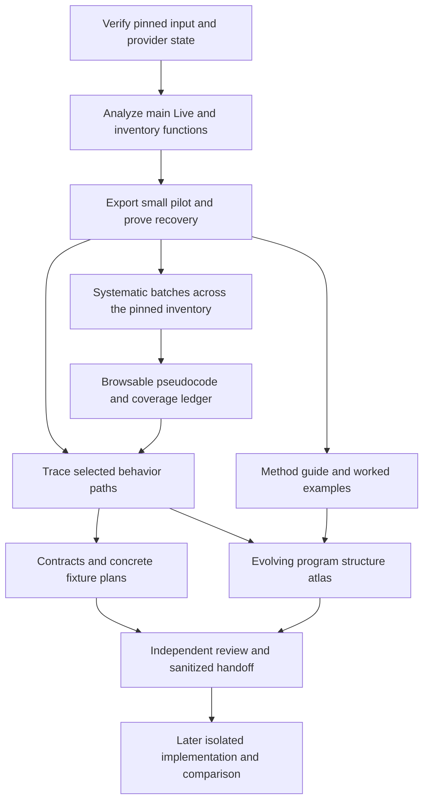

# Next phase: decompiled code corpus and behavioral handoffs

## Proposed outcome

Produce a browsable, reproducible **main Live decompilation corpus**, then use
selected code paths to produce reviewed behavioral contracts. Document the
method and the emerging program structure so a human reader can follow the
reasoning, learn the tools and assess what we actually know. The user should
be able to search for a function, read its C-like pseudocode, follow available
references, inspect warnings and see exactly what remains unprocessed.

Code export is a first-class deliverable in this phase. Specification writing
continues alongside it; it must not displace main-executable decompilation with
another round of package inventories or helper-only demonstrations. Here,
“decompiled source” means a decompiler representation, not original C++ source,
original filenames, a buildable application or proof of runtime behavior.

**Status: execution authorized by the user on 2026-10-09.** The
[associated execution plan](native-phase-execution.md) tracks actual gates and
resources; authorization is not milestone completion. The original reviewed
revision is retained with the planning artifacts. The
[static-first policy](../decisions/adr-0002-static-first-analysis.md) remains in
force. Work systematically exports bounded batches across one pinned image;
deep semantic investigation remains question-driven. Broad export is a
first-class artifact objective, not a requirement to explain every function
before writing a spec.

## Starting point and scope

| Already established | Still unestablished |
| --- | --- |
| Pinned Live 12.4.3 build and byte-identical arm64 extraction | Main Live auto-analysis completion, duration, memory use and identified-function count |
| Ghidra accepts the 149,711,904-byte main arm64 input | Main-image pseudocode output and sustainable export throughput |
| Push2 helper entry produces pseudocode, assembly and references | Complete helper or main-image decompilation |
| Seventeen MIDI-related modules decoded; 13-requirement analyst draft | Native MIDI arithmetic, host errors, lifecycle and empirical compatibility |
| Artifact catalog and offline browser exist | Per-function main Live browsing and reliable large-corpus search |
| Evidence hashes and source records exist locally | Off-machine retention and enforced clean implementation workspace |

Baseline: [package identity](sources/ableton-live-12.4.3.md),
[decompilation preparation](ableton-decompilation-preparation.md),
[MIDI investigation](midi-user-mapping.md), [artifact catalog](artifacts/index.md).
The native input is the retained `derived/Live.arm64`, SHA-256
`3a99ceeabce62ccd069b6b55d99d186c9bdf8a6b80a7e3350dd0f9d1c383cfad`.
The established provider combination is REA 6.3.0, Ghidra 12.1.4 and JDK 21.0.12.1
for the helper; its main-image capacity is unknown.

Primary scope: the main Live arm64 image for this build. Preserve all discovered
function records, including library-looking and unnamed functions. Other
architectures, historical versions, Max, Push, device bundles and opaque ALP/AGR
containers remain separately visible backlogs. They do not delay the first main
Live export. Existing Python disassembly remains useful; recovering readable
Python is a separate optional work item, not a prerequisite or a substitute.

This phase does not implement the replacement app, settle JUCE/framework choices,
copy GUI assets into a candidate, build a universal replay harness, or promise
whole-product compatibility. Those belong to later scoped decisions and handoffs.

## Three connected workstreams



The export worker produces evidence mechanically. Investigators interpret selected
paths. A documentation steward turns real investigations into accessible
explanations and maintains an evolving program-structure atlas. Reviewers
challenge artifact integrity, behavioral conclusions and the teaching narrative.
Export, behavioral understanding and human understanding have distinct outputs.

## Corpus design

### Identity and storage

Use a new analyst-only directory; preserve existing captures and manifests:

```text
analysis/ableton-live-12.4.3/native-live-arm64-v1/
  run.json                         Build, input digest, tool/profile identity
  inventory/                       Immutable function-inventory revisions
  evidence/                        Immutable exported REA records
  attempts/                        Append-only per-batch attempt records
  functions/<entry-address>/
    <evidence-revision>/
      pseudocode.c                 Unedited returned pseudocode, when available
      metadata.json                Names, ranges, evidence locator, warnings
      references.json              Available callers/callees and edge provenance
      assembly.txt                 Optional detailed trace/failure investigation
  annotations/                     Separately versioned analyst names and types
  coverage.json                    Regenerated current-state ledger
  manifest.json                    Payload hashes; excludes its own digest
  browse/                          Replaceable offline pages and compact indexes
```

A stable function identity combines input SHA-256, architecture and static entry
address. An export revision also identifies provider/version, analysis settings,
annotation revision and evidence ID. Symbol aliases point to that identity;
renaming a function must not move or overwrite its historical evidence.

Retain complete body ranges where the provider supplies them, including gaps;
address-span size is not necessarily code size. Preserve unknown signature/type
information and decompiler warnings. Analyst aliases, inferred class groupings
and type corrections are overlays with supporting evidence, never edits
silently disguised as original output. Missing pseudocode produces a failure
record, not fabricated source. Generated code is never compiled or executed to
“validate” original behavior.

Initially use JSON/JSONL, text files and the existing Python browser tooling.
Introduce a database only if measured indexing/recovery needs justify it. Large
exports go to retained files; do not stream full corpora into chat context.

### Queue and recovery

One coordinator owns the active native REA session and writes the work ledger.
Subagents read exported files; they do not switch the shared target or mutate
the same provider state concurrently. The first job validates actual tool schemas
and provider availability. Advertised tools are planning inputs, not proof of
successful execution on the main image; see the retained
[capability note](../../analysis/ableton-live-12.4.3/phase-2-plan/tool-capabilities.json).

Before implementing the controller, validate its transport: either a client
that owns one long-lived MCP/REA connection, or a supported installed-provider
export route. A standalone Python script cannot invoke the chat runtime
`tools` object. P1 must demonstrate callable operations and reconnection; P2
otherwise implements only file queue/bookkeeping until an adapter is proven.
Do not start a separate CLI/analyzer process per function if that repeats import
and analysis. Pin the chosen transport and its lifecycle in `run.json`.

The advertised procedure-list tool has no cursor; retain its complete result
and page locally if needed. Always supply explicit address lists to batch
decompilation. Batch limits, timeout controls and concurrency are not established
by the available schema. Full function dossiers are reserved for selected
questions; bulk export should not duplicate expensive assembly/CFG/value-flow
analysis for every function. Native tracing uses native procedure/reference
tools; the advertised JavaScript feature-tracing tool is not a native substitute.

Freeze a function-inventory revision before calculating coverage. Deduplicate
aliases by resolved function entry while retaining every provider inventory row.
Classify external/bodyless records separately, with reasons; do not silently
exclude unnamed, large or inconvenient functions. A changed analysis inventory
creates a new revision and a reconciled backlog, not a moved denominator.

The local controller owns explicit address batches and per-item results. Begin
with one function, then five if successful; use a proposed twenty-function pilot
to sample seeded, unnamed, short, large and indirect-flow cases that are actually
present. Tune batch size from measured memory, latency and payload sizes.
Persist each completed item atomically, then mark it committed in the ledger.
On interruption, reconcile output hashes and pending attempts before resuming;
do not regenerate verified successful items for unchanged inputs/settings.

Test controller interruption separately from provider shutdown. REA snapshots
retain eligible queries, not a full saved Ghidra database. A warm controller
restart does not demonstrate a cold analyzer restart. Before the long export,
measure whether a cold restart requires reanalysis and document the recovery
path. If the current adapter cannot sustain the workload, evaluate an explicitly
persistent Ghidra project/export route with the installed provider. A new adapter
or script is engineering work, not an assumed available feature.

Retain partial successes when a batch fails. Distinguish transport-size errors
from provider errors: inspect/export the already retained evidence for the former
rather than rerunning the analysis. Retry a transient item once after diagnosis;
subsequent retries require a changed condition or settings revision. A caller
timeout is not proof the underlying analysis stopped. Confirm provider state
before restarting or opening another session, and close owned sessions at the
end of the run.

### What the user can browse

Extend the [current browser generator](../../tools/build_artifact_browser.py)
rather than create a second unrelated portal. Provide:

- Search by symbol, demangled name, analyst alias and static address.
- A function page containing pseudocode, warnings, provenance and source links.
- Caller/callee links only where established; unresolved/indirect edges remain
  explicit. Pagination or bounded neighborhoods keep graphs usable.
- Separate package-location grouping from inferred feature/class grouping.
- Filters for exported, exported-with-warnings, failed and not-yet-attempted.
- A visible build/architecture/inventory revision and a coverage summary.
- Direct links back to the canonical research question or draft specification.

Use compact indexes and separate function pages so opening the browser does not
load all pseudocode. Render recovered text as escaped data; no external scripts
or network service are required. Preserve direct text-file access and a Markdown
index when browser interaction is unavailable. The existing browser's interactive
smoke test was inconclusive; this phase must actually validate search/navigation
before calling its expanded browser verified.

## Pedagogy and the evolving program map

The phase must teach a technically curious reader how the investigation works,
without requiring familiarity with Ghidra or ARM64. Documentation is produced
with each meaningful finding, not deferred to a final report. Start from a
plain-language explanation, add a small diagram or annotated example, then link
the exact code/evidence for readers who want the detail. Avoid raw tool transcripts
as the main reading experience.

### Reader journey and planned pages

| Reader question | Planned canonical home | Required content |
| --- | --- | --- |
| Where do I start? | `wiki/research/learning/index.md` | Short reading order, prerequisites, links to the existing artifact catalog, method guide and worked cases |
| What are these tools showing me? | `wiki/research/learning/method.md` | Explain binary vs source, symbols vs functions, disassembly vs pseudocode, basic blocks, direct/indirect calls, static addresses vs runtime addresses and evidence confidence; maintain a small glossary here |
| How did we answer a real question? | `wiki/research/learning/walkthroughs/<question>.md` | A reproducible, curated investigation from a user-visible question through code to a supported claim or explicit unresolved result |
| How is Live put together? | `wiki/research/program-structure.md` | Evolving analyst atlas of discovered program relationships, linked to canonical subsystem research and exact evidence; contrast package containment with recovered code relationships |
| What changed in our understanding? | Existing `wiki/log.md`, linked from the atlas | Milestone updates explaining new evidence, corrected interpretations and remaining gaps |

These are proposed pages, not files already written. Create the guide and initial
atlas during M1, using the existing package map and observed tool outputs;
create subsystem pages only when supported findings exist. Link each new page
from its domain index in the same change. Keep behavioral requirements in specs
and detailed findings in their canonical research pages. Tutorials and diagrams
explain and link those facts rather than maintain competing specifications.

### Worked-example format

Each walkthrough answers one concrete question and includes:

1. **Question and starting knowledge:** the behavior or structure we want to
   understand, why it matters, and which parts are still hypotheses.
2. **Evidence selection:** why a particular binary, symbol, string, schema or
   reference is useful; name the pinned build and artifact.
3. **The actual route:** selected commands/tool operations and bounded outputs,
   with enough detail to reproduce the navigation. Distinguish actually executed
   steps from a suggested follow-up.
4. **How to read it:** a small real pseudocode/assembly excerpt or linked range,
   explained in plain language. Identify inferred names/types, warning markers,
   conditions and uncertain calls. Do not invent cleaner “recovered code.”
5. **Reasoning and alternatives:** explain how the evidence supports the claim,
   why alternatives remain possible, and whether another source corroborates it.
6. **What we learned:** observed facts, inferences and unknowns separately, a
   simple structural/state diagram where helpful, and links to the research/spec.
7. **Next discriminating check:** what would strengthen or falsify the conclusion;
   an optional reader exercise with an evidence-backed answer or an explicit unknown.

Initial lessons: reading a real exported main-Live function in M1; tracing a
persisted transport field in M5; and a contrasting case where an indirect/native
boundary prevents a conclusion. The MIDI parser investigation may provide a
short bytecode companion, clearly separate from native decompilation. A failed
or inconclusive investigation can be a useful lesson when it explains the limits
of a method. Do not manufacture a success narrative.

### Program-structure atlas

Maintain three clearly labeled views as evidence accumulates: package/component
containment, static code relationships, and inferred responsibilities/state
relationships. Runtime process/thread or signal-flow diagrams require their own
supporting evidence; a static call graph does not establish execution order or
audio routing. Every consequential node/edge should cite its source or linked
finding and mark observed, inferred or unknown status. Use compact diagrams for
one question or subsystem before assembling an overall map.

For each discovered area, explain in ordinary language what it appears to do,
its entry points, the data/state it touches, neighboring components and open
questions. Label provisional aliases. Version changes to the atlas when new
analysis invalidates a relationship, retain the earlier finding and update
linked tutorials so old conclusions do not appear current. Do not present
compiler-generated functions or C++ class guesses as original source modules.

### Teaching acceptance criteria

M1 delivers a short first-code walkthrough and an initial atlas even if the
interesting conclusion is still unknown. M4 lets a reader follow the guide into
a function page and back to its explanation. M5 supplies at least two native
walkthroughs, including one that explicitly teaches an uncertainty or failed
hypothesis; overlap with the behavior packets is encouraged. Each native packet
updates the atlas in the same change.

Before phase closure, a separate reviewer unfamiliar with the particular
investigation must be able to follow one walkthrough from its question to the
retained evidence, explain the conclusion and one limitation, and distinguish
package structure from inferred internal structure. Record actual review
findings and corrections. Two walkthroughs are a minimum, not a page-count
success metric. Pedagogical clarity does not increase evidence confidence.
These materials contain analysis and recovered internals; they remain outside
clean implementation handoffs.

## Roadmap and milestone gates

Milestone definitions below are targets; actual progress is recorded in the
[execution ledger](native-phase-execution.md#gate-ledger). The gates are deliverables, not promises
about elapsed days. The first measured pilot determines a credible duration and
storage estimate for the long export.

| Milestone | Work and concrete output | Exit gate |
| --- | --- | --- |
| M1 — First main Live code | Set initial resource limits and prove transport; verify identity/settings; run main analysis once; inventory functions and export a twenty-function pilot; write first-code walkthrough/initial atlas | Actual main-image pseudocode and its explanation are readable; failures/warnings retained; initialization cost measured; transport/lifecycle proven |
| M2 — Reliable export controller | Build deterministic queue, atomic persistence, manifests, bounded retries and resume checks; benchmark representative batches | An interrupted controller resumes without losing or duplicating committed exports; cold-provider recovery cost/path documented; batch and resource limits set |
| M3 — Systematic main-image export | Process every eligible function in the pinned discovered-function inventory, with feature-relevant addresses first | Every inventory row accounted for; every eligible function attempted; no pending/running work in a completed export run; failures and successful-output rates visible |
| M4 — Usable code browser | Add per-function views, search, reference links, provenance, warnings and coverage to existing catalog | A reviewer can follow the guide, locate functions, open pseudocode, follow a known edge and inspect a failure; direct-file fallback works |
| M5 — Behavioral trace packets | Trace persistence and transport state paths; connect shipped schema/fixtures; strengthen the existing MIDI candidate | Two native behavior packets and linked walkthroughs; atlas updated; evidence review passes; uncertainty and case coverage explicit |
| M6 — First clean handoff and phase report | Release one finite, self-contained behavioral subset; report corpus results and remaining work | Handoff and independent reader review pass; phase report separates export, semantic, learning and verification coverage; no unmeasured compatibility claim |

M1 precedes long-run automation. M4 begins after M1 and grows during M3. M5 can
start from pilot exports while M3 runs; M6's contract review need not wait for
irrelevant functions. The **major phase is complete only when all six gates are
met**. A subset export can be delivered early, but it must not be labeled a
completed main-image run. If full discovered-function export is infeasible,
record the blocker and a proposed scope revision instead of quietly redefining
completion around whichever few functions succeeded.

“Every eligible function attempted” is export-run completeness, not perfect source
recovery. Disassembly/function discovery can miss code; failed decompilations
remain failures. No claim of recovering all original functions or application
behavior follows from M3.

## Initial feature priorities

| Priority | Bounded question | Inputs and proposed deliverable |
| --- | --- | --- |
| 1 — Minimal persisted transport state | How are stored tempo, loop enable and loop bounds read, defaulted and written for a minimal set? | Shipped schemas/default ALS plus resolved native loader/writer references; field-level contract with missing/malformed/unknown-field cases and explicit units gaps |
| 2 — Transport state changes | Which state changes are requested by start/stop and loop controls, and which are observable or persisted? | Validated transport/song seeds, native references and existing MIDI mappings; transition table with rejected inputs, repeat actions and unresolved scheduler boundary |
| 3 — MIDI handoff closure | Which supported assignments can be specified without promising unresolved native arithmetic or host recovery? | Existing 13 requirements/46 case groups; concretize selected fixtures/observation methods and narrow the first release honestly |
| Next queue — Clip and editing behavior | How do clip state, editing commands and undo connect to the chosen workflow? | AudioClip/song references and resource schemas; add only after the first two native packets have disciplined coverage |

Factory symbols in [the preparation page](ableton-decompilation-preparation.md#ready-native-inputs)
are search seeds, not proven loading or scheduler entry points. Resolve them and
follow supporting references before assigning semantic names. If a seed is
unproductive, preserve the bounded negative result and choose another reference.
GUI/resource work follows a selected command or visual question; no general
asset extraction project is on the critical path.

For each packet, record the question, exact source/evidence, competing
interpretations, branch conditions, native/host boundaries, proposed observable
contract and case matrix. Separate documentary expectations, static derivations
and runtime observations. Include positive, malformed, boundary, repeated-action,
cancellation, teardown, persistence and undo cases when applicable; justify
exclusions explicitly. Prose “known device” and “wait until complete” are not
executable fixtures. A release needs concrete input bytes or construction rules,
an externally usable observation method and explicit remaining comparison work.

A bounded runtime probe is appropriate when static evidence leaves a material
question, the experiment is clearly cheaper, or a measurement claim requires it.
Define the discriminating input and stopping condition first. No general Frida,
diagnostic-plugin or replay-harness project is a gate on code export.

### Default first handoff

Nominate the **minimal persisted transport-state subset** from priority 1 as the
first native-backed release: only fields and read/write/default rules supported
by the actual trace, with concrete fixture construction and declared format scope.
Do not promise full `.als` interchange. At the M5 evidence review, fix the exact
requirement set and exclusions. If no useful native-backed subset is supportable,
record the blocker and select the already reviewed MIDI assignment subset as an
explicit fallback, with rationale and its own release review. That fallback
cannot replace the two native behavior packets or count as a native-backed
release. Report which path actually shipped.

## Work packages and agent ownership

Proposed paths below do not yet exist unless linked. Only analyst tooling is
built in this checkout; no worker here becomes a clean app implementer.

| Task | Owner and dependencies | Files / work product | Verification |
| --- | --- | --- | --- |
| P1 Capture main analysis pilot | Native-session coordinator; first, after resource preflight and transport selection | New `native-live-arm64-v1/run.json`, inventory and first function exports | Hash/input/profile match; inspect representative pseudocode against returned evidence and instructions |
| P2 Implement export ledger | Analyst-tooling author after P1 | Proposed `tools/export_native_corpus.py`, `tools/tests/test_native_export.py` | Meaningful replay tests: interrupted write, partial batch, duplicate aliases, unchanged resume, changed profile and inventory revision |
| P3 Validate recovery and capacity | Coordinator plus independent reviewer after P2 | Attempt logs, resume report, resource envelope | Demonstrate controller recovery; separately establish cold-provider behavior and measured batch bounds |
| P4 Run export batches | Sole native-session owner after P3 | Immutable evidence/function revisions and derived coverage | Item hashes, accounting invariants, bounded failures; regular durable checkpoints |
| P5 Extend artifact browser | Separate analyst-tooling author after P1; separate file ownership from P2 | Existing browser generator, new corpus views, browser smoke scenarios | Actual search/link/filter checks, escaped hostile text, large-index loading and direct-file fallback |
| P6 Trace persistence and transport | Independent investigators reading exported corpus; native queries queued through owner | New bounded research pages and analyst-side specs, names chosen after scope is fixed | Evidence review; every requirement has a supported expectation or explicit unknown |
| P7 Prepare first release | Spec author, then separate handoff reviewer | New immutable release directory and catalog update | Remove recovered code/internal structure; validate in export-only directory and verify every payload digest |
| P8 Teach and map the investigation | Documentation steward alongside P1/P5/P6 | Planned learning index/method/walkthrough pages and `program-structure.md` | Independent reader can reproduce navigation, explain the evidence and name an uncertainty; diagrams use supported edges |
| P9 Close phase | Maintainer after all gates | Phase report; research/spec indexes, coverage/questions/log | Reconcile backlog, no stale completion claims; full documentation lint |

Use subagent-driven development for P2/P5: a fresh author, then scope/compliance
review, then quality review; fix findings before accepting the task. Investigators
can work in parallel on disjoint exported evidence, while native provider access
remains serialized. Reviewers are not implementers. A clean implementation agent
later requires a fresh, access-restricted workspace containing only approved
handoffs and permitted materials; shared analyst access is insufficient.

## Coverage, capacity and failure policy

Keep four separate dashboards:

| Dimension | Required accounting |
| --- | --- |
| Export coverage | Pinned inventory total; eligible bodies; external/bodyless/unresolved classification counts; pending, running, exported, exported-with-warnings and failed items |
| Semantic coverage | Named question packets, supported versus open requirements, reviewed cases and remaining native/host dependencies |
| Learning and structure | Current reading route, evidence-linked atlas, native walkthroughs and independent reader-review findings; completeness follows supported findings, not page count |
| Compatibility | Actual executed comparisons per build/scenario/dimension; initially unknown throughout |

For one inventory revision, eligible items equal the sum of the mutually
exclusive export states. Exported-with-warnings is distinct from exported without
warnings. Report both attempted/eligible and successful/eligible; never merge
failed items into a “decompiled” count. Also report inventory-classification gaps.
Duplicate aliases do not increase the function denominator. Retrying creates an
attempt, not a new function. Byte coverage, if computed, uses the union of known
function body ranges and retains overlaps/gaps; it cannot prove all code was found.

Before M1 starts main analysis, set a written provisional resource envelope
from the actual host: free disk, allocatable memory, JVM/provider limits where
supported, maximum initial analysis duration and safe abort procedure. Reserve
at least 25% of available free disk as headroom and schedule no second native
worker; these are proposed operating defaults, not capacity estimates. Record
absolute limits in the run configuration. Observe logs/resource use at least
once per minute where tooling permits; check external scheduling timeouts do
not leave an untracked analyzer running. If the provider gives no progress or
resource telemetry, state that limitation and choose a bounded external watchdog
before the run. Do not infer a hang solely from a quiet analysis log.

P1/P3 then tune the export envelope: maximum batch size, retry allowance and
checkpoint frequency (initially after every completed batch). Measure
initialization, per-function latency spread,
output bytes and failure rate separately. A sample average alone is not a
reliable estimate for unusually large functions. Extrapolate a range, state the
sample bias and revise after the first larger batch. No calendar estimate is
credible before these measurements.

If the provider cannot complete main analysis, retain logs and partial work;
diagnose one bounded configuration change or evaluate the persistent-provider
fallback. If disk or memory limits are reached, stop scheduling new work and
checkpoint; preserve raw evidence. If a function cannot be decompiled, surface
its instructions/references where available and keep its failure visible. If a
spec cannot close a material gap, narrow that release or retain the question;
do not invent a behavior to satisfy a milestone.

## Phase completion and next boundary

The reviewable delivery consists of the main-image export and inventory,
provenance/coverage/failure reports, an actually usable browser, a readable method
guide and evolving program atlas, at least two native walkthroughs, two native
behavior packets and at least one reviewed behavioral handoff. Preserve raw
provider evidence; browser and annotated views remain rebuildable.

A self-contained handoff may be released while empirical compatibility remains
unknown under [the release workflow](../workflows.md#release-a-handoff). Provisioning
an isolated implementation workspace is the next boundary, not something that
can be simulated by giving a subagent a different role in this checkout.

Unresolved decisions remain in [the question register](../questions.md):
compatibility dimensions (Q-001), retention/isolation (Q-003), implementation
foundation (Q-004), broader native/format work (Q-006), and MIDI gaps (Q-008–010).
Main-image scale/export recovery is tracked as Q-011. Choose an evidence retention
destination before treating local ignored artifacts as durable beyond this host.
The operational defaults in this draft can be tuned by the pilot; target build,
architecture, phase scope and evidence boundaries must remain explicit.

## Revision 2 proposal — 2026-10-17

**Status: proposed, not adopted.** Revision 1 above remains the authorized plan
until the user decides. This section proposes how to restart on the Linux
workstation recorded in the [provisioning record](native-phase-execution.md#linux-workstation-provisioning--2026-10-17)
and how to turn decompilation into specifications faster than the first pass did.

### What changed since revision 1

| Revision 1 assumption | Situation now |
| --- | --- |
| Ephemeral REA session on a 16 GiB macOS host; bulk export in capacity-gated 1,000-entry MCP stages | 125 GiB RAM, 32 CPUs, 36 GiB free on the root filesystem; durable project storage undecided; Live cannot execute on this host |
| Retained corpus, inventory and coverage ledger available locally | Absent here; restore from the macOS host or regenerate as a new inventory revision |
| Semantic work seeded from factory symbols outward | Two transport packets reached an indirect dispatch and produced no external contract |
| REA 6.3.0 lifecycle observations | REA 6.5.0 installed; its source is uninspected |

New observations in [package structure](ableton-package-structure.md#serialization-vocabulary-strings-and-shipped-documents--2026-10-17):
the image contains exact strings for the document vocabulary (`LoopOn`,
`Tempo`, `SchemaChangeCount` and others) and the bundle ships thousands of
`.als`/`.alc`/`.adv`/`.adg` documents plus 203 schema versions. Both support
an outside-in method that was not used in the first pass.

### Proposed sequencing

**Phase 0 — Restart gates.**

| Gate | Work | Exit | Owner |
| --- | --- | --- | --- |
| G0.1 Storage | Choose a durable, user-owned location with at least 40 GiB for project, corpus and indexes: a `sudo`-created root-filesystem directory or freed `/home` capacity | Path recorded in the ledger with measured free bytes | User |
| G0.2 Evidence | Copy the macOS `analysis/` tree and verify its checksum manifests; otherwise record it as lost on the source page and treat ledger counts as historical | Links resolve, or the loss is recorded | Analyst |
| G0.3 Persistent project | `analyzeHeadless` import of `Live.arm64` with `-noanalysis`, one measured full analysis, save, hash `.gpr`/`.rep`, cold reopen proof | Reopen succeeds; duration, heap, CPU and bytes recorded; discovered-function count compared with 418,418 as a new inventory revision | Analyst |

G0.3 starts as soon as G0.1 is decided; it does not wait for G0.2. Gates such
as the two-thread pin in `RecoveryLaunchGate.java` and the 4 GiB heap were
measured on the macOS host and must be re-measured here, not inherited.

**Phase 1 — Corpus as one measured batch job.** Replaces the remainder of
M2–M4 as separate milestones.

- C1 Bulk decompile: a headless post-script derived from
  `RecoveryNativeExport.java` (DecompInterface, 60 s timeout) running parallel
  decompiler instances across cores against the saved project. Sample 10,000
  functions first to measure latency spread, bytes per function and failure
  rate; then attempt every eligible row. Ingest through
  `export_native_corpus.py check` into the layout above.
- C2 Derived indexes the spec work needs: string-to-reference table, call-graph
  edges, indirect-call and vtable candidates, symbol aliases. JSONL, rebuilt
  from the project, never hand-edited.
- C3 Browser regeneration and one real-browser navigation check.

Exit: every inventory row has an outcome, failures stay failures,
`coverage.json` is regenerated and every index checks against the project.

**Phase 2 — Specification packets, anchored from the outside in.** The method
change: begin at externally observable artifacts (document fields, shipped
documents, user-visible strings) and trace into code through references, instead
of from factories outward. Keep the revision 1 packet format, the eight-dossier
budget and retained negative results.

| Packet | Bounded question | Anchors | Deliverable |
| --- | --- | --- | --- |
| S1 Transport-state fields | How are `Tempo`, `LoopOn`, `LoopStart`, `LoopLength` and time signature read, defaulted and written? | Field-name string references; schema declarations across 203 versions; value statistics over the 52 sets and 700 clips; the twelve prepared P1 inputs | `SPEC-TRANSPORT-STATE` draft; first native-backed handoff candidate, unchanged from revision 1 |
| S2 Container and version envelope | What gzip/XML envelope, root attributes and schema versions does the 12.4.3 loader accept? | `MajorVersion`/`MinorVersion`/`SchemaChangeCount`/`Creator` references; schema deltas | `SPEC-ALS-CONTAINER` draft supporting the save/reopen scenario |
| S3 Transport transitions | What does Start, Stop and loop toggling change observably? | Resume from the shared helper's indirect target using the C2 call and vtable index | Transition table, or an ADR 0002 escalation record for Phase 4 |
| S4 MIDI mapping closure | Which further clauses of the 13-requirement draft are supportable? | Existing research and Q-008–Q-010 | Release more clauses or freeze; fallback remains |
| S5 Clip launch and quantization | After S1–S3 | Session/clip references and schemas | Queued |

Each packet yields a draft page under `wiki/specs/` with requirement IDs, a
feature-map link, statically derived acceptance cases and explicit unknowns.

**Phase 3 — Handoffs.** H2 releases the transport-state document subset from S1
(with S2 if supportable) under the release workflow; H3 releases the container
and version contract. The MIDI fallback is used only if H2 cannot be supported,
and the report states which path shipped.

**Phase 4 — Reference observation batch.** This host cannot run Live. Collect
every runtime-dependent question left by S1–S3 into one prepared probe batch
with inputs, discriminating observation and stopping condition per
[ADR 0002](../decisions/adr-0002-static-first-analysis.md), to run in a single
sitting on the macOS host with retained captures. It is not a gate for Phases
1–3.

### Accounting and policy

The four dashboards in the coverage policy above are unchanged. Phase 1 reports
attempted/eligible and succeeded/eligible separately. The 25% free-disk headroom
rule stays. The single-native-worker rule becomes a single project writer;
parallel decompiler threads inside that one process are allowed once measured.
Pedagogy continues as one lesson per packet rather than a separate gate.

### Routing effect if adopted

Before: M1 passed, M2 partial, M3 at 0.485%, M4 partial, M5 partial, M6
shipped the fallback. After: G0.1–G0.3, C1–C3, S1–S5, H2–H3 and the Phase 4
batch are all pending; G0.1 is blocked on the user. Next item: G0.1, then G0.3
immediately. Nothing here changes ADR 0002, the handoff boundary, evidence
rules or the prohibition on implementation in this checkout. Export remains a
deliverable, delivered as one measured job rather than as the gate for
specification work.
