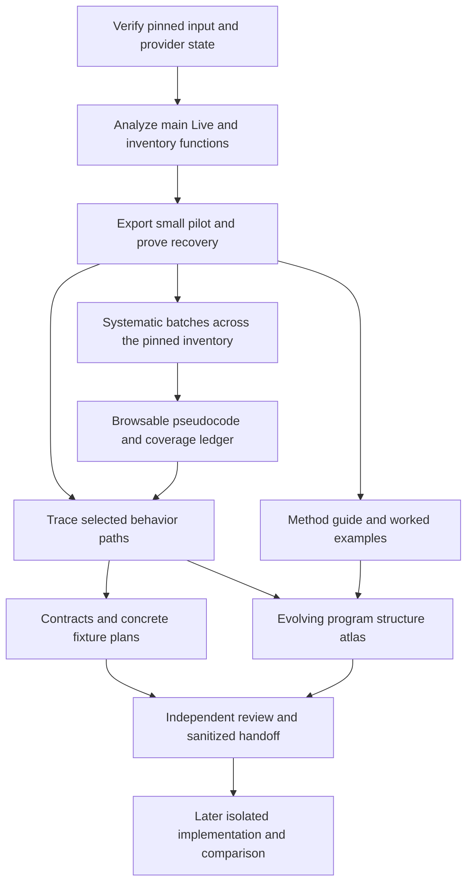

# Next phase: decompiled code corpus and behavioral handoffs

**Current direction: revision 4 (2026-10-19).** Full-product behavioral
specification coverage is now authorized. The [full specification plan](full-live-specification-plan.md)
is the current analyst work selector. Prior revisions below retain the native
export and T1 history; they do not freeze out-of-T1 specification work.

## Proposed outcome

Produce a browsable, reproducible **main Live decompilation corpus**, then use
selected code paths to produce reviewed behavioral contracts. Document the
method and the emerging program structure so a human reader can follow the
reasoning, learn the tools and assess what we actually know. The user should
be able to search for a function, read its C-like pseudocode, follow available
references, inspect warnings and see exactly what remains unprocessed.

Code export is a first-class deliverable in this phase. Specification writing
continues alongside it; it must not displace main-executable decompilation with
another round of package inventories or helper-only demonstrations. Here,
“decompiled source” means a decompiler representation, not original C++ source,
original filenames, a buildable application or proof of runtime behavior.

**Revision 2 adopted 2026-10-17.** The remaining milestones are replaced by the
[revision 2 sequence](#revision-2-proposal--2026-10-17); text below is retained as
revision 1. **Status: execution authorized by the user on 2026-10-09.** The
[associated execution plan](native-phase-execution.md) tracks actual gates and
resources; authorization is not milestone completion. The original reviewed
revision is retained with the planning artifacts. The
[static-first policy](../decisions/adr-0002-static-first-analysis.md) remains in
force. Work systematically exports bounded batches across one pinned image;
deep semantic investigation remains question-driven. Broad export is a
first-class artifact objective, not a requirement to explain every function
before writing a spec.

## Starting point and scope

| Already established | Still unestablished |
| --- | --- |
| Pinned Live 12.4.3 build and byte-identical arm64 extraction | Main Live auto-analysis completion, duration, memory use and identified-function count |
| Ghidra accepts the 149,711,904-byte main arm64 input | Main-image pseudocode output and sustainable export throughput |
| Push2 helper entry produces pseudocode, assembly and references | Complete helper or main-image decompilation |
| Seventeen MIDI-related modules decoded; 13-requirement analyst draft | Native MIDI arithmetic, host errors, lifecycle and empirical compatibility |
| Artifact catalog and offline browser exist | Per-function main Live browsing and reliable large-corpus search |
| Evidence hashes and source records exist locally | Off-machine retention and enforced clean implementation workspace |

Baseline: [package identity](sources/ableton-live-12.4.3.md),
[decompilation preparation](ableton-decompilation-preparation.md),
[MIDI investigation](midi-user-mapping.md), [artifact catalog](artifacts/index.md).
The native input is the retained `derived/Live.arm64`, SHA-256
`3a99ceeabce62ccd069b6b55d99d186c9bdf8a6b80a7e3350dd0f9d1c383cfad`.
The established provider combination is REA 6.3.0, Ghidra 12.1.4 and JDK 21.0.12.1
for the helper; its main-image capacity is unknown.

Primary scope: the main Live arm64 image for this build. Preserve all discovered
function records, including library-looking and unnamed functions. Other
architectures, historical versions, Max, Push, device bundles and opaque ALP/AGR
containers remain separately visible backlogs. They do not delay the first main
Live export. Existing Python disassembly remains useful; recovering readable
Python is a separate optional work item, not a prerequisite or a substitute.

This phase does not implement the replacement app, settle JUCE/framework choices,
copy GUI assets into a candidate, build a universal replay harness, or promise
whole-product compatibility. Those belong to later scoped decisions and handoffs.

## Three connected workstreams



The export worker produces evidence mechanically. Investigators interpret selected
paths. A documentation steward turns real investigations into accessible
explanations and maintains an evolving program-structure atlas. Reviewers
challenge artifact integrity, behavioral conclusions and the teaching narrative.
Export, behavioral understanding and human understanding have distinct outputs.

## Corpus design

### Identity and storage

Use a new analyst-only directory; preserve existing captures and manifests:

```text
analysis/ableton-live-12.4.3/native-live-arm64-v1/
  run.json                         Build, input digest, tool/profile identity
  inventory/                       Immutable function-inventory revisions
  evidence/                        Immutable exported REA records
  attempts/                        Append-only per-batch attempt records
  functions/<entry-address>/
    <evidence-revision>/
      pseudocode.c                 Unedited returned pseudocode, when available
      metadata.json                Names, ranges, evidence locator, warnings
      references.json              Available callers/callees and edge provenance
      assembly.txt                 Optional detailed trace/failure investigation
  annotations/                     Separately versioned analyst names and types
  coverage.json                    Regenerated current-state ledger
  manifest.json                    Payload hashes; excludes its own digest
  browse/                          Replaceable offline pages and compact indexes
```

A stable function identity combines input SHA-256, architecture and static entry
address. An export revision also identifies provider/version, analysis settings,
annotation revision and evidence ID. Symbol aliases point to that identity;
renaming a function must not move or overwrite its historical evidence.

Retain complete body ranges where the provider supplies them, including gaps;
address-span size is not necessarily code size. Preserve unknown signature/type
information and decompiler warnings. Analyst aliases, inferred class groupings
and type corrections are overlays with supporting evidence, never edits
silently disguised as original output. Missing pseudocode produces a failure
record, not fabricated source. Generated code is never compiled or executed to
“validate” original behavior.

Initially use JSON/JSONL, text files and the existing Python browser tooling.
Introduce a database only if measured indexing/recovery needs justify it. Large
exports go to retained files; do not stream full corpora into chat context.

### Queue and recovery

One coordinator owns the active native REA session and writes the work ledger.
Subagents read exported files; they do not switch the shared target or mutate
the same provider state concurrently. The first job validates actual tool schemas
and provider availability. Advertised tools are planning inputs, not proof of
successful execution on the main image; see the retained
[capability note](../../analysis/ableton-live-12.4.3/phase-2-plan/tool-capabilities.json).

Before implementing the controller, validate its transport: either a client
that owns one long-lived MCP/REA connection, or a supported installed-provider
export route. A standalone Python script cannot invoke the chat runtime
`tools` object. P1 must demonstrate callable operations and reconnection; P2
otherwise implements only file queue/bookkeeping until an adapter is proven.
Do not start a separate CLI/analyzer process per function if that repeats import
and analysis. Pin the chosen transport and its lifecycle in `run.json`.

The advertised procedure-list tool has no cursor; retain its complete result
and page locally if needed. Always supply explicit address lists to batch
decompilation. Batch limits, timeout controls and concurrency are not established
by the available schema. Full function dossiers are reserved for selected
questions; bulk export should not duplicate expensive assembly/CFG/value-flow
analysis for every function. Native tracing uses native procedure/reference
tools; the advertised JavaScript feature-tracing tool is not a native substitute.

Freeze a function-inventory revision before calculating coverage. Deduplicate
aliases by resolved function entry while retaining every provider inventory row.
Classify external/bodyless records separately, with reasons; do not silently
exclude unnamed, large or inconvenient functions. A changed analysis inventory
creates a new revision and a reconciled backlog, not a moved denominator.

The local controller owns explicit address batches and per-item results. Begin
with one function, then five if successful; use a proposed twenty-function pilot
to sample seeded, unnamed, short, large and indirect-flow cases that are actually
present. Tune batch size from measured memory, latency and payload sizes.
Persist each completed item atomically, then mark it committed in the ledger.
On interruption, reconcile output hashes and pending attempts before resuming;
do not regenerate verified successful items for unchanged inputs/settings.

Test controller interruption separately from provider shutdown. REA snapshots
retain eligible queries, not a full saved Ghidra database. A warm controller
restart does not demonstrate a cold analyzer restart. Before the long export,
measure whether a cold restart requires reanalysis and document the recovery
path. If the current adapter cannot sustain the workload, evaluate an explicitly
persistent Ghidra project/export route with the installed provider. A new adapter
or script is engineering work, not an assumed available feature.

Retain partial successes when a batch fails. Distinguish transport-size errors
from provider errors: inspect/export the already retained evidence for the former
rather than rerunning the analysis. Retry a transient item once after diagnosis;
subsequent retries require a changed condition or settings revision. A caller
timeout is not proof the underlying analysis stopped. Confirm provider state
before restarting or opening another session, and close owned sessions at the
end of the run.

### What the user can browse

Extend the [current browser generator](../../tools/build_artifact_browser.py)
rather than create a second unrelated portal. Provide:

- Search by symbol, demangled name, analyst alias and static address.
- A function page containing pseudocode, warnings, provenance and source links.
- Caller/callee links only where established; unresolved/indirect edges remain
  explicit. Pagination or bounded neighborhoods keep graphs usable.
- Separate package-location grouping from inferred feature/class grouping.
- Filters for exported, exported-with-warnings, failed and not-yet-attempted.
- A visible build/architecture/inventory revision and a coverage summary.
- Direct links back to the canonical research question or draft specification.

Use compact indexes and separate function pages so opening the browser does not
load all pseudocode. Render recovered text as escaped data; no external scripts
or network service are required. Preserve direct text-file access and a Markdown
index when browser interaction is unavailable. The existing browser's interactive
smoke test was inconclusive; this phase must actually validate search/navigation
before calling its expanded browser verified.

## Pedagogy and the evolving program map

The phase must teach a technically curious reader how the investigation works,
without requiring familiarity with Ghidra or ARM64. Documentation is produced
with each meaningful finding, not deferred to a final report. Start from a
plain-language explanation, add a small diagram or annotated example, then link
the exact code/evidence for readers who want the detail. Avoid raw tool transcripts
as the main reading experience.

### Reader journey and planned pages

| Reader question | Planned canonical home | Required content |
| --- | --- | --- |
| Where do I start? | `wiki/research/learning/index.md` | Short reading order, prerequisites, links to the existing artifact catalog, method guide and worked cases |
| What are these tools showing me? | `wiki/research/learning/method.md` | Explain binary vs source, symbols vs functions, disassembly vs pseudocode, basic blocks, direct/indirect calls, static addresses vs runtime addresses and evidence confidence; maintain a small glossary here |
| How did we answer a real question? | `wiki/research/learning/walkthroughs/<question>.md` | A reproducible, curated investigation from a user-visible question through code to a supported claim or explicit unresolved result |
| How is Live put together? | `wiki/research/program-structure.md` | Evolving analyst atlas of discovered program relationships, linked to canonical subsystem research and exact evidence; contrast package containment with recovered code relationships |
| What changed in our understanding? | Existing `wiki/log.md`, linked from the atlas | Milestone updates explaining new evidence, corrected interpretations and remaining gaps |

These are proposed pages, not files already written. Create the guide and initial
atlas during M1, using the existing package map and observed tool outputs;
create subsystem pages only when supported findings exist. Link each new page
from its domain index in the same change. Keep behavioral requirements in specs
and detailed findings in their canonical research pages. Tutorials and diagrams
explain and link those facts rather than maintain competing specifications.

### Worked-example format

Each walkthrough answers one concrete question and includes:

1. **Question and starting knowledge:** the behavior or structure we want to
   understand, why it matters, and which parts are still hypotheses.
2. **Evidence selection:** why a particular binary, symbol, string, schema or
   reference is useful; name the pinned build and artifact.
3. **The actual route:** selected commands/tool operations and bounded outputs,
   with enough detail to reproduce the navigation. Distinguish actually executed
   steps from a suggested follow-up.
4. **How to read it:** a small real pseudocode/assembly excerpt or linked range,
   explained in plain language. Identify inferred names/types, warning markers,
   conditions and uncertain calls. Do not invent cleaner “recovered code.”
5. **Reasoning and alternatives:** explain how the evidence supports the claim,
   why alternatives remain possible, and whether another source corroborates it.
6. **What we learned:** observed facts, inferences and unknowns separately, a
   simple structural/state diagram where helpful, and links to the research/spec.
7. **Next discriminating check:** what would strengthen or falsify the conclusion;
   an optional reader exercise with an evidence-backed answer or an explicit unknown.

Initial lessons: reading a real exported main-Live function in M1; tracing a
persisted transport field in M5; and a contrasting case where an indirect/native
boundary prevents a conclusion. The MIDI parser investigation may provide a
short bytecode companion, clearly separate from native decompilation. A failed
or inconclusive investigation can be a useful lesson when it explains the limits
of a method. Do not manufacture a success narrative.

### Program-structure atlas

Maintain three clearly labeled views as evidence accumulates: package/component
containment, static code relationships, and inferred responsibilities/state
relationships. Runtime process/thread or signal-flow diagrams require their own
supporting evidence; a static call graph does not establish execution order or
audio routing. Every consequential node/edge should cite its source or linked
finding and mark observed, inferred or unknown status. Use compact diagrams for
one question or subsystem before assembling an overall map.

For each discovered area, explain in ordinary language what it appears to do,
its entry points, the data/state it touches, neighboring components and open
questions. Label provisional aliases. Version changes to the atlas when new
analysis invalidates a relationship, retain the earlier finding and update
linked tutorials so old conclusions do not appear current. Do not present
compiler-generated functions or C++ class guesses as original source modules.

### Teaching acceptance criteria

M1 delivers a short first-code walkthrough and an initial atlas even if the
interesting conclusion is still unknown. M4 lets a reader follow the guide into
a function page and back to its explanation. M5 supplies at least two native
walkthroughs, including one that explicitly teaches an uncertainty or failed
hypothesis; overlap with the behavior packets is encouraged. Each native packet
updates the atlas in the same change.

Before phase closure, a separate reviewer unfamiliar with the particular
investigation must be able to follow one walkthrough from its question to the
retained evidence, explain the conclusion and one limitation, and distinguish
package structure from inferred internal structure. Record actual review
findings and corrections. Two walkthroughs are a minimum, not a page-count
success metric. Pedagogical clarity does not increase evidence confidence.
These materials contain analysis and recovered internals; they remain outside
clean implementation handoffs.

## Roadmap and milestone gates

Milestone definitions below are targets; actual progress is recorded in the
[execution ledger](native-phase-execution.md#gate-ledger). The gates are deliverables, not promises
about elapsed days. The first measured pilot determines a credible duration and
storage estimate for the long export.

| Milestone | Work and concrete output | Exit gate |
| --- | --- | --- |
| M1 — First main Live code | Set initial resource limits and prove transport; verify identity/settings; run main analysis once; inventory functions and export a twenty-function pilot; write first-code walkthrough/initial atlas | Actual main-image pseudocode and its explanation are readable; failures/warnings retained; initialization cost measured; transport/lifecycle proven |
| M2 — Reliable export controller | Build deterministic queue, atomic persistence, manifests, bounded retries and resume checks; benchmark representative batches | An interrupted controller resumes without losing or duplicating committed exports; cold-provider recovery cost/path documented; batch and resource limits set |
| M3 — Systematic main-image export | Process every eligible function in the pinned discovered-function inventory, with feature-relevant addresses first | Every inventory row accounted for; every eligible function attempted; no pending/running work in a completed export run; failures and successful-output rates visible |
| M4 — Usable code browser | Add per-function views, search, reference links, provenance, warnings and coverage to existing catalog | A reviewer can follow the guide, locate functions, open pseudocode, follow a known edge and inspect a failure; direct-file fallback works |
| M5 — Behavioral trace packets | Trace persistence and transport state paths; connect shipped schema/fixtures; strengthen the existing MIDI candidate | Two native behavior packets and linked walkthroughs; atlas updated; evidence review passes; uncertainty and case coverage explicit |
| M6 — First clean handoff and phase report | Release one finite, self-contained behavioral subset; report corpus results and remaining work | Handoff and independent reader review pass; phase report separates export, semantic, learning and verification coverage; no unmeasured compatibility claim |

M1 precedes long-run automation. M4 begins after M1 and grows during M3. M5 can
start from pilot exports while M3 runs; M6's contract review need not wait for
irrelevant functions. The **major phase is complete only when all six gates are
met**. A subset export can be delivered early, but it must not be labeled a
completed main-image run. If full discovered-function export is infeasible,
record the blocker and a proposed scope revision instead of quietly redefining
completion around whichever few functions succeeded.

“Every eligible function attempted” is export-run completeness, not perfect source
recovery. Disassembly/function discovery can miss code; failed decompilations
remain failures. No claim of recovering all original functions or application
behavior follows from M3.

## Initial feature priorities

| Priority | Bounded question | Inputs and proposed deliverable |
| --- | --- | --- |
| 1 — Minimal persisted transport state | How are stored tempo, loop enable and loop bounds read, defaulted and written for a minimal set? | Shipped schemas/default ALS plus resolved native loader/writer references; field-level contract with missing/malformed/unknown-field cases and explicit units gaps |
| 2 — Transport state changes | Which state changes are requested by start/stop and loop controls, and which are observable or persisted? | Validated transport/song seeds, native references and existing MIDI mappings; transition table with rejected inputs, repeat actions and unresolved scheduler boundary |
| 3 — MIDI handoff closure | Which supported assignments can be specified without promising unresolved native arithmetic or host recovery? | Existing 13 requirements/46 case groups; concretize selected fixtures/observation methods and narrow the first release honestly |
| Next queue — Clip and editing behavior | How do clip state, editing commands and undo connect to the chosen workflow? | AudioClip/song references and resource schemas; add only after the first two native packets have disciplined coverage |

Factory symbols in [the preparation page](ableton-decompilation-preparation.md#ready-native-inputs)
are search seeds, not proven loading or scheduler entry points. Resolve them and
follow supporting references before assigning semantic names. If a seed is
unproductive, preserve the bounded negative result and choose another reference.
GUI/resource work follows a selected command or visual question; no general
asset extraction project is on the critical path.

For each packet, record the question, exact source/evidence, competing
interpretations, branch conditions, native/host boundaries, proposed observable
contract and case matrix. Separate documentary expectations, static derivations
and runtime observations. Include positive, malformed, boundary, repeated-action,
cancellation, teardown, persistence and undo cases when applicable; justify
exclusions explicitly. Prose “known device” and “wait until complete” are not
executable fixtures. A release needs concrete input bytes or construction rules,
an externally usable observation method and explicit remaining comparison work.

A bounded runtime probe is appropriate when static evidence leaves a material
question, the experiment is clearly cheaper, or a measurement claim requires it.
Define the discriminating input and stopping condition first. No general Frida,
diagnostic-plugin or replay-harness project is a gate on code export.

### Default first handoff

Nominate the **minimal persisted transport-state subset** from priority 1 as the
first native-backed release: only fields and read/write/default rules supported
by the actual trace, with concrete fixture construction and declared format scope.
Do not promise full `.als` interchange. At the M5 evidence review, fix the exact
requirement set and exclusions. If no useful native-backed subset is supportable,
record the blocker and select the already reviewed MIDI assignment subset as an
explicit fallback, with rationale and its own release review. That fallback
cannot replace the two native behavior packets or count as a native-backed
release. Report which path actually shipped.

## Work packages and agent ownership

Proposed paths below do not yet exist unless linked. Only analyst tooling is
built in this checkout; no worker here becomes a clean app implementer.

| Task | Owner and dependencies | Files / work product | Verification |
| --- | --- | --- | --- |
| P1 Capture main analysis pilot | Native-session coordinator; first, after resource preflight and transport selection | New `native-live-arm64-v1/run.json`, inventory and first function exports | Hash/input/profile match; inspect representative pseudocode against returned evidence and instructions |
| P2 Implement export ledger | Analyst-tooling author after P1 | Proposed `tools/export_native_corpus.py`, `tools/tests/test_native_export.py` | Meaningful replay tests: interrupted write, partial batch, duplicate aliases, unchanged resume, changed profile and inventory revision |
| P3 Validate recovery and capacity | Coordinator plus independent reviewer after P2 | Attempt logs, resume report, resource envelope | Demonstrate controller recovery; separately establish cold-provider behavior and measured batch bounds |
| P4 Run export batches | Sole native-session owner after P3 | Immutable evidence/function revisions and derived coverage | Item hashes, accounting invariants, bounded failures; regular durable checkpoints |
| P5 Extend artifact browser | Separate analyst-tooling author after P1; separate file ownership from P2 | Existing browser generator, new corpus views, browser smoke scenarios | Actual search/link/filter checks, escaped hostile text, large-index loading and direct-file fallback |
| P6 Trace persistence and transport | Independent investigators reading exported corpus; native queries queued through owner | New bounded research pages and analyst-side specs, names chosen after scope is fixed | Evidence review; every requirement has a supported expectation or explicit unknown |
| P7 Prepare first release | Spec author, then separate handoff reviewer | New immutable release directory and catalog update | Remove recovered code/internal structure; validate in export-only directory and verify every payload digest |
| P8 Teach and map the investigation | Documentation steward alongside P1/P5/P6 | Planned learning index/method/walkthrough pages and `program-structure.md` | Independent reader can reproduce navigation, explain the evidence and name an uncertainty; diagrams use supported edges |
| P9 Close phase | Maintainer after all gates | Phase report; research/spec indexes, coverage/questions/log | Reconcile backlog, no stale completion claims; full documentation lint |

Use subagent-driven development for P2/P5: a fresh author, then scope/compliance
review, then quality review; fix findings before accepting the task. Investigators
can work in parallel on disjoint exported evidence, while native provider access
remains serialized. Reviewers are not implementers. A clean implementation agent
later requires a fresh, access-restricted workspace containing only approved
handoffs and permitted materials; shared analyst access is insufficient.

## Coverage, capacity and failure policy

Keep four separate dashboards:

| Dimension | Required accounting |
| --- | --- |
| Export coverage | Pinned inventory total; eligible bodies; external/bodyless/unresolved classification counts; pending, running, exported, exported-with-warnings and failed items |
| Semantic coverage | Named question packets, supported versus open requirements, reviewed cases and remaining native/host dependencies |
| Learning and structure | Current reading route, evidence-linked atlas, native walkthroughs and independent reader-review findings; completeness follows supported findings, not page count |
| Compatibility | Actual executed comparisons per build/scenario/dimension; initially unknown throughout |

For one inventory revision, eligible items equal the sum of the mutually
exclusive export states. Exported-with-warnings is distinct from exported without
warnings. Report both attempted/eligible and successful/eligible; never merge
failed items into a “decompiled” count. Also report inventory-classification gaps.
Duplicate aliases do not increase the function denominator. Retrying creates an
attempt, not a new function. Byte coverage, if computed, uses the union of known
function body ranges and retains overlaps/gaps; it cannot prove all code was found.

Before M1 starts main analysis, set a written provisional resource envelope
from the actual host: free disk, allocatable memory, JVM/provider limits where
supported, maximum initial analysis duration and safe abort procedure. Reserve
at least 25% of available free disk as headroom and schedule no second native
worker; these are proposed operating defaults, not capacity estimates. Record
absolute limits in the run configuration. Observe logs/resource use at least
once per minute where tooling permits; check external scheduling timeouts do
not leave an untracked analyzer running. If the provider gives no progress or
resource telemetry, state that limitation and choose a bounded external watchdog
before the run. Do not infer a hang solely from a quiet analysis log.

P1/P3 then tune the export envelope: maximum batch size, retry allowance and
checkpoint frequency (initially after every completed batch). Measure
initialization, per-function latency spread,
output bytes and failure rate separately. A sample average alone is not a
reliable estimate for unusually large functions. Extrapolate a range, state the
sample bias and revise after the first larger batch. No calendar estimate is
credible before these measurements.

If the provider cannot complete main analysis, retain logs and partial work;
diagnose one bounded configuration change or evaluate the persistent-provider
fallback. If disk or memory limits are reached, stop scheduling new work and
checkpoint; preserve raw evidence. If a function cannot be decompiled, surface
its instructions/references where available and keep its failure visible. If a
spec cannot close a material gap, narrow that release or retain the question;
do not invent a behavior to satisfy a milestone.

## Phase completion and next boundary

The reviewable delivery consists of the main-image export and inventory,
provenance/coverage/failure reports, an actually usable browser, a readable method
guide and evolving program atlas, at least two native walkthroughs, two native
behavior packets and at least one reviewed behavioral handoff. Preserve raw
provider evidence; browser and annotated views remain rebuildable.

A self-contained handoff may be released while empirical compatibility remains
unknown under [the release workflow](../workflows.md#release-a-handoff). Provisioning
an isolated implementation workspace is the next boundary, not something that
can be simulated by giving a subagent a different role in this checkout.

Unresolved decisions remain in [the question register](../questions.md):
compatibility dimensions (Q-001), retention/isolation (Q-003), implementation
foundation (Q-004), broader native/format work (Q-006), and MIDI gaps (Q-008–010).
Main-image scale/export recovery is tracked as Q-011. Choose an evidence retention
destination before treating local ignored artifacts as durable beyond this host.
The operational defaults in this draft can be tuned by the pilot; target build,
architecture, phase scope and evidence boundaries must remain explicit.

## Revision 2 proposal — 2026-10-17

**Status: adopted by user direction on 2026-10-17 ("execute plan. use many
parallel subagents").** It replaces revision 1's remaining milestones; revision 1
stays above as history. This section sets how to restart on the Linux
workstation recorded in the [provisioning record](native-phase-execution.md#linux-workstation-provisioning--2026-10-17)
and how to turn decompilation into specifications faster than the first pass did.

### What changed since revision 1

| Revision 1 assumption | Situation now |
| --- | --- |
| Ephemeral REA session on a 16 GiB macOS host; bulk export in capacity-gated 1,000-entry MCP stages | 125 GiB RAM, 32 CPUs, 36 GiB free on the root filesystem; durable project storage undecided; Live cannot execute on this host |
| Retained corpus, inventory and coverage ledger available locally | Absent here; restore from the macOS host or regenerate as a new inventory revision |
| Semantic work seeded from factory symbols outward | Two transport packets reached an indirect dispatch and produced no external contract |
| REA 6.3.0 lifecycle observations | REA 6.5.0 installed and inspected; it cannot open a saved project ([query route](r2-query-route.md#rea-650-cannot-open-a-saved-project)) |

New observations in [package structure](ableton-package-structure.md#serialization-vocabulary-strings-and-shipped-documents--2026-10-17):
the image contains exact strings for the document vocabulary (`LoopOn`,
`Tempo`, `SchemaChangeCount` and others; which copies are document vocabulary is
qualified on that page) and the bundle ships thousands of
`.als`/`.alc`/`.adv`/`.adg` documents plus 203 schema versions (counts corrected to 26 sets and 350 clips after
excluding AppleDouble companions). Both support
an outside-in method that was not used in the first pass.

### Proposed sequencing

**Phase 0 — Restart gates.**

| Gate | Work | Exit | Owner |
| --- | --- | --- | --- |
| G0.1 Storage | Choose a durable, user-owned location with at least 40 GiB for project, corpus and indexes: a `sudo`-created root-filesystem directory or freed `/home` capacity | Path recorded in the ledger with measured free bytes | User |
| G0.2 Evidence | Copy the macOS `analysis/` tree and verify its checksum manifests; otherwise record it as lost on the source page and treat ledger counts as historical | Links resolve, or the loss is recorded | Analyst |
| G0.3 Persistent project | `analyzeHeadless` import of `Live.arm64` with `-noanalysis`, one measured full analysis, save, hash `.gpr`/`.rep`, cold reopen proof | Reopen succeeds; duration, heap, CPU and bytes recorded; discovered-function count compared with 418,418 as a new inventory revision | Analyst |

G0.3 starts as soon as G0.1 is decided; it does not wait for G0.2. Gates such
as the two-thread pin in `RecoveryLaunchGate.java` and the 4 GiB heap were
measured on the macOS host and must be re-measured here, not inherited.

**Phase 1 — Corpus as one measured batch job.** Replaces the remainder of
M2–M4 as separate milestones.

- C1 Bulk decompile: a headless post-script derived from
  `RecoveryNativeExport.java` (DecompInterface, 60 s timeout) running parallel
  decompiler instances across cores against the saved project. Sample 10,000
  functions first to measure latency spread, bytes per function and failure
  rate; then attempt every eligible row. Revised 2026-10-17: output is chunked
  JSONL checked by `tools/r2_corpus.py`, because `export_native_corpus.py`
  ingests only REA evidence records and its per-function layout would take about
  9.4 GB; see [corpus tooling](r2-corpus-tooling.md#storage-choice).
- C2 Derived indexes the spec work needs: string-to-reference table, call-graph
  edges, indirect-call and vtable candidates, symbol aliases. JSONL, rebuilt
  from the project, never hand-edited.
- C3 Browser regeneration and one real-browser navigation check.

Exit: every inventory row has an outcome, failures stay failures,
`coverage.json` is regenerated and every index checks against the project.

**Phase 2 — Specification packets, anchored from the outside in.** The method
change: begin at externally observable artifacts (document fields, shipped
documents, user-visible strings) and trace into code through references, instead
of from factories outward. Keep the revision 1 packet format, the eight-dossier
budget and retained negative results.

**Provider routing (decided 2026-10-17).** Bulk work does not go through REA.
G0.3, C1 and C2 run `analyzeHeadless` and this repository's Ghidra scripts
against the one saved project. In revision 1, REA snapshots kept eligible
queries rather than a saved Ghidra database (see Queue and recovery above),
REA 6.3.0 cleared the requested JVM CPU options ([recovery](native-analysis-recovery.md))
and large results exceeded MCP response limits ([source page](sources/ableton-live-12.4.3.md)).
Phase 2 dossiers use REA's native operations (`function`, `xrefs`,
`resolve-native-call-targets`, `trace-native-values`,
`inspect-native-dispatch-metadata`) because they return provenance-bearing
`ev_` records, and S3's blocker is the call-target resolution they address.
This applies only if REA 6.5.0 can serve the saved project or a measured fresh
REA session on Live is affordable. Otherwise a read-only headless dossier script
supplies the same fields. That condition is decided in the
[query route](r2-query-route.md). **Decided 2026-10-17:** REA 6.5.0 cannot open
a saved project and re-imports on every session ([details](r2-query-route.md#rea-650-cannot-open-a-saved-project)), so S1–S3
dossiers use `tools/ghidra/R2FunctionDossier.java` served from a hard-linked
copy of LiveR2. A long-lived REA MCP session on Live remains an option for S3
call-target resolution, at the cost of one fresh analysis and its disk. Non-native
REA analyzers serve the outside-in anchors where a shipped artifact fits:
`inspect-sqlite-database` for bundled databases such as
`App-Resources/Database/filerefmap.db`, and `execute-rizin-command` as an
independent Mach-O cross-check. The Hopper demo may give a second-opinion
decompilation of a selected S3 function once its limits on Live are measured.
It is never a corpus source. IDA is unavailable. Installed state is in the
[execution ledger](native-phase-execution.md#rea-analyzer-dependencies--2026-10-17).

| Packet | Bounded question | Anchors | Deliverable |
| --- | --- | --- | --- |
| S1 Transport-state fields | How are `Tempo`, `LoopOn`, `LoopStart`, `LoopLength` and time signature read, defaulted and written? | Field-name string references; schema declarations across 203 versions; value statistics over the 52 sets and 700 clips; the twelve prepared P1 inputs | `SPEC-TRANSPORT-STATE` draft; first native-backed handoff candidate, unchanged from revision 1 |
| S2 Container and version envelope | What gzip/XML envelope, root attributes and schema versions does the 12.4.3 loader accept? | `MajorVersion`/`MinorVersion`/`SchemaChangeCount`/`Creator` references; schema deltas | `SPEC-ALS-CONTAINER` draft supporting the save/reopen scenario |
| S3 Transport transitions | What does Start, Stop and loop toggling change observably? | Resume from the shared helper's indirect target using the C2 call and vtable index | Transition table, or an ADR 0002 escalation record for Phase 4 |
| S4 MIDI mapping closure | Which further clauses of the 13-requirement draft are supportable? | Existing research and Q-008–Q-010 | Release more clauses or freeze; fallback remains |
| S5 Clip launch and quantization | After S1–S3 | Session/clip references and schemas | Queued |

Each packet yields a draft page under `wiki/specs/` with requirement IDs, a
feature-map link, statically derived acceptance cases and explicit unknowns.

**Phase 3 — Handoffs.** H2 releases the transport-state document subset from S1
(with S2 if supportable) under the release workflow; H3 releases the container
and version contract. The MIDI fallback is used only if H2 cannot be supported,
and the report states which path shipped.

**Phase 4 — Reference observation batch.** This host cannot run Live. Collect
every runtime-dependent question left by S1–S3 into one prepared probe batch
with inputs, discriminating observation and stopping condition per
[ADR 0002](../decisions/adr-0002-static-first-analysis.md), to run in a single
sitting on the macOS host with retained captures. It is not a gate for Phases
1–3.

*Reopened 2026-10-21 by [ADR 0006](../decisions/adr-0006-reference-observation-reopened.md): the sitting returns once a host is recorded (plan D-07).* *Superseded 2026-10-18 by [ADR 0003](../decisions/adr-0003-no-reference-execution.md):* no macOS host will be
available. Phase 4 becomes triage of the batch into extracted execution of
original x86_64 functions on this host, static investigation, or permanent
unknowns.

### Scope extension — 2026-10-17

By user direction ("do it", accepting the coordinator's recommendation), Phase 2
was extended beyond S1 to S5. Follow-ups of finished packets: draft
SPEC-PLUGIN-DISCOVERY and SPEC-BROWSER-INDEX, the Analog, Tension and Collision
parameter tables with SPEC-BUNDLED-DEVICE-PARAMETERS, and the MIDI numeric
transforms behind Q-009. New feature families with outside-in packets: S6
automation envelopes, S7 MIDI note storage, S8 warp markers and modes, S9 mixer
value conversions. The packet format, evidence rules and handoff boundary are
unchanged. Progress is tracked in the [gate table](native-phase-execution.md#gate-ledger).

### Accounting and policy

The four dashboards in the coverage policy above are unchanged. Phase 1 reports
attempted/eligible and succeeded/eligible separately. The 25% free-disk headroom
rule stays. The single-native-worker rule becomes a single project writer;
parallel decompiler threads inside that one process are allowed once measured.
Pedagogy continues as one lesson per packet rather than a separate gate.

### Routing effect if adopted

Before: M1 passed, M2 partial, M3 at 0.485%, M4 partial, M5 partial, M6
shipped the fallback. After: G0.1–G0.3, C1–C3, S1–S5, H2–H3 and the Phase 4
batch are all pending; G0.1 is blocked on the user. Next item: G0.1, then G0.3
immediately. Nothing here changes ADR 0002, the handoff boundary, evidence
rules or the prohibition on implementation in this checkout. Export remains a
deliverable, delivered as one measured job rather than as the gate for
specification work.

## Revision 3 — T1 completion plan (2026-10-18)

Adopted with [ADR 0004](../decisions/adr-0004-target-scope-t1.md) (target T1) under
[ADR 0003](../decisions/adr-0003-no-reference-execution.md): no whole-application
reference run, and [extracted execution](extracted-execution.md) of original x86_64
code as evidence class X. Revision 2's corpus, specification and handoff products stand.
This revision plans only the gaps T1 needs. Progress is tracked in the
[gate table](native-phase-execution.md#gate-ledger) under T1.

### Workstreams

| ID | Workstream | Output | Evidence route | Depends on |
| --- | --- | --- | --- | --- |
| T1.1 | Live Set structure | SPEC-LIVE-SET-STRUCTURE: tracks and types, clip slots, scenes, device chains of the seven devices, sends and returns, the main track, sample references, IDs | Shipped schema, shipped and authored sets, reader code (S); X where a reader is pure | — |
| T1.2 | Device audio | Harness extension that loads a device bundle's x86_64 slice and renders audio. One spec per device: parameter meaning, signal behavior and reference renders | X (device bundles, universal binaries), static, documentation | Harness |
| T1.3 | Playback core | SPEC-PLAYBACK-CORE covering three things. First, transport (play, stop, loop, tempo) and launch timing. Second, MIDI clip playback: clip start, end and loop, and note on and off positions. Third, audio clip playback with warping off | Engine and Live corpora (S); X for timing arithmetic; documented behavior (D) | Clip launch, notes, warp, transport specs |
| T1.4 | Mixer and automation in playback | SPEC-MIX-GRAPH: summing order, where volume, pan and crossfade gains apply, sends and returns, mute and solo. Also when automation values are applied during playback | Engine corpus (S); X for gains already settled | Mixer values, automation specs |
| T1.5 | Releases | Reviewed releases of the X-settled revisions and of the new T1 specs. One release per family per round | Release workflow, separate reviewer | T1.1 to T1.4 drafts |
| T1.6 | Implementation workspace | A restricted workspace holding only released handoffs and neutral governance. Proposed mechanism: a bubblewrap (`bwrap`) sandbox launched by the user, with a fresh session inside | User decision and action | T1.5 first releases |
| T1.7 | Candidate and verification | The candidate build, offline renderer and adapters. A comparison of candidate outputs with released expectations and X reference renders | Implementation and validation roles | T1.5, T1.6 |

### Order

T1.1 to T1.4 run in parallel. T1.2 starts with a feasibility gate: load one bundle,
render through it, and compare with the static DSP model
([Corpus DSP](corpus-dsp-static.md)). The other six devices follow only if that
passes. T1.5 runs once each family has a reviewed-ready draft. T1.6 needs the
user's decision on isolation. Analyst contexts never build the candidate.

### Gates

- **Specs.** Each T1 spec lists every T1-relevant clause as D, S, X or U. A U clause
  that blocks T1 is either settled, or recorded as a T1 exclusion with its effect
  on the target.
- **Devices.** Reference renders retain the input, the parameters, the slice hash and
  the import substitutions. Each device spec states its comparison metric.
- **Done.** T1 is complete when every T1 family has a current release, the
  candidate passes the released expectations under ADR 0004's criteria, and the
  remaining T1 exclusions are listed with their impact.

### Routing effect

Before: revision 2 finished except Phase 4, which ADR 0003 cancelled; 14 releases.
After: T1.1 to T1.4 start now; T1.5 follows; T1.6 waits for the user. Next items:
T1.1, T1.2 feasibility, T1.3 and T1.4 in parallel.

## Revision 4 — Full Live specification coverage (2026-10-19)

Adopted by the user's explicit instruction to continue until all of Live has
specification coverage, under [ADR 0005](../decisions/adr-0005-full-live-specification-coverage.md).
The [coverage design](full-live-specification-design.md) owns completion rules;
the [execution plan](full-live-specification-plan.md) owns work selection and
current state. They extend the analyst product scope beyond revision 3's T1.
The existing native corpus remains evidence, not the behavioral denominator.

### Sequence and dependencies

1. Reconcile a frozen product inventory from official documentation, installed
   classes/devices/resources/services and existing contracts. Preserve every
   unmatched or version-uncertain surface.
2. Draft the wholly uncovered Arrangement/editing and recording/comping contracts
   in parallel. Independently review those first packets to establish the method.
3. Extend clip/MIDI, device/rack/hosting, files/browser/delivery and UI/control
   contracts from that inventory. Give every installed native device a specific
   behavioral owner; seven bundled device specs are only the starting subset.
4. Close cross-feature audio/MIDI engine, timing, automation, persistence,
   undo/cancel and error/recovery interactions. Static/documented unknowns retain
   their effect on completion rather than becoming accepted defaults.
5. Independently reconcile the entire denominator against requirements, cases
   and released scope. Publish sanitized subsets as ready; no aggregate coverage
   or compatibility claim follows from page counts or finite self-comparisons.

### Routing effect and preserved gates

Before: T1.1–T1.7 governed the next work; five finite device packages and playback
were locally released, with the broader application mostly unspecified. After:
ten whole-product work packages F-01–F-10 govern analyst execution, initially
three in progress and seven pending. The first selected work was the F-01
inventory and F-02/F-03 drafts. Current dispositions, later subpackets and next
assignments are recorded only in the execution plan; this adoption record is
not a second live queue.
There is no machine queue/selector to regenerate; the linked plan table is the
single work selector, and shared catalogs are coordinator-owned.

T1 remains a bounded implementation milestone and is not marked complete.
At adoption T1.6 was pending. The later [plan revision3 vertical-slice
decision](full-live-specification-plan.md#revision-3--depth-before-breadth-2026-10-19)
and [ADR0004 workspace note](../decisions/adr-0004-target-scope-t1.md#workspace-mechanism--2026-10-19)
record provisioning and supersede that deferral. Finish in-flight breadth, then
select candidate IQs, Corpus/Utility capability gates and released-case unknowns.
Candidate implementation requires a fresh context in the separate workspace;
it remains forbidden in this analyst checkout. Design revisions9/10 own the
depth/conformance numerators; page/case counts do not measure completion.
Amp/Cabinet's host-emulation route stays blocked; those devices remain in the
whole-product denominator. ADR 0002/0003 and immutable handoff rules stand.
Unresolved required behavior keeps the whole-product closure gate open.

## Revision 5 — depth throughput alignment (2026-10-20)

Aligns this roadmap with plan [revision 4](full-live-specification-plan.md#revision-4--analyst-depth-throughput-2026-10-20)
and design [revision 11](full-live-specification-design.md#revision-11--structure-packets-batch-evidence-and-harness-authorization--2026-10-20),
adopted by user direction on 2026-10-20: finish the specification before T1 is
implemented, and start depth from call chains across components.

- The [program-structure atlas](program-structure.md) returns to the critical
  path: component/indirect recovery packet1a precedes the first cross-component
  integration map of the T1 scenario (packet1b), and each family's call-chain map
  is cut from it; every structure
  packet updates the atlas, as the atlas section above already requires of
  native packets. The retained
  `c1-live-v1` call, indirect-call, vtable and alias indexes are its inputs.
- Extracted execution runs in parallel harness sessions; the single native
  provider limit stays with the Ghidra/REA project writer.
- The Corpus capability gate is answered. Device depth proceeds by batch after a
  map; Utility feasibility continues in parallel.
- Revision 4's "select candidate IQs" step is withdrawn: T1.6 stays provisioned
  and idle, and T1.7 waits for the whole-product closure gate or a user decision.
- Amendment, 2026-10-20: the retained call index alone does not carry
  cross-component flow (25,071 of 268,015 indirect sites resolved, 80 vtables).
  The corpus workstream's next deliverable is the symbol-based component layer
  and class-level indirect-call resolution, measured by the resolved count,
  feeding the atlas's static-relationship view before the integration map is
  drawn; see the plan's [amendment](full-live-specification-plan.md#amendment--indirect-call-resolution-precedes-the-map-2026-10-20).

Routing effect at adoption: packet1a, the component layer and indirect-call
resolution, precedes packet1b, the T1 integration map. Current reviewed states
and family-map assignments belong to the sole execution plan;
nothing else in revisions 2–4 changes. Amp/Cabinet stay blocked; ADR 0002/0003,
immutable handoffs and the closure gate stand. The user subsequently confirmed
on2026-10-20 that required unsupported behavior keeps coverage open; the
[ADR0005 confirmation](../decisions/adr-0005-full-live-specification-coverage.md#completion-rule-confirmation--2026-10-20)
owns that durable rule. This resolves the formerly open disposition question
without adopting documentary completion, changing phase order or authorizing
additional runtime/implementation routes.


### Depth execution checkpoint — 2026-10-20, 03:30 UTC successor

Revision5 selection order remains unchanged. [Modulation whole122 source](modulation-pitch-loop-devices.md#modulation-whole122-source-review-approval--2026-10-20)
is approved; [Legacy whole208 metadata](../../analysis/ableton-live-12.4.3/full-spec-v1/reviews/legacy-whole208-root-metadata-selection.json)
precedes its source scope decision. [Automation M actual](automation-envelopes.md#automation-m-boundary-proposal-approval-and-actual-pending-review--2026-10-20)
retains five boundary discrepancies under independent review, with no repaired
oracle. [Wavetable local native contracts](synthesis-instruments.md#wavetable-lookup164-native-review-approval--2026-10-20)
are approved; exact-name x86metadata finds7of8 and refuses complete slot capture,
pending retained-result review. No new readyX/public grade/site/closure; all
required unsupported staysU, Amp/Cabinet blocked andT1.7deferred.

## Revision 5 amendment — yield-ordered depth and one review per standing packet (2026-10-21)

Aligns with plan revision 4's [second amendment](full-live-specification-plan.md#second-amendment--batch-adoption-authorization-scope-and-x-count-ordering-2026-10-21)
and design [revision 12](full-live-specification-design.md#revision-12--review-once-batch-adoption-and-authorization-scope--2026-10-21).

- Native depth packets (source frontiers, metadata censuses, static captures)
  are selected by the family ledger's X count. A family with no X route gets no
  further depth packet until a map revision adds one; Utility feasibility
  (D-03) stays open with its answer so far recorded: nine packets, no route.
- A packet whose calls are all self-contained harness calls or static reads of
  retained bytes carries one frozen manifest and one independent review. The
  preparation and peer chain stays for patched code, original object
  construction and new tooling.
- Approved batch reviews feed the owners' next revisions directly; the atlas
  cites the batch review rather than restating its observations.
- Each checkpoint states the ledger totals across all family cuts (X, S, none)
  next to the resolved-indirect count, as counts.

Routing effect: the next native selections are batches for the Corpus and
playback ledgers, then adoption of the mix and automation batch observations.
Utility, DeviceKit, Wavetable, synthesis, modulation and delay/reverb frontiers
are deselected until they hold an X route. Amp/Cabinet stay blocked; ADR 0002,
0003 and 0005, immutable handoffs and the closure gate stand; T1.7 stays deferred.


[Automation M actual review](automation-envelopes.md#automation-m-boundary-actual-review-approval--2026-10-20)
now approves bounded recording with five confirmed expectation discrepancies;
its earlier pending-review checkpoint is superseded. Native-order investigation
starts from separately selected two-point header/start metadata, not a rerun or
posthoc oracle replacement. Legacy208complete source and Wavetable exactsame-eight
trailing-NUL metadata continue under their separate fixed scopes. Coverage OPEN.


### Frozen-review completion and selection correction — 2026-10-21

The [current checkpoint](full-live-specification-plan.md#current-execution-checkpoint) supersedes the preceding metadata/source continuation wording. Wavetable v2, Automation metadata and Legacy208 frozen reviews are finished and canonically adopted; no native/source successor is selected. Their no-X depth remains parked. Automation and mix approved numerical observations now feed owner revisions directly under design12. The schema-aware census approves 691 X / 1,076 S / 3,857 none across 32 heterogeneous inventories; earlier amendment totals/order missed schema variants. Analog199X is predecessor context only. These are counts, not coverage fractions. Indirect resolution remains25,071baseline +24conditional =25,095of268,015. Current harness eligibility, not route-count alone, governs the next batch; unsupported required behavior remains U/OPEN.


### Finite owner adoption and next eligible batches — 2026-10-21

The [current checkpoint](full-live-specification-plan.md#current-execution-checkpoint) records adopted Automation R6/Mixer R6/Analog R3/Electric R3 and Tension R3 reconciliation. Approved observations became2,450 new finite draft case IDs; Tension's239report entries stay navigation with missing execution/input bridges explicit. Analog21 andElectric8 actual batches passed their single independent reviews. Existing handoffs, unsupported public/ARM/calibration behavior and T1.7 deferral remain unchanged. Playback117one-double observations are frozen for independent review; the whole Transport typed-parser class is next in the existing model. No-X depth remains parked. Ledger inventory stays691X/1,076S/3,857none, mixed frozen units with Analog199X predecessor qualification; indirect25,071baseline +24conditional =25,095of268,015 unchanged. Required unsupported behavior remains U/OPEN.


### Playback and Transport adoption; required-state source yield — 2026-10-21

[Playback R3](playback-core.md#playback-owner-r3-finite-adoption--2026-10-21) now adopts109 additional finite scalar cases, bringing the preceding owner-adoption count to2,559 new draft IDs. [Transport's316 typed-bit observations](transport-state-native.md#transport-whole316-typed-bit-actual-approval--2026-10-21) passed their one independent review;313 new finite argument cases are entering R6 with three supporting historical controls. SetValue bodies remain skipped, so this supplies no public field/storage/formatter/FP or ARM law. Releases remain unchanged.

The next high-X yield selection is Analog's exact retained ARM constructor helper0x1774c, one complete record/body bounded at32,768 bytes/1,000 lines. Its purpose is the unresolved relationship between the returned object, incoming receiver and0x580c0 addresspoint for REQ002/A1 and REQ022. The already-reviewed wrapper cut is context, not new proof. No callee/table/native/provider/original expansion or executable-ready batch follows automatically. Further scalar sampling alone does not close general-state behavior. Amp/Cabinet stay blocked and no-X depth stays parked. Current frozen inventory remains691X/1,076S/3,857none (heterogeneous units, Analog199X predecessor scope); indirect25,071baseline +24conditional =25,095of268,015 unchanged. Unsupported required behavior staysU/OPEN; T1.7 remains deferred.


Transport owner adoption is now complete in [R6](transport-state-native.md#transport-owner-r6-finite-adoption--2026-10-21):313 new finite converter cases plus three supporting controls, all37 old rows exact and the fullR5 inverse reconstructed. The current owner-adoption count is2,872 new finite IDs, never a coverage denominator. Current releases and all public/storage/FP/ARM qualifications remain unchanged; the selected Analog source frontier continues.


The next parallel standing batch is Collision's complete twelve-history Resonator1 enable class: initial0/1 ×sent0/1 ×held/released (eight) plus four matched no-setter controls, all other139-vector values fixed with Resonator2 off. The existing process-local event filter proves that onset4097/off7168 in the first8192-frame segment cannot replay in the second4096-frame segment; warm-up precedes queueing.46CalcA/188or189directexports per child;12one-attemptchildren2,264directexports within standing bounds. Exact scripts/input manifest precede calls, one independent actual review admits finite expectations, and matched-prefix/productive controls remain validity checks. No publicA2/ARM/physicalcalibration/general response law is presumed. Inventory691X/1,076S/3,857none and25,071baseline +24conditional =25,095of268,015indirect sites remain unchanged;requiredU/OPEN.


The Analog source review is adopted; its exact468-byte native follow-up is sealed under independent review. One complete successor frontier is selected after six explicit range-list metadata checks: ten named factory/allocation/wrapper/setter bodies totaling2,036 bytes/509 words, plus five raw table words totaling40 bytes. Existing captured bodies are context only. Relocation/runtime-pointer meaning remains unproved; no encountered callee/fixup/provider/original execution follows. Any supported Analog bundle site association must have its own selected nine-site scope, and cannot be added to the main Live25,095 of268,015 counter. Collision's whole twelve histories are sealed under independent review, with ownerR2 preparation preserving all18 bodies/50 prior rows pending approval. Inventory691 X/1,076 S/3,857 none and requiredU/OPEN remain unchanged.


### Collision finite adoption and native receiver review — 2026-10-21

[Collision R2](device-collision-dsp.md#collision-owner-r2-finite-adoption--2026-10-21) now adopts the approved twelve histories, preserving17 other bodies/all50 old rows/proposed metric and open questions, with all broader U unchanged. Current owner adoptions total2,884 new finite draft IDs, not an outcome denominator or passes. New portable comparators remain NULL; existing releases stay unchanged. [Analog's conditional two-body carrier result](device-analog-dsp.md#analog-two-body-native-carrier-adoption--2026-10-21) is adopted; the whole ten-body/five-word actual is sealed under sole independent review by arrangement_map_review. Root read only collector/README preparatory text, without result/raw review; the author manifest's intended Root-reviewer entry is historical and is not rewritten. Auto selects Tension source eligibility; mix selects Electric source eligibility, both read-only and no acquisition yet. Frozen691 X/1,076 S/3,857 none and main25,071+24=25,095 of268,015 stay unchanged; Analog bundle-local sites are separate. Required U/product OPEN.


The next parallel high-X selections are concrete whole frontiers. Electric's eighteen named ARM bodies total6,252 declared bytes/1,563 words; actual acquisition is conditional on all ten missing explicit range/status records matching, with no inferred continuity. It covers factory/enclosing/core/control-registration/setter/rate/reset/render relationships; no new table words are selected before correct receiver/addresspoint evidence. Tension's three complete retained exports12fc8/13248/13590 total3,999 C bytes and target receiver/index/slot expressions toward REQ008; internal Damper methods/ungated behavior remain unknown. Existing methods only, one frozen packet/one independent review each, no callee/provider/original execution or new model. Main25,071+24=25,095 of268,015 and691 X/1,076 S/3,857 none unchanged;required U/product OPEN.


Current successor status: [Analog whole receiver review](device-analog-dsp.md#analog-whole-receiver-native-adoption--2026-10-21) and [Tension three-export source](device-tension-dsp.md#tension-three-export-source-adoption--2026-10-21) are adopted. Electric's18 once-only calls completed and final124-payload actual is sealed for sole peer review; Tension's exact900-byte/225-word native cut has frozen inputs and is executing/sealing. No capture replay is selected. Mix now assesses Analog's remaining constructor/table-association scope read-only, without presupposing a table for any receiver. Latest focused check passed14 pages/187 new payloads/3,354,561 bytes, carrying prior290/159/29/50 scopes without replay. Main25,071+24=25,095 of268,015 and frozen691 X/1,076 S/3,857 none unchanged;required U/product OPEN.


Current continuation: [Tension's225 native rows are approved/adopted](device-tension-dsp.md#tension-three-export-native-adoption--2026-10-21), with local setter carriers bounded and Calc entry relations conditional on an unread probe. Four targets/named/public/Damper semantics stay U. Analog's next selected cut is its complete1760 thunk plus six outer-literal words,52 bytes; override/callback addresspoints stay unproved. Mix authors/Auto solely reviews, existing method and one frozen actual only. Electric's18-body packet remains sealed under its sole review. No older capture replay or new model. Frozen691 X/1,076 S/3,857 none; main25,071+24=25,095 of268,015 unchanged; required U/product OPEN.


[Electric whole18 receiver operands are now approved/adopted](device-electric-dsp.md#electric-whole-receiver-native-adoption--2026-10-21),124 payloads/1,563 rows, sole peer arrangement/Root adoption by citation. All factory/core/registration roles remain distinct where joins are unproved; no table/runtime/public/ABI/numeric credit. Arrangement selects the next concrete constructor/table cut read-only, while Mix authors selected Analog52 and Auto is sole peer; Tension225 is already adopted. No new model or old capture replay. Frozen691 X/1,076 S/3,857 none; main25,071+24=25,095 of268,015 unchanged;required U/product OPEN.


Next fixed high-X frontiers: Analog52 is executing; Auto reviews it before authoring combined Tension1b7c/1c18 source/native (1,730raw record bytes/857Cbytes plus228native bytes/57words), Root solepeer. Arrangement authors Electric4db0/1b124 source/native plus six O-word nominations48B only after exact explicit metadata bounds/status match; Root solepeer. Both use unchanged methods/one frozenactual-review, with no prior actual replay or automatic callee/table/provider expansion. All addresspoint/class/runtime/public gaps remain qualified. Current route691 X/1,076 S/3,857 none and main25,071+24=25,095 of268,015 unchanged; required U/product OPEN.


Analog's next whole wrapper cut is now concrete and selected conditional on Auto's52-byte approval: six raw-integer-nominated entries19a14/19a60/19ae0/19b60/1a128/1a18c, six wholeC records and1,860native bytes/465words with all15 warning occurrences retained. Mix authors/arrangement solely reviews after Electric148seal. No newRoot gate or automatic callee/table follow; candidate integers remain distinct from runtime pointers/functions and R/C/public binding remains open. Current691 X/1,076 S/3,857 none and main25,071+24=25,095 of268,015 unchanged;required U/product OPEN.


[Analog52 is now approved/adopted](device-analog-dsp.md#analog-thunk-and-outer-word-adoption--2026-10-21), Auto solepeer/Root citation. CompleteB1760→15e0 closes the local A=priorP/Q/B composition conditionally; six stored integers remain static nominations, with O/R/C/runtime/public gaps open. The selected whole6wrapper acquisition is admitted without another gate; Mix authors/arrangement solely reviews. Auto now authors Tension2; Root reviews Electric148/Tension2. Current691 X/1,076 S/3,857 none and main25,071+24=25,095 of268,015 unchanged;required U/product OPEN.


[Electric148 is approved/adopted](device-electric-dsp.md#electric-construction-and-outer-word-adoption--2026-10-21), Root solepeer,37payload73,330B. Whole4db0/1b124 locally support conditionalS=T=K; A/O/R/D/runtime/public joins remain open. Six outer-word nominations lead only to read-only exactmetadata selection, no automatic target acquisition. Arrangement next solely reviews Analog6; Auto authorsTension2/Rootpeer. Frozen691 X/1,076 S/3,857 none and main25,071+24=25,095 of268,015 unchanged;required U/product OPEN.


Electric's next whole6wrapper cut is selected after explicit metadata passed: e5b4/e600/e680/e700/ecc8/ed2c,1,860native bytes/465rows and12,149Cbytes/all15warnings. Mix authors after Analog6seal; Root solely reviews. Arrangement solely reviews Analog6, Auto authors Tension2. Samefixed methods/onefrozenactual-review each, no oldraw replay or callee/table/provider expansion. Staticnominations are not runtimefunction/target proof; missing O/A/R/child/D/public joins remainU. Current691 X/1,076 S/3,857 none and main25,071+24=25,095 of268,015 unchanged;required U/product OPEN.


[Tension constructor/cleanup is approved/adopted](device-tension-dsp.md#tension-construction-and-cleanup-adoption--2026-10-21),28payload75,974B,Root solecombinedpeer. Local P/O/store/return and D/I currentreload/tailBR are bounded; all class/runtime/public/Damper gaps stayU. Next Auto authors whole1c84/15860 source/native plus physical1e04thunk,336native bytes/84words; expandedthunkCexcluded,Root solepeer. Analog6 is sealed/arrangement peer; Electric6 executing/Mixauthor/Rootpeer. Onefrozenreview/existingmethod each, no priorpayload replay or callee/table/provider expansion. Frozen691 X/1,076 S/3,857 none; main25,071+24=25,095 of268,015 unchanged;required U/product OPEN.


[Analog6 is approved/adopted](device-analog-dsp.md#analog-whole-outer-wrapper-adoption--2026-10-21), arrangement solepeer/Root citation,54payload240,836B. Complete local memberforwarding paths do not establish R/C/runtime/public binding; peer16pairs qualifies author15pattern, no frozenrepair. Next Analog constructor/encoding scope is read-only. Electric6 is sealed/Rootpeer, Mix selects furtherbindingmetadata only; Auto authorsTension336/Rootpeer. No oldpayload replay or automaticcallee/table/provider expansion. Frozen691 X/1,076 S/3,857 none; main25,071+24=25,095 of268,015 unchanged;required U/product OPEN.


Current sole-review assignment: Root reviews Electric6; Mix reviews Tension336 after Auto seals it, with frozen intended-Root metadata preserved as historical and no duplicate raw review. Root adopts Mix's result by citation. Analog6 is already adopted; arrangement selects the next constructor/encoding scope read-only. Latest focused delta covers147 new payloads/451,690B and ten pages, carrying155/187/290/159/29/50 prior scopes without replay; Electric6/Tension336 excluded pending review. Frozen691 X/1,076 S/3,857 none; main25,071+24=25,095 of268,015 unchanged;required U/product OPEN.


Next Analog388 is selected: four whole construction helpers1ac0c/1b058/1b0fc/1b138 (380nativeB95words/3007Cbytes) and conditional58150 word8B, arrangement author/Root solepeer. R=A depends on actual O-entry/member/vptr/encoding premises; no callback word is justified. Retained H4 command names lack bind/rebase stream offsets/sizes, so no exact fixup-read scope or runtime target proof is fabricated. Electric48 inner-word proposal remains read-only/unselected pending RootElectric6review; Mix reviewsTension336 afterseal. Existing methods/one frozenreview, no oldpayload replay or callee/provider expansion. Frozen691 X/1,076 S/3,857 none; main25,071+24=25,095 of268,015 unchanged;required U/product OPEN.


[Electric6 is approved/adopted](device-electric-dsp.md#electric-whole-outer-wrapper-adoption--2026-10-21),Root solepeer,54payload237,272B. Auto next authors one bounded six-inner-word/header/complete-declared-LC/rebase-bind witness, Root solepeer; no intermediate header gate or speculative stream offsets/target/runtime credit. The checkpoint fixes adaptive bounded reads and excluded export/symbol/callee/chain-fixup expansion. Mix solely reviews Tension336; arrangement authors Analog388/Rootpeer. Frozen691 X/1,076 S/3,857 none; main25,071+24=25,095 of268,015 unchanged;required U/product OPEN.


[Tension336 is approved/adopted](device-tension-dsp.md#tension-constructor-addresspoint-adoption--2026-10-21), Mix solepeer/Root citation,35payload86,717B. First literalstore is through136d0 returnB, not provenP; Ostore point-local/currenttableU. Next Mix selects helper/outer-slot metadata only, without newcontent. Root reviews sealedAnalog388; Auto authors Electricencodingwitness. FrozenintendedRootpeer labels remainhistorical and no duplicate rawreview occurs. Frozen691 X/1,076 S/3,857 none; main25,071+24=25,095 of268,015 unchanged;required U/product OPEN.


[Analog388 is approved/adopted](device-analog-dsp.md#analog-construction-helpers-and-override-word-adoption--2026-10-21),Root solepeer,44payload108,517B. Complete V/J/Z/interior helpers leave callbackC/currenttable/encoding U; raw2c34 is conditional nomination only. No nextAnalog contentselected. Mix nowauthors wholeTension6helper/export+3word916B,arrangement solelyreviews/Rootcitation; AutoauthorsElectricencodingwitness/Rootpeer. Allselectedwholeextents/status/exclusions are in checkpoint; no oldpayload replay or automaticcalleefollow. Frozen691 X/1,076 S/3,857 none; main25,071+24=25,095 of268,015 unchanged;required U/product OPEN.


Electric witness/Tension916 approvals are adopted:23payload65,171B/57payload164,698B,Root solepeer andarrangement solepeer/Rootcitation respectively. Electric Q01actualinterpreter/argv andQ02sealedtamperpermissions remainexplicit; writabletemporarycopy reproducescontrols withoutfrozenrepair. Tension B=P is conditional, receiver-state vsSPstores andFRINTZ/STRS0 recoverydifference preserved. Currentparallelqueue: arrangementauthorsAnalog1796/Mixsolepeer; MixthenauthorsTension1596/arrangementsolepeer; AutoauthorsElectricownedstreamsiteassociation/Rootsolepeer. Exactwholecuts/authority/bounds/completeness/exclusions incheckpoint; no oldpayload replay or runtime/public promotion. Frozen691 X/1,076 S/3,857 none; main25,071+24=25,095 of268,015 unchanged;required U/product OPEN.


[Electric encoded sites are approved/adopted](device-electric-dsp.md#electric-encoded-site-association-adoption--2026-10-21):25payload299,902B, six exact positive rebase matches, incomplete bind/weak arithmetic frontiers U. Auto next researches primary Apple dyld authority only; Root solepeer, no revised extractor/runtime/image acquisition or old analysis replay selected. Analog1796 Mixpeer and subsequent Tension1596 arrangementpeer remain in the current checkpoint. The [focused105-payload delta](../../analysis/ableton-live-12.4.3/full-spec-v1/reviews/electric-witness-sites-tension-adoption-incremental-check.json) also covers the preceding witness/Tension916 adoptions, carrying older scopes without replay. Frozen691 X/1,076 S/3,857 none; main25,071+24=25,095 of268,015 unchanged;required U/product OPEN.


[Analog1796 is approved/adopted](device-analog-dsp.md#analog-initialization-and-override-adoption--2026-10-21), Mix solepeer/Root citation,32payload274,958B. Arrangement next reads only conditional58130word plus126 complete guard-backed table entries:134dataB, Root solepeer. No computed destination or newbody follow. Mix proceeds selectedTension1596/arrangementsolepeer; Auto freezes Apple dyld source study/Rootsolepeer. Exact scopes and exclusions belong to the current checkpoint. Frozen691 X/1,076 S/3,857 none; main25,071+24=25,095 of268,015 unchanged; required U/product OPEN.


[Primary Apple dyld authority is approved](sources/apple-macho-format.md#primary-classic-dyld-implementation--2026-10-21),20payload685,216B/Root solepeer. Auto now authors a separately frozen Electric owned-data v2 with narrowly modular ordinary/weak advances and independent site validation; no original/runtime acquisition or frozen repair. Analog134 and Tension1596 continue in parallel. The [52-payload adoption delta](../../analysis/ableton-live-12.4.3/full-spec-v1/reviews/analog-initialization-apple-authority-adoption-incremental-check.json) covers authority and Analog1796 with older checks carried as-of. Frozen691 X/1,076 S/3,857 none; main25,071+24=25,095 of268,015 unchanged; required U/product OPEN.


[Analog134 is approved/adopted](device-analog-dsp.md#analog-producer-word-and-guarded-table-adoption--2026-10-21),17payload77,396B/Root solepeer. All126 guarded entries and raw1888word are retained, without destination/runtime proof. Arrangement next checks retained1888 metadata only; Tension1596 review and Electricv2 continue in parallel. Frozen691 X/1,076 S/3,857 none; main25,071+24=25,095 of268,015 unchanged; required U/product OPEN.


Retained1888 metadata bounds the next Analog cut to the entire44nativeB/11words and126Cbytes/11lines, no warnings/errors/partial/timeout. Arrangement authors/Root solepeer, then arrangement reviews Tension1596. No automatic callee/global/target or runtime following. The checkpoint owns the exact method and exclusions; required coverage stays U/OPEN.


The next Tension pair is selected conditionally on approval of the frozen1596 packet: whole159e4/15a64,256native bytes/64words and2,115Cbytes/81lines/allfour warnings. Mix authors and arrangement solely reviews after seal. No further P words, targets or callees are selected; the exact source/metadata and preserved assumptions are in the current checkpoint.


Electricv2/Analog44/Tension1596 are approved/adopted, with canonical reviews linked from the current checkpoint. Together with the preceding Analog134, the [100-payload adoption delta](../../analysis/ableton-live-12.4.3/full-spec-v1/reviews/producer-site-dispatch-adoption-incremental-check.json) covers804,081bytes/eleven pages, carrying older scopes without replay. EES2-RV-Q01 last-committed malformed-LEB cursor and Tension19total versus16GPR-only pair qualification remain. Next: Auto authors allsix Electric inner nominees,2,820nativeB705words/C14,556B500lines; Mix authors Tension256 pair after approval; arrangement checks only Analog3b18 metadata before coherent selection. One frozen packet/solepeer per exact existing-method cut, no hidden target expansion. Frozen691 X/1,076 S/3,857 none; main25,071+24=25,095 of268,015 unchanged; required U/product OPEN.


[Tension256 is approved/adopted](device-tension-dsp.md#tension-outer-rate-and-reset-nominees-adoption--2026-10-21),30payload89,281B/arrangement solepeer/Root citation. Currentparallelwork: arrangement authors combinedAnalog2296/Rootsolepeer; Mix solely reviews sealedElectric6 (frozenintendedRootlabels historical, no Rootpayloadreview); Auto authorsTension40dataB/Rootsolepeer. Exact whole extents, source exclusions, conditional table premises and no-follow limits are in the checkpoint. Latest100payloadcheck is as-of before thisTension256adoption. Frozen691 X/1,076 S/3,857 none; main25,071+24=25,095 of268,015 unchanged; required U/product OPEN.


Electricinner6/Tension40 approvals are adopted, with EIN6-RV-Q01 reloadedC0-vs-priorP distinction intact. The [103-payload delta](../../analysis/ableton-live-12.4.3/full-spec-v1/reviews/inner-dispatch-words-adoption-incremental-check.json) includes precedingTension256:483,817bytes/tenpages, priorchecks carried without replay. Mix solely reviews sealedAnalog2296 (intendedRootlabels historical; Rootno payloadread/citation only). Auto prepares allfiveTension metadata and exactElectric guarded-data scope only; no newcontent selected. Frozen691 X/1,076 S/3,857 none; main25,071+24=25,095 of268,015 unchanged; required U/product OPEN.


The103payload adoption check passed. Next exactcuts are Electric12dataB (arrangementauthor/Rootsolepeer) and wholeTensionfive2020nativeB505words/C10767B365lines/all8warnings (Autoauthor/arrangementsolepeer/Rootcitation). Mix independently reviews sealedAnalog2296. The checkpoint owns bounds, preserved assumptions and excluded target/callee/runtime following; no additional preparation gate. Frozen691 X/1,076 S/3,857 none; main25,071+24=25,095 of268,015 unchanged; required U/product OPEN.


[Analog2296 is approved/adopted](device-analog-dsp.md#analog-producer-constructor-adoption--2026-10-21),31payload365,979B/Mix solepeer/Rootcitation. Physicalthunk continuity is local; savedQ return and helperB literalstores remain distinct, no wholebuffer initialization/allocator/class/public claim. Mix next checks only2b990 retainedmetadata; Electric12/Tension2020 continue. Latest103payloadcheck is as-of beforethisadoption. Frozen691 X/1,076 S/3,857 none; main25,071+24=25,095 of268,015 unchanged; required U/product OPEN.


Exactmetadata selects wholeAnalog2b990[2b990,2b9f0):96nativeB24words/C700B29lines/no warnings/error/partial/timeout, Mixauthor/Rootsolepeer. This tests the remaining savedQ-to-helperB carrier join without further callee/data/runtime following. Electric12 and Tension2020 remain in parallel; the checkpoint owns exactbounds/inputs/checks. Required U/product OPEN, frozen691 X/1,076 S/3,857 none and main25,071+24=25,095 of268,015 unchanged.


[Electric12 is approved/adopted](device-electric-dsp.md#electric-producer-word-and-guarded-table-adoption--2026-10-21),17payload34,033B/Rootsolepeer. Allfour guarded entries and raw3d8cproducer nomination remainconditional; arrangement nextmetadata only. Analog96 and Tension2020 continue in parallel. Latest103payloadcheck remainsas-of before laterAnalog2296/Electric12adoptions. Frozen691 X/1,076 S/3,857 none; main25,071+24=25,095 of268,015 unchanged; required U/product OPEN.


Analog96 and Tension2020 approvals are adopted; [the123-payload delta](../../analysis/ableton-live-12.4.3/full-spec-v1/reviews/base-inner-data-adoption-incremental-check.json) also includes precedingAnalog2296/Electric12:728,054bytes/elevenpages, olderchecks carried without replay. B=Q is conditional at normal helper return; whole+8NULL/currenttable/public remainsU. Tension savedN/currentchild/D/packed8B distinctions persist. Electric3d8c is already whole-reviewed, so its producer bridge inherits citations without duplicate capture. Currentparallel: MixAnalog600/Rootsolepeer, AutoTension12/Rootsolepeer, arrangement finiteElectricinitializer direct-call metadata only. Exactbounds/limits incheckpoint. Frozen691 X/1,076 S/3,857 none; main25,071+24=25,095 of268,015 unchanged; required U/product OPEN.

[Tension12 is approved](device-tension-dsp.md#tension-guarded-table-and-own78-word-adoption--2026-10-21), with raw3ddc and four arithmetic nominations only. Current parallel assignments supersede the preceding checkpoint: Auto solely reviews Mix's sealed Analog600 (Root citation-only); Mix authors three Electric internal helpers/1132newnativeB plus72owned contextB, arrangement sole peer; arrangement authors whole Tension3ddc/8nativeB, Root sole peer. One manifest/one actual review per packet; no repeated old bodies or capture. The plan owns exact bounds. No new cases/grades/releases/sites; frozen691 X/1,076 S/3,857 none and main25,071+24=25,095 of268,015 remain unchanged. Required U/product OPEN.

[Analog600 is now approved](device-analog-dsp.md#analog-interior-state-helper-adoption--2026-10-21), Auto sole peer/Root citation-only. Conditional return/direct-store spans retain all opaque-helper effects and public/runtime gaps. Auto next checks only retained metadata for its three unique targets; Electric3 and Tension3ddc continue under the current checkpoint. Frozen691 X/1,076 S/3,857 none and main25,071+24=25,095 of268,015 unchanged; zero case/grade/release/site credit, required U/product OPEN.

The [interior/getter-data delta](../../analysis/ableton-live-12.4.3/full-spec-v1/reviews/interior-getter-data-adoption-incremental-check.json) checks twelve affected pages/38newpayloads/153,257bytes through their fresh sole reviews and current manifest/review pins. Prior123/103/100/52/105/133/147/155/187/290/159/29/50 scopes carry without replay; ongoing Electric3/Tension3ddc and Analog metadata are excluded. Frozen691 X/1,076 S/3,857 none and main25,071+24=25,095 of268,015 unchanged; required U/product OPEN.

[Electric3](device-electric-dsp.md#electric-internal-initializers-adoption--2026-10-21) and [Tension3ddc](device-tension-dsp.md#tension-own78-getter-body-adoption--2026-10-21) are approved with no new behavioral grade. Mix authors allthree Analog opaque helpers/652nativeB, Auto sole peer/Root citation-only. Arrangement assesses only existing Tension sensitivity/harness source and metadata for all37uncalibrated settings; no new runtime/calibration/tooling yet. Current checkpoint owns scope and authorization boundaries. Frozen691 X/1,076 S/3,857 none and main25,071+24=25,095 of268,015 unchanged, bundle sites separate; required U/product OPEN.

[The internal-initializers/getter delta](../../analysis/ableton-live-12.4.3/full-spec-v1/reviews/internal-initializers-getter-adoption-incremental-check.json) checks twelve pages/65newpayloads/218,163bytes through fresh sole-review and manifest pins. Older38/123/103/100/52/105/133/147/155/187/290/159/29/50 scopes carry as-of without replay. Ongoing Analogopaque3/Tensionassessment excluded. Frozen691 X/1,076 S/3,857 none and main25,071+24=25,095 of268,015 unchanged; required U/product OPEN.

Tension's selection assessment found an unchanged recorded-harness route for all37 uncalibrated settings. One batch of222children (five perturbations plus a fresh paired control per setting) is now selected, arrangement author/Root sole peer. Existing executable/model and frozen inputs only; no build/new tooling/harness edit, retry or automatic calibration/public/ARM claim. Mix assesses the next whole ClipLaunch21X standing batch without execution; Analogopaque3 is under Auto's sole review. Exactbounds/stop rules in current checkpoint. Frozen691 X/1,076 S/3,857 none and main25,071+24=25,095 of268,015 unchanged; required U/product OPEN.

[ClipLaunch21X selection assessment](clip-launch.md#standing-batch-selection-assessment--2026-10-21) found no new whole unpatched standing batch; retained finite classes remain inherited, four member-sentinel inputs lack an admitted generic-post-load route. Mix now assesses MIDI-user19X. Tension222 originals completed under the selected model; offline analysis/finalseal/sole review pending, no new observation admission yet. Frozen691 X/1,076 S/3,857 none and main25,071+24=25,095 of268,015 unchanged; required U/product OPEN.

[Analogopaque3 approved](device-analog-dsp.md#analog-opaque-three-helpers-adoption--2026-10-21), Auto sole peer/Root citation-only; no currently admitted pureX or automatic callee/model successor. [MIDI-user relative-byte batch](midi-user-mapping.md#complete-relative-byte-class-batch-selection--2026-10-21) selected:1024logicalrows/18inherited/1006newtargets+8initializers/8children, Mixauthor/Rootsolepeer, unchanged unpatched model. Tension222 originals completed/offlineanalysis pending; Auto reassigned solepeer before Rootnewpayload reads, historicalRootlabels preserved/Rootcitation-only. Frozen691 X/1,076 S/3,857 none and main25,071+24=25,095 of268,015 unchanged; required U/product OPEN.

The [opaque-three/selection incremental delta](../../analysis/ableton-live-12.4.3/full-spec-v1/reviews/opaque-three-and-selection-incremental-check.json) checks thirteen pages/39newpayloads/130,991bytes via the fresh sole review and manifest pins, plus current selections. Older65/38/123/103/100/52/105/133/147/155/187/290/159/29/50 carried without replay. Tension222 underAutopeer and new MIDIactual excluded. Frozen691 X/1,076 S/3,857 none and main25,071+24=25,095 of268,015 unchanged; required U/product OPEN.

### Whole37 sensitivity and finite MIDI-byte adoption — 2026-10-21

[Tension222 actual](device-tension-dsp.md#tension-whole37-sensitivity-actual-adoption--2026-10-21) passed Auto's sole review; Root citation-only. [Composed R4 owner](device-tension-dsp.md#tension-owner-r4-sensitivity-annex-adoption--2026-10-21) is adopted after Root's new-wording/mapping/preservation review:37settings→16existingcases/31proposed-margin matches/sixunresolved; no newIDs/class/calibration/tolerances/release. Estimator interval and parentStable qualifications explicit. [MIDI fixed-UNIT relative-byte actual](midi-transforms-native.md#midi-relative-byte-whole-class-adoption--2026-10-21) passed Root's sole review:1006fresh+18inherited=1024points/1014originalcalls/eightchildren. Mix freezesR7, Auto onlynewowner wording/mapping/IDs/preservation using Root summary/no actualreplay. R6current untilapproval;1006newIDs pending. Arrangement assesses next highest eligible whole-family standing batch from retained conclusions only; no newexecution/model/tool is selected by that assessment. CurrentadoptednewIDs2,884, not grades/denominator. Frozen691X/1,076S/3,857none and main25,071+24=25,095of268,015 unchanged, bundles separate; requiredU/productOPEN. Earlier checkpoint paragraphs remain as-of history.

The [whole37/MIDI-actual/R4 adoption delta](../../analysis/ableton-live-12.4.3/full-spec-v1/reviews/whole37-midi-actual-r4-adoption-incremental-check.json) passed14pages/2158newpayload107803016B metadata pins, carrying prior39/65/38/123/103/100/52/105/133/147/155/187/290/159/29/50 without replay. R7owner excluded,2,884adoptednewIDs unchanged; frozen691X/1,076S/3,857none/main25,071+24=25,095of268,015/bundlesseparate/requiredUproductOPEN.

[Mix complete Boolean class](mix-graph.md#complete-boolean-send-gate-batch-selection--2026-10-21) is the next selected17-X-family batch:2recordedGcontexts×16binarytuples=32catalogrows,25freshcalls/25children+7inherited/no oldoriginal replay. Arrangementauthor/Rootsoleactualpeer, unchangedMXB01buffer/exe/model/20s/fullreceipts/importuse/custody/firstfaultstop/no retry/no build/patch/construction/tool/provider. No MainOn/currentgroup/public/ARM law. Mixagent next assessesMixer14/MIDIstorage12/Warp5/ALS1 without execution. Frozen691X/1,076S/3,857none/main25,071+24=25,095of268,015 unchanged/bundlesseparate/requiredUproductOPEN.

[Mixer regular-node helper class](mixer-values.md#complete-regular-node-helper-batch-selection--2026-10-21) is now selected inparallel:7helpers×129naturally namednodes=903logicalpairs/77inherited/826freshcalls/7children at118calls. Mixauthor/Autosoleactualpeer/Rootcitation-only for ALLnewactualsource/raw/results/code; unchangedscalarroute/exe/Linuxcos/cosf, initiallyNULLoracles/nofit/portablecomparator,20s/fullrawlanes/receipts/importuse/custody/firstanomalystop/no retry/no construction/tool/build/provider. Actual129table/interpolation/trackfactor/public/ARM remainU;36patchedrows withheld. LowerMIDIstorage12/Warp5/ALS1assessment afterbatch. Frozen691X/1,076S/3,857none/main25,071+24=25,095of268,015 unchanged/bundlesseparate/requiredUproductOPEN.

### MIDI-user R7 owner adopted — 2026-10-21

[Auto sole composed-owner review/adoption](midi-user-mapping.md#midi-user-owner-r7-finite-annex-adoption--2026-10-21) approves exact74,585-byte R7/e2321ad1… with1,006new MUR-REL IDs/18inherited joins/1,024catalog at fixedUNIT only. Base13payload2,959,712B plusRootonepayload1,677B wording overlay are immutable;20author/22peercontrols/fullR6reversal pass. All12otherREQ/56MT/161releasedobjects/generalS/precision/state/error/U exact; portablecomparatorsNULL/publicARMunknown. Rootadoptsbycitation/no duplicateactual/ownerreview. CurrentnewfiniteIDs3,890, not grades/denominator; releases36/19current/17superseded unchanged. SelectedMix25 andMixer826 continue underseparate soleactualpeers. Latest14page2158payloadcheck predatesR7/selections; freshdelta pending. Frozen691X/1,076S/3,857none/main25,071+24=25,095of268,015/bundlesseparate/requiredUproductOPEN.

The [R7 owner/standing-selection delta](../../analysis/ableton-live-12.4.3/full-spec-v1/reviews/midi-r7-owner-and-standing-selections-incremental-check.json) passed19pages/14newpayload2,961,389B metadata pins, no newlinks/differrors/HEADlogprefix exact. Prior2158scope and earlier39/65/38/123/103/100/52/105/133/147/155/187/290/159/29/50 carried without replay; newMix25/Mixer826actuals excluded. Owners3,890newfiniteIDs/notgradesordenominator; frozen691X/1,076S/3,857none/main25,071+24=25,095of268,015/bundlesseparate/requiredUproductOPEN.

[Mix25 actual](mix-graph.md#whole-boolean-send-gate-actual-adoption--2026-10-21) passedRootsole review7d6a67be…/57280B:88payload5,549,531B/all25new16Bpositivezero outputs/full32catalog with7inherited/no oldreplay.33owned+16peercontrols/125runtime+16authoritypairs pass;1,882bindings perchild/zero countedimportuses,64bitcarriers/volatilehighbits/custody/durability limits explicit. ArrangementpreparesR3/25newIDs, Autoonlynewowner wording/mapping/IDs/preservation fromRootsummary; no newIDs untiladoption. Mixer826sealedunderAutosoleactualreview, Rootcitation-onlyforallnewactualpayloads. Owners3,890newIDs/releasecounts unchanged. Frozen691X/1,076S/3,857none/main25,071+24=25,095of268,015/bundlesseparate/requiredUproductOPEN.

[MIDI-storage12X](midi-note-storage.md#standing-whole-class-selection-assessment--2026-10-21) and [Warp5X](warp-markers.md#standing-whole-class-selection-assessment--2026-10-21) bounded retained assessments found no mapped whole unrun standing class; legalreceiver/state/save/provider and q-setter factory/partialinitialization gaps remain. No scalar/onecase replay selected. Mix assesses existingprotocol for potential Structure/ALS1X complete seed0×all256one-byte CRC inputs, not yet execution-selected; exact inheritedseed/bytes/route must be confirmed first. No extra preparation artifact/gate/newtool/native/model run. Frozen691X/1,076S/3,857none/main25,071+24=25,095of268,015/bundlesseparate/requiredUproductOPEN.

[Structure/ALS1X one-byte CRC class](live-set-structure.md#complete-one-byte-crc-class-selection--2026-10-21) is selected after exactretainedT11protocolassessment:256logical/3inherited00,FF,B7/no oldreplay/253fresh ascendingbytes in2children127+126,254/252buffers<256. Mixauthor/Rootsoleactualpeer; existingunpatchedT11loader/seedzero4B/length1/no Runner import/build/newmodel/tool/patch/provider, pre-callintegeroracle/input/code/env/custody frozen/20s/fullrawmemorycarriers/importuse/receipts/firstanomalystop/no retry. Low16littleendianmemoryresult notRAX, upper16retainedwithoutpromotion. Finitechecksum only/publicmatching/OpenSave/ARM U; no case/grade/release/site yet. Frozen691X/1,076S/3,857none/main25,071+24=25,095of268,015/bundlesseparate/requiredUproductOPEN.

### Mix R3 and remaining finite actual adoptions — 2026-10-21

[MixR3](mix-graph.md#mix-owner-r3-finite-annex-adoption--2026-10-21) adoptedbyAuto soleownerreviewcitation4fa279a6…/61195B/exact52173B/aa4b2884…:25MG042–066 IDs/7refs/full32catalog;16REQ34oldrows28releasedscope exact/15author13peercontrols/fullR2reversal. Owners3,915newfiniteIDs/notpassesordenominator; portableNULL/releasesunchanged. [Mixer826actual](mixer-values.md#whole-regular-node-helper-actual-adoption--2026-10-21) adoptedbyAuto soleactualcitation51d8f66a…/631459B,31payload4721407B/903catalog77inherited. [CRC253actual](live-set-structure.md#whole-one-byte-crc-actual-adoption--2026-10-21) passedRootsoleactualc9e1d427…/437123B,21payload1724586B/256catalog3inherited/all253frozenintegerlow16matches/upper16RAXnotcriterion. MixerR7andLiveSetR3owners nowfrozenunderAuto newwording/mapping/IDs/preservation review usingapprovedsummariesonly/noactualredo. [Bundled1X31legalindices](device-parameter-mapping-native.md#bundled-parameter-standing-class-assessment--2026-10-21) alreadyrepresented, no missingclass/publicloademissionroute. Mixassesses remaininghigher-X standingeligibility, especiallyCorpusparkedsetupnotblanketban; no newexecutionselected. Latest19page14payloadcheck predatesnewactual/ownerwork, freshdelta pending. Frozen691X/1,076S/3,857none/main25,071+24=25,095of268,015/bundlesseparate/requiredUproductOPEN.

The [MixR3/Mixer/CRC actual-adoption delta](../../analysis/ableton-live-12.4.3/full-spec-v1/reviews/mix-r3-mixer-crc-actual-adoptions-incremental-check.json) passed17pages/149newpayload12,077,936B metadata pins/no newlinks/differrors/HEADlogprefixexact. PriorR7owner14payload2,961,389B/2158payload107,803,016B and earlier39/65/38/123/103/100/52/105/133/147/155/187/290/159/29/50 carried without replay. PendingMixerR7/LiveSetR3ownerproposals excluded; higher-X eligibility reassessment read-only underMix(Corpus/playback/Collision/transport/automation) andArrangement(Analog/Electric/Tension), no newexecution/source/model/tool/provider selection. Owners3,915newfiniteIDs/notgradesordenominator; frozen691X/1,076S/3,857none/main25,071+24=25,095of268,015/bundlesseparate/requiredUproductOPEN.

### Live Set R3/Mixer R7 adopted; new recorded-model classes — 2026-10-21

[CRC ownerR3](live-set-structure.md#live-set-owner-r3-finite-crc-annex-adoption--2026-10-21) is appliedexact63820B/fa157546… afterAuto72771a20…/142934Bsoleownerreview (12payload799501B/253newIDs/3refs/all18REQ40rows34releasedmetadata exact/22author14peercontrols/fullreverse). [Mixer ownerR7](mixer-values.md#mixer-owner-r7-regular-node-annex-adoption--2026-10-21) appliedexact74008B/ce0c1eba… afterAuto053a92cd…/49583B (10payload473301B/826newIDs/77refs/28R6aliases/no freshduplicates/14otherREQ48rows252R6+80releasedexact/21author14peercontrols/fullreverse). No actualredo/portablecomparator/newrelease/grade/site. Currentowners4,994newfiniteIDs/notpassesordenominator.

[Analog127freshvelocity captures](device-analog-dsp.md#complete-dan028-velocity-byte-class-selection--2026-10-21) selectedat exactDAN028203params/key60/events/rate/44100frames,100inherited/no oldreplay, Arrangementauthor/Autosoleactualpeer/Rootcitation-only forallnewactualpayloads;44.8056MB/37211directexports+separateinitializeraccounting, eightvelocitymods0/no productivecurve/generalzero/publicARMlaw. [Corpus deterministic Free-LFO class](corpus-dsp-static.md#deterministic-free-lfo-capture-stopped--2026-10-21) selectedall0..4 deterministic types:0/3inherited/1attempted/2and4UNLAUNCHED afterwrongfrozenRate0bookkeepingguardvsactual1. Onepartialsealed25payload391579BunderRootsolepeer/noSquare retry/no actualclockinterpretation/whole3completion.5/6clockU/176modalomissions/parked96setup unaffected. Newclosurecredit0; frozen691X/1,076S/3,857none/main25,071+24=25,095of268,015/bundlesseparate/requiredUproductOPEN.

### Standing execution update — 2026-10-21

The [current checkpoint](full-live-specification-plan.md#current-execution-checkpoint) supersedes earlier pending labels: Mixer R7 and LiveSet R3 owners are adopted; the adopted total is 4,994 finite draft IDs, not grades or a denominator. [Analog velocity](device-analog-dsp.md#whole-velocity-byte-actual-adoption--2026-10-21) and [Corpus deterministic Free-LFO](corpus-dsp-static.md#deterministic-free-lfo-continuation-adoption--2026-10-21) actuals are approved and next owner annexes drafting. Electric's 25-integer transpose class is selected: 22 new once-only captures, three inherited controls, unchanged recorded host model. Root remains citation-only for new Analog/Electric actuals. No new runtime model or execution follows from eligibility assessment alone; frozen route/site totals, existing releases and required U / product OPEN are unchanged.

### Analog R4 and Corpus R8 owner adoption — 2026-10-21

[Analog R4](device-analog-dsp.md#analog-owner-r4-velocity-annex-adoption--2026-10-21) and [Corpus R8](corpus-dsp-static.md#corpus-owner-r8-deterministic-annex-adoption--2026-10-21) are applied exactly after their sole wording/mapping/ID/preservation reviews, without repeating actual review. Added draft IDs now total 5,124; NULL portable comparators, existing releases and required U / product OPEN remain unchanged. Electric's 22 transpose captures are sealed under sole review. The next selected Analog packet is the complete typed note-key class at fixed velocity 100, with 127 fresh keys and inherited 60 in the unchanged DAN028 context; all historical incomplete input joins remain qualified. Mix assesses Tension read-only; no new class follows automatically from that assessment.

[Electric25 actual approval](device-electric-dsp.md#whole-transpose-integer-actual-adoption--2026-10-21) is adopted by citation, with next-owner R4 drafting and no duplicate actual review. Tension's complete default-context velocity-byte class is selected: 125 new values / three inherited; Root is sole peer for this packet, with prior Auto222 actuals remaining citation-only. Analog's 127 new note-key captures remain a separate selected packet under Auto. All use unchanged recorded models; no extra construction/provider/FP/calibration route or portable law is selected. Current [checkpoint](full-live-specification-plan.md#current-execution-checkpoint) owns exact assignments; adopted draft IDs remain 5,124.

[Analog key128](device-analog-dsp.md#whole-note-key-actual-adoption--2026-10-21), [channel16](device-analog-dsp.md#whole-channel-nibble-actual-adoption--2026-10-21) and [Tension velocity128](device-tension-dsp.md#whole-velocity-byte-actual-adoption--2026-10-21) actuals are approved within their finite scopes. Analog R5 note-key and Electric R4 transpose owner proposals await Root's wording/preservation reviews; Tension R5 authors from Root's approved summary, and the channel annex waits for R5 adoption. Tension's missing pre-call parent-launch file pin remains an explicit provenance unknown, with no frozen repair or retry. Existing releases and required U / product OPEN remain; no whole-product credit from these catalogs.

[Analog R5 note-key owner](device-analog-dsp.md#analog-owner-r5-note-key-annex-adoption--2026-10-21) is applied exactly; cumulative added draft IDs are 5,251. Auto authors the channel R6 annex on that base after Tension R5, while Arrangement solely reviews Electric R4 new wording/mapping/preservation. Root read no Electric R4 proposal payload before reassignment and remains citation-only. The approved Tension actual retains its explicit parent-launch pre-call custody gap; these catalogs add no portable criterion, release or site. Current [checkpoint](full-live-specification-plan.md#current-execution-checkpoint) supersedes earlier pending labels.

[Electric R4](device-electric-dsp.md#electric-owner-r4-transpose-annex-adoption--2026-10-21) and [Tension R5](device-tension-dsp.md#tension-owner-r5-velocity-annex-adoption--2026-10-21) are applied exactly. Electric's sole peer is Arrangement and Root inherits its review by citation; Tension's new owner preserves its parent-launch source-custody gap. Added draft IDs total 5,398, portable criteria NULL, no release/site/product closure. Analog R6 channel authors from the approved summary on R5. Electric's complete P1 key class and Analog's complete release-velocity class are selected at unchanged recorded models; no new timing history, metric, provider or physical calibration route follows.

[Analog R6](device-analog-dsp.md#analog-owner-r6-channel-annex-adoption--2026-10-21) is applied after Mix's sole owner review; Root uses its complete approved delta by citation. Added draft IDs are5,413, no portable grade/release/site. [Electric key128](device-electric-dsp.md#whole-p1-note-key-actual-adoption--2026-10-21) is approved under Auto's sole actual review; Mix authors R5 from its summary. Analog release-velocity actual/annex and Tension key actual continue under assigned peers. Current [checkpoint](full-live-specification-plan.md#current-execution-checkpoint) owns scopes; required U/product OPEN and Tension velocity's parent-custody qualification remain.

[AnalogR7](device-analog-dsp.md#analog-owner-r7-release-velocity-annex-adoption--2026-10-21) and [ElectricR5](device-electric-dsp.md#electric-owner-r5-note-key-annex-adoption--2026-10-21) are applied, cumulative5,667added draftIDs. [Tensionkeyactual](device-tension-dsp.md#whole-note-key-actual-adoption--2026-10-21) is approved for R6authoring; [AnalogTranspose25](device-analog-dsp.md#transpose-input-history-eligibility-join--2026-10-21) selected under existingmodel. No repeated actual/source/raw/numericproof, productgrade/release/mainimagesite. Frozen691X/1,076S/3,857none across32cuts/5,624mixedunits and25,071+24=25,095of268,015indirectsites unchanged; bundleimagesseparate. RequiredU/productOPEN persists.

[Tension R6](device-tension-dsp.md#tension-owner-r6-note-key-annex-adoption--2026-10-21) is applied after its sole new-wording/mapping/preservation review; cumulative added draft IDs are5,790. Earlier velocity custody gaps and all portable-criterion unknowns remain. Analog transpose and Electric velocity actuals continue under their existing models; complete host-domain eligibility assessments are metadata only. Frozen691X /1,076S /3,857none across32 cuts /5,624 mixed units and25,071+24=25,095 of268,015 main indirect sites remain unchanged; bundle sites separate. Required U / whole-product OPEN.

[Analog transpose](device-analog-dsp.md#whole-transpose-actual-adoption--2026-10-21) and [Electric velocity](device-electric-dsp.md#whole-p1-velocity-actual-adoption--2026-10-21) actuals are approved; next owners remain pending. Complete host-domain sweeps select208 Analog,106 Tension and [57 Corpus vectors](corpus-dsp-static.md#whole-native-integer-domain-batch-selection--2026-10-21) under unchanged models, with one actual review each. Native-only/dormant contexts and inherited-history gaps remain qualified. Added draft IDs stay5,790, frozen691X /1,076S /3,857none and25,095of268,015 main indirect sites unchanged; bundle sites separate. No calibration, new criterion, release/site or whole-product closure; required U/OPEN.

[Tension106 actual](device-tension-dsp.md#whole-native-host-domain-actual-adoption--2026-10-21) is approved; R7 authors from its full164-alias /117-vector summary without numeric/source replay. Analog208 awaits sole review and Corpus57 authors. Native-only boundary/current/public/ARM and historical recipe gaps remain qualified. Added draft IDs stay5,790 until owner approvals;691X /1,076S /3,857none mixed-unit inventory and25,095of268,015 main indirect sites remain unchanged. Required U / whole-product OPEN.

[Electric R6](device-electric-dsp.md#electric-owner-r6-velocity-annex-adoption--2026-10-21) is applied by sole owner-review citation, adding127 velocity observation IDs; cumulative added draft IDs5,917. Native-only/public/clock/history/ARM gaps and all portable-criterion unknowns persist. Tension R7 authors, Analog208 actual awaits sole review and Corpus57 final packet/review remains pending. Frozen691X /1,076S /3,857none and25,095of268,015 main indirect sites remain unchanged; bundle sites separate. No release/site/product closure, required U/OPEN.

[Corpus57 actual](corpus-dsp-static.md#whole-native-integer-domain-actual-adoption--2026-10-21) is approved with the original checker failure retained and separately labeled corrected post-capture DATA check; no capture/raw repair or original retry. R9 authors from that qualified full69-alias63-vector summary. TensionR7's sole owner peer is Mix after reassignment before any Root payload read; a minimal external wording correction preserves v1. Added draft IDs5,917,691X /1,076S /3,857none and25,095of268,015main indirect sites remain unchanged; no release/site/product closure, required U/OPEN.

[Corrected Tension R7](device-tension-dsp.md#tension-owner-r7-native-host-annex-adoption--2026-10-21) is applied by Mix's sole review citation with preserved v1/external wording erratum. Cumulative added draft IDs6,023 include auxiliary native observations, never application passes/denominator. [Analog208 actual](device-analog-dsp.md#whole-kind3-native-host-actual-adoption--2026-10-21) is approved for combined R8; Corpus R9 authors, Electric31 awaits sole review. Frozen691X /1,076S /3,857none and25,095of268,015 main indirect sites unchanged; no release/site/product closure, required U/OPEN.

[Corrected Corpus R9](corpus-dsp-static.md#corpus-owner-r9-native-integer-annex-adoption--2026-10-21) and [combined Analog R8](device-analog-dsp.md#analog-owner-r8-combined-host-annex-adoption--2026-10-21) are applied after their sole owner reviews:57+232 new observation IDs, cumulative6,312 added draft IDs, never passes or a product denominator. [Electric31 actual](device-electric-dsp.md#whole-finite-host-domain-actual-adoption--2026-10-21) is approved; next Electric/Tension142-history MIDI batches are selected under unchanged models. Frozen691X/1,076S/3,857none and25,095of268,015 main indirect sites unchanged; unsupported required U/whole-Live OPEN, releases unchanged.

[Tension’s full MIDI-axis actual approval](device-tension-dsp.md#whole-midi-axis-actual-adoption--2026-10-21) admits142 fresh histories/one inherited baseline for R8 authoring; no extra IDs yet. [Corpus’s complete finite converted-host class](corpus-dsp-static.md#complete-finite-stored-host-domain-eligibility-and-selection--2026-10-21) selects201 missing inputs from277aliases/264vectors/63inherited references under the unchanged I1 model. Current added draft IDs6,312; ledger691X/1,076S/3,857none and25,095of268,015 main sites unchanged, not completion fractions. Required unsupported U / whole-Live OPEN, no release/calibration/candidate claim.

[Electric R7](device-electric-dsp.md#electric-owner-r7-combined-host-and-midi-annex-adoption--2026-10-21) and [Tension R8](device-tension-dsp.md#tension-owner-r8-midi-axis-annex-adoption--2026-10-21) are applied after their sole owner reviews,173+142 new observation IDs. Cumulative added draft IDs6,627, never passes or product denominator. Old criteria/releases and all broader U remain; Corpus201/Collision85 batches are selected under unchanged models. Ledger691X/1,076S/3,857none and25,095of268,015 main sites unchanged, no release/calibration/public/ARM/candidate or whole-product closure.

[Corpus’s complete finite stored-host actual approval](corpus-dsp-static.md#complete-finite-stored-host-actual-adoption--2026-10-21) admits201 new observations/63qualified inherited references across277aliases/264vectors. R10 authoring adds no IDs yet; current cumulative added draft IDs remain6,627. Collision’s selected85-input batch stopped with an unreviewed partial packet; no retry or continuation selected. Unsupported required U/whole-Live OPEN; ledger691X/1,076S/3,857none and25,095of268,015 main sites/releases unchanged.

[Corpus R10](corpus-dsp-static.md#corpus-owner-r10-complete-finite-host-annex-adoption--2026-10-21) is applied,201 new observation IDs; cumulative added draft IDs6,828, never passes or product denominator. [Collision partial approval/continuation](device-collision-dsp.md#native-kind3-partial-actual-adoption-and-unlaunched-continuation--2026-10-21) admits15 finite observations while preserving one guard failure/U semantics; ONLY69 previously unlaunched inputs are selected, no retry/guard revision. Corpus’s held-note268 class is selected separately. Ledger691X/1,076S/3,857none/main25,095of268,015/releases unchanged; required U/whole-Live OPEN.

[Corpus held-note268](corpus-dsp-static.md#held-note-midi-axis-actual-adoption--2026-10-21) and [Collision continuation69](device-collision-dsp.md#native-kind3-unlaunched-continuation-actual-adoption--2026-10-21) passed sole independent reviews. R11/R3 authoring adds no IDs yet; current cumulative added draft IDs6,828. Collision has84 approved observations/one failed-return U discovery/one historical-input-only baseline, not85success. Original history/NULLportablecriteria/publicARM/required U remain, whole-Live OPEN; ledger691X/1,076S/3,857none/main25,095of268,015/releases unchanged.

[CorpusR11](corpus-dsp-static.md#corpus-owner-r11-held-on-midi-annex-adoption--2026-10-21) and [CollisionR3](device-collision-dsp.md#collision-owner-r3-finite-kind3-annex-adoption--2026-10-21) applied aftersoleownerreviews,268+84newdraftIDs; cumulative7,180, notpasses/denominator. Collision84approved+failedguardU+input-onlybaseline, not85success. Originalcriteria/releases/history/U exact. [DCO032eligibility](corpus-dsp-static.md#dco032-pre-impulse-note-off-midi-axis-eligibility--2026-10-21) selects396missing underexistingmodel; no newcriterion/model/tool/calibration/publicARMlaw/grade/release/site. Ledger691X/1076S/3857none/main25095of268015 unchanged; requiredU/whole-LiveOPEN.

[CorpusDCO032396actual](corpus-dsp-static.md#dco032-whole-midi-axis-actual-adoption--2026-10-21) passedsoleRootreview; R12drafting addsnoIDsyet/current7,180. ResidualCorpus157 and Analog284 areselected underexistingmodels/soleactualreview; laterlargepackets reuse [existinganalyststore](native-analysis-recovery.md#existing-analyst-store-reuse-for-finite-batches--2026-10-21), no oldevidencemove/newsymlink/install/model. Electric284/Collision157/Tension284 remain metadataeligibilityonly. Ledger691X/1076S/3857none/main25095of268015/releases unchanged; NULLnewportablecriteria/grades/requiredU/whole-LiveOPEN.

[CorpusR12](corpus-dsp-static.md#corpus-owner-r12-two-event-midi-annex-adoption--2026-10-21) applies396newIDs/currentcumulative7,576, notpasses/denominator;12otherwhole/562oldIDs/22objects/criteriaU/releasesexact. [Tension284selection](device-tension-dsp.md#independent-note-and-channel-byte-batch-selected--2026-10-21) joinsCorpus157/Analog284 underexistingmodels/existinganalyststorewherebudgeted, RootcitationonlynewTensionactualbeforeanyread/Mixsolepeer; no newownerIDsyet. Ledger691X1076S3857none/main25095of268015/releases unchanged; requiredU/OPEN.

[Corpusresidual157actual](corpus-dsp-static.md#dco032-residual-midi-axis-actual-adoption--2026-10-21) passedsoleRootreview/full160aliases158histories/oneinheritedDCO032INPUTref; R13drafting addsnoIDsyet/current7,576. Recordedresourceguards untriggered, fullsource/data/protocol checks bounded/nativeonly; no oldcriteria/metric/calibration/generalMIDI/publicARMlaw transfer. Analog284/Tension284 selected viaexistingstore; Electric284/Collision157metadataonly. Ledger691X1076S3857none/main25095of268015/releasesunchanged/requiredU/OPEN.

[CorpusR13](corpus-dsp-static.md#corpus-owner-r13-residual-midi-annex-adoption--2026-10-21) applies157IDs/currentcumulative7,733, notpasses/denominator. Matching-keyCorpus127 isselected/queued; Electric284 and Collision157 join Analog284/Tension284 underexistingmodels/existinganalyststore/fullresourcebudgets/oneactualpeer. Rootcitationonlynewdeviceactuals beforeanyread; no baseline replay/newcriteria. Ledger691X1076S3857none/main25095of268015/releasesunchanged/requiredU/OPEN.

[Analog284](device-analog-dsp.md#independent-midi-byte-actual-adoption--2026-10-21) and [Tension284](device-tension-dsp.md#independent-midi-byte-actual-adoption--2026-10-21) passed their sole independent actual/source reviews. R9owner revisions are queued/drafting under separate new-wording/mapping/preservation reviews; Root citation-only newactual/proposalpayloads beforeanyread. QuietTension002003/commonAnalogcustody/rawNOFDfsync versusTensionperchild/FDfsyncrequests/oldsourceparentlimits retained. No IDsyet/current7,733/notpasses/denominator; ledger691X1076S3857none/main25095of268015/releases/requiredU/OPEN unchanged.

[Collision157actual](device-collision-dsp.md#independent-no-setter-midi-byte-actual-adoption--2026-10-21) passedsoleMixreview/full160aliases158histories/oneDCL054INPUTref. ArrR4author/Rootsolenewownerpeer; RootcitationonlyactualandoldR3proposalscope/approvedembeddedpreservation only. No IDsyet/current7,733, notpasses/denominator; oldkind3failure and unknownRet1/input-onlybaseline unchanged. Ledger691X1076S3857none/main25095of268015/releases/requiredU/OPEN unchanged.

[Tension R9](device-tension-dsp.md#tension-owner-r9-independent-midi-annex-adoption--2026-10-21) and [Collision R4](device-collision-dsp.md#collision-owner-r4-independent-midi-annex-adoption--2026-10-21) are applied after sole new-owner reviews, adding284+157 draft IDs. Current cumulative additions: **8,174**, not passes or a product denominator. [Corpus127 actual](corpus-dsp-static.md#dco032-matching-key-actual-adoption--2026-10-21) and [Electric284 actual](device-electric-dsp.md#independent-midi-byte-actual-adoption--2026-10-21) are sole-approved and enter R14/R8 drafting without a second actual review. Analog R9 remains pending. Exact scopes and limits are canonical in those pages; frozen691X/1076S/3857none, main25095of268015, releases and requiredU/productOPEN remain unchanged.

[Collision’s remaining five DCL054 MIDI axes](device-collision-dsp.md#dcl054-five-remaining-midi-axes-selected--2026-10-21) are selected as523 missing bounded input histories under the existing model. Mix authors after Corpus R14; Auto solely reviews actual/source after Electric R8; Root remains citation-only new actual payloads. Selection adds no draft IDs, grades, public route, native construction or release. Current8,174 draft additions / frozen691X1076S3857none / main25095of268015 / requiredU/productOPEN remain unchanged.

[Analog R9](device-analog-dsp.md#analog-owner-r9-independent-midi-annex-adoption--2026-10-21) is applied after Arr’s sole new-wording/mapping/preservation review, by exact embedded target citation only. It adds284 draft IDs, bringing cumulative additions to **8,458**, not passes or a product denominator. Corpus R14 and Electric R8 remain in drafting; Collision523 is selected under its existing model. Frozen691X1076S3857none/main25095of268015/releases/requiredU/productOPEN remain unchanged.

[Corpus R14](corpus-dsp-static.md#corpus-owner-r14-matching-key-annex-adoption--2026-10-21) and [Electric R8](device-electric-dsp.md#electric-owner-r8-independent-midi-annex-adoption--2026-10-21) are applied after sole new-wording/mapping/preservation reviews, adding127+284draftIDs. Cumulative additions: **8,869**, not passes or a product denominator. Collision523 remains selected/pending sole actual approval. All old criteria/releases/history stay preserved; frozen691X1076S3857none/main25095of268015/requiredU/productOPEN remain unchanged.

[Corpus Decay controller representatives](corpus-dsp-static.md#decay-controller-cell-standing-batch-selected--2026-10-21) select127fresh/full128cells/one DCO020 INPUT reference through the existing no-event I1 model. Arr authors one packet/Root solely reviews actual/source; no baseline replay or newnative/model/tool/calibration. The bounded [playback assessment](playback-core.md#post-adoption-standing-input-assessment--2026-10-21) leaves scalar boundary work eligible with exact matrix/setup still needed. Current8,869 added draft IDs/ledger691X1076S3857none/main25095of268015/releases/requiredU/productOPEN unchanged.

[Playback’s integer-semitone/rate matrix](playback-core.md#integer-semitone-and-retained-rate-class-selected--2026-10-21) selects582 fresh single-call histories through the existing three-binary64 scalar helper. The54 historical argument matches are not whole-history equivalences; all new result priors remain NULL. Mix authors after Collision523 seal/Auto solely reviews actual/source after Collision523 review; Root citation-only all new actual payloads. No new model/build/patch/provider/criterion/grade/IDs. Current8,869 draft additions/frozen691X1076S3857none/main25095of268015/releases/requiredU/productOPEN unchanged.

[Corpus Decay127](corpus-dsp-static.md#decay-controller-cell-actual-adoption--2026-10-21) and [Collision523](device-collision-dsp.md#dcl054-five-midi-axis-actual-adoption--2026-10-21) passed their sole actual/source reviews. R15/R5 drafting adds no IDs yet; cumulative8,869draft additions/notpasses/denominator unchanged. Root remains citation-only all new Collision actual payloads, with separate NEW owner review scoped to wording/mapping/preservation. Playback582 continues selected; ledger691X1076S3857none/main25095of268015/releases/requiredU/productOPEN unchanged.

[Corpus’s seven remaining resonator-control partitions](corpus-dsp-static.md#seven-resonator-control-classes-selected-together--2026-10-21) are selected together:890fresh/full896aliases891histories/one qualified INPUT reference6aliases. Auto authors after Playback582 review/Root solely reviews actual/source. Bipolar/inverted/unipolar input distinctions and Ratio baseline nonrepresentability remain; three A1 position controls excluded. Existing model/resource guards only/no new criteria or IDs. Current8,869draft additions/frozen691X1076S3857none/main25095of268015/releases/requiredU/productOPEN unchanged.

[Collision R5](device-collision-dsp.md#collision-owner-r5-five-axis-annex-adoption--2026-10-21) is applied after its sole new-owner review, adding523draftIDs/current cumulative **9,392**, not passes/denominator. [Playback582 actual](playback-core.md#integer-semitonerate-actual-adoption--2026-10-21) is sole-approved and enters R4 drafting;54oldargument matches are not whole-history equivalences or old-output transfer. Corpus R15 pending/Corpus890 selected; ledger691X1076S3857none/main25095of268015/releases/requiredU/productOPEN unchanged.

[Corpus R15](corpus-dsp-static.md#corpus-owner-r15-decay-annex-adoption--2026-10-21) is applied after its sole new-wording/mapping/preservation review, adding127draftIDs/current cumulative **9,519**, not passes/denominator. REQ007 finite observations preserve all other bodies, old criteria/history/releases and qualified INPUT-only baseline;003cell formula is no new quantizer law. Playback R4 pending/Corpus890 selected; ledger691X1076S3857none/main25095of268015/releases/requiredU/productOPEN unchanged.

[Analog’s converted virtual-enum class](device-analog-dsp.md#converted-virtual-enum193-standing-batch-selected--2026-10-21) selects193fresh/full198aliases194histories/one INPUT reference5aliases using the immutable v1+mandatory prose erratum. Exact amount values remain0.5; no dormancy/MPE/voice-capacity claim. Mix authors/Auto solely reviews actual-source/Root citation-only new actual payloads. Existing model/resource guards only/no criteria or IDs; current9,519draft additions/ledger691X1076S3857none/main25095of268015/releases/requiredU/productOPEN unchanged.


[Playback R4](playback-core.md#playback-owner-r4-integer-semitone-and-rate-annex-adoption--2026-10-21) is applied by exact sole-review target citation only:582new PBC-206–787 IDs/759PlaybacknavigationIDs/current cumulative **10,101**draft additions, not passes or a product denominator. Auto solely reviewed NEW wording/mapping/IDs/preservation before any Root proposal read; intendedRoot labels stay historical. Only017append/annex/revision;22otherwhole/old017R3prefix/177oldIDs68rows/R3scope/criteriaU/releases92 exact/fullreverse. NativeSAVEDXMM0 expectations/54ARG-onlysupports/no oldwholehistorytransfer; portablecriteria/gradesNULL/newappFalse/no formula/publicARM law. Prior numeric/status paragraphs retain their as-of adoption snapshots; [current checkpoint](full-live-specification-plan.md#current-execution-checkpoint) owns current queue. Analog193/Corpus890actual adoptions excluded from this metadata delta for Root's next routing. Frozen691X1076S3857none/main25071+24=25095of268015/releases/requiredU/productOPEN unchanged.

[Corpus890](corpus-dsp-static.md#seven-resonator-control-actual-adoption--2026-10-21) and [Analog193](device-analog-dsp.md#converted-virtual-enum-actual-adoption--2026-10-21) passed their sole actual/source reviews and enter the next owner revisions directly. R16/R10 wording/mapping/preservation remains separate; no IDs yet/current10,101draft additions/notpasses. Root citation-only Analog actuals and R10proposal; exacterratum/amount0.5 preserved/noquantizer/MPEcapacity law. Ledger691X1076S3857none/main25095of268015/releases/requiredU/productOPEN unchanged.

[Electric pickup256](device-electric-dsp.md#complete-pickup-cell256-standing-batch-selected--2026-10-21) selects the complete two128cell INPUT class/256fresh histories under the existing model. Mix author/Auto sole actual peer/Root citation-only all new actuals. Original0.5isnotn/127/no inherited history, no nativequantizer/within-cell law. Current10,101draftIDs/notpasses/frozen691X1076S3857none/main25095of268015/releases/requiredU/productOPEN unchanged.

[Tension stepped5349](device-tension-dsp.md#complete-stepped-control5349-standing-batch-selected--2026-10-21) selects the complete30-axis INPUT class/full5364aliases5350histories/one qualified baseline15aliases. Arr authors afterCorpusR16seal/Root sole actual-source peer under the existing model;4GiB+128MiB unreserved lifecycle/freshguard planning. No new IDs/criteria/current10,101draft additions/notpasses; ledger691X1076S3857none/main25095of268015/releases/requiredU/productOPEN unchanged.

[Corpus R16](corpus-dsp-static.md#corpus-owner-r16-seven-resonator-annex-adoption--2026-10-21) and [Analog R10](device-analog-dsp.md#analog-owner-r10-converted-virtual-enum-annex-adoption--2026-10-21) are applied after sole NEW wording/mapping/preservation reviews:890+193draftIDs/current cumulative **11,184**, not passes/denominator. Existing clauses/criteria/history/releases and qualified INPUT references remain exact; no actual proof redo. Rootcitation-only Analog actuals/R10proposal. Electric256/Tension5349 remain selected; ledger691X1076S3857none/main25095of268015/releases/requiredU/productOPEN unchanged.

[Corpus native-HOST position189](corpus-dsp-static.md#bounded-native-host-position189-class-selected--2026-10-21) selects64P-cell representatives per supplied host−1..1 axis,192aliases190histories189fresh/oneINPUTref3aliases. Stored/UI A1 remainsU/no128cell/physical/generalposition law; old890/R16exclusions retain scope. Auto author/Root sole actual-source peer; existingmodel/no IDs yet. Current11,184draft additions/notpasses/ledger691X1076S3857none/main25095of268015/releases/requiredU/productOPEN unchanged.

[Tensionpartial1388](device-tension-dsp.md#stepped-control-partial-actual-adoption--2026-10-21), [Corpus189](corpus-dsp-static.md#native-host-position189-actual-adoption--2026-10-21) and [Electric256](device-electric-dsp.md#pickup-controller256-actual-adoption--2026-10-21) passed their sole actual/source reviews for exactly those observations. Tensionfailed1/3960unlaunched remainU/no retry; Electric budget discrepancy retained. Separate NEWowner reviews pending/no newIDs/current11,184draft additions/notpasses. RootactualElectric/R17proposalCITEONLY; CorpusA1U. Ledger691X1076S3857none/main25095of268015/releases/requiredU/productOPEN unchanged.

[Tension R10](device-tension-dsp.md#tension-owner-r10-partial-stepped-annex-adoption--2026-10-21) addsONLY1388draftIDs/current cumulative **12,572**, not passes/denominator. Failed1/3960never-runU remainunnumbered/completefalse; all15oldREQ/criteria/history/releases exact. The [proposed return-recording design](full-live-specification-design.md#revision-13-proposal--opaque-return-recording-for-unattempted-tension-histories-2026-10-21) is NOTadopted, pending userdecision/no changedcollector or newcall authorized. Currentownerreviewscontinue/691X1076S3857none/main25095of268015/releases/requiredU/productOPEN unchanged.

[Electric R9](device-electric-dsp.md#electric-owner-r9-pickup-controller-annex-adoption--2026-10-21) and [Corpus R17](corpus-dsp-static.md#corpus-owner-r17-native-host-position-annex-adoption--2026-10-21) are applied after sole new-owner reviews, adding256+189 draft IDs; cumulative additions **13,017**, not passes or a product denominator. Prior clauses, objects, criteria, history and releases remain exact. [Analog’s five protocol comparisons](device-analog-dsp.md#secondary-protocol-device-harness-source-bounds--2026-10-21) are assigned under the unchanged standing model; actual success remains unreviewed. Tension design13 is still proposed only/pending user decision. Frozen691X/1076S/3857none, main25095of268015, releases36/19/17 and requiredU/productOPEN remain unchanged.

[Corpus’s internal controller neighborhoods](corpus-dsp-static.md#internal-controller-boundary-neighborhoods-selected--2026-10-21) select3586 missing histories from1197 rational transitions/3591aliases3587histories/one qualified INPUT reference5aliases, under the unchanged no-event I1 model. Mix authors and Root solely reviews actual/source after freeze. Inputs are not native boundary/within-cell/public-ARM proof. No newIDs: cumulative13,017draft additions/notpasses; ledger691X1076S3857none/main25095of268015/releases/requiredU/productOPEN unchanged. Analog5 actuals await sole review; Tension design13 remains proposed/userpending.

[Analog’s five protocol observations](device-analog-dsp.md#secondary-protocol-five-actual-adoption--2026-10-21) passed sole actual/source review and enter R11 drafting; no new IDs yet/current13,017draft additions. Full6histories7aliases/baselineINPUTonly; no old-output comparison or general rate/block law. Root remains citation-only actuals and ALLnewR11proposals; Auto authors/Arrangement solely reviews new owner wording/mapping/preservation. Corpus3586 selected; Tensiondesign13 pending. Ledger691X1076S3857none/main25095of268015/releases/requiredU/productOPEN unchanged.

[Electric’s retained124-history polyphony comparison](device-electric-dsp.md#whole-retained-polyphony-load-comparison-selected--2026-10-21) is selected as a whole: p0–30/two loads/full+omit-first/62same-end pairs. Auto authors/Arrangement solely reviews actual-source; Root citation-only. It is historically declared, with new retained captures and explicit old per-history bridge limits, not a never-run or general capacity claim. No newIDs/current13,017draft additions/notpasses. AnalogR11pending/Corpus3586selected/Tensiondesign13pending; ledger691X1076S3857none/main25095of268015/releases/requiredU/productOPEN unchanged.

[Analog R11](device-analog-dsp.md#analog-owner-r11-secondary-protocol-annex-adoption--2026-10-21) is applied by exact sole-review target citation, adding five draft IDs; cumulative additions **13,022**, not passes or a product denominator. All prior whole clauses, objects, criteria, error history, MPE erratum and releases remain exact; no rate/block invariance law. Electric124/Corpus3586 actual work continues; Tension design13 remains proposed/userpending. Ledger691X1076S3857none/main25095of268015/releases36/19/17/requiredU/productOPEN unchanged.

[Playback’s retained unwarped-rate class](playback-core.md#shipped-unwarped-file-rate-class-selected--2026-10-21) selects four missing histories in the complete ten-pair INPUT set, with six qualified INPUT-only references. Auto authors/Mix solely reviews actual-source; Root citation-only. The zero-only source inventory and UserFloat metadata establish no complete fine-pitch domain or public clip admission. No IDs/current13,022draft additions/notpasses; other selected work and Tensiondesign13pending/ledger691X1076S3857none/main25095of268015/releases/requiredU/productOPEN unchanged.

[Collision’s complete Mallet controller class](device-collision-dsp.md#complete-mallet-controller-input-class-selected--2026-10-21) selects 256 missing histories across two declared 128-step controls. Auto authors and Arrangement solely reviews actual/source; Root is citation-only. Old kind3 failure, input-only baseline, criteria and broader unknowns stay unchanged. No new IDs: current13,022 draft additions, not passes. Other selected batches continue; Tension design13 remains pending. Ledger691X1076S3857none/main25095of268015/releases/requiredU/productOPEN unchanged.

[Electric’s124 retained polyphony histories](device-electric-dsp.md#retained-polyphony-comparison-actual-adoption--2026-10-21) passed their sole actual/source review and enter R10 drafting. Pair differences supply no capacity or stealing law, portable criterion or old-history repair. Root remains actual citation-only; the new owner review covers wording/mapping/preservation. No IDs yet: current13,022draft additions/notpasses. Other selected work continues; Tensiondesign13 remains pending. Ledger691X1076S3857none/main25095of268015/releases/requiredU/productOPEN unchanged.

[ElectricR10](device-electric-dsp.md#electric-owner-r10-load-and-omission-annex-adoption--2026-10-21) is applied after sole new-owner review, adding124 draft IDs/current **13,146**, not passes. [Tension’s separate protocol class](device-tension-dsp.md#declared-rate-and-block-protocol-class-selected--2026-10-21) selects five gaps under the original guard; design13 remains pending for3960 only. [Collision’s partial packet](device-collision-dsp.md#mallet-controller-partial-packet-awaiting-sole-review--2026-10-21) awaits sole review/failed1+131unlaunchedU/no continuation. Earlier clauses/criteria/history/releases and ledger691X1076S3857none/main25095of268015/requiredU/productOPEN unchanged.

[Analog’s whole14 INPUT selection](device-analog-dsp.md#declared-multi-note-fourteen-history-class-selected--2026-10-21) precedes [Tension’s four never-launched protocol histories](device-tension-dsp.md#four-never-launched-protocol-histories-selected--2026-10-21). The latter corrects future initializer DATA from already approved model metadata while keeping ret0/flag01/allotherguards; failed64U/no retry and pendingdesign13for3960 remain separate. Sole-approved [Playback4](playback-core.md#shipped-unwarped-rate-actual-adoption--2026-10-21), [Collision124partial](device-collision-dsp.md#mallet-controller-partial-actual-adoption--2026-10-21) and [Tensionpartial](device-tension-dsp.md#rate-and-block-protocol-partial-actual-adoption--2026-10-21) enter canonical research without proof replay. Owner revisions pending/current13,146draftIDs/notpasses; ledger691X1076S3857none/main25095of268015/releases36/19/17/requiredU/productOPEN unchanged.

[CollisionR6](device-collision-dsp.md#collision-owner-r6-partial-mallet-annex-adoption--2026-10-21) and [PlaybackR5](playback-core.md#playback-owner-r5-shipped-rate-annex-adoption--2026-10-21) apply128new draft IDs/current **13,274**, not passes. [Corpus3586actual](corpus-dsp-static.md#internal-boundary-neighborhood-actual-adoption--2026-10-21) is solely approved/R18ArrangementauthorAutoNEWownerpeer/RootproposalCITEONLY; no second actual review/nativequantizerlaw/IDs yet. WholeAnalog14andfournever-launchedTension remain selected with originalguards/correctfutureinitializerDATAonly; failedU/no retry/pending3960design13 unchanged. Ledger691X1076S3857none/main25095of268015/releases36/19/17/requiredU/productOPEN remain.

Next finite unchanged-model selections: [Electric7](device-electric-dsp.md#seven-history-rate-and-block-protocol-class-selected--2026-10-21) then [Corpus13](corpus-dsp-static.md#declared-thirteen-history-rate-and-block-protocol-class-selected--2026-10-21), afterTension4. Analog14authorpartial4recorded/failed1U9unlaunchedawaitssolepeer; no retry/guardchange. Current13,274draftIDs/notpasses/ledger691X1076S3857none/main25095of268015/releases36/19/17/requiredU/productOPEN unchanged.

[Analogpartialsoleadoption](device-analog-dsp.md#declared-multi-note-partial-actual-adoption--2026-10-21) admitsfourp00–03; failedp04U9unlaunchedU/noactualreleasecontrolcomparison/R12drafting. [WholeStiffness128selection](device-collision-dsp.md#whole-never-launched-stiffness-class-selected--2026-10-21) followsCorpus13 underunchangedguards/model; oldfailedVolume+threeVolume-tailU untouched. Current13,274draftIDs/notpasses/ledger691X1076S3857none/main25095of268015/releases36/19/17/requiredU/productOPEN unchanged.

[CorpusR18adopted](corpus-dsp-static.md#corpus-owner-r18-controller-boundary-annex-adoption--2026-10-21) adds3586draftIDs/current **16,860**, not passes. Sole-approved [Tension4](device-tension-dsp.md#four-never-launched-protocol-actual-adoption--2026-10-21) and [Electric7](device-electric-dsp.md#seven-history-protocol-actual-adoption--2026-10-21) awaitowneradoption/no proofredo; failedU/no retry/pending3960design13/ledger691X1076S3857none/main25095of268015/releases36/19/17/requiredU/productOPEN unchanged.

## Revision 5 amendment — reference observation route (2026-10-21)

[ADR 0006](../decisions/adr-0006-reference-observation-reopened.md) reopens whole-application observation; plan
[revision 5](full-live-specification-plan.md#revision-5--reference-observation-route-2026-10-21) and design
[revision 14](full-live-specification-design.md#revision-14--reference-observation-evidence--2026-10-21) carry the
rules. For this roadmap: the atlas and the family route ledgers carry route
class O beside X, S and none; the Phase 4 sitting that revision 2 planned and
ADR 0003 cancelled is reinstated as the first observation packet, pending the
host decision D-07; nothing is provisioned, installed or run for it by the
analyst or coordinator sessions. Native decompilation, extracted execution and
the X ordering of the second amendment are unchanged.

## Device owner adoption and next standing packet — 2026-10-22

The [current checkpoint](full-live-specification-plan.md#current-execution-checkpoint) records Analog R12 (+4), Tension R11 (+4), Electric R11 (+7), Corpus R19 (+13) and Collision R7 (+128): **156 new draft IDs; 17,016 cumulative additions**. Each owner preserves earlier whole requirements, objects, unknown criteria/history and immutable releases. Sole actual approvals were adopted without another source/raw/numeric proof review; the owner peers reviewed new wording, mapping, IDs and preservation only. No new grade or release is claimed.

[Analog's complete four-history release/control class](device-analog-dsp.md#whole-four-history-releasecontrol-class-selected--2026-10-22) is selected with unchanged guards. [Tension's approved execution steps](full-live-specification-plan.md#execution-steps--exact-3960-unlaunched-tension-histories-2026-10-22) retain the full4GiB+128MiB storage floor; fresh capacity now admits selection, with every parent/child resource guard retained. The [Playback86 INPUT assessment](playback-core.md#remaining-scalar-input-class-assessment--2026-10-21) supplies no additional justified whole-history class in its bounded inventory.

The frozen pre-O census remains691X/1076S/3857none; the revision5 route interpretation is691X/1076S/3857O-pending/0none, with zero observed O. These heterogeneous inventories are not a coverage denominator. D-07 is unrecorded; no O host/tool provisioning or execution is selected. Main indirect25095of268015, releases36/19current/17superseded, required unsupported U and whole-product OPEN remain unchanged.

## Current route projection — 2026-10-22

[Program structure](program-structure.md#conditional-observation-route-projection--2026-10-22) owns the current32family policy projection and machine-readable counts. It preserves691X/1076S and assigns3857required former-none units O-pending, with0none/0observedO. Frozen census evidence stays unchanged; no route is graded. D-07 still blocks O selection; currently selected X work remains in the plan checkpoint.

## Analog R13 adopted; five-count remainder selected — 2026-10-22

[Four-control actual and R13 adoption](device-analog-dsp.md#four-releasecontrol-actual-and-r13-owner-adoption--2026-10-22) adds four draft IDs, bringing cumulative additions to **17,020**. The two pair differences are descriptive raw bytes/hashes only; earlier whole requirements, objects, criteria/U/history and releases remain exact. [All five unattempted count histories](device-analog-dsp.md#whole-five-count-unlaunched-remainder-selected--2026-10-22) are selected with unchanged Analog ret0/flag01; no failed p04/acceptedcount/releasefour replay or Tension-only return-policy transfer. Auto authors; Arrangement solely reviews actual/source; Root citation-only. Tension's independently selected3960packet continues under adopted13/allotherguards. No new grade/release/coverage denominator; requiredU/productOPEN/D07unrecorded/Oinert remain.

## D-07 local Windows guest selected; observations pending — 2026-10-22

The [user's D-07 choice](../decisions/adr-0006-reference-observation-reopened.md#windows-guest-profile-selected--2026-10-22) selects a local Windows VM; they will provide the authorized Live12.4.3 installer and can run the required sudo step. Bounded setup is selected, without a guest boot or observed Live result. Exact guest/license/build/installer hashes, usable acceleration, isolation and evidence copy remain open. Package/provider mutations wait for active X captures/source-window checks. Windows/VM evidence is a separate profile; pinned macOS/arm64 equivalence is not assumed. The3857conditional O units remain pending/U/zeroobserved, and whole-product coverage remains OPEN. Earlier unrecorded-host statements are as-of history.

## Analog count partial and Windows preparation — 2026-10-22

The [sole-reviewed Analog count partial](device-analog-dsp.md#five-count-remainder-partial-actual-adoption--2026-10-22) records0accepted/p05guardFAIL/fourunattemptedU, no retry/newIDs/guardchange. Current17020draft additions andR13remain unchanged. Tension3960 is still active under its separately approved opaque-return policy. [Windows Session0+A inputs](phase4-probe-batch.md#windows-first-sitting-input-packet-prepared--2026-10-22) are prepared21INPUT/zeroobservations; first authoring failure was retained and plain-XML envelope corrected in a new packet. D07selects localWindows11Pro; package downloads are verified, KVM reboot deferred by user, guest/build/installer/license/graphics/copy readiness open. No guest boot/Ograde/coverage closure.

## Local Windows VM preparation retained — 2026-10-22

The [VM/transfer preparation](full-live-specification-plan.md#prepared-transfer-media-and-current-stop-points--2026-10-22) records private QEMU tool checks, the sparse guest disk/private firmware state and read-only21INPUT/separate empty export images. No global package/provider/cache mutation, guest boot or observed Live result occurred. Microsoft's ISO request returnedHTTP403; user media and their later KVM reboot remain needed. Host choice is decided; guest/build/license/Liveinstaller/graphics/copy readiness is open. Tension3960 capture is sealed and under its sole actual/source review, with no owner IDs credited before approval; current draft additions remain17020/requiredU/productOPEN.

## Tension3960 sole actual approval — 2026-10-22

[All3960 new suffix observations](device-tension-dsp.md#exact-3960-opaque-return-actual-adoption--2026-10-22) are approved by the sole actual/source reviewer, under user-adopted opaque-return recording with every other guard unchanged. Quiet13/nonzero3947/889hashes and literal0/1 return projections remain descriptive, without a general domain/ABI/meaning/criterion. Old5350as-of dispositions/failedU1389/INPUTbaseline/accepted histories remain exact and unreplayed. Mix authors R12; Arrangement solely reviews NEW wording/IDs/mapping/preservation; Root applies by citation only. Current17020draft additions stay unchanged until owner adoption. No new grade/release/Oresult/product closure.

## Tension R12 adopted — 2026-10-22

[Tension R12](device-tension-dsp.md#tension-owner-r12-opaque-suffix-annex-adoption--2026-10-22) adds3960finite observation IDs, bringing cumulative draft additions to **20,980**. All15whole requirements/old42rows/objects/criteriaU/history/releases/full5350OLD-ASOF5364aliases remain exact.13quiet/3947nonzero/889hashes and signed64 return projections stay descriptive, not a domain/ABI/meaning/calibration/publicARM law. Root applied the sole owner's embedded approved target/delta by citation without proposal payload or actual proof rereview; no new release/grade or product closure. [The selected static locator cut](device-analog-dsp.md#selected-float-unit-constructor-locator-cut--2026-10-22) continues toward the unresolved parameter-emission join. VM setup is staged; user media and reboot will come later. RequiredU/whole-LiveOPEN/zeroobservedO remain.


## Parameter-emission source cohort selected — 2026-10-22

The [current checkpoint](full-live-specification-plan.md#current-execution-checkpoint) selects the [complete five-branch factory cohort](device-analog-dsp.md#complete-five-branch-factory-successor-source-selection--2026-10-22): thirteen whole already-retained methods, 8,274 C bytes / 389 lines. Auto authors; Mix is the sole independent source/locator reviewer; Root adopts by citation. This expands the same unsealed locator packet to all five producer/discriminator pairs and both typed-store anchors. Other callee/global bodies and execution remain unselected; class/current-receiver/emission joins and required coverage stay open. The VM remains staged for the user’s later reboot and media; this does not pause supported analyst work.


## Paired Automation predicate audit selected — 2026-10-22

Alongside the factory source review, the [paired native interval audit](automation-envelopes.md#paired-m-predicate-native-intervals-selected--2026-10-22) addresses the explicit REQ-009 numeric-algorithm gap. Arrangement authors both fixed intervals (1,080 bytes total); Root is sole independent reviewer. All interval bytes and paths must be accounted for, with unresolved extents/constants/tails and FP/caller/public joins retained. No numerical model, runtime call, behavioral grade or release is selected. Current queue and authorizations belong to the plan checkpoint.


## Parameter-factory source study adopted — 2026-10-22

The [sole-approved thirteen-method cohort](device-analog-dsp.md#five-branch-factory-source-adoption--2026-10-22) qualifies the earlier unconditional AFloat factory association. Five alternatives, distinct AFloat/LFloat-labeled store receivers and missing recovered arguments leave actual class/current receiver/emission unknown. Root adopted the peer summary by citation; no new behavioral case, grade, X route or site credit. Exact four-method successor metadata is being assessed, with further source unselected; the paired Automation interval audit continues independently.


## Whole selector/base/binding successor selected — 2026-10-22

Exact retained metadata now supports the [whole four-method source cohort](device-analog-dsp.md#whole-four-method-selector-and-binding-source-cohort-selected--2026-10-22): 1,118 C bytes / 57 lines for the common selector, base return, binding helper and qualified LFloat slot. Auto authors; Mix solely reviews; Root remains citation-only. Further callee/global/native bodies and runtime/model work remain unselected. The paired Automation audit includes its entire nine-range direct-literal union (96 bytes), for 1,176 instruction/data bytes in the same packet. Neither study changes cases, criteria, grades or product closure.


## Whole selector and binding source study adopted — 2026-10-22

The [sole-reviewed four-method study](device-analog-dsp.md#whole-selector-and-binding-source-adoption--2026-10-22) supports conditional descriptor walking, receiver/field assignments and eight-byte field forwarding. Ambient register recovery, omitted arguments and unread targets leave actual type/emission/A1/rescale unknown. Root adopted the sole peer’s summary by citation. Exact metadata for the complete four downstream identities is being assessed; no additional bodies, native/global/provider/model or execution selected. The paired Automation native study remains under its sole review process. Cases, grades and releases remain unchanged.


## Paired Automation native study adopted — 2026-10-22

The [sole-reviewed paired contract](automation-envelopes.md#paired-m-predicate-native-contract-adopted--2026-10-22) accounts for all 1,176 selected instruction/literal bytes and ordinary local paths. It records compensation and root operations in order, including five ARM FMADDs and x86 packed-compare upper-lane exception dependence. Full numeric validation, discrepancy cause, actual FP state/callers, public applicability and cross-slice equivalence remain open. No numerical model, runtime call, case/grade/site/release or closure follows. Current selections remain in the plan checkpoint.


## Whole transitive source cohort selected — 2026-10-22

The [next complete four-record union](device-analog-dsp.md#whole-transitive-four-method-source-cohort-selected--2026-10-22) is selected from exact retained metadata: 2,049 C bytes / 84 lines, ten stored call references and one in-cohort target. Auto authors, Mix solely reviews, Root adopts by citation. All nine outside targets, provider/global/native content, runtime/model work and emission/public joins remain unselected or unknown. This continues the current bounded parameter-emission question; it adds no cases, grades or product closure.


## Whole immediate-M-caller native cohort selected — 2026-10-22

The [complete direct-caller cohort](automation-envelopes.md#whole-immediate-caller-native-cohort-selected--2026-10-22) selects all eight declared native body unions, 2,314 bytes, addressing all twelve M-transfer sites and relevant argument/upper-lane/FP/return branches. Arrangement authors, Root solely reviews. Discontiguous holes, other targets, C bodies, globals/providers and runtime/model work remain unselected; previously approved M/source proof is inherited. Incoming FP state and public applicability remain open.


## Transitive base/value source study adopted — 2026-10-22

The [sole-reviewed whole four-method study](device-analog-dsp.md#transitive-base-and-value-source-cohort-adopted--2026-10-22) records conditional receiver/link/copy/stack forwarding. Two source indirect expressions are absent from the fixed-caller index; no native sites or runtime targets are inferred. Source statement order and call-index address order remain distinct. No numeric emission, A1/rescale, X eligibility or current ABI/receiver proof. Further CalcA policy work is metadata assessment only, with strict guards/no retry unchanged. The whole immediate-M-caller native cohort remains the active selected content.


## Executed-x86 CalcA metadata selected — 2026-10-22

The [bounded CalcA metadata packet](device-analog-dsp.md#bounded-executed-x86-calca-metadata-packet-selected--2026-10-22) selects only exact-slice header/load commands and a validated complete function-start stream. It addresses the missing native-boundary route for the actually executed x86 entry; the available ARM source is not a substitute. Auto authors, Mix solely reviews, Root adopts by citation. Method bytes need a concrete same-packet expansion after metadata; no guard change, failed replay, model, runtime/provider or public return-meaning claim. The eight-M-caller native study includes its entire 112-byte x86 literal union, total 2,426 bytes; ARM exception slots remain unread metadata.

## Immediate-caller native adoption and CalcA scalar selection — 2026-10-22

The [sole-reviewed Automation caller contract](automation-envelopes.md#immediate-m-caller-native-contract-adopted--2026-10-22) narrows local delivery/branch premises across3,009selected bytes without a new case, grade or public/cross-slice law. [CalcA's complete33byte scalar union](device-analog-dsp.md#whole-calca-direct-scalar-union-added-before-review--2026-10-22) joins its metadata+784B native packet before the sole final review; GOT/pointees, zero-fill and strings remain excluded. Current20,980draft additions, releases36/19current/17superseded, main25095of268015, zeroobservedO and requiredU/productOPEN remain. User will supply the Windows ISO/authorized Live installer after their deferred reboot; VM readiness remains open. The [current checkpoint](full-live-specification-plan.md#current-execution-checkpoint) owns selection; earlier dated selection snapshots are historical.

## Whole host-processing native cohort selected — 2026-10-22

The [next bounded X/S assessment](device-electric-dsp.md#next-bounded-x-and-host-processing-s-frontier--metadata-assessment-2026-10-22) establishes no new complete capture-ready X catalog in its accounted inventory. Under the existing ledger order, [three whole Live ARM host methods](device-host-protocol.md#whole-three-method-host-native-cohort-selected--2026-10-22),1128B/282words, are selected for local return/activity delivery recovery. Arrangement authors, Auto solely reviews, Root adopts by citation; missing INPUT recipes/public scheduler/x86 bundle return meaning remain open. No zero-X family reopened or source/model/failed execution repeated; no grade/site/case/release change. CalcA's selected packet and deferred user media/reboot continue independently.

## Executed-x86 CalcA static adoption — 2026-10-22

The [sole-approved combined study](device-analog-dsp.md#executed-x86-calca-metadatanativescalar-adoption--2026-10-22) narrows conditional local register/pointer delivery across4041selected content bytes. Formal return ABI/meaning/benignness, old failure cause, current runtime/public/ARM behavior and all-exits proof remain unknown. Strictguards/failedandunattemptedU/currentR13 unchanged; no new IDs, grade, release or site. Whole-product coverage stays OPEN. The [selected host-processing cohort](device-host-protocol.md#whole-three-method-host-native-cohort-selected--2026-10-22) continues independently; no automatic CalcA dependency or capture follow-up.

## Whole Electric protocol INPUT-source function selected — 2026-10-22

The [metadata discovery](device-electric-dsp.md#entire-protocol-remainder-source-locator-discovery--2026-10-22) supplies an exact source identity/start but no complete finite remainder. The [whole unique protocol INPUT function](device-electric-dsp.md#complete-protocol-input-source-function-selected--2026-10-22) is selected to establish every branch/label/recipe and remaining input gaps, including startup. Auto authors/Mix solely reviews/Root citation-only. Prior observations stay inherited; no producer/estimator/original execution, new capture, alphabet, model or guard change. The independent [host cohort](device-host-protocol.md#entire-host-gap-and-static-slot-union-added-before-review--2026-10-22) now totals1196selectedB. Native/source selection alone changes no owner/grade/coverage denominator.

## Host native adoption and next INPUT classes — 2026-10-22

The [sole-approved1196B host study](device-host-protocol.md#three-method-host-native-contract-adopted--2026-10-22) narrows local return/activity/context delivery; native binding of the old BDH-013 numeric model remains unjoined. No public/audible/x86-bundle guard law or new grade. The [whole Tension quantization INPUT function](device-tension-dsp.md#whole-quantization-input-source-function-selected--2026-10-22) is selected for its985declared historical invocations before dedup/intersections; Electric protocol source is frozen pending sole review. No original capture, policy transfer, release, site or coverage closure selected; current20,980draft additions/requiredU/productOPEN/O0 unchanged.

## Electric protocol INPUT adoption and whole known remainder — 2026-10-22

The [sole-approved complete INPUT study](device-electric-dsp.md#complete-protocol-input-source-adoption--2026-10-22) distinguishes30declarations/16labels from histories and qualifies activity planning at862blocks, not the old521globalbound. [Exactly17known nonsine remainder recipes](device-electric-dsp.md#whole-seventeen-known-recipe-capture-selected--2026-10-22) are selected under strict guards/unchanged admitted model/full1GiB+128MiBfloor; two sine artifacts stayU, rate7reference-only, Poly3context-only. No new observation/ID/grade before the one final actual review. Tension's whole985-recipe INPUT study includes its complete selected helpers/data, still no capture or policy transfer. Current20980draft additions/requiredU/productOPEN/O0 unchanged.

## Whole quantization INPUT adoption and981-script selection — 2026-10-22

The [sole-approved Tension INPUT study](device-tension-dsp.md#whole-quantization-input-sourcedata-adopted--2026-10-22) preserves985aliases/981literal scripts and all source/literal/legacy-context qualifications. [Exactly981scripts are selected](device-tension-dsp.md#whole981-script-quantization-capture-selected--2026-10-22) under unchanged admittedmodel/strictret0flag01/full4GiB+128MiBfloor/firstfaultstop, with no Tension13policy transfer or failed replay. No new observation/ID/grade before sole actual review. Electric17partial remains four recorder-valid/onefailedU/twelveunattemptedU pending its sole peer. Current20980draft additions/releases/sites/requiredU/productOPEN/O0 unchanged.


## Electric partial approved; Tension prelaunch failure pending review — 2026-10-22

[Electric17 partial actual approval](device-electric-dsp.md#declared-protocol-remainder-partial-actual-adoption--2026-10-22) admits four finite observations only; failed activity_noteU and twelveunattemptedU stay open. Mix authors R12/RootsoleNEWowner peer without actual proof replay. Tension981 author reports prelaunch custody rejection, all981originals unlaunched/U pending sole review; no repair/retry selected. Current20980draft additions/releases/sites/requiredU/productOPEN/O0 unchanged.


## Electric R12 adoption and corrected Tension collector — 2026-10-22

[ElectricR12](device-electric-dsp.md#electric-owner-r12-four-protocol-annex-adoption--2026-10-22) adds four IDs/current1164nav/**20984cumulative draft additions**, preserving16wholeREQ/40rows/oldobjects/releases. E12-RV-Q01 scopes17dispositions to the frozen partial snapshot, separate12packetpendingsolepeer. [Tensionsolezero-native diagnosis](device-tension-dsp.md#whole981-prelaunch-custody-failure-adopted--2026-10-22) supports a [separate corrected981recorder](device-tension-dsp.md#complete-unlaunched981-corrected-recorder-packet-selected--2026-10-22), fullidentitychecks/strictret0flag01/4GiB+128MiBfloor/no13transfer. Corpusdeclaration locators are metadata-only; no parked96/dependency expansion. RequiredU/productOPEN/O0/releases/sites unchanged.


## Corpus locator adoption and whole variant INPUT selection — 2026-10-22

[The sole metadata review](corpus-dsp-static.md#whole-producer-locator-inventory-adopted--2026-10-22) approves complete source locators/labels/bounds, not histories or outcomes; CPDL-RV-Q01 keeps comprehension iterator spans distinct. [Whole19variant INPUT cohort](corpus-dsp-static.md#whole-nineteen-variant-input-source-cohort-selected--2026-10-22) now selects exact declarations/helpers/context joins, Mixauthor/RootsoleNEWINPUTpeer, no producer/original/helper/estimator run or parked96successor. [Design15](full-live-specification-design.md#revision-15-proposal--opaque-returns-for-two-remaining-declared-device-classes-2026-10-22) is a pending opaque-return proposal only, no changed collector or calls. Current20984draft additions/requiredU/productOPEN/O0 unchanged.


## Electric R13 activity-empty finite adoption — 2026-10-22

[ElectricR13](device-electric-dsp.md#electric-owner-r13-activity-empty-annex-adoption--2026-10-22) adds one DEL-CS-1133/current1165navigationIDs/**20985cumulative draft additions**; all16wholeREQ/40rows/oldobjects/criteriaU/releases117eval129inventory and fullreverse remain exact. Both dated17/12snapshots retain failed/unlaunched dispositions; no silence/activity/flag/startup/publiclaw, new portable criterion or grade. SoleNEWowner review30owned+14independent negativesPASS, no underlying proof replay. RequiredU/productOPEN/O0 unchanged; D08opaqueproposal pending user/soleTensionremaining-set review.


## Tension corrected recorder partial adoption; D08 exact proposal scope — 2026-10-22

[The sole-reviewed corrected recorder](device-tension-dsp.md#corrected981-recorder-partial-actual-adoption--2026-10-22) admits209finite observations/onefailedU/771unlaunched scripts775aliasesU; AutoauthorsR13/RootsoleNEWownerpeer, no IDcredit beforeadoption. [D08proposed exactset](device-tension-dsp.md#d-08-exact-remaining-set-binding-user-decision-pending--2026-10-22) binds771Tension+10Electric=781scripts785aliases fromsoleapprovedsummaries, pendinguser/no changedcollector/neworiginals/13transfer/failedreplay. Current20985draft additions, criteriaU/releases/productOPEN/O0 unchanged.


## Corpus19 INPUT adoption; whole wrapper source selected — 2026-10-22

[The sole-approved19variant INPUT study](corpus-dsp-static.md#whole-nineteen-variant-input-source-adoption--2026-10-22) records declarations/words/order only, tenotherrecipesnotmissing/nativehistories. [Whole2893Bwrapper+HERE source](corpus-dsp-static.md#whole-wrapper-and-producer-path-input-source-selected--2026-10-22) now targets caller/env/path→render preparation, Mixauthor/Arrangementsolepeer/Rootcitation-only; no build/render/module/helper/original run or capture. D08stillpendingUSER, TensionR13ownerpreparationcontinues; current20985draft additions/requiredU/productOPEN/O0 unchanged.


## Tension R13 declared-quantization finite adoption — 2026-10-22

[TensionR13](device-tension-dsp.md#tension-owner-r13-declared-quantization-annex-adoption--2026-10-22) adds209DTN6175–6383/current6383navigationIDs/**21194cumulative draft additions**. All15wholeREQ/42oldrows/6174oldIDs/objects/criteriaU/history/releases27eval35inventory/5350OLD-ASOF5364aliases/originalzero-native snapshot and fullreverse remain exact. Full981/985newasofsnapshot keepsfailedTQI-B4-pointU/771unlaunchedhist775aliasesU withoutIDs/acceptedmetrics. SoleNEWowner29owned+16peernegativesPASS; RTN13-RV-Q01 baseline-emission timing qualified, no underlying actualproof replay. D08USERpending/no changedcollector/calls/13transfer/failedreplay; requiredU/productOPEN/O0 unchanged.


## Corpus wrapper adoption and whole ten-variant capture — 2026-10-23

[Wrapper sole approval](corpus-dsp-static.md#wrapper-input-source-adoption--2026-10-23) distinguishes import-timeBIN from render-timeambient→explicit envmerge, source timeout/nonzero checks from independent collector guards. [Exactly ten remaining declared variants](corpus-dsp-static.md#complete-ten-remaining-declared-variants-capture-selected--2026-10-23) selected in onepacket with new unchanged8128Bdriver nine-verb INPUT admission beforeANYcall, Mixauthor/Arrangementsoleactualpeer/Rootcitation-only; completeadmissionelseNONE/strictret0flag01/full256MiB+128MiBfloor/no oldreplay/modelpatch/newpolicy. Current21194draft additions/D08pendingUSER/requiredU/productOPEN/O0 unchanged.


## Tension checks locator adoption and complete timing INPUT cohort — 2026-10-23

[Whole producer locators](device-tension-dsp.md#whole-checks-producer-locator-adoption--2026-10-23) are solely approved metadata,403calls/66loops/18definitions nothistorycounts. [Whole timing INPUT-source cohort](device-tension-dsp.md#whole-timing-input-source-cohort-selected--2026-10-23) selected Autoauthor/Arrangementsolepeer/Rootcitation-only; sixexactASTrecords/dependencies/completeinputuniversenext, no estimator/gridoracle/original/nativecalls. Corpus10standingcapture/driveradmissioncontinues separately; D08USERpending/current21194draft additions/requiredU/productOPEN/O0 unchanged.


## User-adopted15 exact two-family opaque-return batches — 2026-10-23

[Useradopteddesign15](full-live-specification-design.md#user-adopted-revision-15-decision--2026-10-23) changesonlyCalcAsigned64returnrecording for [771Tension](device-tension-dsp.md#revision15-exact771-opaque-return-capture-selected--2026-10-23) and [tenElectric](device-electric-dsp.md#revision15-exactten-startup-opaque-return-capture-selected--2026-10-23), allotherguards/model/input/budgets unchanged/allpreviousnativechildrenexcluded/no failedreplay. AutoTensionauthoraftertiming-source seal/MixElectricauthorafterCorpus10seal/Arrangementsoleactualpeer/Rootcitation-only, onefinalrevieweach. Current21194draft additions/requiredU/productOPEN/O0 unchanged before soleactual/owneradoption.


## Corpus R20 finite observation adoption — 2026-10-23

[CorpusR20](corpus-dsp-static.md#corpus-owner-r20-remaining-variant-annex-adoption--2026-10-23) adds tenDCO6048–6057/current6057navigationIDs/**21204cumulative draft additions**. All13wholeREQ/oldobjects40rows/criteriaU/history/releases27groups73evaluations/fullreverse remain exact; frozen actual checker FAIL/independent complete DATA audit and prior0775mode qualification remain explicit. Sole NEW owner review24owned+16independent negatives passed; no underlying actual/source/raw/numeric proof replay, portablecriterion, applicationgrade or closure. Electric10actual is solely approved and R14wording prepares; exact771Tensioncapture and five-static-group INPUT work remain selected. RequiredU/productOPEN/O0/releases unchanged.


## Electric R14 finite startup adoption — 2026-10-23

[ElectricR14](device-electric-dsp.md#electric-owner-r14-startup-annex-adoption--2026-10-23) adds tenDEL-CS1134–1143/current1175navigationIDs/**21214cumulative draft additions**. Only new user15 signed64opaque return recording changes; every other guard, all16wholeREQ40rows/oldobjects/criteriaU/releases117eval129inventory/both17+12as-of snapshots/failedactivity_note+startup0U/fullreverse remain exact. Sole NEWowner26owned+18independent negatives pass; no underlying proof replay, return/flag/startup/Offdelivery/publiclaw, portablecriterion, grade or closure. Tension771capture and subsequent five-static-group INPUT materialization remain selected; requiredU/productOPEN/O0/releases unchanged.


## Tension R14 adoption completes exact revision15 execution — 2026-10-23

[TensionR14](device-tension-dsp.md#tension-owner-r14-opaque-quantization-annex-adoption--2026-10-23) adds771DTN6384–7154/full775aliases/current7154navigationIDs/**21985cumulative draft additions**. Alongside ElectricR14’s ten, all exact781user15histories now have sole actual approval/reviewed owners. Allotherguards/old15REQ42rows/objects/criteriaU/releases27eval35inventory/frozen981985as-of/originalzero-native/failedpoint/5350OLD-ASOF5364/fullreverse remain exact. Sole NEWowner30owned+20independent negatives pass/no underlying proof replay. Eightnewlower-point ones remain opaque/no return domain/ABI/meaning or failedreplay. Next work remains five static timing INPUT groups and complete strict Electric dynamic-Polyphony class; requiredU/productOPEN/O0/releases unchanged.


## Electric R15 adoption and remaining INPUT source work — 2026-10-23

[ElectricR15](device-electric-dsp.md#electric-owner-r15-dynamic-polyphony-annex-adoption--2026-10-23) adds3DEL-CS1144–1146/current1178navigationIDs/**21988cumulative draft additions**. All16wholeREQ40rows/oldobjects/criteriaU/releases117eval129inventory/both17+12ASOF/failedU/acceptedopaque10policyRLE/fullreverse exact. Sole NEWowner27owned+12independent negatives pass/no underlying proof replay; strictret0flag01/no user15transfer/segmentationconfound/no causalvoicelaw. Current work continues complete named-change helper/StringStudio INPUT source and complete retained Corpus base-case INPUT source, with original/estimator/native execution unselected. RequiredU/productOPEN/O0/releases unchanged.


## Corpus complete base-case INPUT source adopted — 2026-10-23

[The sole whole-cases review](corpus-dsp-static.md#complete-base-case-input-source-universe-adopted--2026-10-23) covers30constructor sites/16loops/conditional64SOURCE invocations; no concrete/executable/native/missing count follows. Filter200 host28word, artifact and current context gaps remain U. [Whole808B make_inputs SOURCE](corpus-dsp-static.md#whole-input-artifact-construction-source-selected--2026-10-23) is selected Mixauthor/ArrangementsoleNEWINPUTpeer/Rootcitation-only, allbranches/symbolicrecipes/no producerexecution/artifactgeneration/capture. Tension complete1087INPUT sole review continues separately. Current21988draft additions/requiredU/productOPEN/O0/releases unchanged.


## Complete Tension timing INPUT catalog adopted — 2026-10-23

[The sole DATA approval](device-tension-dsp.md#complete-converted-timing-input-catalog-adopted--2026-10-23) covers1087arrays/140223words/570exactpriorstrings/localconstructiongaps0/allfive nativecontextU. Historical seed/catalog limits remain explicitly prior-source ASOF; no native/case/grade/guardtransfer follows. [Exact11127byte command-admission SOURCE cohort](device-tension-dsp.md#five-group-timing-command-admission-source-selected--2026-10-23) selected Autoauthor/ArrangementsoleNEWINPUTpeer/Rootcitation-only, wholeT.render/wrapper/drivergrammar/allfive requests/no clipping/helper-or-drivertrial/capture/currentexecutionproof. Current21988draft additions/requiredU/productOPEN/O0/releases unchanged.


## Corpus artifact-recipe SOURCE adopted; complete INPUT catalog selected — 2026-10-23

[Whole808byte make_inputs SOURCE](corpus-dsp-static.md#whole-input-artifact-construction-source-adopted--2026-10-23) is solely approved, eightorderedgroups/13conditionalrecipes without file bytes, reproducibility or consumption proof. [Complete30-group INPUT DATA materialization](corpus-dsp-static.md#complete-base-case-input-materialization-selected--2026-10-23) selected afterD09policyseal, Mixauthor/ArrangementsoleNEWINPUTpeer/Rootcitation-only; wholeliteral/arithmetic/order/word associations or whole-group gaps, filter200formula and currentartifactidentityU/no originalexecution/artifactgeneration/capture. Current21988draft additions/requiredU/productOPEN/O0/releases unchanged.


## User16 adopted; exact four Analog count histories selected — 2026-10-23

[User-adopted16](full-live-specification-design.md#user-adopted-revision-16-decision--2026-10-23) selects [new four-count capture](device-analog-dsp.md#revision16-exact-four-count-opaque-return-capture-selected--2026-10-23) aftertimingSOURCEseal, Autoauthor/ArrangementsoleNEWactualpeer/Rootcitation-only. Exactp06–09/full203wordinputs/new signed64opaque returns only/allotherguards/full268435456byte+remainingfutureconcurrentbudgets; oldp00–05/failedp04-p05 excluded unchanged/no replay/firstfaultstop/onefinalsolepeer. Prior policyreview clear; currentR13/U/21988draft additions/requiredU/productOPEN/O0/releases unchanged before actual/owneradoption.


## Electric shared-sine path SOURCE selected — 2026-10-23

[Exact7218byte helper SOURCE selection](device-electric-dsp.md#shared-sine-input-path-source-selected--2026-10-23) addresses the two remaining shared-sine INPUT declarations together, Mixauthor/ArrangementsoleNEWINPUTpeer/Rootcitation-only afterCorpusDATAseal. Semantic scope onlytop-levelSCRATCH/path/dependency bindings, other function bodies inert/inheritedprotocolfacts metadata-only; no module/NumPy execution, artifact acquisition/generation/nativecall or return-policy transfer. Exactcurrentartifactbytes/consumption/nativehistoryU; Analogownerpriorityafteritssoleactualapproval. Current21988draft additions/requiredU/productOPEN/O0/releases unchanged.


## Corpus complete INPUT DATA adopted; all caller paths selected — 2026-10-23

[The sole complete DATA approval](corpus-dsp-static.md#complete-base-case-input-materialization-adopted--2026-10-23) accounts for64source slots/63symbolic38word projections/2394words/onewholefilter200gap/13logicalkeys, not executable/native/missing histories. [Exactretained2557byte main caller-path SOURCE](corpus-dsp-static.md#all-input-caller-path-source-selected--2026-10-23) selected Mixauthor/ArrangementsoleNEWINPUTpeer/Rootcitation-only, all13logicalkeys/inheritedHEREbindingmetadata/buildmeasurementsinert/no artifactacquisition/generation/capture. CurrentR20/6057nav/21988draft additions/requiredU/productOPEN/O0/releases unchanged; Analogownerpriorityafteritssoleactualapproval.


## Tension command SOURCE adopted; complete timing finite capture selected — 2026-10-23

[The sole11127byte SOURCE study](device-tension-dsp.md#five-group-timing-command-admission-source-adopted--2026-10-23) supports all1087literal shapes/sourcegrammar0gaps, with currentnativecontext/publicFPbridgesU and packaging failures/cache retained. [Complete five-group finite capture](device-tension-dsp.md#complete-five-group-timing-finite-capture-selected--2026-10-23) selected afterAnalog4seal, Autoauthor/ArrangementsoleNEWactualpeer/Rootcitation-only, concreteallslot/currentprovideddedup/priorfailedexclusions/acceptedmatchesreferenceonly/unchangedadmittedmodel/strictret0flag01/no user15or16transfer/full4429185024byte+remainingfutureconcurrentbudgets/firstfaultstop/no retry. No source→historical/currentexecution/publicequivalence or newcasecredit follows; current21988draft additions/requiredU/productOPEN/O0/releases unchanged.


## Electric sine path SOURCE adopted; supplied artifact DATA selected — 2026-10-23

[The sole SOURCE approval](device-electric-dsp.md#shared-sine-input-path-source-adopted--2026-10-23) establishes two bindings78semanticB/conditional sharedpath only. [Exact266512byte candidate DATA acquisition](device-electric-dsp.md#shared-sine-provided-artifact-data-selected--2026-10-23) selected Mixauthor/ArrangementsoleNEWINPUTpeer/Rootcitation-only afterCorpuspathSOURCEseal, preboundonceROcustody/type/size/hash/shape/unsignedfinite or wholeboth-membergap/no fallback/formula/generation/nativecall/consumptionproof. All runtime/public/FP qualifications persist; current21988draft additions/requiredU/productOPEN/O0/releases unchanged.


## Corpus all caller paths adopted; supplied artifact DATA selected — 2026-10-23

[The sole caller-path SOURCE approval](corpus-dsp-static.md#all-input-caller-path-source-adopted--2026-10-23) establishes13conditional paths without current file/consumption proof. [All13exact131072byte candidate DATA acquisitions](corpus-dsp-static.md#all13-supplied-input-artifact-data-selected--2026-10-23) selected Mixauthor/ArrangementsoleNEWINPUTpeer/Rootcitation-only afterElectricDATAseal, onceROcustody/allkeys orwholedependentgaps/threeoldpincomparisons/no retry/fallback/repair/generation/nativecall/sourceequivalence. Current21988draft additions/requiredU/productOPEN/O0/releases unchanged; filter200gap persists/Analogownerpriorityaftersoleactualapproval.


## Analog exactfour opaque actual adopted — 2026-10-23

[The sole actual approval](device-analog-dsp.md#revision16-exact-four-count-actual-adoption--2026-10-23) admits fouronce finite observations/1652exports828CalcA3380800rawB under exactuser16;638ret0+190ret1 remain opaque/no meaning/domain/ABI or capacitylaw. Allotherguards/fullbudgets and oldp00–05/failedp04-p05 exclusions remain exact. MixauthorsNEW R14four-observationannex/RootsoleNEWwordingIDsmap-preservationpeer/CITEONLYunderlyingproof; currentR13/1193nav/21988draft additions untilowneradoption. Tensioncompletefivegroup binding/Corpus13INPUTDATA andElectricmissingartifactDATAsole reviews continue; requiredU/productOPEN/O0/releases unchanged.


## Electric shared-artifact INPUT gap adopted — 2026-10-23

[The sole DATA review](device-electric-dsp.md#shared-sine-provided-artifact-gap-adopted--2026-10-23) approves truthful wholeboth-membergap:oneboundedlstatENOENT/0FD0bytes0copies/no actualhashshape/finitenesspass/conditional266512Bneverobserved. Fixturecontrols do not promote missingbytes; bothflags stayINPUT-ineligible without retry/fallback/generation/nativecalls or policytransfer. Current21988draft additions/requiredU/productOPEN/O0/releases unchanged; Tension1087strictcapture/AnalogR14owner/Corpus13DATA review continue.


## Corpus all13 supplied INPUT DATA adopted; complete binding selected — 2026-10-23

[All13copies/1703936bytes](corpus-dsp-static.md#all13-supplied-input-artifact-data-adopted--2026-10-23) are solely approved supplied INPUT, zero gaps/3qualifiedoldhashmatches10currentonly/12laneequal1asymmetric descriptive/0664originals distinctfrom0444privatecopies. [Complete63slot supplied-context binding](corpus-dsp-static.md#complete-base-case-supplied-context-binding-selected--2026-10-23) selected afterAnalogR14owner seal, Mixauthor/Rootcoordinator/fullsourcegroupaccounting/filter200gap/priorINPUTmetadata/fullbudgets/no calls. AnylaterCorpuscapture waitsTensionfinalseal/frozenconcurrentallowance; strictret0flag01/no user15or16transfer. Current21988draft additions/requiredU/productOPEN/O0/releases unchanged.


## Analog R14 completes exact user16 execution — 2026-10-23

[AnalogR14](device-analog-dsp.md#analog-owner-r14-four-count-annex-adoption--2026-10-23) addsfourDAN1194–1197/current1197nav/**21992cumulative draft additions**, all23wholeREQ72oldrows/R3–R13objects/criteriaU/releases38g42e/old14+5ASOF/failedp04-p05/current471Bqualification/fullreverse exact. SoleNEWowner26owned+12independent negativesPASS; underlyingactual/source/rawproof remainscitation-only, reviewerprojectionassertionmistake preserved/correctedbeforeownedcheck/no packetrepair. User16exactfour complete/no ABIvoicepubliclaw/policytransfer/grade. Tension1087soleactualapproved/NEW R15authoring andCorpus59providedcapture selection continue; requiredU/productOPEN/O0/releases unchanged.

### Execution checkpoint — Tension R15 and complete supplied Corpus class (2026-10-23)

[Current plan](full-live-specification-plan.md#current-execution-checkpoint) records23079new draft IDs after sole-approved TensionR15/1087timing adoption. Corpus59soleactual approval advances to newowner composition without case credit yet. Parallel next SOURCE selections account for all ten remaining Tension checks functions and Analog’s wholeproducer declarations before any new INPUT semantics/capture. Exact source pins/roles/limits belong to canonical research selections. No phase/order/policy change: failed histories stayU/unreplayed, unsupported behavior staysU/wholeLiveOPEN, observedO0 and VMreadiness deferred to usermedia/reboot.

### Corpus R21 adoption and remaining Collision strict suffix (2026-10-23)

[Current checkpoint](full-live-specification-plan.md#current-execution-checkpoint) nowrecords23138newdraftIDs after59Corpus base-case observations/complete priorpreservation. Select the complete three unattempted CollisionVolume histories with existing strictguards/fullresource floor/onceonly/firstfaultstop; failedVolume124 remainsU/unreplayed and no opaquereturnpolicy transfers. SOURCE pipeline continues completeTensionchecks/Analogdeclarations. No phase/order/completion-rule change, O0/VMpending/requiredU/productOPEN.

### Electric R16 and complete input-universe execution checkpoint (2026-10-23)

[Current plan](full-live-specification-plan.md#current-execution-checkpoint) records23140newdraftIDs after two Electric current-provided sine observations, with originalmissing-input gaps unchanged. The next bounded Tension capture retains842source slots with natural eligibility gaps/prior-history references/deduplication/strictguards, including an unlaunched FTZ group under unchanged FPpolicy. Analog’s complete23producer INPUTcatalog and support dependencies continue in parallel, without case credit or guessed defaults. Phase order/one-review/authorization/completion rules unchanged; wholeLiveOPEN/O0/VMmedia-reboot deferred.


## Current-provided Tension candidate route — 2026-10-23

[One conventional candidate SOURCE is solely approved](device-tension-dsp.md#current-candidate-input-source-adopted--2026-10-23), with4982retained bytes/eightqualifiedINPUTfacts and no original-import/native/public bridge. The [complete41-slot current-provided INPUT study](device-tension-dsp.md#complete-candidate-provided-brightdefaults48-input-data-selected--2026-10-23) is selected under the standing INPUT-authoring route, without new model/FP/provider/construction/guard policy or native launch. Root solely reviews this NEW candidate/DATA scope; existing actual/source proofs remain citation-only. Whole oldgap/failed/ASOF records and the762actual/owner priority remain; wholeLiveOPEN/O0 unchanged.


## Tension R16 adopted; complete provided classes continue — 2026-10-23

[737Tension observations are in R16](device-tension-dsp.md#tension-owner-r16-remaining-checks-annex-adopted--2026-10-23), bringing draft additions to23877/current8978nav while failed/unlaunched/gap/U/criteria/releases remain exact. Root applies Arrangement’s sole-approved NEWowner target by citation, without another proof review. [Analog469capture](device-analog-dsp.md#complete-producer469-current-provided-capture-selected--2026-10-23) is selected under unchanged strictguards/fullbudgets; new code/precall binding precedeonceexecution, no ID credit yet. [The41providedTension INPUTcatalog](device-tension-dsp.md#complete41-current-provided-input-data-adopted--2026-10-23) passed qualifiedDATAreview and proceeds tocompletecontextbinding; its native launch waitsAnalogfinalseal. FTZ/provider/model/output/public/source-executed unknowns and wholeLiveOPEN/O0 remain.

## Current supplied-context handoff — 2026-10-23

[Analog469partial](device-analog-dsp.md#complete-producer469-first-fault-partial-sealed--2026-10-23) is sealed after first fault, pending sole actual review and then NEW owner review. No307continuation selected. [Tension29strict prospective histories](device-tension-dsp.md#complete41-binding-sealed29-strict-histories-selected--2026-10-23) are the next concrete once-run, unchanged model/guards/fullresources; one prior reference is excluded. [Grammar SOURCE adoption](device-analog-dsp.md#selected-commandoutput-grammar-source-adopted--2026-10-23) is conditional static knowledge, not a capture gate/native policy or public-behavior law. Current23877draft additions/requiredU/productOPEN/O0/releases remain unchanged.

[Design17proposal](full-live-specification-design.md#revision-17-proposal--opaque-returns-for333-retained-unattempted-members-2026-10-23) is pendingsoleDATA-policyreview/userD10,333retained records only/no new native eligibility or selection. StrictTension29 continues independently; failed/accepted histories are excluded from every proposed new class.

## User steer: O preparation, then S order — 2026-10-23

Prepare [all137 remainingPhase4 Windows dispositions and Session0tool checklist](phase4-probe-batch.md#remaining137-windows-triage-preparation-selected--2026-10-23) inONE frozen prep packet/one sole review, no guestboot/install. KVMreboot/WindowsISO/authorizedLiveinstaller are user items, not analyst acquisition work. After the alreadyselected strictXclasses drain, select Swork inledgerorder. [Unadopted333opaqueproposal](full-live-specification-design.md#revision17-disposition--parked-by-user-steering2026-10-23) is parked/no review/question/collectorchange/nativepacket withoutnewuserdecision; priorD08/D09exactscopes unchanged.

[Analog R15 adoption](device-analog-dsp.md#analog-owner-r15-producer-partial-annex-adopted--2026-10-23) adds161finite observation IDs, current1358navigation IDs/**24038cumulative draft additions**; failed1/307unattempted and all other unsupported behavior remainU. The selected Tension29strict class and137Windows preparation continue; no furtheropaque packet is selected.

[StrictTension29runfinalsealed](device-tension-dsp.md#provided29-first-fault-partial-sealed-sole-review-pending--2026-10-23) afterfirstfault/14attempted13authorrecordedfailed1+15unlaunchedU; soleactualthennewownerreviewremain, no retry/policytransfer. Followingusersteer, [Analog8methodnativeSstudy](device-analog-dsp.md#whole-eight-method-s-native-study-selected--2026-10-23) is selected nextinledgerorder asonebounded676Bcohort+necessaryphysicalmappingmetadata, oldCproofinherited/onepeer/no install-nativeexecution/calleeexpansion. O137onepacketprep continuesindependently.

[The full137 Windows preparation is adopted](phase4-probe-batch.md#remaining137-windows-preparation-adopted--2026-10-23), including the complete Session0tool/version checklist,107conditionalWindows/15hardware-plugin/15macOS categories and mixed/deferred dependencies. One frozen packet/one sole review/no guestboot/install/O observation. FreshKVMnodeaccess is metadata only; bothrequestedmedia paths remain absent. SelectedS work and TensionR17ownerreview continue; current24038draft additions/requiredU/productOPEN/O0 unchanged.

[Tension R17 adoption](device-tension-dsp.md#tension-owner-r17-provided-bright-annex-adopted--2026-10-23) adds13strict observation IDs/current8991navigation IDs/**24051cumulative draft additions**, retainingfailed1/15unattemptedU and all prior gaps. The selectedXclass has drained; Analog8methodS acquisition proceeds with the existing Rizin decoder, no installation/native execution or oldCproof replay. Reviewed137Windows preparation adds no O observations or guest readiness.

[The complete8method native study is adopted](device-analog-dsp.md#eight-method-current-value-native-study-adopted--2026-10-23),676B/169rows/12conditional local delivery facts. ExistingRizin/private-tool route resolved without installation; missingderivedmanifest and two formatter anomalies stayqualified. All outside contents/runtime/public/numerical emission remainU. The next coherent13-method factory nomination is metadata only until selected by the plan.

[NextSselection is the complete13method factory cohort](device-analog-dsp.md#whole-thirteen-method-factory-native-study-selected--2026-10-23):2104declared nativebytes coveringallfive alternatives, O137_finishauthor/tension_review_finishsoleNEWpeer/RootCITEONLY. ApprovedS8map metadata is inherited; oldheader/native/C/tool proof stays closed. Newone-acquisition/codeprebinding/fullresources/staticowneddecode only, no install/nativeexecution/newmodels/providers/FP/automaticoutsideexpansion. WholeproductOPEN/O0/current24051remain.


## D-07 host KVM readiness recorded — 2026-10-23

[The bounded host smoke](../decisions/adr-0006-reference-observation-reopened.md#kvm-readiness-verified-media-present-but-unverified--2026-10-23) passed device API12 and paused diskless KVM initialization; own children exited cleanly. Both chosen media paths now exist as nonempty regular files but content/build/integrity/license/authorization are unverified. Both-media-before-OS-boot user sequencing applies; full guest readiness stays OPEN/no OS boot or O observation by this task. Independent existing guest state remains unknown. No order/policy/coverage change: selected S13 sole review continues; no new opaque packet/current24051draft additions/productOPEN/O0.


## Complete factory native contract adopted — 2026-10-23

[The sole-approved13method study](device-analog-dsp.md#thirteen-method-factory-native-study-adopted--2026-10-23) adds13conditional operand/receiver/initialization groups across2104nativebytes526rows without public/runtime/numerical emission proof. Complete79direct-call and8indirect/25addresspoint dependency metadata is retained; alloutside content stays unread,35Bscalar nomination is not a selection. Next complete dependency-union metadata nomination combines approved S13/S8 metadata before separate acquisition. No new opaque packet or X replay; current24051draft additions/wholeLiveOPEN/O0/main25095of268015 unchanged.


## Whole dependency locator metadata selected — 2026-10-23

[The next coherent frontier](device-analog-dsp.md#complete-factory-dependency-locator-metadata-selected--2026-10-23) combines approved S8/S13 metadata:34unread direct targets,10unresolved sites,32addresspoints/allunknownextents. Select exact retained locator/declaration metadata for the whole union, not a scalar/native subset. O137_finishauthor/tension_review_finishsoleNEWpeer/RootCITEONLY; new code/prebinding/fullresources/once acquisition/one final review. No content follow, newopaque/X execution, guest action, case/grade/site or closure.


## D-07 local media custody recorded — 2026-10-23

[The first actual read-only media pass](../decisions/adr-0006-reference-observation-reopened.md#local-media-custody-recorded-exact-builds-still-unknown--2026-10-23) retained both local wholehashes/four stable endpoints and bounded ISO/ZIP metadata. No exact build/publisher/license/auth proof or guest action follows. V1preopenstop is unchanged; v2properread-only budget passed, without reducing native/VM budgets. Latest accountfree belowVMsetupfloor/full guest readinessOPEN/O0. Complete dependency locator-metadata study continues independently; no new media/installer content or guest scope selected.


## Supplied26H2 ISO provenance retained — 2026-10-23

[D-07’s supplied-source update](../decisions/adr-0006-reference-observation-reopened.md#windows-iso-provenance-update--2026-10-23) joins the saved Microsoft English64-bit digest/26H2label to the retained ISO hash;26300.9457 remains suppliedfilename/build association, installedguestU. Four small sources retained once; no script/media/guest execution or repeated custody. Abandoned25H2partial excluded, remaining user Windowslicence/authorized exactLive installer and fullguest readiness OPEN. Current S34/32/10 locator packet is frozen with its solepeer, no new content selected beforeapproval. Current24051/productOPEN/O0/main25095 unchanged.


## Unactivated Windows profile and complete native successor — 2026-10-23

[D-07’s latest user direction](../decisions/adr-0006-reference-observation-reopened.md#unactivated-windows-profile-adopted--2026-10-23) removes Windowsactivation/key from blockers; declaredWindows11Pro withoutkey/notactivated, actualguestunknown. Only authorized exactLive12.4.3 installer remains user-supplied. Watermark/lockedpersonalization are accepted expected capture conditions to record. No guest/production action or O result follows.

[Wholelocator soleapproval](device-analog-dsp.md#complete-factory-dependency-locator-metadata-adopted--2026-10-23) supplies34exactdeclared ranges3696B and keeps23objectextent/10runtime-target gapsU. [Select the whole34callee/six-cell native cohort](device-analog-dsp.md#complete34-callee-and-six-cell-native-cohort-selected--2026-10-23),3744newselectedcontentB/allknownfile-backedfields/noBSSdiskbytes, onepacket/onefinalpeer/fullresources/RootCITEONLY. This follows existing Sledgerorder, no new opaque packet/X retry/install/FP/provider/guest or automaticoutsidefollow. Current24051/productOPEN/O0/main25095 unchanged.


## Signed Windows reference identity and expanded native cohort — 2026-10-23

[D-07’s observed-software update](../decisions/adr-0006-reference-observation-reopened.md#live-media-supplied-windows-and-installed-live-identities-observed--2026-10-23) completes usermedia inputs and records the already-runningWindows11Pro26H2/26300.9457 guest andsignedmainLive12.4.3/hash, without duplicate/newboot/install/Liveprocess. Activation-querytimeout is not ablocker. [Offline profile and exact32-byte copy route are now observed](../decisions/adr-0006-reference-observation-reopened.md#offline-profile-copy-route-and-hardware-code-observed--2026-10-23); hardwarecode sent, userAUZ file/path pending. No credentialsinguest/chat; keepvirtualhardware unchanged while awaitingAUZ. Capture/audio/MIDI/CPU/tool-version/input-admission and authorizedO readiness remainOPEN, no requiredbehaviorgrade.

[S34sole native approval](device-analog-dsp.md#complete34-callee-and-six-cell-native-study-adopted--2026-10-23) narrows local factory-output/receiver/slot/link/disk-cell legs only. [S49locator approval](device-analog-dsp.md#expanded498917-locator-metadata-adopted--2026-10-23) admits49declarations50ranges8516B, excludes4Bhole andkeeps89objectextents17actualtargetsU. [Nextcomplete8604Bnativecohort](device-analog-dsp.md#expanded49callee50fragment-native-cohort-selected--2026-10-23) selectsall50fragments+11fields withoutguessingobjectsize, replayingoldproof orautomaticfollow. ExistingSledgerorder/Oparallelism unchanged; current24051/productOPEN/reviewedO0/main25095 unchanged.


## Expanded49entry metadata adopted;50fragment cohort selected — 2026-10-23

[The sole-approved locator census](device-analog-dsp.md#expanded498917-locator-metadata-adopted--2026-10-23) admits49exactdeclarations/50ranges8516B while preserving four-bytehole0x101290bd0–bd4, all89objectboundaries17actualtargetsU and no globalownership/sourcecontent credit. [Select all50fragments plus all11knownaccessfields](device-analog-dsp.md#expanded49callee50fragment-native-cohort-selected--2026-10-23),8604newcontentB, existingSledgerorder/oneimageROFD/staticowneddecodes/fullparent-everychild-concurrentbudgets/newcontrols-prebinding/onefinalpeer/RootCITEONLY. No nativecontent admission from metadata approval itself, gapbridging, oldproofreplay, originalruntime, newmodel/provider/FP/opaqueX/guest or automaticfollow. D-07setup continues independently; current24051/productOPEN/reviewedO0/main25095 unchanged.


[Latest D-07 coordination](../decisions/adr-0006-reference-observation-reopened.md#guest-operations-assigned-to-claude-concurrent-interaction-held--2026-10-23) assigns Claude guestboot/OSLiveinstallation; Root/workers hold QEMUlaunch, guest-v1 modification and all guest/QMP/UI/media/profile/AUZ interaction until its completion report. Earlier raw guest/software/copy/hardwarecode findings remain ASOF; no unchanged final profile or matching code is inferred. Readonly inventory commands were never launched; frozen focus-only partial adds no tool/capture capability. Static work continues; reviewedO0 and wholeLiveOPEN unchanged.


[Analog expanded native adoption](device-analog-dsp.md#expanded49-native-study-adopted-local-chains-and-complete-frontier--2026-10-23) carries21qualified local groups and the complete remaining dependency nomination, with no runtime/public/ABI/numerical/site-grade claim. The [next metadata cohort](device-analog-dsp.md#complete6415524-locator-cohort-selected--2026-10-23) follows the current S selection: all64destinations/155points/24sites/sixloadfields, one frozen packet/sole peer and RootCITEONLY. Existing inventory denominators, unknowns and closure rules remain unchanged; no further opaque-return scope or guest interaction is selected.


The [complete64locator metadata adoption](device-analog-dsp.md#complete64-locator-metadata-adopted-66-declarations-and-qualified-hint--2026-10-23) and [next complete66/67fragment native selection](device-analog-dsp.md#complete6667fragment-native-cohort-selected--2026-10-23) advance the existing S queue, preserving both gaps, runtime/object unknowns, one sole peer and RootCITEONLY. The newly encountered static hint authorizes only an explicitly selected target-locator lookup in the same packet, no target-body or automatic follow. [Primary-source Session0 methods](phase4-probe-batch.md#session0-capability-methods-primary-source-followup-adopted--2026-10-23) qualify future CPU/audio/video/MIDI measurements without a new approval/completeness gate, guest execution or readiness claim. Existing scope/denominators/opaquereturn limits and Claude guesthold remain unchanged; no new behavioral case, grade, site, O or closure.


[Complete66native adoption](device-analog-dsp.md#complete66-native-study-adopted-27-qualified-groups-and-cache-history--2026-10-23) preserves its27qualified groups, two return-identity refinements and failed peer cache-inspection history without bytecode-equivalence/runtime/grade proof. The [next combined63frontier/dispatch cohort](device-analog-dsp.md#complete63-frontier-and-known-dispatch-leg-selected--2026-10-23) groups the complete metadata frontier with the already admitted168-byte target body/112file-field bytes, under one freeze/sole peer and full unchanged budgets. New63destination/point/hint bodies and virtual/pointee prefixes remain unselected; raw candidates stay distinct from addresses/objects. Existing route/source denominators, case/release/site counts, unknown/closure and opaque-return limits remain unchanged.


The [combined frontier/dispatch cohort is adopted](device-analog-dsp.md#complete63-frontier-and-dispatch-adopted--2026-10-23); [complete67 native work](device-analog-dsp.md#complete67-native-frontier-selected--2026-10-23) is the current S selection. Host-only Windows archive/media preparation follows the [Phase4 record](phase4-probe-batch.md#host-only-tools-and-calibration-transfer-selected-and-adopted--2026-10-23). Continue the selected S queue while Claude owns guest operations. No runtime-target, behavioral-case or release milestone advances.


[Complete67 native findings](device-analog-dsp.md#complete67-native-study-adopted-with-two-semantic-refinements--2026-10-23) are adopted with two semantic refinements and retained author/resource history. [The next combined59 cohort](device-analog-dsp.md#complete59-frontier-and-admitted-dispatch-legs-selected--2026-10-23) selects the whole metadata frontier and only already admitted unread content, with full current concurrency from the first point. This continues the existing S queue; guest operations stay held and no case/site/O/release milestone advances.


[Combined59 resource admission](device-analog-dsp.md#complete59-resource-admission-gap-no-original-acquisition--2026-10-23) stopped before original acquisition under its full conservative contract, without budget/scope reduction. Analog retains priority pending capacity; independent scope assessment continues with Electric, next in ledger order. This is an environmental scheduling disposition, not a scope/closure change or evidence-route exhaustion. Guest operations remain held.


The [complete Automation caller frontier metadata cohort](automation-envelopes.md#whole-immediate-m-caller-frontier-metadata-selected--2026-10-23) is selected from the ledger-order assessment while wholeAnalog59 awaits capacity. It preserves full class membership, architecture-specific authority and current concurrency from the first point, with no native/source-content follow or old proof recertification. This is an independent S question, not a reduced Analog scope or a new public-behavior milestone.


[The next AClip locator metadata question](clip-launch.md#aclip-post-load-locator-metadata-selected--2026-10-23) is selected alongside the prior Automation whole frontier, retaining ledger-order selection and sole-review adoption. One explicit ARM64hook is not an established full load/creation graph; no body follow or behavior milestone is implied. Both preserve full concurrency from the first point and leave wholeAnalog59capacity-pending.


[Clip locator metadata recovery](clip-launch.md#locator-reader-failure-retained-one-bounded-metadata-recovery-selected--2026-10-23) preserves the failed packet and permits one separately bound corrected analysis reader under the same full scope/budget. The unchanged wholeAnalog59capacity requirement and original-execution/history limits remain; this tool fix is no behavior or release milestone.


The [Automationdependency native/hint cohort](automation-envelopes.md#whole-dependency-class-native-and-unread-hint-study-selected--2026-10-23) and [wholeACliphook native question](clip-launch.md#whole-aclip-post-load-native-declaration-selected--2026-10-23) follow sole metadata approval. Full class accounting excludes already-read overlaps by citation, retains architecture/public gaps and PREeligibility/currentconcurrency from the first point, with one finalfreeze/solepeer and RootCITEONLY. The original Clipfailure and recoveryclassifierU remainhistory, no original/audio history retry or broader opaque policy. Analog59remainswhole/capacity-pending; no behavioral/site/O/release/closure milestone advances.


[Automation’s first owned decoder toy stopped before original acquisition](automation-envelopes.md#pre-original-owned-toy-limit-failure-native-v2-selected--2026-10-23) on an inherited CPU-limit conflict. The failed v1is preserved, and one separately bound v2analysis-tool correction retains the entire class, budgets and unknowns before the first image/index read. This narrow Root-selected owned-tool recovery changes no user reference/X/audio-history retry permission or opaque policy; no behavior/release milestone advances.


[The all-four MNS-053metadata frontier](midi-note-storage.md#all-four-mns-053-frontier-metadata-selected--2026-10-23) is selected after the Clipquestion inledgerorder, preserving all variants/unnamedjoins and architecture/offset/extent unknowns. It reuses prior source HEADERmetadata without re-reviewing source semantics or selecting contents. Automation’s owned-tool raw-loader correction is separately documented; no public/grade/release milestone or original-execution retry follows.


[The whole AClip hook is adopted](clip-launch.md#whole-aclip-hook-native-findings-adopted--2026-10-23); its complete dependency union is nominated, not automatically acquired. [Automationv2 partial/violation](automation-envelopes.md#native-v2-partial-capture-and-protocol-breach-retained--2026-10-23) awaits an eligible truthful freeze and sole review before its conditional owned-toy/static-tool v3 recovery. [All captures, diagnostics and terminal audits now wait on shared capacity](native-analysis-recovery.md#shared-filesystem-capacity-stop--2026-10-23); wholeAnalog59priority/fullcontracts and MNSfour-variant scope persist. No guest action, case/grade/site/O/release or closure milestone advances.


[User-directed disposable cleanup restores an eligible capacity snapshot](native-analysis-recovery.md#user-directed-disposable-cleanup-and-capacity-revalidation--2026-10-23), with the unchanged completeAnalog59contract now fitting root at that snapshot. Resume selection only through fresh full-budget guards in the existing queue; Automationpartial/MNSpreparation remain unsealed/unreviewed and no guest/source/native run occurred during cleanup. No milestone, scope, case/grade/site/O/release or closure change.


[The next whole AClip frontier](clip-launch.md#complete-aclip-dependency-metadata-and-two-constant-windows-selected--2026-10-23) explicitly selects ninecallee declarations/fiveunreadhintrecords/full17candidate and14runtimeclassaccounting plus only32admitted rawfilebytes. It is one standing static cohort/one sole peer/fullcurrentbudget/RootCITEONLY, with no newcallee body, runtime/FP/provider/opaque or guest action. Existing publicunknowns, completeAnalog59priority and product closure rules remainunchanged.


[The Automationv2partialrecord is adopted](automation-envelopes.md#native-v2-sole-partial-record-adopted--2026-10-23), preserving its protocolbreach and whole-classunknowns. The [explicitv3owneddiagnostic/static-tool recovery](automation-envelopes.md#native-v3-after-sole-handoff-exact-diagnostic-command-and-retained-semantic-scope--2026-10-23) records the exactcommand-expression/countunit change and permits onlyNEWwhole-class semanticclaims from retainedprojections, with oldguards/proof inherited rather thanrerun/reviewedagain. This changes no useropaque/reference/Xaudio retry, sourceacquisition, guest, scope or completionpolicy.


[The whole four-declaration MNS053 native question](midi-note-storage.md#whole-four-declaration-native-question-selected--2026-10-23) is now explicitly selected aftersolemetadataapproval:1180bytes/fourexactranges/295prospectiverows, with globalwidth/value/provider/runtime/publicjoinsU. Existing onefreeze/solepeer/RootCITEONLY/fullcurrentbudget/firstfault rules apply; new byte-countdecoder fixtures test the largest836Bcase, without oldproof/decoder replay. No opaque/runtime/provider/guest or scope/closure change.


Nextstaticclasses followsoleadoption and [boundedcross-cohortsharing](program-structure.md#cross-cohort-static-reference-reconciliation--2026-10-23):[wholeAnalog57](device-analog-dsp.md#whole57-class-after-shared-stub-reconciliation-selected--2026-10-23) carriesonealreadyguardedstub/reads56remaining7372B plusnewtail/29candidateMETADATA;[wholeClip9](clip-launch.md#whole-nine-callee-native-class-selected--2026-10-23) reads1032Bonly;[wholeAuto12-16-5-4-2-12](automation-envelopes.md#complete-recovered-method-frontier-metadata-and-five-cells-selected--2026-10-23) selectsmetadata+40rawcellbytes. Freshpre-moduleidentityreceipts/chronologicallyspecificeligibility/fullcurrentbudgets/firstfault/onefreeze-solepeer apply, oldproceduralgapsnotretrorepaired. No neworiginalruntime/FP/provider/opaque/guest, policydenominator or closure change.


The [complete MNS053 dependency metadata class](midi-note-storage.md#complete-four-body-dependency-metadata-class-selected--2026-10-23) is selected after current independent author/reviewer boundaries:four outside destinations, twenty indirect-site metadata questions, all73 typed candidates and six access classes. Carry known1054d56b4geometry and existing map/native/file evidence by citation; only three new callee declarations and twenty new site metadata queries, no file content or runtime follow. One packet/sole review/full current concurrency and resource guards; Root citation-only, Claude guest hold and all behavioral unknowns unchanged.


## Confirmed Windows handoff and sitting-first routing — 2026-10-23

[ADR0006's confirmed handoff/priority](../decisions/adr-0006-reference-observation-reopened.md#confirmed-handoff-and-windows-sitting-priority-supersede-static-queues--2026-10-23) and the [current plan checkpoint](full-live-specification-plan.md#current-execution-checkpoint), mirrored exactly in the [session handoff](session-handoff.md#current-selection), supersede earlier dated Claude-exclusive holds and active static-author/peer scheduling on this page. Root alone resumes the offline/no-NIC guest for **Session0 then all nine SessionA records**, with one sole NEW sitting-evidence/code review after freeze. Workers stay host-only; no new static follow, semantic work or queued static review runs ahead of Windows. Approved INPUT/tool/source proofs are inherited without a second proof review, and per-record unavailable prerequisites remain explicit not-observed/U rather than a new universal readiness gate.

Claude's authorized-offline Live12.4.3/build/hash, WindowsPro26300/unactivated observer profile and44.1kHz ich9HDA audio are reported handoff context, not reviewed current capability/results. The203924 authorization-session crash is separate setup history. Root records oldPID1588360 disappearing before first key and one supplied-script offline existing-disk relaunch, without reinstall/revert/duplicate process; newPID1590872/desktop is Root-reported, actual identity/results UNVERIFIED. No new Windows-key/AUZ/credentials request or NIC use is selected.

[Analog57](device-analog-dsp.md#windows-priority-parks-the-analog57-author-partial--2026-10-23) is a truthful frozen author partial; [Clip9](clip-launch.md#windows-priority-parks-the-nine-callee-review--2026-10-23) and [Automation frontier](automation-envelopes.md#windows-priority-parks-the-recovered-frontier-author-freeze--2026-10-23) are author-frozen UNREVIEWED, peers unbegun/parked. [MNS dependency](midi-note-storage.md#windows-priority-parks-the-once-census-terminal-record--2026-10-23) has a once-census terminal author freeze, with mapping/73-membership/synthesis/ordinary checker/sole peer and Automation peer unattempted. Frozen bytes, source scopes, full budgets and all failed/unattempted/ASOF histories remain unchanged; no automatic continuation. Current24,051draft additions, reviewedO0, main25,095of268,015, releases36total/19current/17superseded and wholeLiveOPEN stay exact. This scheduling amendment changes no behavioral criterion, case/grade/site/release, source denominator, opaque policy, failed-X/audio retry rule or completion rule.

## Revision 5 amendment — paired observation and static analysis (2026-10-23)

[Plan revision 6](full-live-specification-plan.md#revision-6--paired-observation-and-static-analysis-2026-10-23)
and [design revision 18](full-live-specification-design.md#revision-18--paired-observation-and-static-analysis--2026-10-23)
run static work on the same components in parallel with each observation
sitting, as two additive sources with their own adoption paths.


## Three-source Session0 and SessionA execution — 2026-10-23

The user-amended [plan revision6](full-live-specification-plan.md#revision-6--paired-observation-and-static-analysis-2026-10-23) supersedes the earlier sitting-only scheduling restriction: O, S and X run as three concurrent subagents on document container/save path, transport state, mixer values and MIDI note storage. O=tension_owner_finish alone drives the guest; S=tension_review_finish and X=o137_finish stay on the host. Root relinquished guest input after handing over the active first SessionA case. Already known authorization/identity facts are inherited; no repeated readiness confirmation delays the sitting. Each route adopts through its existing separate packet and sole review, with no combined packet, extra review, required ordering or platform-equivalence inference. Root solely reviews NEW S/X scope; o137 is the sole O reviewer after its own natural closed X boundary. Old unrelated static author freezes and their unbegun reviews remain parked; their bytes and unknowns are unchanged.

## Revision 5 amendment — gdb introspection in extracted execution (2026-10-23)

Extracted execution now looks inside the functions it runs, not only at their
returns. The [gdb introspection method](extracted-execution.md#gdb-introspection--2026-10-23)
adds branch coverage, exit paths, stage values, call traces, dynamic
indirect-call targets and watchpoints to every X target. Indirect targets seen
at run time feed the indirect-resolution count directly.
