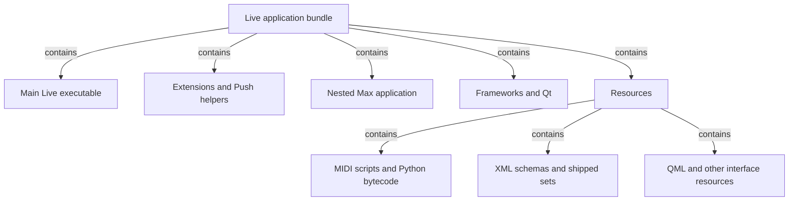
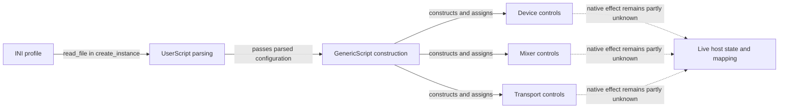
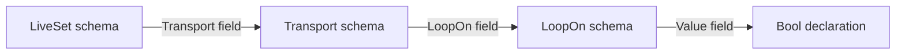
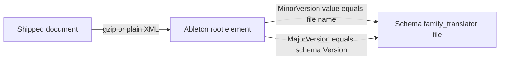
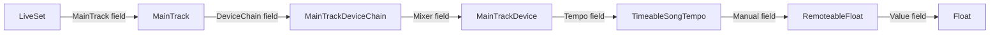
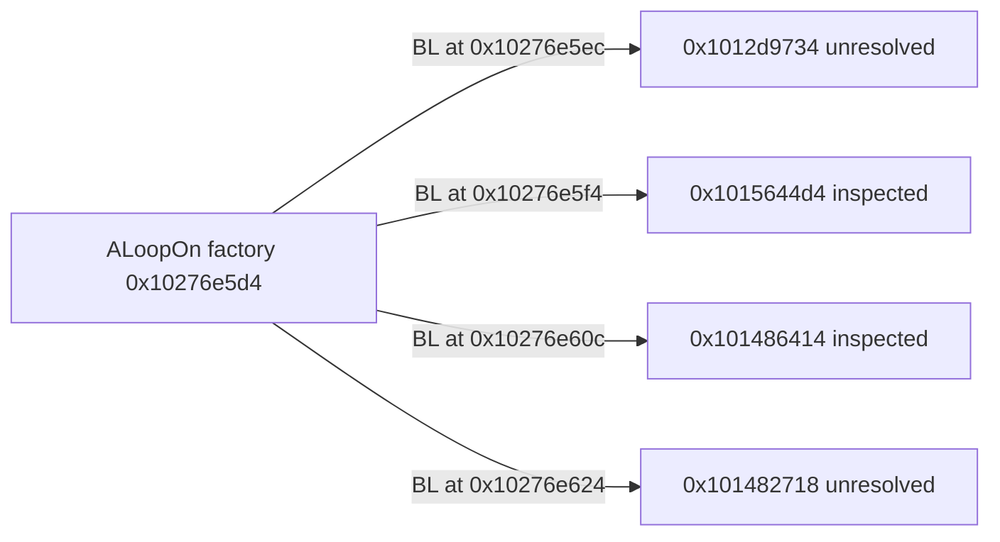
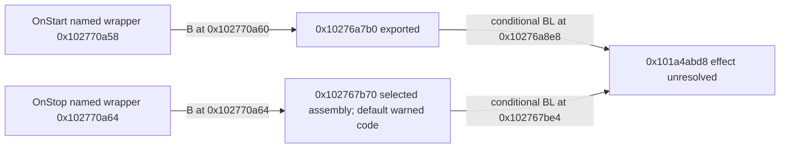
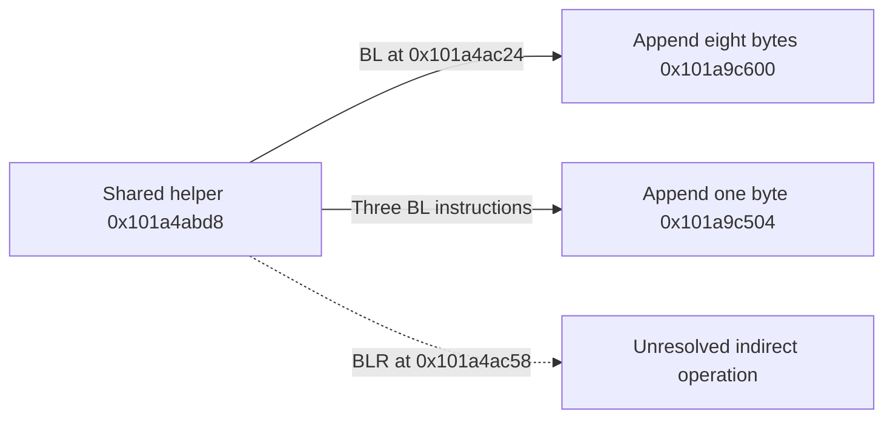

# An evolving map of Live

We know much more about **what is packaged with Live** than about **how its main
native program is organized**. This atlas makes that distinction visible. It
explains relationships already supported by retained evidence and links their
canonical findings; it is not a recovered original architecture document.
Start with the [method guide](learning/method.md) for the vocabulary.

## What is inside the application package

The application bundle is a directory containing the main executable, other
executables, native dependencies and resource trees. The following edges mean
only “contains.” All are observed in the pinned package inventory summarized in
the [bundle map](ableton-package-structure.md#bundle-map), backed by
[SRC-ABLETON-12-4-3](sources/ableton-live-12.4.3.md), INV/PKG and resource captures.

Different executables are candidates for separate process boundaries. Packaging
alone does not show which run together, how they communicate, or which threads
handle audio. Native dependencies are modeled separately in the
[dependency evidence](../../analysis/ableton-live-12.4.3/dylib-resolution.json);
unresolved loads and partial coverage remain in the [package findings](ableton-package-structure.md#native-and-process-boundaries).

| Area | What a reader can inspect now | What its presence does not establish |
| --- | --- | --- |
| Main Live | [First selected function and explanation](learning/walkthroughs/first-native-loop-factory.md), plus [symbols and provenance](artifacts/index.md#native-evidence-shelf) | Complete subsystem boundaries, thread ownership or audio graph |
| Push2 display helper | [Entry pseudocode and references](artifacts/index.md#choose-a-starting-point) | Complete display behavior, or main Live's implementation |
| MIDI scripts | [Seventeen decoded modules](artifacts/index.md#python-module-directory) and selected traced paths | Every controller, native arithmetic or host lifecycle |
| Schemas and sets | [Resource findings](../../analysis/ableton-live-12.4.3/resource-findings.txt); on this host, the [container](document-container-static.md) and [transport-state](transport-state-static.md) packets | A complete accepted-file grammar or runtime defaults |
| QML and other GUI resources | [Package resource inventory](ableton-package-structure.md#resources-that-can-ground-specifications) | All widget behavior, native bindings or exact rendering |

## A linker-provided navigation index

The main executable also carries an `LC_FUNCTION_STARTS` table. The
[source record](sources/ableton-live-12.4.3.md) pins its 413,794 decoded start
addresses and the [readable table](../../analysis/ableton-live-12.4.3/derived/function-starts-v1/addresses.tsv)
maps each to a file offset. This gives us many more search locations than the
retained symbol names alone. It supplies no names, bodies or responsibilities.
The distance to the next start is not a recovered function size, and this table
is not the full analyzer inventory or the denominator for current exports.

## One code path we have traced: user controller configuration

This smaller region is already understandable because we retained and decoded
its Python bytecode. The diagram describes **static construction and assignment
relationships on the selected path**, not measured MIDI delivery or scheduling.
The [MIDI investigation](midi-user-mapping.md#evidence-and-conclusions) owns the
detailed findings; the [source record](sources/midi-user-mapping-12.4.3.md) pins
the modules and decoder.

| Edge or responsibility | Evidence locator | Boundary |
| --- | --- | --- |
| Read profile and parse numbers/modes | [Parser findings](../../analysis/ableton-live-12.4.3/midi-user-mapping-v1/parser-findings.json), PARSE-01–08; `_UserScript.create_instance` and named parser functions | Distinct paths have distinct error rules; app-level recovery is unknown |
| Construct configured controls | [Mapping findings](../../analysis/ableton-live-12.4.3/midi-user-mapping-v1/bytecode-mapping-findings.json), BC-01–04; `GenericScript.__init__`, `_init_device_component` | Sparse entries can compact; ownership/preconditions matter |
| Assign mixer actions | Same mapping findings, BC-05/06; mixer construction and channel-strip handlers | Preferences and track capability affect actions; no audio routing measured |
| Assign transport actions | Same mapping findings, BC-07/08; `TransportComponent`, `ToggleComponent` | Property/task requests are traced; native scheduler cadence is not |
| Reach native mapping or host state | PARSE-04/09 and BC-08/09, with their explicit limits | Dashed edges mark unresolved effects, not recovered native call targets |

The class and module names in this diagram are retained names, not a proposed
replacement design. The [integer-parsing lesson](learning/walkthroughs/midi-integer-parsing.md)
shows how one supported rule was read from this path. Behavioral requirements
live in the [draft contract](../specs/midi-user-mapping.md), not in the diagram.

## A declared document relationship: the loop-enable field

The [transport study](native-transport-study.md#evidence-already-available)
now retains exact schema bytes and resolves the field/class distinction. The
following arrows mean **declares a field of this class**; they are not native
calls or observed runtime object ownership.

The exact locator evidence is in the
[recapture manifest](../../analysis/ableton-live-12.4.3/native-live-arm64-v1/behavior-preparation/sources-v1/manifest.json)
and cited study. This is enough to follow the stored structure to a small
investigation question. It does not yet establish which text tokens the native
reader accepts, what happens when a field is missing, or whether changing that
state participates in undo. The prepared file variants test those distinctions
once a supported observation or traced parser path supplies expectations.

### Which schema a document names

The [container packet](document-container-static.md#schema-directory-and-version-cross-check)
compared every shipped document's root attributes with the 203 shipped schema
files. These arrows mean **this value equals that file's name or header value**.
They do not mean Live reads the schema file when it loads the document. Whether
12.4.3 reads `Schema/*.txt` at runtime is unknown.

All 12 MinorVersion values in shipped documents match a schema file name
exactly, and 191 schema files have no shipped document. Shipped 12.4 content
uses `12.0_12402`, the newest schema.

### Where song tempo is stored

The [transport-state packet](transport-state-static.md#where-tempo-and-time-signature-live)
followed declared fields and found that no schema version puts tempo under
`Transport`. In `12.0_12402` the path runs through the main track's mixer
device. Arrows mean **declares a field of this class**, as above. The two
middle edges were also checked directly in `12.0_12402.txt`: `MainTrack`'s
`DeviceChain` field (line 4116) and `MainTrackDeviceChain`'s `Mixer` field
(line 4177).

Time signature hangs off `MainTrackDevice` the same way, through
`TimeableTimeSignature`. The path changed across versions: the main track was
`MasterTrack` until the 12.0_12013–12.0_12017 transition. Image strings such as `Transport/Bpm/Value`
suggest older documents kept tempo under `Transport`, but no shipped schema or
document has that path. This is document structure only. It does not show
which code reads tempo, the default for a missing value, or its accepted range.

## First main native call edges

The selected function at `0x10276e5d4`, named
`TPtr<ACompound> SNewCompound<ALoopOn>()` in the symbol index, contains four direct
calls. This diagram means **contains a call instruction targeting this address**.
It is not a runtime sequence or a document-state graph. The
[transport findings](native-transport-study.md#first-native-findings) pin the
actual assembly, profile and unresolved types.

The actual code also stores two address values, increments a word through a
retained pointer and writes that pointer through an incoming destination.
Construction/setup is a plausible responsibility inferred from the symbol and
code shape. A follow-up found a zero write and a named boolean-controller
pointer in the first inspected callee, and entry traversal with computed writes
in the second. The [persistence packet](native-transport-study.md#persistence-packet-after-the-callee-follow-up)
retains those positive findings and their limits. Exact callee roles, object
layout, table identities, loop default, serialization and playback effects
remain unresolved. The shipped schema graph
above and these native calls are not yet joined by a proven data-flow path.

The `ghidra-selected-entry-noanalysis-v1` profile recovers this 104-byte body
within a bounded window; whole-image automatic analysis was disabled. It must
not be mistaken for a completed native inventory. The
[first-code lesson](learning/walkthroughs/first-native-loop-factory.md) teaches
how the actual register writes help interpret incomplete pseudocode.

## Transport wrapper branches

Two selected callback wrappers have useful assembly even though their
pseudocode exports failed the bounded-body acceptance rule. The
[wrapper findings](native-transport-study.md#transport-wrapper-findings)
pin these exact static transfers:

Wrapper arrows are direct branches; the two later arrows are calls
reached on conditional paths found by the follow-up. The
[destination packet](native-transport-study.md#transport-packet-after-the-destination-follow-up)
records their shared target and differing argument patterns. The Stop body
still has two unresolved computed transfers, so its selected-profile pseudocode export remains
failed. Neither the common callee's effect nor the external state transition is
established. Start's wrapper first writes one to `w1` and `w2`; the parameter
meanings remain unknown. The
[failure lesson](learning/walkthroughs/transport-wrapper-boundary.md)
shows how a bounded negative result narrows the next investigation.

## A small native record-building path

The [default-profile follow-up](native-transport-study.md#default-profile-comparison-and-shared-helper)
traced the shared transport callee one level further. The solid arrows below
mean observed call instructions; the dashed node remains an unresolved indirect
operation. The append descriptions come from the helpers' exact memory accesses,
not recovered original names.

The helper builds a local structure and passes its address to the indirect
operation. Record assembly is supported; queuing, dispatch, ownership and the
external meaning of its values remain unknown. This is a local code map, not
a recovered application-wide command architecture. Default-profile pseudocode
also preserves warnings at Stop's two computed transfers; the earlier selected
failure remains valid. The linked study owns the exact evidence and limits.

## Reading an inferred native interface

The [incoming-register study](learning/walkthroughs/incoming-registers.md)
checks the first browsable entry, `0x100002000`, against its instructions.
It is another example of why a recovered function name and C-like prototype do
not establish the original interface. The lesson owns the exact register/branch
findings; caller and target responsibilities remain unknown. This entry has not
been assigned to a DAW subsystem or used as a behavioral contract.

## Broader native structure remains open

Names such as `ATransport`, `ASongAgent` and `AAudioClip` in the retained symbol
index are promising search seeds. They are not yet a recovered transport,
document or clip architecture. The [decompilation preparation](ableton-decompilation-preparation.md#ready-native-inputs)
records these seeds and their limits. The factory above establishes only a
small local set of code relationships. Further relationships require exact
exported function/reference locators and stated confidence.

For each new area, record: the bounded question; entry points actually inspected;
data or state directly read/written; identified neighboring calls; inferred
responsibility; and unresolved boundaries. Keep the package view above separate
from those code maps. A later runtime process, thread or signal-flow map needs
its own evidence.

The [phase roadmap](native-decompilation-roadmap.md#initial-feature-priorities)
prioritizes stored transport fields and transport state changes. The observed
factory calls have not established those behaviors. The
[learning plan](learning/design-and-plan.md) requires this atlas to advance with
each meaningful native packet, with corrections recorded in the [log](../log.md).
