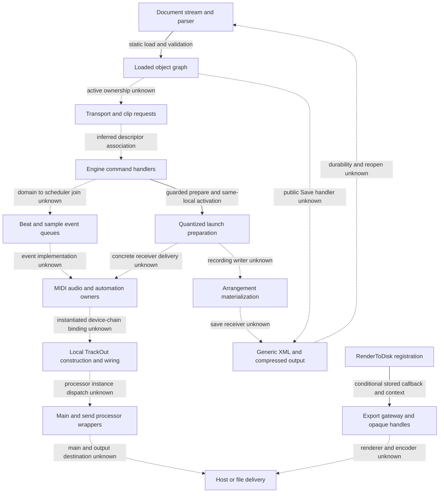
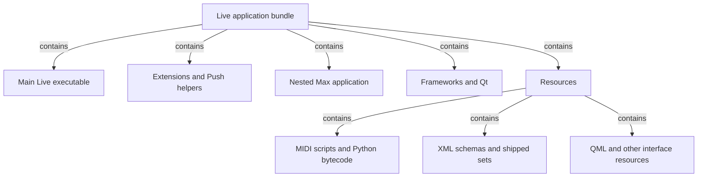
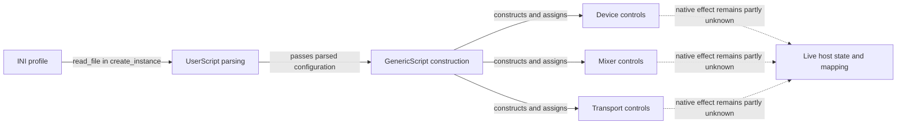
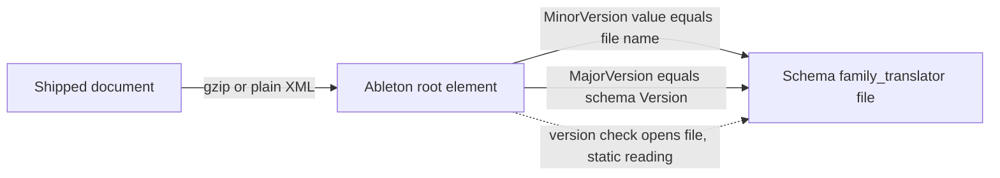
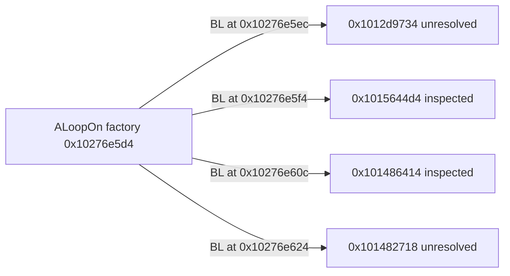
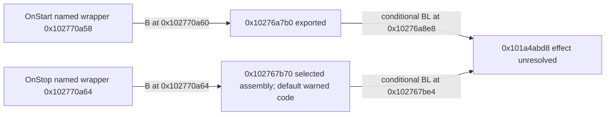
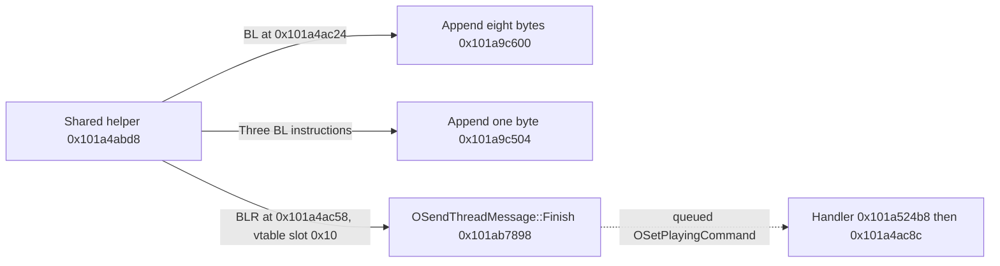
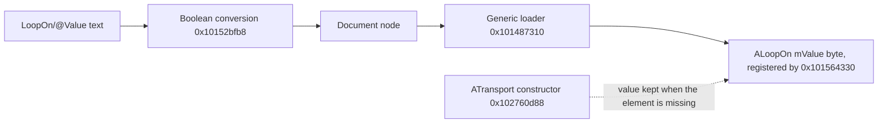

# An evolving map of Live

We know much more about **what is packaged with Live** than about **how its main
native program is organized**. This atlas makes that distinction visible. It
explains relationships already supported by retained evidence and links their
canonical findings; it is not a recovered original architecture document.
Start with the [method guide](learning/method.md) for the vocabulary.

## Native component layer and indirect resolution — 2026-10-20

The amended [execution plan](full-live-specification-plan.md#amendment--indirect-call-resolution-precedes-the-map-2026-10-20)
selects component/dispatch recovery before the integration map. Its
[packet 1a](../../analysis/ableton-live-12.4.3/full-spec-v1/component-resolution-v1/README.md)
[passed independent structure review](../../analysis/ableton-live-12.4.3/full-spec-v1/reviews/component-resolution-v1-review.json).
The following inventories support bounded scenario search; they do not by
themselves select semantic component edges. All belong to the pinned main arm64 image, SHA256
`3a99ceeabce62ccd069b6b55d99d186c9bdf8a6b80a7e3350dd0f9d1c383cfad`.
[Input pins](../../analysis/ableton-live-12.4.3/full-spec-v1/component-resolution-v1/packet-inputs.json)
verify the retained call, indirect, alias, string and named-vtable indexes.

### Lexical component candidates

The [symbol layer](../../analysis/ableton-live-12.4.3/full-spec-v1/component-resolution-v1/symbol-readme.md)
accounts for all 420,470 alias entries. Exactly 45,948 contain qualified labels;
their 38,154 distinct qualified spellings yield 22,548 conservatively parsed lexical
owners. The remaining 374,522 entries remain an explicit pinned-source complement.
The plan amendment's 91,903 qualified names are field occurrences: primary-name
and symbol-array labels repeat. Likewise 39,700 `ableton::` occurrences represent
19,841 distinct labels across 19,850 entries. These are different units, not added
component counts. Template/operator ambiguities, library paths and namespace
versus class interpretation stay explicit in the
[summary](../../analysis/ableton-live-12.4.3/full-spec-v1/component-resolution-v1/symbol-summary.json).
A spelling alone supplies neither a semantic subsystem nor a receiver proof.

### Class/address-point candidates

The read-only [class recovery summary](../../analysis/ableton-live-12.4.3/full-spec-v1/component-resolution-v1/class-summary.json)
records 28,017 normal-dyld-bound typeinfo-layout records, 25,101 distinct literal
type encodings and 25,485 RTTI-header/executable-prefix address points in the
selected `__DATA_CONST/__const` section. Those prefixes contain 458,796 slots,
458,576 of which match retained internal function entries. Slot occurrences can
repeat the same function across tables; they are not distinct function counts.
These are structural matches under declared predicates, not complete original
table extents or runtime class memberships. Name-pointer bit 63 clearing is an explicit candidate
interpretation; missing layouts/imports and capped prefixes remain unresolved.
Lexical literal-store candidates require full receiver/lifetime/native-PC
validation before they can attach a dispatch edge.

The old 80 named-table rows were all checked: 55 address points match the new
selected predicate, 25 remain outside it. Nine of their 2,191 slot-like values are
non-executable; eight are imported RTTI-vptr pseudo-addresses and one is data.
Do not treat the exported slot list as a complete list of callable methods.
The retained old index is unchanged.

### Indirect-site baseline and search boundary

The [indirect census](../../analysis/ableton-live-12.4.3/full-spec-v1/component-resolution-v1/indirect-baseline.json)
verifies 268,015 unique sites across 98,328 functions: 244,762 call-kind sites and
23,253 computed jumps. The amendment's 25,071 resolved count means sites with
nonempty exported target references: 22,873 call-kind and 2,198 jump sites.
Only 21,685 sites have at least one exported target naming a known function.
These denominators are not interchangeable with virtual calls or behavior.
The [resolution overlay](../../analysis/ableton-live-12.4.3/full-spec-v1/component-resolution-v1/indirect-report.json)
adds 24 conditional static records, all previously empty call-kind sites, for
constructed `OSendThreadMessage` receivers at address point `0x106756188`, slot
`+0x10`, target `0x101ab7898`. The exported-or-conditional inventory is therefore
25,095 of 268,015; the original export remains 25,071. Receiver/vptr stability
across any listed opaque calls and ordinary-call premises are explicit; this
is not an unconditional runtime dispatch count. The selected cohort uses the
retained transport sender plus 23 deterministic constructor callers, with exact
native-PC/source/byte evidence. A matching slot offset across unrelated tables
adds no target. No other recovered class is assigned to a site by this packet.

This prerequisite performs no scenario traversal. The integration packet must
state its entry/sink sets, hub-pruning rule, per-level search budget and reviewed
frontiers, retain unresolved indirect sites as unknown edges, and collapse
function-level evidence into observed, inferred or unknown component edges.
No outcome grade, X/S/no-route family count, complete profile or runtime order
follows from this inventory.

## T1 scenario integration map — 2026-10-20

[Packet 1b](../../analysis/ableton-live-12.4.3/full-spec-v1/integration-structure-v1/README.md)
extends the reviewed component layer into one scenario map. The combined packet
[passed independent structure review](../../analysis/ableton-live-12.4.3/full-spec-v1/reviews/integration-structure-v1-review.json). It covers document load, transport,
quantized launch, playback and mixing, recording into Arrangement, save/reopen
and export. Recording/export here are analyst scenario boundaries; they do not
expand ADR 0004's implementation T1 or start its deferred implementation.

This drawing groups **static relationships and explicit missing joins**. Solid
arrows have source-supported local relationships, with semantic owners still
qualified by the table below. Dotted arrows label either a narrow inference or
an unknown bridge. Drawing order is not execution order, thread delivery or
observed audio flow. In particular a stored document graph is not the active
engine topology.

### Component boundaries, state and ownership

The source packets retain function-level records behind these grouped edges.
**Observed-static** identifies an expression/reference in a retained source;
**inferred** identifies its narrowly supported owner or association;
**unknown** identifies a missing join. None is a behavioral outcome grade.

| ID / scenario boundary | State/data and source-supported owner relationship | Evidence and qualification |
| --- | --- | --- |
| I-01 / document entry and parsing | The selected app branch passes file/path/configuration into the document loader, stream recognizer and XML reader. Parsed nodes become a returned root plus context. | [Document edges DOC-01–04](../../analysis/ableton-live-12.4.3/full-spec-v1/integration-structure-v1/document-component-edges.json): `1002e6e00 → 1018536d4 → 10148389c → 101484108 → 101486fe4`. Static references observed; file-type meaning, success and app receiver/slot predicates remain qualified. |
| I-02 / loaded root and validation | Root load writes the returned root handle, invokes post-load hooks and calls the recursive validation walk. Serialized Tracks/Scenes/Transport/DeviceChain membership supplies document structure. | [Document synthesis](../../analysis/ableton-live-12.4.3/full-spec-v1/integration-structure-v1/document-delivery.md), DOC-05, and [Live Set structure](live-set-structure.md#document-skeleton). Dynamic classes/hooks and publication into active playback/device objects remain unknown. |
| I-03 / transport request and engine state | Start calls the playing-command sender. Exact descriptor/registration evidence associates its word and three byte-like fields with the engine handler; that handler reaches the guarded engine-state path. | [Transport composition and inherited message associations](../../analysis/ableton-live-12.4.3/full-spec-v1/integration-structure-v1/transport-playback.md#boundary-composition-after-source-review): `10276a7b0 → 101a4abd8`, consumer `101a524b8 → 101a4ac8c → 101a4af58`. Sender/consumer association inferred with exact registration evidence; runtime queue delivery/order and domain-to-scheduler join unknown. The packet1a sender target keeps its receiver/vptr premises. |
| I-04 / quantized launch and activation | Clip-slot producer assembles launch settings. Engine Fire uses one local preparation record as input to activation; preparation stores two timing results and consults clock/quantization helpers. | [Transport boundary records](../../analysis/ableton-live-12.4.3/full-spec-v1/integration-structure-v1/transport-boundary-edges.json): producer `10245c72c → 102710290`; engine `101af0cbc → 101b0dc14`, with preparation and activation through the same local record. Guarded static relations observed; owner/timing meanings carried from T13. Public admission and producer-to-engine delivery remain unknown. |
| I-05 / scheduler events | The selected scheduler processes list/countdown state and dispatches due entries through virtual `+0x10`. | `101ab5cec`, [transport source synthesis](../../analysis/ableton-live-12.4.3/full-spec-v1/integration-structure-v1/transport-playback.md). Beat/sample-domain interpretation is qualified canonical evidence. Actual event classes, targets and audio-callback ordering are unknown; the OSend class proof cannot transfer to these receivers. |
| I-06 / MIDI, audio and automation preparation | MIDI preparation builds eight-byte time and 28-byte event arrays; the selected consumer branches on record kind. Audio parameter writing serializes controls/marker data. Float automation constructs a message with parallel time/value arrays. | [Transport source and boundary composition](../../analysis/ableton-live-12.4.3/full-spec-v1/integration-structure-v1/transport-playback.md). Concrete receiver/provider/instrument delivery and Warp resampling are unknown. ARM `10225b4e8` is a file-start-position calculation here, not proved voice activation. Existing value oracles are unchanged. |
| I-07 / local track-output construction | Named control/split/ramp and Volumes ports connect to TrackOut. Unit InL/R fields `+0x168/+0x170` reach the constructed TrackOut member `+0x428`; its outputs connect to local main/send/prehear/meter destinations. | [Nine source wiring edges and interfaces](../../analysis/ableton-live-12.4.3/full-spec-v1/integration-structure-v1/mix-component-edges.json), full builder `102731438` lines 1683–2016. Helper arguments observed; port-registration interpretation is qualified. Endpoint virtual targets, instantiated upstream chain and runtime routing remain unknown. Twelve construction iterations are not a global device/track limit. |
| I-08 / processor wrappers and main delivery | Selected main and send wrappers read referenced float inputs, update local state and write/accumulate referenced outputs. | [Mix synthesis](../../analysis/ableton-live-12.4.3/full-spec-v1/integration-structure-v1/mix-structure.md): `101b1c114` and `101b1afbc`. Their actual instance dispatch, bus ownership, global summation order and downstream host/export buffers remain unknown. |
| I-09 / recording into Arrangement | Documentary owners distinguish recording Session launches/property changes from newly recorded input/media. | [Recording boundary analysis](../../analysis/ableton-live-12.4.3/full-spec-v1/integration-structure-v1/mix-structure.md#explicit-remaining-integration-gaps) and [recording research](recording-comping.md). No selected native writer, state transition, timestamp ownership or undo/file transaction joins this stage. It remains an explicit unknown bridge. |
| I-10 / save and reopen | Generic format dispatch calls the XML envelope writer; it invokes member writing and compression setup/flush. | DOC-06–08 and [document synthesis](../../analysis/ableton-live-12.4.3/full-spec-v1/integration-structure-v1/document-delivery.md): `101485c50 → 101485240 → 1014339e4`. Public Save→actual song receiver, file replacement/durability and successful reopened state remain unknown. Generic reader/writer intersections do not prove a round trip. |
| I-11 / export command and gateway | RenderToDisk registration forwards a callback/context; the command constructor stores them at `+0x40/+0x48`. The selected eight-byte operand points to the named callback, whose indexed tail branch reaches a guarded gateway. | [Targeted callback bridge](../../analysis/ableton-live-12.4.3/full-spec-v1/integration-structure-v1/document-delivery.md#targeted-export-callback-bridge), DOC-09–13: data `106530bd8 → 100294f20`, retained branch to `10028dfcc`. This is a conditional source/data-linked association. Actual registry selection, stable fields, ABI/context and invocation are premises. It does not add an unconditional indirect target to packet1a. |
| I-12 / rendering and delivery | Gateway handle/view-like calls and a separate movie-backend body are available as landmarks. | [Document remaining predicates](../../analysis/ableton-live-12.4.3/full-spec-v1/integration-structure-v1/document-delivery.md#remaining-cross-component-predicates). Audio render buffers, range/track selection, encoder/file lifecycle and movie/audio pipeline composition remain unknown. No rendered output was observed. |

### Search scope and residual frontiers

[Shared search definitions](../../analysis/ableton-live-12.4.3/full-spec-v1/integration-structure-v1/README.md#shared-search-and-limits)
pin the predecessor and complete index identities. The top 1,000 destinations by
incoming index-row occurrences are pruned, with explicit seeds exempt. Each
direction accepts at most 200 edges and advances at most 80 nodes per level;
three levels are retained. The [reference census](../../analysis/ableton-live-12.4.3/full-spec-v1/integration-structure-v1/graph-reference-kinds.json)
separates 1,594,306 call-kind rows (including 485 override references) from 5,524
tail-jump rows. These are static index references, not runtime invocations.

Document, transport and mix parts retain respectively 168, 121 and 15 unresolved
indirect-site associations in considered functions. These are overlapping local
inventories, not an application total or a census of terminal unexpanded nodes.
Document traversal also leaves four then 32 node-budget omissions; the other
parts have no node/edge-budget omissions, while all retain hub pruning. Common
wiring/message helpers can be pruned hubs despite being semantically important;
selected complete source bodies retain those relationships explicitly.

Authors report reviewing each frontier before deeper expansion. Transport notes
retain UTC review values; document/mix notes establish hash-linked decisions but
do not independently establish wall-clock review ordering. The
[synthetic check](../../analysis/ableton-live-12.4.3/full-spec-v1/integration-structure-v1/trace-selfcheck-result.json)
exercises real search logic on owned fixtures, including depth progression,
unknown interior targets and hash rejection, without rerunning real graphs.

The first family maps must cite this integration context and classify the
owner's required outcomes as X-route, S-route or no established route under
ADR 0003. The unknown bridges above are not global impossibility findings.
No requirement/case/oracle, grade, complete profile/family or candidate result
changes with this map. Whole-product specification closure remains open.

## Family route cuts — 2026-10-20

The first family cuts inherit packet 1b's component edges and unknown joins;
they do not repeat the whole source traversal. The
[mix cut](../../analysis/ableton-live-12.4.3/full-spec-v1/family-mix-routes-v1/structure.md)
[passed independent review](../../analysis/ableton-live-12.4.3/full-spec-v1/reviews/family-mix-routes-v1-review.json). Its current revision 2 owner has 16 requirement
IDs and 34 case records. Its bounded ledger enumerates 110 required predicates:
17 with extracted-execution routes, 70 with static routes and 23 without an
established route. These are route inventory units, not behavior grades or a
whole-product denominator. Two auxiliary restatements and 13 explicit scope
gaps are separate from that count.

The mix cut follows I-07/I-08 from local port construction through TrackOut
wrapper reads, state updates and stores. Actual processor dispatch, bus/host
buffer ownership and final audible delivery remain unjoined. I-05/I-06 retain
automation provider/timebase premises; I-12 retains export delivery as unknown.
Five proposed retained-input batches link arithmetic leaves to their required
predicates. Thirty-six X2 curve setup rows patch original allocator sites and
retain the preparation/review gate; unpatched recorded scalar/model calls use
the standing execution rule. No original code ran for this map, and no public
waveform or application outcome gained credit.

The [playback cut](../../analysis/ableton-live-12.4.3/full-spec-v1/family-playback-routes-v1/structure.md)
[passed independent review](../../analysis/ableton-live-12.4.3/full-spec-v1/reviews/family-playback-routes-v1-review.json). Its 23 requirement IDs decompose into 243
bounded predicates (43 X routes, 69 static routes, 131 without an established
route), with eight shared cross-references collapsed. Its 703 historical input
and result rows are auxiliary evidence, not calls or required outcomes. The cut
follows I-03–I-06 through state/domain control, launch preparation/activation,
scheduler, MIDI record and audio parameter paths. Active clock selection,
concrete event/player receivers, instrument delivery and clip audio remain
unknown joins. ARM StartFileSmpl supplies a position calculation, not voice
activation. No new indirect target or public output evidence is credited.

The [transport-state cut](../../analysis/ableton-live-12.4.3/full-spec-v1/family-transport-routes-v1/structure.md)
[passed independent review](../../analysis/ableton-live-12.4.3/full-spec-v1/reviews/family-transport-routes-v1-review.json). Its 12 requirement IDs enumerate 108 bounded
predicate/context rows: 30 X routes, 44 static routes and 34 without an
established route. Nineteen qualified relationships and five missing bridges
connect I-01/I-02/I-10 to typed nodes, descriptor-based member stores, conditional
post-load/tempo reconciliation and generic number/XML writing. Stored values
are distinct from active song/engine state. Public Save receiver, file lifecycle,
error recovery, later range effects and general precedence remain unjoined.
Meter's 510 retained rows cover 495 distinct legal pairs; neither count is an
outcome denominator. No active transport or public open/save outcome is added.

The first [mix leaf batch](../../analysis/ableton-live-12.4.3/full-spec-v1/batch-mix-leaves-v1/README.md)
[passed independent review](../../analysis/ableton-live-12.4.3/full-spec-v1/reviews/batch-mix-leaves-v1-review.json) after its map approval. It replayed 137
unpatched recorded-model command rows and evaluated seven scalar curves at 43
boundary positions each. All 144 processes returned 517 direct calls, including
32 return-only allocation calls. Seventy-seven historical dumps and 99 declared
return fields matched; 252 distinct new boundary evaluations remain ungraded.
A tiny negative Fast Cut result is confined to the supplied x86/glibc helper
context. The 36 patched setup rows remain withheld. No component edge,
public mix delivery, ARM equivalence or route/behavior grade changes here.

The [clip-launch cut](../../analysis/ableton-live-12.4.3/full-spec-v1/family-clip-launch-routes-v1/structure.md)
[passed independent review](../../analysis/ableton-live-12.4.3/full-spec-v1/reviews/family-clip-launch-routes-v1-review.json): 229 bounded predicates from 23 requirement IDs
(21 X / 98 S / 110 no-established-route). Its 11,756 historical input/result
rows remain auxiliary. I-04 is extended with retained member/constructor,
preference, hook, API and migration landmarks; final document state, active
global-grid publication, mode/release/Legato/follow effects and public output
remain unjoined. The zero/zero chance run observed invocation(false) while
skipping the Enabled setter, so its final disable-state route stays unresolved.
Unavailable C exports remain unavailable; retained disassembly is identified as
such. No owner label, case or grade is changed by this cut.

The [MIDI storage cut](../../analysis/ableton-live-12.4.3/full-spec-v1/family-midi-note-routes-v1/structure.md)
[passed independent review](../../analysis/ableton-live-12.4.3/full-spec-v1/reviews/family-midi-note-routes-v1-review.json): 88 required predicates (12 X / 52 S / 24
no-established-route) across 17 requirement IDs. REQ-011's explicitly undefined
unsafe-key behavior has no required reference outcome; its getter and unchecked
stores stay auxiliary. The cut joins I-01/I-02/I-10 to note-array item reset,
limits/grid copy-in, ID/list repair and member writing, and links I-06 as context
without claiming active-player delivery. Expression endpoint-adjustment dispatch,
probability-group shape, final saved state and error/host lifecycle remain open.
Its 161 historical result rows and six raw command rows are different units from
outcomes and calls. This map remains pinned to r4. The later [reviewed r5 group delta](../../analysis/ableton-live-12.4.3/full-spec-v1/midi-probability-groups-owner-r5/route-delta.json) supplies conditional shape/type associations and concrete six-case reader inputs, while final Save/later effects/whole-load counter repair stay U; the old88 is not a new r5 denominator.

The combined [Live Set/ALS cut](../../analysis/ableton-live-12.4.3/full-spec-v1/family-structure-als-routes-v1/structure.md)
[passed independent review](../../analysis/ableton-live-12.4.3/full-spec-v1/reviews/family-structure-als-routes-v1-review.json): 196 bounded rows across 27 owner requirement
bodies (one CRC X route / 129 S / 66 no-established-route). Shared predicates
are cross-referenced, including a separate 33-row minimal-document status
crosswalk; they are not recounted per table cell. I-01/I-02/I-10 connect format
recognition, root/context selection, ID/envelope/send/list validation, sample
path candidates and generic writing. ALS envelope acceptance is distinct from a
Set opening. Active state, code-2–7 media search, duplicate-repair UI, public
Save/durability/reopen and failure recovery remain unjoined. All 69 released case
objects remain unchanged, including five required refusals with unspecified
refusal classes. No unknown is converted to an acceptance or invented default.

The corrected [Warp cut v2](../../analysis/ableton-live-12.4.3/full-spec-v1/family-warp-routes-v2/structure.md)
[passed independent correction review](../../analysis/ableton-live-12.4.3/full-spec-v1/reviews/family-warp-routes-v2-review.json). [V1 review](../../analysis/ableton-live-12.4.3/full-spec-v1/reviews/family-warp-routes-v1-review.json) remains correction-required; no notification interception is established for its selected run. Inventory remains: 80 required predicates (5 X / 50 S / 25
no-established-route) across 16 requirement IDs. I-04/I-06 gain retained marker,
cache/table, frame-conversion and setter/edit relationships, while active voice,
mode DSP, post-edit reconstruction, public Save and final audio remain unjoined.
Shadow-append seconds are auxiliary, with no counted outcome or batch. WMK-019's
M0 vector is computed rather than historically executed; REQ-009 stays unreleased
without a case. Thirty-four historical result rows/four raw command rows are
separate evidence units. Setter q's original registry/object setup requires its
separate preparation/review; conversion/bounds owned buffers keep their recorded
model premises. No case disposition or grade changes.

The [mixer-values cut](../../analysis/ableton-live-12.4.3/full-spec-v1/family-mixer-routes-v1/structure.md)
[passed independent review](../../analysis/ableton-live-12.4.3/full-spec-v1/reviews/family-mixer-routes-v1-review.json): 104 bounded predicates (14 X / 52 S / 38
no-established-route) across 15 requirement IDs, with 80 unchanged released case
objects. I-07/I-08 cover field/control, converter, pan tuple, crossfade table and
processor-wrapper relationships. Q-019 A3/A4/A5, unset identity bypass, actual
port/branch/table/receiver, precise stored-floor and public output remain
qualified or unknown. The reviewed 252 new helper-boundary pairs stay ungraded;
off-grid 0.96 is distinct from a 129-point table/interpolated public factor.
All 36 allocator-patching construction rows remain withheld from standing replay.
No general round-trip bound, current Save result or application grade follows.

The [automation cut](../../analysis/ableton-live-12.4.3/full-spec-v1/family-automation-routes-v1/structure.md)
[passed independent review](../../analysis/ableton-live-12.4.3/full-spec-v1/reviews/family-automation-routes-v1-review.json) with a nonblocking historical-metadata note: 129 required predicates (22 X / 69 S / 38
no-established-route) across 13 requirements. I-05/I-06 distinguish stored
values, supplied evaluator E(t), ideal envelope-time P(t), parameter conversion,
clip/song time and ramped sample delivery. RA2's discard-before-survivor-validation
order and target/gate premises remain explicit. Seven cross-references are not
recounted. Provider/parameter ownership, loaded units, lane/Session offset and
actual processor/audio delivery remain unresolved. Historical factory/registry
setup was partial and does not gain standing execution eligibility.

The [Corpus cut](../../analysis/ableton-live-12.4.3/full-spec-v1/family-corpus-routes-v1/structure.md)
[passed independent structure review](../../analysis/ableton-live-12.4.3/full-spec-v1/reviews/family-corpus-routes-v1-review.json). Its 146 local predicate/context rows
(49 X / 83 S / 14 without a complete route/oracle) cover the current 13-requirement
owner and timing/state section, with all 38 host indices and seven models
crosslinked. Its 27 released groups/73 evaluation identities are finite inputs,
not an outcome denominator. Generic I-07/I-08 does not establish an actual
Corpus instance, same-control A1 emission or main host/bus delivery. All 174
historical and two note72 mode16 omissions remain ungraded; physical-component
identity and actual rounded coefficients remain qualified. D01 capability is
answered, whole profile partial, and the parked 96-byte setup stays unexecuted.
No clause, case, release, new execution or grade follows from this map.

The [Electric cut](../../analysis/ableton-live-12.4.3/full-spec-v1/family-electric-routes-v1/structure.md)
[passed independent structure review](../../analysis/ableton-live-12.4.3/full-spec-v1/reviews/family-electric-routes-v1-review.json): 181 bounded predicate/context rows
(149 local X / 11 S / 21 without an established route) across the current
16-requirement owner and timing/state material. Its 117 released evaluations
are separate finite inputs. Generic I-07/I-08 does not identify an Electric
instance or output; A1 mapping is inferred and A2/public clock, lane and lifecycle
joins remain unknown. All 33 host indices and distinct held/new-note/event/ramp
contexts are navigable; numbers, parameter samples and helper steps are not a
whole-product denominator. Reset/NewRate and grouped warm-up stay distinct.
No new execution, clause, case, release or grade follows from this map.

The [Tension cut](../../analysis/ableton-live-12.4.3/full-spec-v1/family-tension-routes-v1/structure.md)
[passed independent structure review](../../analysis/ableton-live-12.4.3/full-spec-v1/reviews/family-tension-routes-v1-review.json): 93 bounded predicates (71 X routes /
12 S / 10 without an established route) across 15 current requirements. Its
42 draft IDs and 27 released evaluations are separate navigation/input units;
four chaotic and 37 uncalibrated settings remain excluded from finite release.
Generic I-05–I-08 does not bind a Tension instance/event receiver or public output.
A1/A2, actual clock/automation/reset/lifecycle and ARM/Apple qualifications remain.
TNR-067 records a callable DamperVelocity route with an unjoined exact receipt;
no coverage is inferred from that owner's historical X label. Ordinary Reset/
NewRate differs from four-helper grouped warm-up and the old finite 1024 test.
No original execution, normative/case/release or grade change follows.

The [Analog cut](../../analysis/ableton-live-12.4.3/full-spec-v1/family-analog-routes-v1/structure.md)
[v1 requires correction](../../analysis/ableton-live-12.4.3/full-spec-v1/reviews/family-analog-routes-v1-review.json) for ANRMAP-001 and remains unapproved. The additive [v2 history correction](../../analysis/ableton-live-12.4.3/full-spec-v1/family-analog-routes-v2/structure.md) [passed bounded correction review](../../analysis/ableton-live-12.4.3/full-spec-v1/reviews/family-analog-routes-v2-review.json). Inventory stays 241 bounded predicates/contexts
(199 local X / 30 S / 12 without an established route). Thirty-seven owner-U
predicates have investigative local X routes but remain U. All public bindings
are unknown, including actual Analog instance/output, A1 stored delivery and
A2 clocks/automation/lifecycle. Its 203 host indices, 171 stored parameters,
31 secondary outputs and 38 groups/42 finite evaluations are separate units.
Index99 envelope removal is measurement-only; frozen stationary/onset/envelope/
first-40-harmonic scope grants no random/statistical trajectory or general law.
No original execution, normative/case/release or grade changes.

Current [Analog owner r2 correction](../../analysis/ableton-live-12.4.3/full-spec-v1/analog-owner-r2-anrmap001/README.md)
[passed independent review](../../analysis/ableton-live-12.4.3/full-spec-v1/reviews/analog-owner-r2-anrmap001-review.json).
It removes unsupported REQ022 grading promises and preserves required unknowns.
The [route delta](../../analysis/ableton-live-12.4.3/full-spec-v1/analog-owner-r2-anrmap001/route-delta.json)
qualifies AN-OUT-222–231 and the 241/199X/30S/12none counts above as predecessor-r1
contexts, not a newly derived r2 denominator. Frozen v1/v2 maps remain exact;
the reviewed eight-control actual batch is ungraded discovery only.

The [Collision cut](../../analysis/ableton-live-12.4.3/full-spec-v1/family-collision-routes-v1/structure.md)
[passed independent review](../../analysis/ableton-live-12.4.3/full-spec-v1/reviews/family-collision-routes-v1-review.json): 84 local predicates/contexts (38 X / 10 S /
36 without a complete route/oracle) across all 18 requirement contexts, with
50 draft-row and 139-index navigation. All 41 original render/script references
remain distinct from the two released comparisons. Original 103 payloads verify
only through explicit recovery mappings for the two changed current paths;
unknown-provenance extras supply no evidence. Generic I-07/I-08 identifies no
Collision instance/output; A1/host/grid/ARM/modal/noise/lifecycle gaps remain.
Constructor silence with both resonators off and positive Defaults Pipe output
retain their finite scopes. No original execution, norm/case/release or grade change.

The [MIDI-user mapping cut](../../analysis/ableton-live-12.4.3/full-spec-v1/family-midi-user-routes-v1/structure.md)
[passed independent structure review](../../analysis/ableton-live-12.4.3/full-spec-v1/reviews/family-midi-user-routes-v1-review.json): 94 bounded local contexts
(19 X / 31 S / 44 without a complete route or oracle) across 13 requirements.
Its 161 release objects and 56 MT rows are navigation/input units. Four on/off
rows remain unreleased. Current r6 and immutable v4 parent r5 stay distinct;
I-04/I-05 supplies no actual controller ingress or parameter instance. X2's
simulated accessors/setter, skipped notification and direct-only path remain
explicit. Public delivery, feedback, lifecycle and exact-build joins remain U.
No execution, norm/case/release or grade change follows from this map.

The [bundled parameter document cut](../../analysis/ableton-live-12.4.3/full-spec-v1/family-bundled-parameters-routes-v1/structure.md)
[passed independent structure review](../../analysis/ableton-live-12.4.3/full-spec-v1/reviews/family-bundled-parameters-routes-v1-review.json):135 bounded contexts (120S/one local X/14without an established route) across15requirements, with37ownerU rows retained. All public application bindings remain unestablished. Its502metadata rows/82release inputs stay separate; A1/A2/A3, constructor/default/browser/save joins, nine position exclusions and Cabinet label correction remain qualified. Electric Polyphony index/local voice count does not establish display or public delivery. No new execution, norm/case/release or grade.

The [Browser-index cut](../../analysis/ableton-live-12.4.3/full-spec-v1/family-browser-index-routes-v1/structure.md)
[passed independent structure review](../../analysis/ableton-live-12.4.3/full-spec-v1/reviews/family-browser-index-routes-v1-review.json): 83 bounded contexts (35 conditional S /
48 without an established route / zero X), across 13 requirements and state,
error and lifecycle contexts. Main/helper address domains remain separate;
no new indirect resolution is credited. Direct folder files versus pack
ancestor queries, held-state pruning versus disk write-back, and missing
full apply/query bodies stay qualified. Its 68 draft IDs and 26 released
objects are navigation units. Old compiled pseudocode/models supply no X
credit. No original execution, norm/case/release or grade change.

The [plug-in discovery cut](../../analysis/ableton-live-12.4.3/full-spec-v1/family-plugin-discovery-routes-v1/structure.md)
[passed independent structure review](../../analysis/ableton-live-12.4.3/full-spec-v1/reviews/family-plugin-discovery-routes-v1-review.json): 84 bounded contexts (53 conditional or
documentary S / 31 without an established route / zero X), across all 16
requirements. Crash, hang, large-scan and duplicate requirements 012–015 remain
entirely without an established route. Main/scanner domains and historical
helper pointers stay qualified, with zero new main indirect-site credit.
Candidate-set comparison, successful module load and public listing/instance/
audio delivery are distinct. Its 62 draft IDs and 35 released objects are
navigation; no original execution, norm/case/release or grade change.

The [Utility cut](../../analysis/ableton-live-12.4.3/full-spec-v1/family-utility-routes-v1/structure.md)
[passed independent structure review](../../analysis/ableton-live-12.4.3/full-spec-v1/reviews/family-utility-routes-v1-review.json): 48 bounded predicates (two retained-file
S / 46 without a complete exact-target public route / zero X), across 15
requirements. All 41 case objects are indexed; all 38 application outcomes
remain U. Current-manual D12 and three historical package-file checks remain
separate. Two children/six returned helper calls are auxiliary X evidence,
not public Mute or audio outcomes. Model admission/same receiver/host-buffer
joins, pre-steering opaque bytes and missing lifecycle/error behavior remain
explicit. No new native read/execution, norm/case/release or grade change.

The [Arrangement cut](../../analysis/ableton-live-12.4.3/full-spec-v1/family-arrangement-routes-v1/structure.md)
[passed independent structure review](../../analysis/ableton-live-12.4.3/full-spec-v1/reviews/family-arrangement-routes-v1-review.json):345bounded predicate/context rows (six retained-packageS/339without established exact-target route/zeroX), across42requirements and all84unchanged scenarios.43named/41null documentary pairs are not actual outcomes; every public edit binding and actual scenario remainsU. Native registry names/generic readers/writers and transport/playback computations remain auxiliary. Corrected numeric pairs staynull; productive processing/same-start/Follow baselines, Undo/cancel/save/teardown gaps and64main-lane versus90historical Arrangement/take-lane package scopes remain qualified. No new native read/execution/traversal/indirect credit, norm/case/release or grade.

The [native MIDI effects cut](../../analysis/ableton-live-12.4.3/full-spec-v1/family-native-midi-effects-routes-v1/structure.md)
[passed independent structure review](../../analysis/ableton-live-12.4.3/full-spec-v1/reviews/family-native-midi-effects-routes-v1-review.json):eight effects/27requirements/176unchanged scenarios;309bounded behavioral/context rows(91D12/218U), all without an established behavioral route in the selected data-only scope. This scope excludes native-body semantics and is not absence/impossibility.538metadata rows/212call rows are navigation;49table-prefix slots/35targets/27stores establish no current receiver/event output or new indirect-site credit. Reviewed NONEMPTY/BOTH/LatchOFF/displacement and source-version guards persist. No native body/original execution, norm/case/release/grade or completed profile.

Subsequent source depth is recorded canonically in the [Utility class-source approval](device-audio-utilities.md#utility-class-construction-source-review-approval--2026-10-20) and [native MIDI initialization-source approval](native-midi-effects.md#native-midi-initialization-source-review-approval--2026-10-20), followed by [processing-source review](native-midi-effects.md#native-midi-processing-source-review-approval--2026-10-20). The processing frontier establishes no complete callable X leaf. Later [Utility native readback](device-audio-utilities.md#utility-native-abi-static-review-approval--2026-10-20) narrows conditional return/argument carriers and initializer-local bytes without closing public bindings or adding indirect-site credit. These independently reviewed conditional source relationships leave the historical map inventories intact; public admission/control/receiver/event-or-audio-output and lifecycle joins remain unknown. They add no native indirect-site credit, new behavioral route grade or completed profile. Later selections belong to the current plan rather than these frozen maps.

The [Filter/EQ cut](../../analysis/ableton-live-12.4.3/full-spec-v1/family-filter-eq-routes-v1/structure.md) [passed independent structure review](../../analysis/ableton-live-12.4.3/full-spec-v1/reviews/family-filter-eq-routes-v1-review.json):four current devices/65whole-clause bundles/140case pointers/46existingU action contexts as separate inventory units;four historical-file-onlyS/61without established public route/zeroX. Seven table prefixes/21slots/ten stores/379aliases-memberships and492call-indirect rows are bounded metadata;39indirect sites remain unresolved. Device-kit external symbols, exp10f edges and broad Biquad names do not establish coefficient/render/control laws. Legacy/current/source-version, productive modulation/Audition/LED prerequisites and detector-Type/Audition-return questions remain qualified. All public runtime outcomesU; no source-body/original execution, indirect credit, owner/case/release/grade or complete profile. Canonical [approval and residuals](filter-eq-devices.md#filtereq-family-route-review-approval--2026-10-20) own the source/read limits.

The [Dynamics cut](../../analysis/ableton-live-12.4.3/full-spec-v1/family-dynamics-routes-v1/structure.md) [passed independent structure review](../../analysis/ableton-live-12.4.3/full-spec-v1/reviews/family-dynamics-routes-v1-review.json):five devices/62clauses/153case pointers;271required predicates comprise251application predicates without an established target route and20retained-file-onlyS,zeroX.142D12 annotations mirror existing predicates;413context records are not an atomic denominator. Selected32table associations/88slots/26stores/359aliases-memberships/48call-indirect rows leave two indirect sites unresolved and696slots unselected. Limiter external names, small prefixes and metadata stores establish no public processing/ABI/default law. Productive normal/detector/Audition and both-channel/band baselines, exact-build/source/clock/calibration/lifecycle gaps remain explicit. No source-body/original execution, native-site credit, owner/case/release/grade or complete profile. Canonical [review scope and residuals](dynamics-devices.md#dynamics-family-route-review-approval--2026-10-20) own fresh versus inherited semantic limits.

The [Recording/comping cut](../../analysis/ableton-live-12.4.3/full-spec-v1/family-recording-comping-routes-v1/structure.md) [passed independent review](../../analysis/ableton-live-12.4.3/full-spec-v1/reviews/family-recording-comping-routes-v1-review.json):34clauses/90case pointers,282bounded predicate-context rows (eight retained-inventoryS/274unknown/zeroX). All90actualU remain; four artifact-only roles and86application cases stay distinct. Metadata447rows/32tables/130slots/75stores and133call-indirect associations provide no writer/clock/Undo/Save/host join. The38-block Comping source semantics remain inherited, not a whole Recording audit. Canonical [approval and residuals](recording-comping.md#recordingcomping-family-route-review-approval--2026-10-20) preserve productive histories, case-only RC077 unknown and exact scope.

The [audio/video-export cut](../../analysis/ableton-live-12.4.3/full-spec-v1/family-audio-video-export-routes-v1/structure.md) [passed independent review](../../analysis/ableton-live-12.4.3/full-spec-v1/reviews/family-audio-video-export-routes-v1-review.json):23clauses/34scenarios/91required application predicates,all unknown/zeroS/zeroX. Forty-six D12annotations add no outcomes. Metadata385rows/32tables/150slots/37boundary seeds and14prospective prefixes/102targets are not callable public routes. Conditional stored callback/current buffers/encoder/writer/clock/file completion remain unjoined. Canonical [approval and residuals](audio-video-export.md#audiovideo-export-family-route-review-approval--2026-10-20) retain source/build/dropout/encoder/cancel qualifications and the unaliased LFlac target.

The [Utility x86 static review approval](device-audio-utilities.md#utility-x86-static-review-approval--2026-10-20) adopts three ranges/320bytes/93rows and seven conditional carrier facts,with the explicit22-encoding correction. Public construction/control/current receiver/output/lifecycle and cross-slice joins remain unknown. Sixteen direct E8targets add no indirect-site credit; neither names nor similar carrier patterns equate native bodies. The separate [four-target static approval](device-audio-utilities.md#utility-x86-four-target-static-review-approval--2026-10-20) adopts conditional member/carrier flow and an unresolved localx86tail,with UDN002ESIL excluded. The [inner-entry actual approval](device-audio-utilities.md#utility-x86-inner-entry-static-review-approval--2026-10-20) adopts352bytes/64rows/sevenconditionalfacts,including late load64(T+10) return and unknown nine-helper effects;UDN002extends toEB00,allESILexcluded. All6G/publicU stayopen,no successor capture selected.

The [sample-instrument cut](../../analysis/ableton-live-12.4.3/full-spec-v1/family-sample-instruments-routes-v1/structure.md) [passed review](../../analysis/ableton-live-12.4.3/full-spec-v1/reviews/family-sample-instruments-routes-v1-review.json):63clauses/102cases,350applicationnone/U,221D12annotations/fiveauxiliaryfileS separate. [Canonical approval](sample-instruments.md#sample-instrument-family-route-review-approval--2026-10-20) preserves25,071+24combined site units and the reviewed old017-negative/039-own-positive erratum. No public voice/control/output route or grade follows.

The [distortion cut](../../analysis/ableton-live-12.4.3/full-spec-v1/family-distortion-routes-v1/structure.md) [passed review](../../analysis/ableton-live-12.4.3/full-spec-v1/reviews/family-distortion-routes-v1-review.json):67non-atomic whole-clause bundles(9fileS/58appnone/zeroX),200actualU/47D12annotations separate. Seven typed visualization candidates establish no callable DSP/math route. [Canonical approval](distortion-devices.md#distortion-family-route-review-approval--2026-10-20) owns productive controls/source/lifecycle limits;no grade/closure.

The [device chains/Racks cut](../../analysis/ableton-live-12.4.3/full-spec-v1/family-device-racks-routes-v1/structure.md) [passed independent review](../../analysis/ableton-live-12.4.3/full-spec-v1/reviews/family-device-racks-routes-v1-review.json):38non-atomic whole-clause bundles(1fileS/37appnone/zeroX),101actualU;35D12annotations remain separate. Twelve prospective small prefixes prove no callable leaf or public route. [Canonical approval](device-racks.md#device-chains-and-racks-family-route-review-approval--2026-10-20) preserves separate124Rack/153Devices source scopes and all productive/lifecycle limits. No grade/closure.

The [Delay/Reverb cut](../../analysis/ableton-live-12.4.3/full-spec-v1/family-delay-reverb-routes-v1/structure.md) [passed independent review](../../analysis/ableton-live-12.4.3/full-spec-v1/reviews/family-delay-reverb-routes-v1-review.json):93clauses/176actualU;562requirednone/U,316D12+246Uannotations on those SAMEunits,sevenauxiliaryfileS outside. [Canonical approval](delay-reverb-devices.md#delay-and-reverb-family-route-review-approval--2026-10-20) preserves207inherited source semantics and actual productive/IR/Serial/lifecycle limits. Twenty-nine selectedtables nominate sourcefrontiers,not callable/publicroutes or grades.

The [fixed14Delay/Reverb source approval](delay-reverb-devices.md#fixed-fourteen-method-source-review-approval--2026-10-20) adopts complete21,218Cbytes/634lines asconditionalprojections,not nativeextent or publicroutes. No complete callablemath/Xleaf established;one conditionalstore andone auxiliaryexpression retainreceiver/ABI/helper/FP/consumer gaps. All562required/176actualU stayopen,no automatic successor.

The [Modulation/Pitch/Loop cut](../../analysis/ableton-live-12.4.3/full-spec-v1/family-modulation-pitch-loop-routes-v1/structure.md) [passed independent review](../../analysis/ableton-live-12.4.3/full-spec-v1/reviews/family-modulation-pitch-loop-routes-v1-review.json):106wholeclause bundles allnone/U,96D12+10U onSAME106,tenauxfileS outside;all208appactualU. [Canonical approval](modulation-pitch-loop-devices.md#modulation-family-route-review-approval--2026-10-20) preserves correctedhistorical/current spectralartifact IDs,332inheritedsource semantics andallproductive/lifecycle unknowns. No newsite/publicroute/mathleaf/grade.

The [five-profile synthesis cut](../../analysis/ableton-live-12.4.3/full-spec-v1/family-synthesis-instruments-routes-v1/structure.md)
[passed independent review](../../analysis/ableton-live-12.4.3/full-spec-v1/reviews/family-synthesis-instruments-routes-v1-review.json):
110 whole clauses / 190 actual-U cases; all 585 route units unsupported.
[Canonical approval](synthesis-instruments.md#synthesis-family-route-review-approval--2026-10-20)
preserves Operator/Meld ambiguities, all eight typed Wavetable prefixes and
actual voice/control/output unknowns. Source567 semantics remain inherited;
geometry and354 current quote occurrences are mechanical. No callable X leaf,
site or grade. The mutable plan as-of qualification is nonblocking.

The [eight-profile Legacy cut](../../analysis/ableton-live-12.4.3/full-spec-v1/family-legacy-native-routes-v1/structure.md)
[passed independent review](../../analysis/ableton-live-12.4.3/full-spec-v1/reviews/family-legacy-native-routes-v1-review.json):
77whole clauses, eight file-only S / 69 application-none,194actualU records.
[Canonical approval](legacy-native-devices.md#legacy-family-route-review-approval--2026-10-20)
preserves D11 applicability, complete208seed scope and all productive/lifecycle
unknowns. A separately selected one-shot metadata-index check passed29controls;
full114source semantics remain inherited. No complete X leaf, site or grade.

### DeviceKit provider frontier — 2026-10-20

Root read/adopted full [independent inventory review](../../analysis/ableton-live-12.4.3/full-spec-v1/reviews/devicekit-provider-inventory-v1-review.json),22,017bytes/SHA256f6eb05913bacf6c619a5338c2f9b11064d8dc5571095f57eff5e9f513152d530. The [sealed inventory](../../analysis/ableton-live-12.4.3/full-spec-v1/depth-devicekit-provider-inventory-v1/manifest.json),SHA2566c4dc1ff7027408242c876d8a7208b85e477feed62d62d664cf9e1994f096934,binds11payloads/113,131bytes. Exact target-only query joins37selected call/tail-jump occurrences across approved Filter/EQ,Dynamics,Distortion maps,27lexicalEXTERNALlabels/sevenDeviceKit template families. All37parent records/byte locators andgroups were checked against865retained parentmetadata rows;original431MBcallsindex/fullhash authority remains inherited. No provider image/importordinal/install-name/rpath/bind/body or same-instance/publicreceiver association established. EXTERNAL/namespace/content directories are not native-provider proof.

Thirty immutable non-wiki pins andthree canonicalresearch pins matched at review;the research-index contextpin drift is explicitly historical(DKP-REVIEW-NOTE-001). Later canonical changes do not invalidate frozen metadata;do not run the old blanket34pin main as a future mutable-page gate. Independent stdlib checks verified22package list-root pointers,nineshallowlegacyhelperdocuments,fivemissinglegacy inputpaths andtwo stat-onlyconsumer paths,15author+twoextra negativecontrols. Author3,721,476bytes/review1,382,183bytes remain below separate4MiBdocument budgets. No image/body/symbol/bind/provider/native/original bytes opened. Missing linked package/import manifests are retained-input gaps,not absence/infeasibility. LegacyAmplifier/Tension/Collision source-to-slice metadata does not bind currentDeviceKit families.

The separate [consumer load-command preparation selection](../../analysis/ableton-live-12.4.3/full-spec-v1/reviews/devicekit-consumer-loadcommands-root-preparation-selection.json),SHA2567acddc0a74c5ab09aacfdf1b105ac84304c4da6cbf8e67157ee5af9246468852,selects source preparation only:futurefixedthinARMconsumer header32bytes andboundedloadcommands<=65,536bytes/512commands,rawmetadata<=65,568bytes. Futurewholeimagehashbefore/after is explicit custodyonly. At that preparation selection,no image/header/table bytes had been acquired;no symbol/string/indirect/bind/export/fixup/section/code/global/provider data,decoder/original execution or automatic tablefollow. Rootsourcepreflight,independentreadiness andseparateactualselection mustprecede anycapture. Header/loadcommands alone cannot bind the37calls. All requiredunsupportedbehavior remainsU/coverageOPEN;zero site/grade/case/release or family/productclosure.

#### Consumer metadata capture — pending actual review, 2026-10-20

Root read/adopted complete independentreadiness13,333B/SHA2560c33e15d29fc74972482da52aed40055940e3f28cef0c0c723fde68d3a842288 after sourcepreflight7cbba0ee.... Separate [actual selection](../../analysis/ableton-live-12.4.3/full-spec-v1/reviews/devicekit-consumer-loadcommands-root-actual-selection.json),SHA2566aa4da2093883d4e242b52bb1e0a25da8a504dec35341898ebbc6276b4bb539f,pinned exactcollector/prepmanifest/bothreviews. One isolatedattempt ran2026-10-21T01:18:00.850–01.045UTC:32header+6,944commandbytes=6,976contentbytes/53commands,zerochildren/original,errornull,tenrecordedbeforeafteridentitiesequal. Whole149,711,904B consumerhashbeforeafter wasselectedcustodyonly. OuterPID unavailable;failure/deadline paths untested,no retry.

[Actual manifest](../../analysis/ableton-live-12.4.3/full-spec-v1/depth-devicekit-consumer-loadcommands-v1/manifest.json),SHA256e1df22175a2caf2d8d15b06406982cc170fa821b3d3ee97cf3eaf44fdd45c7c1,binds11payloads/101,743bytes. Root checked all53rawcommand segments/hash/namebytegeometry anddeclaredtablefilebounds. Thirty-five dylibdeclarations/tworpaths andsegment/section/tablelocations supply noactualimport/provider/runtimebinding. No symbol/nlist/indirect/bind/export/section/code/global/provider payload read or pathresolution. Independentactualreviewactive;no semantic/publicgradeadoption.

The explicit unselected [prospective stub geometry](../../analysis/ableton-live-12.4.3/full-spec-v1/depth-devicekit-consumer-loadcommands-v1/prospective-stub-geometry.json) joins37retainedcalleeaddresses to27declaredstubindices usingreserved2=12/reserved1=0,without readingstubcode. It proposes atmost27indirectwords108B→27nlistrecords432B→27boundedNULnames<=4,096Beach,total<=111,132contentbytes. This is not currenttableacquisition,binding or futureselection. Independentactualreview andseparateRootscope/source/readiness/actualgates precede any successor. Requiredunsupportedbehavior staysU/coverageOPEN;no site/case/grade/release/closure.

#### Consumer load-command actual approval — 2026-10-20

Root read/adopted full [independent actualreview](../../analysis/ableton-live-12.4.3/full-spec-v1/reviews/devicekit-consumer-loadcommands-actual-review.json),16,975bytes/SHA25655345259ea54ee2ff3fe14f6b1bae06f1efa2d37dc61a70216835ec9871c5995,no findings. All6,976retainedbytes/53records/38sectionheaders/38strings/16tablelocations,13immutablegatepins,tenrecordedidentities and37metadata→27stub-index joins passed;9focusednegativecontrols reject. Image149MBhashes remaincollector-recorded custody,notfreshpeerimageproof;no image/table/provider/sourceindex/body/collector execution by review. Unknown0x32/0x2a remainraw,no fullloader/ABI proof. CollectorUTCspan0.194962s andtoolwall0.082654112s are separate recordedfields,not a reconciled elapsed/deadline/performanceoracle. OuterPID unavailable,failure/deadlinebranches untested. Frozenpendingflags remainhistory.

This adopts declarations/locations andprospectivearithmetic only;35dylibnames/tworpaths prove no providerabsence oractualbinding. The separate [selected-symbol preparation](../../analysis/ableton-live-12.4.3/full-spec-v1/reviews/devicekit-selected-symbols-root-preparation-selection.json),SHA256ec4314236c2f52c0e95315ec60d29b34c0aa763c8eaf84089521e87876701927,now selects sourcepreparation for27indirectwords→up to27nlistrecords→boundedselectednames,total<=111,132contentbytes. No newtablebytes now. Futurefixedimagehashbeforeafter iscustodyonly,no freshheader/fulltablescan/providerfile/code/bind/export/fixup/valuepointer follow. Rawtype/descriptor/ordinal bits requirequalifiedinterpretation,not universal librarybinding. Rootsourcepreflight/independentreadiness/separateactualgates precede acquisition. RequiredunsupportedU/coverageOPEN,no site/grade/case/release/publicroute orautomaticfollow.

## What is inside the application package

The application bundle is a directory containing the main executable, other
executables, native dependencies and resource trees. The following edges mean
only “contains.” All are observed in the pinned package inventory summarized in
the [bundle map](ableton-package-structure.md#bundle-map), backed by
[SRC-ABLETON-12-4-3](sources/ableton-live-12.4.3.md), INV/PKG and resource captures.

Different executables are candidates for separate process boundaries. Packaging
alone does not show which run together, how they communicate, or which threads
handle audio. Native dependencies are modeled separately in the
[dependency evidence](../../analysis/ableton-live-12.4.3/dylib-resolution.json);
unresolved loads and partial coverage remain in the [package findings](ableton-package-structure.md#native-and-process-boundaries).

| Area | What a reader can inspect now | What its presence does not establish |
| --- | --- | --- |
| Main Live | [First selected function and explanation](learning/walkthroughs/first-native-loop-factory.md), plus [symbols and provenance](artifacts/index.md#native-evidence-shelf) | Complete subsystem boundaries, thread ownership or audio graph |
| Push2 display helper | [Entry pseudocode and references](artifacts/index.md#choose-a-starting-point) | Complete display behavior, or main Live's implementation |
| MIDI scripts | [Seventeen decoded modules](artifacts/index.md#python-module-directory) and selected traced paths | Every controller, native arithmetic or host lifecycle |
| Schemas and sets | [Resource findings](../../analysis/ableton-live-12.4.3/resource-findings.txt); on this host, the [container](document-container-static.md) and [transport-state](transport-state-static.md) packets | A complete accepted-file grammar or runtime defaults |
| QML and other GUI resources | [Package resource inventory](ableton-package-structure.md#resources-that-can-ground-specifications) | All widget behavior, native bindings or exact rendering |

## A linker-provided navigation index

The main executable also carries an `LC_FUNCTION_STARTS` table. The
[source record](sources/ableton-live-12.4.3.md) pins its 413,794 decoded start
addresses and the [readable table](../../analysis/ableton-live-12.4.3/derived/function-starts-v1/addresses.tsv)
maps each to a file offset. This gives us many more search locations than the
retained symbol names alone. It supplies no names, bodies or responsibilities.
The distance to the next start is not a recovered function size, and this table
is not the full analyzer inventory or the denominator for current exports.

## One code path we have traced: user controller configuration

This smaller region is already understandable because we retained and decoded
its Python bytecode. The diagram describes **static construction and assignment
relationships on the selected path**, not measured MIDI delivery or scheduling.
The [MIDI investigation](midi-user-mapping.md#evidence-and-conclusions) owns the
detailed findings; the [source record](sources/midi-user-mapping-12.4.3.md) pins
the modules and decoder.

| Edge or responsibility | Evidence locator | Boundary |
| --- | --- | --- |
| Read profile and parse numbers/modes | [Parser findings](../../analysis/ableton-live-12.4.3/midi-user-mapping-v1/parser-findings.json), PARSE-01–08; `_UserScript.create_instance` and named parser functions | Distinct paths have distinct error rules; app-level recovery is unknown |
| Construct configured controls | [Mapping findings](../../analysis/ableton-live-12.4.3/midi-user-mapping-v1/bytecode-mapping-findings.json), BC-01–04; `GenericScript.__init__`, `_init_device_component` | Sparse entries can compact; ownership/preconditions matter |
| Assign mixer actions | Same mapping findings, BC-05/06; mixer construction and channel-strip handlers | Preferences and track capability affect actions; no audio routing measured |
| Assign transport actions | Same mapping findings, BC-07/08; `TransportComponent`, `ToggleComponent` | Property/task requests are traced; native scheduler cadence is not |
| Reach native mapping or host state | PARSE-04/09 and BC-08/09, with their explicit limits | Dashed edges mark unresolved effects, not recovered native call targets |

The class and module names in this diagram are retained names, not a proposed
replacement design. The [integer-parsing lesson](learning/walkthroughs/midi-integer-parsing.md)
shows how one supported rule was read from this path. Behavioral requirements
live in the [draft contract](../specs/midi-user-mapping.md), not in the diagram.

## A declared document relationship: the loop-enable field

The [transport study](native-transport-study.md#evidence-already-available)
now retains exact schema bytes and resolves the field/class distinction. The
following arrows mean **declares a field of this class**; they are not native
calls or observed runtime object ownership.

The exact locator evidence is in the
[recapture manifest](../../analysis/ableton-live-12.4.3/native-live-arm64-v1/behavior-preparation/sources-v1/manifest.json)
and cited study. This is enough to follow the stored structure to a small
investigation question. It does not yet establish which text tokens the native
reader accepts, what happens when a field is missing, or whether changing that
state participates in undo. The prepared file variants test those distinctions
once a supported observation or traced parser path supplies expectations.

### Which schema a document names

The [container packet](document-container-static.md#schema-directory-and-version-cross-check)
compared every shipped document's root attributes with the 203 shipped schema
files. These arrows mean **this value equals that file's name or header value**.
They do not by themselves mean Live reads the schema file. The
[native packet](document-container-native.md) found code on the version-check path
that opens `Schema/<MinorVersion>.txt` and refuses the document when it is
missing; a static reading, not an executed load.

All 12 MinorVersion values in shipped documents match a schema file name
exactly, and 191 schema files have no shipped document. Shipped 12.4 content
uses `12.0_12402`, the newest schema.

### Where song tempo is stored

The [transport-state packet](transport-state-static.md#where-tempo-and-time-signature-live)
followed declared fields and found that no schema version puts tempo under
`Transport`. In `12.0_12402` the path runs through the main track's mixer
device. Arrows mean **declares a field of this class**, as above. The two
middle edges were also checked directly in `12.0_12402.txt`: `MainTrack`'s
`DeviceChain` field (line 4116) and `MainTrackDeviceChain`'s `Mixer` field
(line 4177).

Time signature hangs off `MainTrackDevice` the same way, through
`TimeableTimeSignature`. The path changed across versions: the main track was
`MasterTrack` until the 12.0_12013–12.0_12017 transition. Image strings such as `Transport/Bpm/Value`
suggest older documents kept tempo under `Transport`, but no shipped schema or
document has that path. This is document structure only. It does not show
which code reads tempo, the default for a missing value, or its accepted range.

## First main native call edges

The selected function at `0x10276e5d4`, named
`TPtr<ACompound> SNewCompound<ALoopOn>()` in the symbol index, contains four direct
calls. This diagram means **contains a call instruction targeting this address**.
It is not a runtime sequence or a document-state graph. The
[transport findings](native-transport-study.md#first-native-findings) pin the
actual assembly, profile and unresolved types.

The actual code also stores two address values, increments a word through a
retained pointer and writes that pointer through an incoming destination.
Construction/setup is a plausible responsibility inferred from the symbol and
code shape. A follow-up found a zero write and a named boolean-controller
pointer in the first inspected callee, and entry traversal with computed writes
in the second. The [persistence packet](native-transport-study.md#persistence-packet-after-the-callee-follow-up)
retains those positive findings and their limits. Exact callee roles, object
layout, table identities, loop default, serialization and playback effects
remain unresolved. The shipped schema graph
above and these native calls are not yet joined by a proven data-flow path.

The `ghidra-selected-entry-noanalysis-v1` profile recovers this 104-byte body
within a bounded window; whole-image automatic analysis was disabled. It must
not be mistaken for a completed native inventory. The
[first-code lesson](learning/walkthroughs/first-native-loop-factory.md) teaches
how the actual register writes help interpret incomplete pseudocode.

## Transport wrapper branches

Two selected callback wrappers have useful assembly even though their
pseudocode exports failed the bounded-body acceptance rule. The
[wrapper findings](native-transport-study.md#transport-wrapper-findings)
pin these exact static transfers:

Wrapper arrows are direct branches; the two later arrows are calls
reached on conditional paths found by the follow-up. The
[destination packet](native-transport-study.md#transport-packet-after-the-destination-follow-up)
records their shared target and differing argument patterns. The Stop body
still has two unresolved computed transfers, so its selected-profile pseudocode export remains
failed. Neither the common callee's effect nor the external state transition is
established. Start's wrapper first writes one to `w1` and `w2`; the parameter
meanings remain unknown. The
[failure lesson](learning/walkthroughs/transport-wrapper-boundary.md)
shows how a bounded negative result narrows the next investigation.

## A small native record-building path

The [default-profile follow-up](native-transport-study.md#default-profile-comparison-and-shared-helper)
traced the shared transport callee one level further. The solid arrows below
mean observed call instructions; the dashed node remains an unresolved indirect
operation. The append descriptions come from the helpers' exact memory accesses,
not recovered original names.

The helper builds a local structure and passes its address to the indirect
operation. Record assembly is supported. Dispatch is resolved on the
[transitions page](transport-transitions-native.md); queue ordering remains unknown. This is a local code map, not
a recovered application-wide command architecture. Default-profile pseudocode
also preserves warnings at Stop's two computed transfers; the earlier selected
failure remains valid. The linked study owns the exact evidence and limits.

## Reading an inferred native interface

The [incoming-register study](learning/walkthroughs/incoming-registers.md)
checks the first browsable entry, `0x100002000`, against its instructions.
It is another example of why a recovered function name and C-like prototype do
not establish the original interface. The lesson owns the exact register/branch
findings; caller and target responsibilities remain unknown. This entry has not
been assigned to a DAW subsystem or used as a behavioral contract.

## How a stored loop value reaches its object

Arrows mean static call or data flow, not observed execution. Evidence and
limits are on the [transport-state native](transport-state-native.md) page.

On save, `0x101486cdc` writes registry members, and `0x101520c70` and
`0x101520dbc` format the numbers.

## Broader native structure remains open

Names such as `ATransport`, `ASongAgent` and `AAudioClip` in the retained symbol
index are promising search seeds. They are not yet a recovered transport,
document or clip architecture. The [decompilation preparation](ableton-decompilation-preparation.md#ready-native-inputs)
records these seeds and their limits. The factory above establishes only a
small local set of code relationships. Further relationships require exact
exported function/reference locators and stated confidence.

For each new area, record: the bounded question; entry points actually inspected;
data or state directly read/written; identified neighboring calls; inferred
responsibility; and unresolved boundaries. Keep the package view above separate
from those code maps. A later runtime process, thread or signal-flow map needs
its own evidence.

The [phase roadmap](native-decompilation-roadmap.md#initial-feature-priorities)
prioritizes stored transport fields and transport state changes. The observed
factory calls have not established those behaviors. The
[learning plan](learning/design-and-plan.md) requires this atlas to advance with
each meaningful native packet, with corrections recorded in the [log](../log.md).

## Selected DeviceKit symbol acquisition — 2026-10-20

Root read the complete reader source, its count erratum and the
[independent readiness report](../../analysis/ableton-live-12.4.3/full-spec-v1/reviews/devicekit-selected-symbols-preparation-review.json),
then made a [separate actual selection](../../analysis/ableton-live-12.4.3/full-spec-v1/reviews/devicekit-selected-symbols-root-actual-selection.json).
One acquisition completed at 2026-10-21T01:44:24.328562–25.402545 UTC:
108 indirect bytes, 432 nlist bytes and 2,608 name bytes, totaling 3,148 selected
content bytes. All 27 selected records were ordinary indices; all 27 names were
retained with their exact first NUL. Twelve recorded before/after identities
match. Whole-image digests were custody reads once before and once after the
batch; Root did not replay them. No child, original execution or provider lookup
occurred. Collector UTC and tool wall fields remain separate measurements;
no reconciled duration, deadline or failure-handling result is claimed.

The [actual manifest](../../analysis/ableton-live-12.4.3/full-spec-v1/depth-devicekit-selected-symbols-v1/manifest.json),
SHA256 `376943162e3097cc6138a2b8e3439e6b7e6251f6ffd2a863575614b17294c643`,
seals 170 payloads / 95,004 bytes. Root checked raw receipts, offsets, fields,
names and counters. Independent actual-result review is pending. This is raw
symbol-declaration evidence; it establishes no public behavior or runtime binding.

A separate [unselected navigation proposal](../../analysis/ableton-live-12.4.3/full-spec-v1/reviews/devicekit-symbol-declaration-navigation-proposal.json)
uses the [pinned Apple format source](sources/apple-macho-format.md) and retained
section order to classify these records as section-defined external weak symbols
in section 1 (`__text`). Their raw descriptors are 0x80 with high byte zero;
that is no imported-library identity. The 27 values are potential retained-export
navigation addresses only. No value, body, source index, stub instruction,
bind/export payload or provider was followed. Unsupported required behavior
remains U and whole-product coverage OPEN. Further lookup needs a separate Root
selection after actual-result review.

## Selected DeviceKit symbol review approval — 2026-10-20

Root read and adopts the complete [independent actual review](../../analysis/ableton-live-12.4.3/full-spec-v1/reviews/devicekit-selected-symbols-actual-review.json),
26,479 bytes, SHA256
`9b6386dfd392cd8d78d7e4afaa695f9c84d9636dabc15a7cdede7dc8dce5570c`.
It has no findings. Independent checks covered the exact 170-payload tree,
all 81 raw files and 81 location receipts, 27 joins covering 37 source occurrences,
16 distinct document pins and 21 rejected false-join or promotion controls.
Image identity remains collector-recorded custody, not a fresh reviewer image
read. The earlier pending-review notices are history.

The approved result is declaration navigation only: section-defined weak
symbols for seven DeviceKit template families, with no actual stub destination,
provider, reached receiver, legal ABI/control domain or audio delivery proved.
No indirect-site, case, grade or release credit follows. The 25,071 retained
reference sites plus 24 conditional class sites remain 25,095 of 268,015
inventory sites. Required unsupported behavior stays U and coverage OPEN.

Root then made a [separate exact-address metadata selection](../../analysis/ableton-live-12.4.3/full-spec-v1/reviews/devicekit-defined-method-root-metadata-selection.json).
All 27 declared values have retained export records: the
[census](../../analysis/ableton-live-12.4.3/full-spec-v1/depth-devicekit-defined-method-source-frontier-v1/candidate-census.json)
measures 121,309 C bytes / 3,601 lines, at most 241 lines each, across eight
pinned chunks with four warning-bearing records. The lookup measured C strings
without semantic body reading. This is not a new original-image/native read.
A [separate whole-set source selection](../../analysis/ableton-live-12.4.3/full-spec-v1/depth-devicekit-defined-method-source-frontier-v1/selection-source-read.json)
now permits exact-record retention and full reading of those 27 records only.
Source authoring/review is pending. No encountered callee, slot, global, provider,
new native bytes or execution is selected. This source packet owns shared facts
for Filter/EQ, Dynamics and Distortion; no body fact or execution-ready leaf is
adopted before source review.

## Fixed27 DeviceKit defined-method source frontier — 2026-10-20 (pending review)

Proposed append for canonical `wiki/research/program-structure.md`; Root owns
adoption after independent source review. No canonical edit is made by author.

Root separately selected the [exact27 retained records](../../analysis/ableton-live-12.4.3/full-spec-v1/depth-devicekit-defined-method-source-frontier-v1/selection-source-read.json)
after the approved selected-symbol acquisition and metadata census. The
[source packet](../../analysis/ableton-live-12.4.3/full-spec-v1/depth-devicekit-defined-method-source-frontier-v1/structure.md)
retains138,935raw bytes and freshly reads all121,309C bytes/3,601lines, including
four nonreturn warning projections. Eight chunk identities remain inherited;
only exact selected record ranges were freshly read/hashed once. No native,
image, provider, decoder, original, model or comparator operation occurred.

All seven DeviceKit template families have Init/Exit/CalcMain projections; two
also have selected constructor/UpdateOutX/OnMidi bodies. Conditional relationships
include list linking/unlinking, opaque module configuration/processing, guarded
cache/feedback publication and queue state. Roar's selected CalcMain explicitly
forwards32-byte queued records to an unread helper before its processing helper.
These observations do not establish actual event codecs, current control units,
legal ABI/receivers, callback timing, audio/host delivery, bypass/silence/tail or
cleanup laws. Warning paths supply no observed failure/success rule.

The27declared weak n_value/export joins cover37old boundary occurrences only.
Actual stub destinations/interposition/provider/runtime dispatch remain unknown.
The173lexical C call expressions are unselected dependencies, not newly resolved
native sites. Zero complete callable math/X leaves or executable original batches
are established. No encountered callee/global/slot/provider expansion, new
input/metric/calibration, required outcome, case, grade, release or successor is
selected.25,095of268,015indirect inventory remains unchanged. Required unsupported
behavior remainsU; whole-product coverageOPEN with no documentary fallback.

## DeviceKit fixed27 source review approval — 2026-10-20

Root read and adopts the complete [independent source review](../../analysis/ableton-live-12.4.3/full-spec-v1/reviews/devicekit-defined-method-source-v1-review.json),
30,629 bytes, SHA256
`e0448550024d2c13243e98a74fb82b2e6dae94fafd28d58fca53a1fbcb38bc5f`,
with no findings. The preceding exact pending proposal is preserved as author
history, now qualified by this approval. [Manifest](../../analysis/ableton-live-12.4.3/full-spec-v1/depth-devicekit-defined-method-source-frontier-v1/manifest.json)
SHA256 `627ca8802878170ba994795206a7ccbcbc2a4522032b4386e5ab7ae6a1e56b83`
seals 18 payloads / 441,908 bytes. The reviewer freshly read all27complete C
projections /121,309bytes /3,601lines, all four warning paths and all86conditional
statement texts. All86span anchors,27declaration joins covering37old IDs and
173lexical references passed; one isolated checker passed33negative controls.
Fifteen immutable document pins and30watched identities remained exact.
The changing atlas/plan as-of hashes are explicitly nongating.

The reviewed source relationships remain conditional. Allocator-shaped calls
and the literal0x600 establish no allocation/failure contract. Recovered plVar4
is not proved equal to this; AutoFilter and ChannelEq handle/refcount offsets
and feedback payload widths differ. A manager-leading int converted to float
is not a measured sample-rate unit. OnMidi kind6/0x7b remains an unknown codec,
and the apparent growth path is not guaranteed reachable under valid ordinary
pointer/capacity bounds. Init/Exit list manipulation proves no full lifecycle or
callback quiescence. Cached32-bit words, counters and feedback projections are
not identified audio channels, samples or gains. The common cursor rewind is
not a public reset/flush/silence rule. Roar's conditional32-byte queue walk
proves neither a public event codec nor consumer effects.

This approves source-data relationships, not a current weak stub destination,
legal receiver/ABI, helper contract, loaded parameter/timebase, actual audio/host
output, native CFG or x86 equivalence. All173lexical dependencies remain unread;
there is no complete callable math/X leaf, ready original batch, new site,
required outcome, case, grade, owner, release or automatic successor. Required
unsupported behavior stays U and whole-product coverage OPEN.

The [whole48 Wavetable source review](synthesis-instruments.md#wavetable-whole48-source-review-approval--2026-10-20)
is approved: eight complete typed six-slot prefixes,8,116C lines with18warning
records. The synthesis research page owns conditional setup/update relationships
and unrepaired cast/NaN/tag/helper/ABI limits. No complete callable math/X leaf,
public audio route, site or grade is established; the32-map count is unchanged.

The [Automation whole34 actual review](automation-envelopes.md#automation-whole34-actual-result-approval--2026-10-20)
is approved:11processes/34calls, six new local nonfinite/overflow predicate zeros
plus28historical controls. The canonical research page owns exact input/custody/
FP/fixture/consumer limits. All50factory rows remain withheld; no public outcome,
new grade, resolved site or complete family/product denominator follows.

## Seven DeviceKit active delegates — source frontier, 2026-10-20 (pending review)

Proposed canonical program-structure append after independent review; Root owns
adoption/shared routing. The [whole-seven source assessment](../../analysis/ableton-live-12.4.3/full-spec-v1/depth-devicekit-active-delegate-source-frontier-v1/source-README.md)
follows a separate coherent selection of one central active-path delegate from
each reviewed CalcMain family. Seven exact original record ranges retain10,797raw
bytes and freshly read all7,851Cbytes/277lines, including two stack-check
nonreturn warnings. Six chunk identities remain inherited; no alias rescan,
new whole-chunk semantic audit or encountered dependency followed.

Nineteen anchored conditional statements cover local packing, delegation,
callback-list and state-update projections. AutoFilter includes ABS/NAN-sensitive
field comparisons; ChannelEq a named callable/invoke/manage projection;
Erosion2/Redux2 stack-word delegation; Limiter/Saturator opaque-helper/indirect
processing and scalar/packed/SIMD-looking state; Roar an inner callback list
distinct from its parent's32-byte record loop. Arithmetic is not simplified into
target DSP/FP, meter/clock/reset, input-domain, channel or output laws.

Recovered void callee declarations differ from parent return-word use, and
several visible argument counts/types differ. Native ABI/hidden registers,
legal receivers/state, helper effects, weak runtime binding, current controls,
audio/host delivery and failure/lifecycle results remain unproved. Seven parent
DKP source IDs are a subset of the inherited27parent/37old occurrence navigation,
not new declarations or resolved sites. Twenty-four dependency expressions and
ten projection operators remain source navigation only, with no follow.

Zero complete callable math/X leaves, ready original batches, new site/
required-outcome/case/grade/release or successor credit is established.
No original/model/harness/provider/native/image operation occurred. Unsupported
required behavior remainsU and whole-product coverageOPEN, with no documentary
completion fallback.

## DeviceKit seven-delegate source review approval — 2026-10-20

Root read and adopts the complete [independent review](../../analysis/ableton-live-12.4.3/full-spec-v1/reviews/devicekit-active-delegate-source-v1-review.json),
21,587 bytes, SHA256
`619bafbdbffabf4682fbd806ca56dde67193adf2dde4179363177161d6a5aa20`,
with no findings. The exact pending proposal above remains author history,
qualified by this approval. [Manifest](../../analysis/ableton-live-12.4.3/full-spec-v1/depth-devicekit-active-delegate-source-frontier-v1/manifest.json)
SHA256 `f64d8f5a06df2e3af488a29455b16ff42327b006a76877154507d992e3837b14`
seals 22 payloads / 148,710 bytes. Fresh independent review covers all seven
complete projections / 7,851 C bytes / 277 lines / two warnings, all 19 claims,
24 dependency expressions, ten operators and seven exact parent joins. All
36 author and 17 independent negative controls passed; eight protected files
and four immutable parent documents remained exact. The corrected preseal
scanner excludes declarations from outgoing calls; original data was unchanged.

Every callee projects void while its parent consumes a returned word. Visible
parent/callee arities are 3/1, 2/2, 2/3, 2/3, 2/3, 5/5 and 2/2 respectively;
these differences and matches prove no native register, hidden argument or
return ABI. AutoFilter comparisons and Limiter/Saturator scalar/packed arithmetic
remain unsimplified under opaque helper and legal-state premises. Roar's inner
16-byte callback entries differ from its parent's 32-byte queued records and
56-byte callback projection. Normal count clearing proves no public delivery,
reset, cleanup or reentrancy law. Nonreturn stack-check warnings in ChannelEq
and Saturator are source properties, not observed failures or a complete CFG.

Seven old DKP IDs remain a subset of 27 reviewed parent records / 37 historical
occurrences. No new provider binding, actual receiver/control/audio consumer,
complete callable math/X leaf, ready batch, site, case, grade, release or
successor is established. All dependencies remain unfollowed. Required
unsupported behavior remains U and whole-product coverage OPEN.

The [remaining67 Synthesis source review](synthesis-instruments.md#remaining67-synthesis-source-review-approval--2026-10-20)
is approved. Together with the preceding48 packet it reviews all115selected
seed projections, with no complete callable leaf or public route established.
Expanded four-byte metadata/source mismatches and current voice/control/output
unknowns remain explicit. This adds no map, resolved site or behavioral grade.

The [whole17 Wavetable phase-helper source review](synthesis-instruments.md#wavetable-phase17-source-review-approval--2026-10-20)
is approved, with two conditional lookup math surfaces and unresolved native
arguments/packed returns. The [Automation whole50 construction assessment](automation-envelopes.md#automation-withheld50-construction-review-approval--2026-10-20)
is also reviewed: recipes are enumerable, legal-state admission remains open.
Neither adds a callable X leaf, public route, resolved site or grade.

[Wavetable lookup native review](synthesis-instruments.md#wavetable-lookup164-native-review-approval--2026-10-20)
approves two conditional local straight-line register/vector/FP contracts.
Current-index masking is absent; table/caller/FP/runtime premises stay open.
No new resolved indirect site, ready-X admission or public grade is established.
Whole-eight x86 typed-prefix metadata is separately selected, without code/runtime following.

[Complete Modulation122 source review](modulation-pitch-loop-devices.md#modulation-whole122-source-review-approval--2026-10-20)
is approved with an unusedvoid* wording qualification, preserving47four-byte
expanded native-extent mismatches and eight OPEN integration frontiers. No
complete callableX leaf/public route/newsite follows. [Whole Legacy208 metadata](../../analysis/ableton-live-12.4.3/full-spec-v1/reviews/legacy-whole208-root-metadata-selection.json)
is separately selected before any source read. Automation's [whole M actual](automation-envelopes.md#automation-m-boundary-proposal-approval-and-actual-pending-review--2026-10-20)
retains five local expectation discrepancies pending independent result review.

[Wavetable x86typed8 metadata](synthesis-instruments.md#wavetable-x86-typed8-metadata-review-approval--2026-10-20)
passed bounded REFUSED-U review:seven admitted BOTH-NUL names do not complete
the fixed eight; zero slot prefixes/materialized sites. The same exact eight
trailing-NUL search is separately selected to investigate the excluded locator
class, with no class-absence, ABI/runtime or behavior conclusion.

[Automation M actual provenance](automation-envelopes.md#automation-m-boundary-actual-review-approval--2026-10-20)
is approved with five confirmed local-oracle discrepancies, preserving259NULL
rows ungraded. No native-order/public-route/site conclusion follows. Current
M linker-start metadata and exactsame-eight Wavetable trailing-NUL metadata
are selected bounded investigations, not original numerical reruns.

## Whole-family route census correction — 2026-10-21

The [schema-aware census](../../analysis/ableton-live-12.4.3/full-spec-v1/family-route-ledger-census-v1/manifest.json) passed one [independent review](../../analysis/ableton-live-12.4.3/full-spec-v1/reviews/family-route-ledger-census-v1-review.json), SHA256 `1c58ffb7f52659680240ae49e8370ea315ff25783f6f7291af645e79ceb19023`. All 5,624 required-unit IDs/routes/pointers across 32 frozen family cuts were independently checked against their explicit schemas and 68 immutable document inputs. The nine census payloads total 2,268,127 bytes. Thirteen author controls and five independent route-rejection controls passed.

**691 X / 1,076 S / 3,857 without an established route** are heterogeneous inventory counts, not an atomic behavior denominator, current-owner whole-product census or completion fraction. Analog v2 preserves 241 predecessor-r1 contexts (199 X / 30 S / 12 none); its current R2 denominator remains unestablished. Excluding that historical Analog cut gives 492 X / 1,046 S / 3,845 none across the other 31 cuts and does not fill the current Analog gap. The MIDI-note map remains pinned to R4, not a fresh R5/R6 denominator.

| Family cut | X | S | None |
| --- | ---: | ---: | ---: |
| analog | 199 | 30 | 12 |
| electric | 149 | 11 | 21 |
| tension | 71 | 12 | 10 |
| corpus | 49 | 83 | 14 |
| playback | 43 | 69 | 131 |
| collision | 38 | 10 | 36 |
| transport | 30 | 44 | 34 |
| automation | 22 | 69 | 38 |
| clip-launch | 21 | 98 | 110 |
| midi-user | 19 | 31 | 44 |
| mix | 17 | 70 | 23 |
| mixer | 14 | 52 | 38 |
| midi-note | 12 | 52 | 24 |
| warp | 5 | 50 | 25 |
| bundled-parameters | 1 | 120 | 14 |
| structure-als | 1 | 129 | 66 |
| arrangement | 0 | 6 | 339 |
| audio-video-export | 0 | 0 | 91 |
| browser-index | 0 | 35 | 48 |
| delay-reverb | 0 | 0 | 562 |
| device-racks | 0 | 1 | 37 |
| distortion | 0 | 9 | 58 |
| dynamics | 0 | 20 | 251 |
| filter-eq | 0 | 4 | 61 |
| legacy-native | 0 | 8 | 69 |
| modulation-pitch-loop | 0 | 0 | 106 |
| native-midi-effects | 0 | 0 | 309 |
| plugin-discovery | 0 | 53 | 31 |
| recording-comping | 0 | 8 | 274 |
| sample-instruments | 0 | 0 | 350 |
| synthesis-instruments | 0 | 0 | 585 |
| utility | 0 | 2 | 46 |

This corrects the plan amendment's literal totals and allegedly absent route columns (CENSUS-001/002), and its omitted higher-count families (CENSUS-003). Dynamics/export/sample each join one required predicate to one required context; their 409 documentary annotation contexts are excluded. Whole-clause bundles stay bundles; auxiliary file/fixture metadata stays outside required counts. Missing route values fail the census rather than defaulting to none.

Selection follows descending X count with current-owner and standing-harness eligibility checked separately. Analog's historical count grants no automatic current-R2 admission. The two 1-X families are tied; alphabetical presentation is not an eligibility rule. All 16 zero-X families are parked for further depth until a map revision adds a route. Existing approved batch observations enter the owner's next revision under design12; release review remains separate.

Indirect resolution remains **25,071 retained-reference baseline + 24 conditional additions = 25,095 of 268,015**. It is inherited separately, with zero new site credit from the census. All unsupported required behavior stays U and whole-product coverage OPEN. Prior family/source semantic reviews are inherited; no original/native/provider/model execution or new public behavior proof occurred.

## Bundled-device local dispatch depth — 2026-10-21

Later local device frontiers are owned by [Analog](device-analog-dsp.md#analog-opaque-three-helpers-adoption--2026-10-21), [Electric](device-electric-dsp.md#electric-internal-initializers-adoption--2026-10-21) and [Tension](device-tension-dsp.md#tension-own78-getter-body-adoption--2026-10-21). Their reviews distinguish conditional construction/member forwarding and stored or encoded site metadata from runtime receiver, class and target resolution. Their images are separate from main Live.arm64, so none adds to its indirect-site count. Consult the [current checkpoint](full-live-specification-plan.md#current-execution-checkpoint) for selections; the frozen family inventories remain historical rather than being silently regraded by local depth.

Frozen routes remain691 X/1,076 S/3,857 none across32 heterogeneous inventories, with Analog199 X predecessor context. Main resolution remains25,071baseline +24conditional =25,095of268,015. Required unsupported behavior remains U and product coverage OPEN.

## Standing finite-class adoption limits — 2026-10-21

[Tension whole37 sensitivity/R4](device-tension-dsp.md#tension-owner-r4-sensitivity-annex-adoption--2026-10-21) and [MIDI whole relative-byte actual](midi-transforms-native.md#midi-relative-byte-whole-class-adoption--2026-10-21) are approved. Tension's 31 proposed-margin matches/six unresolved do not close public/native dispatch joins; MIDI's 1,024-point fixed-UNIT class does not close all19X contexts or actual ingress/parameter delivery. Root inherited Auto's sole Tension actual review and reviewed only new R4 owner text; Auto inherits Root's MIDI actual review for R7 wording/preservation. Neither adds main-image indirect sites. Frozen routes remain 691 X / 1,076 S / 3,857 none (Analog199 predecessor context), main Live25,071+24=25,095 of268,015; bundle sites separate. Required U/product OPEN.

## MIDI fixed-class owner adoption — 2026-10-21

[MIDI-user R7](midi-user-mapping.md#midi-user-owner-r7-finite-annex-adoption--2026-10-21) adopts1,006finite supplied-state IDs from the approved1,024-point relative-byte catalog;18historical joins receive no newIDs/receipts. Rootactualapproval is inherited by Auto's sole ownerreview and Rootadoptionbycitation. No actualingress/currentparameter/setter/public/ARM join, route regrade or indirect-site closure. Current owneradoptions3,890newfiniteIDs are not required-outcome counts/passes. Frozen691X/1,076S/3,857none/main25,071+24=25,095of268,015/bundlesseparate/requiredUproductOPEN.

## Mix Boolean helper class qualification — 2026-10-21

[Mix complete32-point helper class](mix-graph.md#whole-boolean-send-gate-actual-adoption--2026-10-21) is approved after25newcalls/seveninherited joins. FixedinternalG contexts do not establish currentgroup/TrackOut/receiver, MainOn independence or an executed public route. No graph/dispatch edge or main-image indirect site is resolved by these memory outputs. CurrentMixer903point class is underAutoactualreview and StructureALS256onebyte CRC class selected; no newgradeorroutecount. Frozen691X/1,076S/3,857none/main25,071+24=25,095of268,015/bundlesseparate/requiredUproductOPEN.

## Standing-class adoptions and remaining joins — 2026-10-21

[MixR3](mix-graph.md#mix-owner-r3-finite-annex-adoption--2026-10-21) adds25finite native-memory IDs afterRootactualapproval/Auto newownerreview. [Mixer regular-node actual](mixer-values.md#whole-regular-node-helper-actual-adoption--2026-10-21) and [one-byte CRC actual](live-set-structure.md#whole-one-byte-crc-actual-adoption--2026-10-21) are approved, with their ownerrevisions pending. These complete903helper/input and256seed-zero-byte catalogs only; currentruntime table/track/publicdelivery and actualfile matching/OpenSave edges stayunknown. [Bundledparameters' sole X class](device-parameter-mapping-native.md#bundled-parameter-standing-class-assessment--2026-10-21) already includesall31legalPolyphony indices; no newstandingclass found. No resolvedmain site or route regrade. Frozen691X/1,076S/3,857none/main25,071+24=25,095of268,015/bundlesseparate/requiredUproductOPEN.

## Finite owner adoptions and active standing models — 2026-10-21

[LiveSetR3](live-set-structure.md#live-set-owner-r3-finite-crc-annex-adoption--2026-10-21) and [MixerR7](mixer-values.md#mixer-owner-r7-regular-node-annex-adoption--2026-10-21) adopt approvedfiniteclasses without newactual/source review, portablecomparatorsNULL and public/file/track joinsU. Currentowners4,994newfiniteIDs are not outcomes/passes. [Analog's exactDAN028velocity class](device-analog-dsp.md#complete-dan028-velocity-byte-class-selection--2026-10-21) usesan existing recordedmodel, separatefromitsopaquehelper pure-X blocker/predecessor199inventory. [Corpus's deterministic Free-LFO class](corpus-dsp-static.md#deterministic-free-lfo-capture-stopped--2026-10-21) usesan existing recordedmodel, separatefromparked96setup; an authorguard mismatch stoppedafterfirstchild, not a new runtime/publicedge orwholeclass completion. No newmain indirectsite/route regrade. Frozen691X/1,076S/3,857none/main25,071+24=25,095of268,015/bundlesseparate/requiredUproductOPEN.

[Analog R4](device-analog-dsp.md#analog-owner-r4-velocity-annex-adoption--2026-10-21) and [Corpus R8](corpus-dsp-static.md#corpus-owner-r8-deterministic-annex-adoption--2026-10-21) are now adopted from their approved summaries. The cumulative addition is 5,124 finite draft IDs, including three new Corpus rows with U acceptance criteria; no portable pass, route regrade or indirect site follows. Analog's next typed note-key class is selected under its existing recorded host model; Electric's transpose actuals are under their sole review. Main and bundle inventories remain separate, and required U / product OPEN is unchanged.

[Analog R5](device-analog-dsp.md#analog-owner-r5-note-key-annex-adoption--2026-10-21) is adopted, bringing added draft IDs to 5,251. [Analog key/channel](device-analog-dsp.md#whole-channel-nibble-actual-adoption--2026-10-21) and [Tension velocity](device-tension-dsp.md#whole-velocity-byte-actual-adoption--2026-10-21) approvals remain finite host observations, with Tension's parent-launch pre-call custody gap explicitly open. They add no main-image indirect sites or route grades. The current checkpoint owns remaining owner reviews; required U / product OPEN and all frozen inventories are unchanged.

[Electric R4](device-electric-dsp.md#electric-owner-r4-transpose-annex-adoption--2026-10-21) and [Tension R5](device-tension-dsp.md#tension-owner-r5-velocity-annex-adoption--2026-10-21) are adopted, bringing added draft IDs to 5,398. These add no route grade or indirect site, and Tension's parent-launch custody gap stays unknown. The current checkpoint owns Analog R6 and new complete typed-class selections; frozen inventories, bundle separation and required U / product OPEN are unchanged.

[Analog R6](device-analog-dsp.md#analog-owner-r6-channel-annex-adoption--2026-10-21) is adopted; cumulative added draft IDs are5,413. [Electric P1 key actual](device-electric-dsp.md#whole-p1-note-key-actual-adoption--2026-10-21) is approved for next-owner authoring. These remain finite recorded-host observations, with no route grade/main-image site/public or ARM law. Frozen691X/1,076S/3,857none and main25,071+24=25,095of268,015 remain; bundle sites separate and required U / product OPEN unchanged.

[AnalogR7](device-analog-dsp.md#analog-owner-r7-release-velocity-annex-adoption--2026-10-21) and [ElectricR5](device-electric-dsp.md#electric-owner-r5-note-key-annex-adoption--2026-10-21) are applied, cumulative5,667added draftIDs. [Tensionkeyactual](device-tension-dsp.md#whole-note-key-actual-adoption--2026-10-21) is approved for R6authoring; [AnalogTranspose25](device-analog-dsp.md#transpose-input-history-eligibility-join--2026-10-21) selected under existingmodel. No repeated actual/source/raw/numericproof, productgrade/release/mainimagesite. Frozen691X/1,076S/3,857none across32cuts/5,624mixedunits and25,071+24=25,095of268,015indirectsites unchanged; bundleimagesseparate. RequiredU/productOPEN persists.

[Tension R6](device-tension-dsp.md#tension-owner-r6-note-key-annex-adoption--2026-10-21) is applied after its sole new-wording/mapping/preservation review; cumulative added draft IDs are5,790. Earlier velocity custody gaps and all portable-criterion unknowns remain. Analog transpose and Electric velocity actuals continue under their existing models; complete host-domain eligibility assessments are metadata only. Frozen691X /1,076S /3,857none across32 cuts /5,624 mixed units and25,071+24=25,095 of268,015 main indirect sites remain unchanged; bundle sites separate. Required U / whole-product OPEN.

[Analog transpose](device-analog-dsp.md#whole-transpose-actual-adoption--2026-10-21) and [Electric velocity](device-electric-dsp.md#whole-p1-velocity-actual-adoption--2026-10-21) actuals are approved; next owners remain pending. Complete host-domain sweeps select208 Analog,106 Tension and [57 Corpus vectors](corpus-dsp-static.md#whole-native-integer-domain-batch-selection--2026-10-21) under unchanged models, with one actual review each. Native-only/dormant contexts and inherited-history gaps remain qualified. Added draft IDs stay5,790, frozen691X /1,076S /3,857none and25,095of268,015 main indirect sites unchanged; bundle sites separate. No calibration, new criterion, release/site or whole-product closure; required U/OPEN.

[Tension106 actual](device-tension-dsp.md#whole-native-host-domain-actual-adoption--2026-10-21) is approved; R7 authors from its full164-alias /117-vector summary without numeric/source replay. Analog208 awaits sole review and Corpus57 authors. Native-only boundary/current/public/ARM and historical recipe gaps remain qualified. Added draft IDs stay5,790 until owner approvals;691X /1,076S /3,857none mixed-unit inventory and25,095of268,015 main indirect sites remain unchanged. Required U / whole-product OPEN.

[Electric R6](device-electric-dsp.md#electric-owner-r6-velocity-annex-adoption--2026-10-21) is applied by sole owner-review citation, adding127 velocity observation IDs; cumulative added draft IDs5,917. Native-only/public/clock/history/ARM gaps and all portable-criterion unknowns persist. Tension R7 authors, Analog208 actual awaits sole review and Corpus57 final packet/review remains pending. Frozen691X /1,076S /3,857none and25,095of268,015 main indirect sites remain unchanged; bundle sites separate. No release/site/product closure, required U/OPEN.

[Corpus57 actual](corpus-dsp-static.md#whole-native-integer-domain-actual-adoption--2026-10-21) is approved with the original checker failure retained and separately labeled corrected post-capture DATA check; no capture/raw repair or original retry. R9 authors from that qualified full69-alias63-vector summary. TensionR7's sole owner peer is Mix after reassignment before any Root payload read; a minimal external wording correction preserves v1. Added draft IDs5,917,691X /1,076S /3,857none and25,095of268,015main indirect sites remain unchanged; no release/site/product closure, required U/OPEN.

[Corrected Tension R7](device-tension-dsp.md#tension-owner-r7-native-host-annex-adoption--2026-10-21) is applied by Mix's sole review citation with preserved v1/external wording erratum. Cumulative added draft IDs6,023 include auxiliary native observations, never application passes/denominator. [Analog208 actual](device-analog-dsp.md#whole-kind3-native-host-actual-adoption--2026-10-21) is approved for combined R8; Corpus R9 authors, Electric31 awaits sole review. Frozen691X /1,076S /3,857none and25,095of268,015 main indirect sites unchanged; no release/site/product closure, required U/OPEN.

[Corrected Corpus R9](corpus-dsp-static.md#corpus-owner-r9-native-integer-annex-adoption--2026-10-21) and [combined Analog R8](device-analog-dsp.md#analog-owner-r8-combined-host-annex-adoption--2026-10-21) are applied after their sole owner reviews:57+232 new observation IDs, cumulative6,312 added draft IDs, never passes or a product denominator. [Electric31 actual](device-electric-dsp.md#whole-finite-host-domain-actual-adoption--2026-10-21) is approved; next Electric/Tension142-history MIDI batches are selected under unchanged models. Frozen691X/1,076S/3,857none and25,095of268,015 main indirect sites unchanged; unsupported required U/whole-Live OPEN, releases unchanged.

[Tension’s full MIDI-axis actual approval](device-tension-dsp.md#whole-midi-axis-actual-adoption--2026-10-21) admits142 fresh histories/one inherited baseline for R8 authoring; no extra IDs yet. [Corpus’s complete finite converted-host class](corpus-dsp-static.md#complete-finite-stored-host-domain-eligibility-and-selection--2026-10-21) selects201 missing inputs from277aliases/264vectors/63inherited references under the unchanged I1 model. Current added draft IDs6,312; ledger691X/1,076S/3,857none and25,095of268,015 main sites unchanged, not completion fractions. Required unsupported U / whole-Live OPEN, no release/calibration/candidate claim.

[Electric R7](device-electric-dsp.md#electric-owner-r7-combined-host-and-midi-annex-adoption--2026-10-21) and [Tension R8](device-tension-dsp.md#tension-owner-r8-midi-axis-annex-adoption--2026-10-21) are applied after their sole owner reviews,173+142 new observation IDs. Cumulative added draft IDs6,627, never passes or product denominator. Old criteria/releases and all broader U remain; Corpus201/Collision85 batches are selected under unchanged models. Ledger691X/1,076S/3,857none and25,095of268,015 main sites unchanged, no release/calibration/public/ARM/candidate or whole-product closure.

[Corpus’s complete finite stored-host actual approval](corpus-dsp-static.md#complete-finite-stored-host-actual-adoption--2026-10-21) admits201 new observations/63qualified inherited references across277aliases/264vectors. R10 authoring adds no IDs yet; current cumulative added draft IDs remain6,627. Collision’s selected85-input batch stopped with an unreviewed partial packet; no retry or continuation selected. Unsupported required U/whole-Live OPEN; ledger691X/1,076S/3,857none and25,095of268,015 main sites/releases unchanged.

[Corpus R10](corpus-dsp-static.md#corpus-owner-r10-complete-finite-host-annex-adoption--2026-10-21) is applied,201 new observation IDs; cumulative added draft IDs6,828, never passes or product denominator. [Collision partial approval/continuation](device-collision-dsp.md#native-kind3-partial-actual-adoption-and-unlaunched-continuation--2026-10-21) admits15 finite observations while preserving one guard failure/U semantics; ONLY69 previously unlaunched inputs are selected, no retry/guard revision. Corpus’s held-note268 class is selected separately. Ledger691X/1,076S/3,857none/main25,095of268,015/releases unchanged; required U/whole-Live OPEN.

[Corpus held-note268](corpus-dsp-static.md#held-note-midi-axis-actual-adoption--2026-10-21) and [Collision continuation69](device-collision-dsp.md#native-kind3-unlaunched-continuation-actual-adoption--2026-10-21) passed sole independent reviews. R11/R3 authoring adds no IDs yet; current cumulative added draft IDs6,828. Collision has84 approved observations/one failed-return U discovery/one historical-input-only baseline, not85success. Original history/NULLportablecriteria/publicARM/required U remain, whole-Live OPEN; ledger691X/1,076S/3,857none/main25,095of268,015/releases unchanged.

[CorpusR11](corpus-dsp-static.md#corpus-owner-r11-held-on-midi-annex-adoption--2026-10-21) and [CollisionR3](device-collision-dsp.md#collision-owner-r3-finite-kind3-annex-adoption--2026-10-21) applied aftersoleownerreviews,268+84newdraftIDs; cumulative7,180, notpasses/denominator. Collision84approved+failedguardU+input-onlybaseline, not85success. Originalcriteria/releases/history/U exact. [DCO032eligibility](corpus-dsp-static.md#dco032-pre-impulse-note-off-midi-axis-eligibility--2026-10-21) selects396missing underexistingmodel; no newcriterion/model/tool/calibration/publicARMlaw/grade/release/site. Ledger691X/1076S/3857none/main25095of268015 unchanged; requiredU/whole-LiveOPEN.

[CorpusDCO032396actual](corpus-dsp-static.md#dco032-whole-midi-axis-actual-adoption--2026-10-21) passedsoleRootreview; R12drafting addsnoIDsyet/current7,180. ResidualCorpus157 and Analog284 areselected underexistingmodels/soleactualreview; laterlargepackets reuse [existinganalyststore](native-analysis-recovery.md#existing-analyst-store-reuse-for-finite-batches--2026-10-21), no oldevidencemove/newsymlink/install/model. Electric284/Collision157/Tension284 remain metadataeligibilityonly. Ledger691X/1076S/3857none/main25095of268015/releases unchanged; NULLnewportablecriteria/grades/requiredU/whole-LiveOPEN.

[CorpusR12](corpus-dsp-static.md#corpus-owner-r12-two-event-midi-annex-adoption--2026-10-21) applies396newIDs/currentcumulative7,576, notpasses/denominator;12otherwhole/562oldIDs/22objects/criteriaU/releasesexact. [Tension284selection](device-tension-dsp.md#independent-note-and-channel-byte-batch-selected--2026-10-21) joinsCorpus157/Analog284 underexistingmodels/existinganalyststorewherebudgeted, RootcitationonlynewTensionactualbeforeanyread/Mixsolepeer; no newownerIDsyet. Ledger691X1076S3857none/main25095of268015/releases unchanged; requiredU/OPEN.

[Corpusresidual157actual](corpus-dsp-static.md#dco032-residual-midi-axis-actual-adoption--2026-10-21) passedsoleRootreview/full160aliases158histories/oneinheritedDCO032INPUTref; R13drafting addsnoIDsyet/current7,576. Recordedresourceguards untriggered, fullsource/data/protocol checks bounded/nativeonly; no oldcriteria/metric/calibration/generalMIDI/publicARMlaw transfer. Analog284/Tension284 selected viaexistingstore; Electric284/Collision157metadataonly. Ledger691X1076S3857none/main25095of268015/releasesunchanged/requiredU/OPEN.

[CorpusR13](corpus-dsp-static.md#corpus-owner-r13-residual-midi-annex-adoption--2026-10-21) applies157IDs/currentcumulative7,733, notpasses/denominator. Matching-keyCorpus127 isselected/queued; Electric284 and Collision157 join Analog284/Tension284 underexistingmodels/existinganalyststore/fullresourcebudgets/oneactualpeer. Rootcitationonlynewdeviceactuals beforeanyread; no baseline replay/newcriteria. Ledger691X1076S3857none/main25095of268015/releasesunchanged/requiredU/OPEN.

[Analog284](device-analog-dsp.md#independent-midi-byte-actual-adoption--2026-10-21) and [Tension284](device-tension-dsp.md#independent-midi-byte-actual-adoption--2026-10-21) passed their sole independent actual/source reviews. R9owner revisions are queued/drafting under separate new-wording/mapping/preservation reviews; Root citation-only newactual/proposalpayloads beforeanyread. QuietTension002003/commonAnalogcustody/rawNOFDfsync versusTensionperchild/FDfsyncrequests/oldsourceparentlimits retained. No IDsyet/current7,733/notpasses/denominator; ledger691X1076S3857none/main25095of268015/releases/requiredU/OPEN unchanged.

[Collision157actual](device-collision-dsp.md#independent-no-setter-midi-byte-actual-adoption--2026-10-21) passedsoleMixreview/full160aliases158histories/oneDCL054INPUTref. ArrR4author/Rootsolenewownerpeer; RootcitationonlyactualandoldR3proposalscope/approvedembeddedpreservation only. No IDsyet/current7,733, notpasses/denominator; oldkind3failure and unknownRet1/input-onlybaseline unchanged. Ledger691X1076S3857none/main25095of268015/releases/requiredU/OPEN unchanged.

[Tension R9](device-tension-dsp.md#tension-owner-r9-independent-midi-annex-adoption--2026-10-21) and [Collision R4](device-collision-dsp.md#collision-owner-r4-independent-midi-annex-adoption--2026-10-21) are applied after sole new-owner reviews, adding284+157 draft IDs. Current cumulative additions: **8,174**, not passes or a product denominator. [Corpus127 actual](corpus-dsp-static.md#dco032-matching-key-actual-adoption--2026-10-21) and [Electric284 actual](device-electric-dsp.md#independent-midi-byte-actual-adoption--2026-10-21) are sole-approved and enter R14/R8 drafting without a second actual review. Analog R9 remains pending. Exact scopes and limits are canonical in those pages; frozen691X/1076S/3857none, main25095of268015, releases and requiredU/productOPEN remain unchanged.

[Analog R9](device-analog-dsp.md#analog-owner-r9-independent-midi-annex-adoption--2026-10-21) is applied after Arr’s sole new-wording/mapping/preservation review, by exact embedded target citation only. It adds284 draft IDs, bringing cumulative additions to **8,458**, not passes or a product denominator. Corpus R14 and Electric R8 remain in drafting; Collision523 is selected under its existing model. Frozen691X1076S3857none/main25095of268015/releases/requiredU/productOPEN remain unchanged.

[Corpus R14](corpus-dsp-static.md#corpus-owner-r14-matching-key-annex-adoption--2026-10-21) and [Electric R8](device-electric-dsp.md#electric-owner-r8-independent-midi-annex-adoption--2026-10-21) are applied after sole new-wording/mapping/preservation reviews, adding127+284draftIDs. Cumulative additions: **8,869**, not passes or a product denominator. Collision523 remains selected/pending sole actual approval. All old criteria/releases/history stay preserved; frozen691X1076S3857none/main25095of268015/requiredU/productOPEN remain unchanged.

[Corpus Decay127](corpus-dsp-static.md#decay-controller-cell-actual-adoption--2026-10-21) and [Collision523](device-collision-dsp.md#dcl054-five-midi-axis-actual-adoption--2026-10-21) passed their sole actual/source reviews. R15/R5 drafting adds no IDs yet; cumulative8,869draft additions/notpasses/denominator unchanged. Root remains citation-only all new Collision actual payloads, with separate NEW owner review scoped to wording/mapping/preservation. Playback582 continues selected; ledger691X1076S3857none/main25095of268015/releases/requiredU/productOPEN unchanged.

[Collision R5](device-collision-dsp.md#collision-owner-r5-five-axis-annex-adoption--2026-10-21) is applied after its sole new-owner review, adding523draftIDs/current cumulative **9,392**, not passes/denominator. [Playback582 actual](playback-core.md#integer-semitonerate-actual-adoption--2026-10-21) is sole-approved and enters R4 drafting;54oldargument matches are not whole-history equivalences or old-output transfer. Corpus R15 pending/Corpus890 selected; ledger691X1076S3857none/main25095of268015/releases/requiredU/productOPEN unchanged.

[Corpus R15](corpus-dsp-static.md#corpus-owner-r15-decay-annex-adoption--2026-10-21) is applied after its sole new-wording/mapping/preservation review, adding127draftIDs/current cumulative **9,519**, not passes/denominator. REQ007 finite observations preserve all other bodies, old criteria/history/releases and qualified INPUT-only baseline;003cell formula is no new quantizer law. Playback R4 pending/Corpus890 selected; ledger691X1076S3857none/main25095of268015/releases/requiredU/productOPEN unchanged.

[Playback R4](playback-core.md#playback-owner-r4-integer-semitone-and-rate-annex-adoption--2026-10-21) is applied by exact sole-review target citation only:582new PBC-206–787 IDs/759PlaybacknavigationIDs/current cumulative **10,101**draft additions, not passes or a product denominator. Auto solely reviewed NEW wording/mapping/IDs/preservation before any Root proposal read; intendedRoot labels stay historical. Only017append/annex/revision;22otherwhole/old017R3prefix/177oldIDs68rows/R3scope/criteriaU/releases92 exact/fullreverse. NativeSAVEDXMM0 expectations/54ARG-onlysupports/no oldwholehistorytransfer; portablecriteria/gradesNULL/newappFalse/no formula/publicARM law. Prior numeric/status paragraphs retain their as-of adoption snapshots; [current checkpoint](full-live-specification-plan.md#current-execution-checkpoint) owns current queue. Analog193/Corpus890actual adoptions excluded from this metadata delta for Root's next routing. Frozen691X1076S3857none/main25071+24=25095of268015/releases/requiredU/productOPEN unchanged.

[Corpus890](corpus-dsp-static.md#seven-resonator-control-actual-adoption--2026-10-21) and [Analog193](device-analog-dsp.md#converted-virtual-enum-actual-adoption--2026-10-21) passed their sole actual/source reviews and enter the next owner revisions directly. R16/R10 wording/mapping/preservation remains separate; no IDs yet/current10,101draft additions/notpasses. Root citation-only Analog actuals and R10proposal; exacterratum/amount0.5 preserved/noquantizer/MPEcapacity law. Ledger691X1076S3857none/main25095of268015/releases/requiredU/productOPEN unchanged.

[Corpus R16](corpus-dsp-static.md#corpus-owner-r16-seven-resonator-annex-adoption--2026-10-21) and [Analog R10](device-analog-dsp.md#analog-owner-r10-converted-virtual-enum-annex-adoption--2026-10-21) are applied after sole NEW wording/mapping/preservation reviews:890+193draftIDs/current cumulative **11,184**, not passes/denominator. Existing clauses/criteria/history/releases and qualified INPUT references remain exact; no actual proof redo. Rootcitation-only Analog actuals/R10proposal. Electric256/Tension5349 remain selected; ledger691X1076S3857none/main25095of268015/releases/requiredU/productOPEN unchanged.

[Tensionpartial1388](device-tension-dsp.md#stepped-control-partial-actual-adoption--2026-10-21), [Corpus189](corpus-dsp-static.md#native-host-position189-actual-adoption--2026-10-21) and [Electric256](device-electric-dsp.md#pickup-controller256-actual-adoption--2026-10-21) passed their sole actual/source reviews for exactly those observations. Tensionfailed1/3960unlaunched remainU/no retry; Electric budget discrepancy retained. Separate NEWowner reviews pending/no newIDs/current11,184draft additions/notpasses. RootactualElectric/R17proposalCITEONLY; CorpusA1U. Ledger691X1076S3857none/main25095of268015/releases/requiredU/productOPEN unchanged.

[Tension R10](device-tension-dsp.md#tension-owner-r10-partial-stepped-annex-adoption--2026-10-21) addsONLY1388draftIDs/current cumulative **12,572**, not passes/denominator. Failed1/3960never-runU remainunnumbered/completefalse; all15oldREQ/criteria/history/releases exact. The [proposed return-recording design](full-live-specification-design.md#revision-13-proposal--opaque-return-recording-for-unattempted-tension-histories-2026-10-21) is NOTadopted, pending userdecision/no changedcollector or newcall authorized. Currentownerreviewscontinue/691X1076S3857none/main25095of268015/releases/requiredU/productOPEN unchanged.

[Electric R9](device-electric-dsp.md#electric-owner-r9-pickup-controller-annex-adoption--2026-10-21) and [Corpus R17](corpus-dsp-static.md#corpus-owner-r17-native-host-position-annex-adoption--2026-10-21) are applied after sole new-owner reviews, adding256+189 draft IDs; cumulative additions **13,017**, not passes or a product denominator. Prior clauses, objects, criteria, history and releases remain exact. [Analog’s five protocol comparisons](device-analog-dsp.md#secondary-protocol-device-harness-source-bounds--2026-10-21) are assigned under the unchanged standing model; actual success remains unreviewed. Tension design13 is still proposed only/pending user decision. Frozen691X/1076S/3857none, main25095of268015, releases36/19/17 and requiredU/productOPEN remain unchanged.

[Corpus’s internal controller neighborhoods](corpus-dsp-static.md#internal-controller-boundary-neighborhoods-selected--2026-10-21) select3586 missing histories from1197 rational transitions/3591aliases3587histories/one qualified INPUT reference5aliases, under the unchanged no-event I1 model. Mix authors and Root solely reviews actual/source after freeze. Inputs are not native boundary/within-cell/public-ARM proof. No newIDs: cumulative13,017draft additions/notpasses; ledger691X1076S3857none/main25095of268015/releases/requiredU/productOPEN unchanged. Analog5 actuals await sole review; Tension design13 remains proposed/userpending.

[Analog’s five protocol observations](device-analog-dsp.md#secondary-protocol-five-actual-adoption--2026-10-21) passed sole actual/source review and enter R11 drafting; no new IDs yet/current13,017draft additions. Full6histories7aliases/baselineINPUTonly; no old-output comparison or general rate/block law. Root remains citation-only actuals and ALLnewR11proposals; Auto authors/Arrangement solely reviews new owner wording/mapping/preservation. Corpus3586 selected; Tensiondesign13 pending. Ledger691X1076S3857none/main25095of268015/releases/requiredU/productOPEN unchanged.

[Electric’s retained124-history polyphony comparison](device-electric-dsp.md#whole-retained-polyphony-load-comparison-selected--2026-10-21) is selected as a whole: p0–30/two loads/full+omit-first/62same-end pairs. Auto authors/Arrangement solely reviews actual-source; Root citation-only. It is historically declared, with new retained captures and explicit old per-history bridge limits, not a never-run or general capacity claim. No newIDs/current13,017draft additions/notpasses. AnalogR11pending/Corpus3586selected/Tensiondesign13pending; ledger691X1076S3857none/main25095of268015/releases/requiredU/productOPEN unchanged.

[Analog R11](device-analog-dsp.md#analog-owner-r11-secondary-protocol-annex-adoption--2026-10-21) is applied by exact sole-review target citation, adding five draft IDs; cumulative additions **13,022**, not passes or a product denominator. All prior whole clauses, objects, criteria, error history, MPE erratum and releases remain exact; no rate/block invariance law. Electric124/Corpus3586 actual work continues; Tension design13 remains proposed/userpending. Ledger691X1076S3857none/main25095of268015/releases36/19/17/requiredU/productOPEN unchanged.

[Playback’s retained unwarped-rate class](playback-core.md#shipped-unwarped-file-rate-class-selected--2026-10-21) selects four missing histories in the complete ten-pair INPUT set, with six qualified INPUT-only references. Auto authors/Mix solely reviews actual-source; Root citation-only. The zero-only source inventory and UserFloat metadata establish no complete fine-pitch domain or public clip admission. No IDs/current13,022draft additions/notpasses; other selected work and Tensiondesign13pending/ledger691X1076S3857none/main25095of268015/releases/requiredU/productOPEN unchanged.

[Collision’s complete Mallet controller class](device-collision-dsp.md#complete-mallet-controller-input-class-selected--2026-10-21) selects 256 missing histories across two declared 128-step controls. Auto authors and Arrangement solely reviews actual/source; Root is citation-only. Old kind3 failure, input-only baseline, criteria and broader unknowns stay unchanged. No new IDs: current13,022 draft additions, not passes. Other selected batches continue; Tension design13 remains pending. Ledger691X1076S3857none/main25095of268015/releases/requiredU/productOPEN unchanged.

[Electric’s124 retained polyphony histories](device-electric-dsp.md#retained-polyphony-comparison-actual-adoption--2026-10-21) passed their sole actual/source review and enter R10 drafting. Pair differences supply no capacity or stealing law, portable criterion or old-history repair. Root remains actual citation-only; the new owner review covers wording/mapping/preservation. No IDs yet: current13,022draft additions/notpasses. Other selected work continues; Tensiondesign13 remains pending. Ledger691X1076S3857none/main25095of268015/releases/requiredU/productOPEN unchanged.

[ElectricR10](device-electric-dsp.md#electric-owner-r10-load-and-omission-annex-adoption--2026-10-21) is applied after sole new-owner review, adding124 draft IDs/current **13,146**, not passes. [Tension’s separate protocol class](device-tension-dsp.md#declared-rate-and-block-protocol-class-selected--2026-10-21) selects five gaps under the original guard; design13 remains pending for3960 only. [Collision’s partial packet](device-collision-dsp.md#mallet-controller-partial-packet-awaiting-sole-review--2026-10-21) awaits sole review/failed1+131unlaunchedU/no continuation. Earlier clauses/criteria/history/releases and ledger691X1076S3857none/main25095of268015/requiredU/productOPEN unchanged.

[Analog’s whole14 INPUT selection](device-analog-dsp.md#declared-multi-note-fourteen-history-class-selected--2026-10-21) precedes [Tension’s four never-launched protocol histories](device-tension-dsp.md#four-never-launched-protocol-histories-selected--2026-10-21). The latter corrects future initializer DATA from already approved model metadata while keeping ret0/flag01/allotherguards; failed64U/no retry and pendingdesign13for3960 remain separate. Sole-approved [Playback4](playback-core.md#shipped-unwarped-rate-actual-adoption--2026-10-21), [Collision124partial](device-collision-dsp.md#mallet-controller-partial-actual-adoption--2026-10-21) and [Tensionpartial](device-tension-dsp.md#rate-and-block-protocol-partial-actual-adoption--2026-10-21) enter canonical research without proof replay. Owner revisions pending/current13,146draftIDs/notpasses; ledger691X1076S3857none/main25095of268015/releases36/19/17/requiredU/productOPEN unchanged.

[CollisionR6](device-collision-dsp.md#collision-owner-r6-partial-mallet-annex-adoption--2026-10-21) and [PlaybackR5](playback-core.md#playback-owner-r5-shipped-rate-annex-adoption--2026-10-21) apply128new draft IDs/current **13,274**, not passes. [Corpus3586actual](corpus-dsp-static.md#internal-boundary-neighborhood-actual-adoption--2026-10-21) is solely approved/R18ArrangementauthorAutoNEWownerpeer/RootproposalCITEONLY; no second actual review/nativequantizerlaw/IDs yet. WholeAnalog14andfournever-launchedTension remain selected with originalguards/correctfutureinitializerDATAonly; failedU/no retry/pending3960design13 unchanged. Ledger691X1076S3857none/main25095of268015/releases36/19/17/requiredU/productOPEN remain.

## Conditional observation route projection — 2026-10-22

[ADR 0006](../decisions/adr-0006-reference-observation-reopened.md), [plan revision5](full-live-specification-plan.md#revision-5--reference-observation-route-2026-10-21) and [design14](full-live-specification-design.md#revision-14--reference-observation-evidence--2026-10-21) supersede the permanent absence of a whole-reference route. The frozen census above stays byte-for-byte history. The [current machine-readable projection](../../analysis/ableton-live-12.4.3/full-spec-v1/family-route-current-o-pending-v1.json) derives only from the sole approved census REPORT's32family counts, without reopening per-unit source/fixtures or repeating the census review. Existing required-unit IDs, contexts, pointers, schema boundaries and X/S routes remain inherited exactly by reference. Required `none`/`no-established-route` entries now have route O with pending evidence; annotation-only contexts are excluded as before.

| Family cut | X | S | O-pending | None |
| --- | ---: | ---: | ---: | ---: |
| analog | 199 | 30 | 12 | 0 |
| electric | 149 | 11 | 21 | 0 |
| tension | 71 | 12 | 10 | 0 |
| corpus | 49 | 83 | 14 | 0 |
| playback | 43 | 69 | 131 | 0 |
| collision | 38 | 10 | 36 | 0 |
| transport | 30 | 44 | 34 | 0 |
| automation | 22 | 69 | 38 | 0 |
| clip-launch | 21 | 98 | 110 | 0 |
| midi-user | 19 | 31 | 44 | 0 |
| mix | 17 | 70 | 23 | 0 |
| mixer | 14 | 52 | 38 | 0 |
| midi-note | 12 | 52 | 24 | 0 |
| warp | 5 | 50 | 25 | 0 |
| bundled-parameters | 1 | 120 | 14 | 0 |
| structure-als | 1 | 129 | 66 | 0 |
| arrangement | 0 | 6 | 339 | 0 |
| audio-video-export | 0 | 0 | 91 | 0 |
| browser-index | 0 | 35 | 48 | 0 |
| delay-reverb | 0 | 0 | 562 | 0 |
| device-racks | 0 | 1 | 37 | 0 |
| distortion | 0 | 9 | 58 | 0 |
| dynamics | 0 | 20 | 251 | 0 |
| filter-eq | 0 | 4 | 61 | 0 |
| legacy-native | 0 | 8 | 69 | 0 |
| modulation-pitch-loop | 0 | 0 | 106 | 0 |
| native-midi-effects | 0 | 0 | 309 | 0 |
| plugin-discovery | 0 | 53 | 31 | 0 |
| recording-comping | 0 | 8 | 274 | 0 |
| sample-instruments | 0 | 0 | 350 | 0 |
| synthesis-instruments | 0 | 0 | 585 | 0 |
| utility | 0 | 2 | 46 | 0 |
| Total | 691 | 1076 | 3857 | 0 |

All3857 O-route units remain pending/U, with **zero observed O**, no new evidence, grade or source/runtime claim. D-07 remains unrecorded; no O host/tool provisioning or execution is selectable. X/S selection is unchanged until D-07. The old zero-X parking statement remains the pre-O selection history; the new conditional route does not make O work eligible before the host record. Analog's predecessor-R1 denominator and the historical MIDI-note R4 cut remain qualified;5624heterogeneous units still provide no atomic behavior denominator or percentage. No indirect-site, release or whole-product closure credit is added.

This is a user-authorized policy projection, not another behavior/source review gate. Six in-memory controls reject a missing family, pending-to-grade promotion, invented observation, changed X count, erased pending route and annotation/schema substitution. The [focused metadata/documentation check](../../analysis/ableton-live-12.4.3/full-spec-v1/reviews/conditional-observation-route-projection-incremental-check-v2.json) records the projection pin and affected links.

## Native transfer labels and source-index limits — 2026-10-22

The [sole-reviewed Automation caller study](automation-envelopes.md#immediate-m-caller-native-contract-adopted--2026-10-22) finds four raw tail B/JMP transfers among twelve C2 rows labelled `call`; use its native opcode facts for transfer form. The [separate sole-reviewed transitive source study](device-analog-dsp.md#transitive-base-and-value-source-cohort-adopted--2026-10-22) finds two recovered source indirect expressions with zero corresponding fixed-caller index rows. These bounded index limitations neither erase historical index bytes nor establish new native indirect PCs/targets. Main indirect totals and family inventories are unchanged. Current observation readiness follows the plan checkpoint; older unrecorded-D07 paragraphs above are as-of history.

## Analog factory dependency chain progress — 2026-10-23

The [sole-reviewed expanded native study](device-analog-dsp.md#expanded49-native-study-adopted-local-chains-and-complete-frontier--2026-10-23) adds conditional local receiver/output/field/control-transfer understanding. A fullyselected two-body chain preserves entryx0 locally; separate outside bases, unresolved callbacks, current object/type/runtime binding and public behavior remain unknown. The split declaration excludes a four-byte gap with unknown outside-call return/fallthrough, so declaration geometry is not runtime CFG completeness. The canonical device page owns the21qualified semantic groups and exact proof pins; no main-image resolved-site, behavioral-case or coverage credit follows.

The [selected complete frontier metadata cohort](device-analog-dsp.md#complete6415524-locator-cohort-selected--2026-10-23) accounts for all64outsidecall/branchdestinations,155points,24unresolvedsites and sixunreadloadfields. It inherits earlier approved geometry/hints, looks up only new site metadata, and authorizes no C/native/data content, traversal or current-target inference. Existing component/integration maps and frozen family route counts are unchanged. Current guest interaction is held under Claude ownership; static work continues independently.

[The complete64locator review](device-analog-dsp.md#complete64-locator-metadata-adopted-66-declarations-and-qualified-hint--2026-10-23) is adopted: exact declared entries plus two separate point code declarations, with whole-object and actual-target questions stillunknown. A new split hole remains excluded. One nonself static-index hint supplies neither admitted target extent nor runtime binding/sitecredit. The [selected next whole native cohort](device-analog-dsp.md#complete6667fragment-native-cohort-selected--2026-10-23) keeps fragments separate and includes only that hinted target locator as metadata, with no target-body follow. Canonical geometry/lineage/limits belong to the device page; component/integration maps and main resolved-site totals remain unchanged.

[The complete66native study is adopted](device-analog-dsp.md#complete66-native-study-adopted-27-qualified-groups-and-cache-history--2026-10-23) as27qualified local groups, including two return-identity refinements, live-context islands and disk-word/static-hint agreement without runtime binding. Its failed peer cache inspection and precise source eligibility remain in the record; no bytecode-equivalence or extra-site claim follows. The canonical device page owns the evidence/limits. The [next combined cohort](device-analog-dsp.md#complete63-frontier-and-known-dispatch-leg-selected--2026-10-23) joins the full remaining metadata frontier with only its already admitted unread dispatch body/load fields, one frozen packet/sole peer. Raw candidate values are not automatically addresses/objects; main resolved sites and component/integration inventories are unchanged.

[Combined frontier/dispatch adoption](device-analog-dsp.md#complete63-frontier-and-dispatch-adopted--2026-10-23) adds qualified local receiver/tag/tail-call relations and a complete bounded unread declaration union. Static hints and file-word agreement leave actual targets unknown. The [next complete67 native selection](device-analog-dsp.md#complete67-native-frontier-selected--2026-10-23) covers all admitted unread bodies, with two additional locator questions only. Canonical geometry, retained peer-audit failures and proof limits belong to the device page; component/integration maps and resolved-site totals are unchanged.

[The complete67 native study is adopted](device-analog-dsp.md#complete67-native-study-adopted-with-two-semantic-refinements--2026-10-23), clarifying output-slot/allocation/receiver delivery and separating two return/guard cases. Its complete bounded union supplies questions, without actual-target resolution or public emission proof. [Next combined59 selection](device-analog-dsp.md#complete59-frontier-and-admitted-dispatch-legs-selected--2026-10-23) groups all metadata with the two already admitted unread bodies/file windows, preserving holes, TLS/virtual qualifications and full concurrency budgets. Component/integration inventories and main resolved-site totals are unchanged.

[The frozen S-route scope projection](full-live-coverage-inventory.md#frozen-s-route-scope-assessment-and-new-metadata-questions--2026-10-23) preserves all1076existingS memberships and their heterogeneous schemas. It distinguishes current factory depth from already supported local/file claims and whole unresolved metadata frontiers; it changes no component/integration map, runtime target, route/grade total or product denominator. The independent complete Automation metadata census is the current new S selection.

[Automationwholecaller metadata](automation-envelopes.md#whole-caller-frontier-metadata-adopted--2026-10-23) and [AClipqualified declaration](clip-launch.md#failed-locator-and-qualified-recovery-metadata-adopted--2026-10-23) are adopted without runtime/public/target-resolution credit. Automation’s four already-read overlaps are carried by citation, with14unread bodies and five fields selected as a complete accounted class; the independent452-byte AClip hook is also selected. Old failed-reader/classifier-U and resource/interpreter qualifications remainexplicit. Component/integration maps and main resolved-site totals are unchanged.

[Sole-approved AClip hook findings](clip-launch.md#whole-aclip-hook-native-findings-adopted--2026-10-23) add ten qualified local groups and a complete bounded dependency nomination; current class/bindings/public behavior remainU. [Automationv2](automation-envelopes.md#native-v2-partial-capture-and-protocol-breach-retained--2026-10-23) is unreviewed/unsealed, with failed decoder7, seven unlaunched suffix decoders and quarantined post-stop hint metadata. No target resolution or integration-map claim follows. The [shared capacity hold](native-analysis-recovery.md#shared-filesystem-capacity-stop--2026-10-23) blocks new acquisition/diagnostics/audits.

[Automationv2solepartialrecord](automation-envelopes.md#native-v2-sole-partial-record-adopted--2026-10-23) is adopted as truthfulpartial only:fourinherited/sixguarded/onediagnostic/sevenunattempted, all18newpoststophintsquarantined/all92public-runtimequestionsretained. The separatelyselectedv3owneddiagnostic/static-tool recovery is nowposthandoffconditional, preserving oldbyteproofbycite and reviewing onlyNEWsemantic/recoveryclaims. No runtime/provider/FP/site/behavioralcase/O/release/closure credit.

[AllfourMNS053frontier metadata is adopted](midi-note-storage.md#all-four-frontier-metadata-adopted--2026-10-23):fourdisjoint836/320/16/8Bdeclarations1180B/295prospectiverows, zerobodysemantics. Twointervalglobalpointsretainwidth/value/extentU; threeproviderpredicatesremainoffsets, actualPC/target/currentreceiverU. Bothwarningclasses/allfourpublicoutcomes/r6v4criteria/oldfailures preserved. No actualsite/native/runtime/case/grade/O/release/closure credit or automaticsuccessor.

## Cross-cohort static reference reconciliation — 2026-10-23

Approved metadata exposes two bounded sharing relations, with no new original byte read or runtime inference:

- Analog59's57admitted-but-asof-unread ranges contain `[1054d30f8,1054d3104)`/12B atfileoffset88944888. This is exactly the three-row stub newlyguarded in [Automationv3](automation-envelopes.md#native-v3-retained-recovery-and-conditional-semantics-adopted--2026-10-23), on the same149711904byte ARMimage/3a99…cfad. A nextwhole57class must carry that onebycitation and read only56remaining ranges7372B/1843rows; this is completeclassaccounting, not a convenient subset or globalnovelty claim.
- [MNSnativegroup6](midi-note-storage.md#all-four-declaration-native-review-adopted--2026-10-23) conditionally loads16B at1055d9680. Exactly that16B/fileoffset90019456/SHA256 `497821f671556433fbf3e1a747b925c0881e1cfb9fdd35a912f9f04b350eb32f` was alreadycaptured as rawFILEBITS by the [Clipfrontiercohort](clip-launch.md#complete-aclip-frontier-metadata-and-raw-file-windows-adopted--2026-10-23). Carry those filebytes bycitation for that newreferenceassociation; do notreadthem again or infer commonFPmeaning/currentobject/provider/runtimevalues. MNS's other8Bcell1064f8818 is also one of AutoV3'sfive unreadcellnominations; one futurecapture mayservebothquestions aftersoleapproval.

These are staticpreferred-image range/reference joins, not observed inter-component execution, actual currentdataflow, shared object identity, solvedindirectsites, numerical laws or publicbehavior. All20AClip+2Song, fourMNSvariants and Automationscope/Analogr15unknowns remainopen. No case/grade/site/O/release credit.
